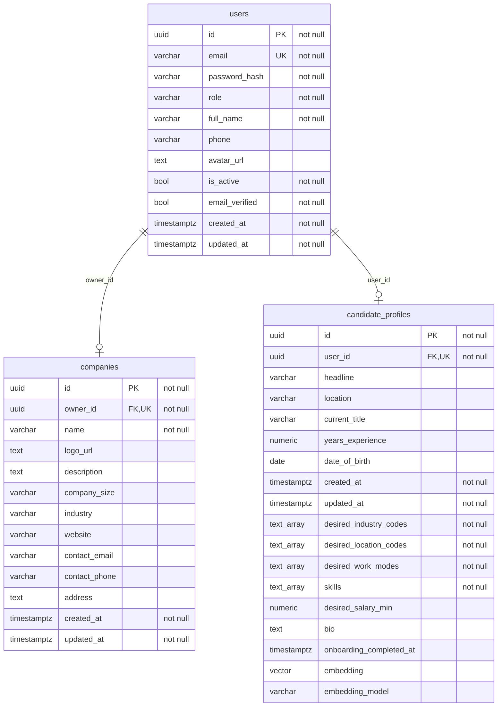
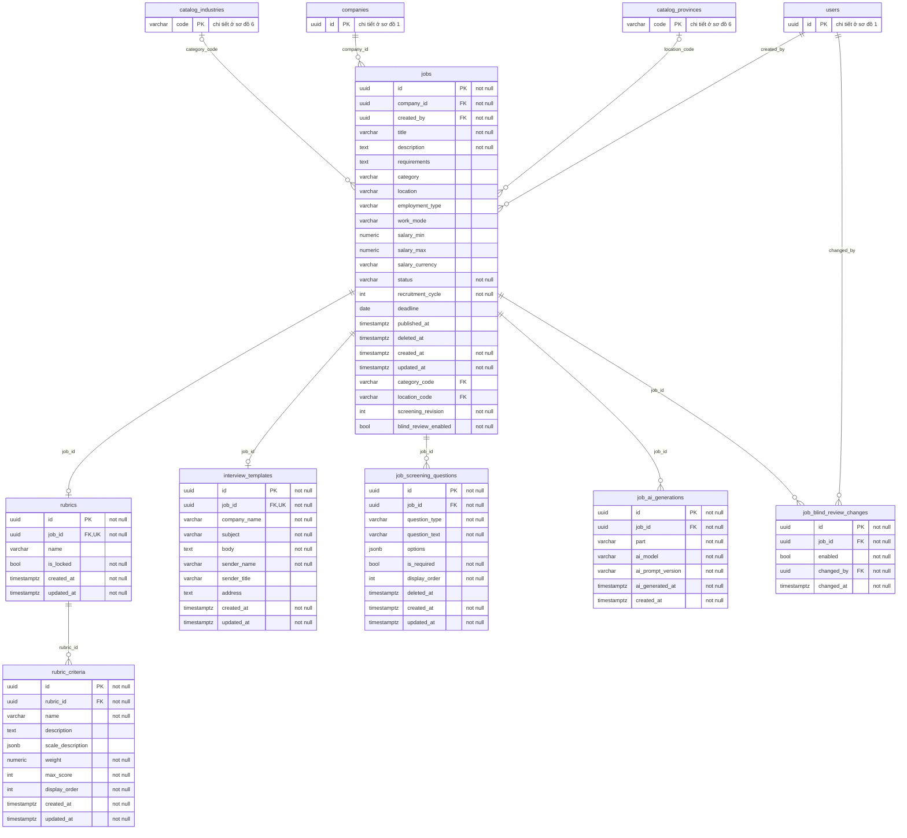
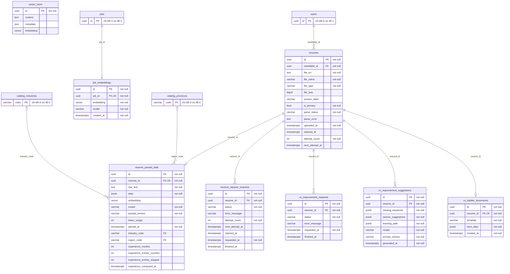
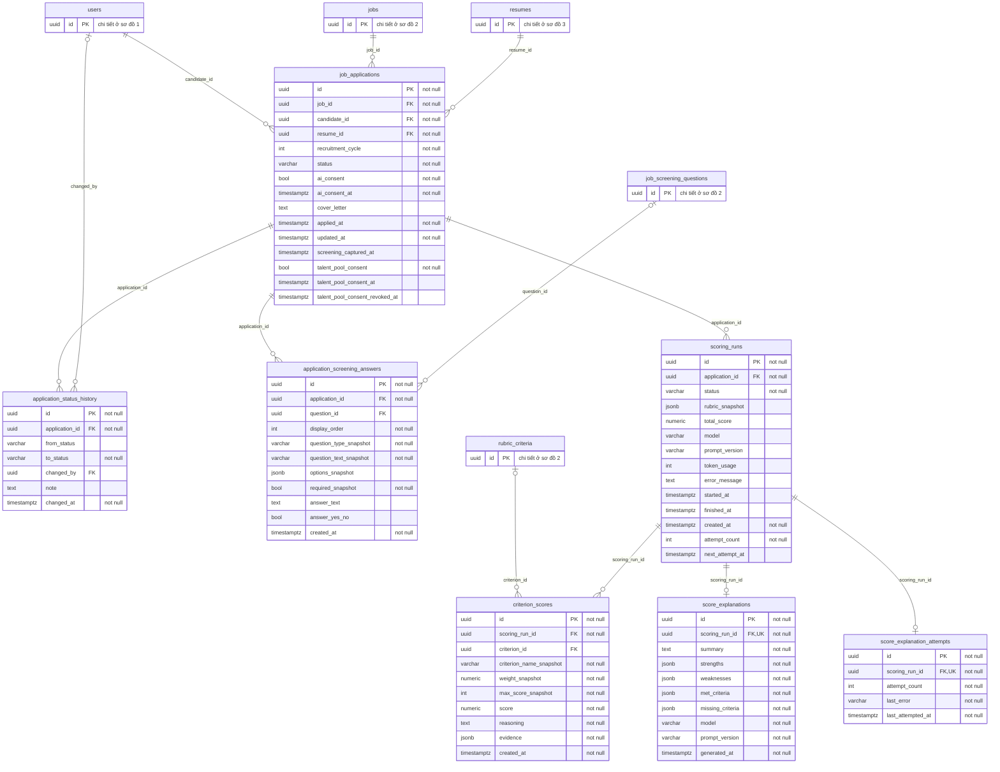
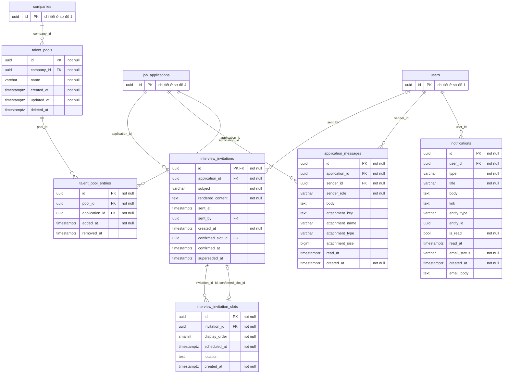
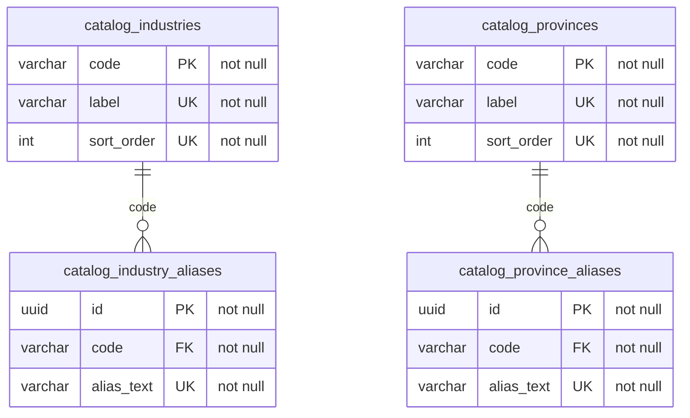

# Sơ đồ ER — AI Recruitment Agent

> Xuất tự động từ catalog Postgres (`pg_catalog`) của database dev ở Flyway **V19**, ngày
> 2026-10-20 13:32 (giờ Việt Nam). Không vẽ tay, không đọc file migration. Flyway là nguồn sự thật của schema
> (`backend/src/main/resources/db/migration`); schema đổi thì xuất lại theo phụ lục.

Database có **35 bảng** trong schema `public` (không tính `flyway_schema_history`), chia thành
6 sơ đồ theo package backend. Mỗi bảng được vẽ đầy đủ cột ở đúng một sơ đồ; ở sơ đồ khác nó chỉ
hiện tên và khoá chính (ghi "chi tiết ở sơ đồ N"). Mỗi khoá ngoại được vẽ đúng một lần, ở sơ đồ của bảng chứa nó.

Cách đọc:

- Kiểu rút gọn: `varchar` (character varying), `timestamptz`, `numeric`, `vector` (pgvector, 1536 chiều),
  `text_array` (`text[]`), `int`, `bool`. Độ dài/độ chính xác bỏ khỏi sơ đồ.
- `PK` khoá chính, `FK` khoá ngoại, `UK` UNIQUE một cột không điều kiện. UNIQUE nhiều cột và UNIQUE INDEX một phần
  (partial) nằm ở bảng "Ràng buộc quan trọng" dưới mỗi sơ đồ. `"not null"` là cột NOT NULL.
- Quan hệ: `||--o{` bảng con có cột FK NOT NULL; `|o--o{` cột FK cho phép NULL; `--o|` khi cột FK của bảng con
  đồng thời là PK/UNIQUE (quan hệ 1–0..1). Nhãn là tên cột FK.
- Bảng "Ràng buộc quan trọng" liệt kê UNIQUE nhiều cột, UNIQUE INDEX một phần, CHECK tên `chk_*` và CHECK trạng thái
  (`*_status_check`); phép ép kiểu `::text`/`::character varying` bỏ cho dễ đọc. CHECK còn lại (độ dài, giá trị enum
  phụ…) có trong JSON do câu truy vấn ở phụ lục xuất ra.

## Mục lục

- [1. Tài khoản và công ty](#1-tài-khoản-và-công-ty) — 3 bảng
- [2. Tin tuyển dụng, rubric, sàng lọc](#2-tin-tuyển-dụng-rubric-sàng-lọc) — 7 bảng
- [3. CV, trích xuất, embedding, CV builder](#3-cv-trích-xuất-embedding-cv-builder) — 8 bảng
- [4. Đơn ứng tuyển, chấm điểm, giải thích](#4-đơn-ứng-tuyển-chấm-điểm-giải-thích) — 7 bảng
- [5. Giấy mời, tin nhắn, thông báo, kho ứng viên](#5-giấy-mời-tin-nhắn-thông-báo-kho-ứng-viên) — 6 bảng
- [6. Danh mục dùng chung](#6-danh-mục-dùng-chung) — 4 bảng
- [Phụ lục: cách xuất lại](#phụ-lục-cách-xuất-lại)

## 1. Tài khoản và công ty

Package: `auth/`, `user/`, `company/`, hồ sơ nghề nghiệp (FR-U14). Bảng: `users`, `companies`, `candidate_profiles`.



**Ràng buộc quan trọng**

| Bảng | Tên | Loại | Điều kiện |
|---|---|---|---|
| `candidate_profiles` | `chk_candidate_bio_length` | CHECK | `((bio IS NULL) OR (char_length(bio) <= 500))` |
| `candidate_profiles` | `chk_candidate_desired_industry_codes_max` | CHECK | `(cardinality(desired_industry_codes) <= 3)` |
| `candidate_profiles` | `chk_candidate_desired_location_codes_max` | CHECK | `(cardinality(desired_location_codes) <= 3)` |
| `candidate_profiles` | `chk_candidate_desired_salary_min_nonneg` | CHECK | `((desired_salary_min IS NULL) OR (desired_salary_min >= (0)))` |
| `candidate_profiles` | `chk_candidate_desired_work_modes_valid` | CHECK | `(desired_work_modes <@ ARRAY['ONSITE', 'HYBRID', 'REMOTE'])` |
| `candidate_profiles` | `chk_candidate_skills_max` | CHECK | `(cardinality(skills) <= 20)` |

## 2. Tin tuyển dụng, rubric, sàng lọc

Package: `job/`, `rubric/`, `interviewtemplate/`, `screening/`, `jobdraft/`, `blindreview/`. Bảng: `jobs`, `rubrics`, `rubric_criteria`, `interview_templates`, `job_screening_questions`, `job_ai_generations`, `job_blind_review_changes`.



**Ràng buộc quan trọng**

| Bảng | Tên | Loại | Điều kiện |
|---|---|---|---|
| `jobs` | `chk_salary_range` | CHECK | `((salary_max IS NULL) OR (salary_min IS NULL) OR (salary_max >= salary_min))` |
| `jobs` | `jobs_status_check` | CHECK | `status` ∈ {DRAFT, OPEN, PAUSED, CLOSED} |
| `rubric_criteria` | `uq_criterion_name_per_rubric` | UNIQUE | (rubric_id, name) |
| `job_screening_questions` | `chk_screening_question_options` | CHECK | `((((question_type) = 'SINGLE_CHOICE') AND (options IS NOT NULL) AND (jsonb_typeof(options) = 'array') AND ((jsonb_array_length(options) >= 2) AND (jsonb_array_length(options) <= 10))) OR (((question_type) <> 'SINGLE_CHOICE') AND (options IS NULL)))` |
| `job_ai_generations` | `uq_job_ai_generation_part` | UNIQUE | (job_id, part) |

## 3. CV, trích xuất, embedding, CV builder

Package: `resume/`, `ai/embedding/`, `ai/cvimprovement/`, `cvbuilder/`. Bảng: `resumes`, `resume_parsed_data`, `resume_reparse_requests`, `cv_improvement_requests`, `cv_improvement_suggestions`, `cv_builder_documents`, `job_embeddings`, `vector_store`.



**Ràng buộc quan trọng**

| Bảng | Tên | Loại | Điều kiện |
|---|---|---|---|
| `resumes` | `uq_resume_primary_per_candidate` | UNIQUE INDEX một phần | (candidate_id) WHERE `is_primary` |
| `resumes` | `resumes_parse_status_check` | CHECK | `parse_status` ∈ {PENDING, PROCESSING, DONE, FAILED} |
| `resume_parsed_data` | `chk_parsed_experience_months` | CHECK | `((experience_computed_at IS NULL) OR ((experience_entries_counted = 0) AND (experience_months IS NULL)) OR ((experience_entries_counted > 0) AND (experience_months >= 1)))` |
| `resume_parsed_data` | `chk_parsed_experience_state` | CHECK | `(((experience_computed_at IS NULL) AND (experience_months IS NULL) AND (experience_entries_counted IS NULL) AND (experience_entries_skipped IS NULL)) OR ((experience_computed_at IS NOT NULL) AND (experience_entries_counted >= 0) AND (experience_entries_skipped >= 0)))` |
| `resume_reparse_requests` | `uq_resume_reparse_request_active` | UNIQUE INDEX một phần | (resume_id) WHERE `((status) = ANY ((ARRAY['PENDING', 'RUNNING'])))` |
| `resume_reparse_requests` | `resume_reparse_requests_status_check` | CHECK | `status` ∈ {PENDING, RUNNING, DONE, FAILED} |
| `cv_improvement_requests` | `uq_cv_improvement_request_active` | UNIQUE INDEX một phần | (resume_id) WHERE `((status) = ANY ((ARRAY['PENDING', 'RUNNING'])))` |

## 4. Đơn ứng tuyển, chấm điểm, giải thích

Package: `jobapplication/`, `scoring/`, `ai/criterion/`, `ai/explanation/`. Bảng: `job_applications`, `application_status_history`, `application_screening_answers`, `scoring_runs`, `criterion_scores`, `score_explanations`, `score_explanation_attempts`.



**Ràng buộc quan trọng**

| Bảng | Tên | Loại | Điều kiện |
|---|---|---|---|
| `job_applications` | `uq_application_per_cycle` | UNIQUE | (job_id, candidate_id, recruitment_cycle) |
| `job_applications` | `chk_consent_true` | CHECK | `(ai_consent = true)` |
| `job_applications` | `chk_talent_pool_consent_state` | CHECK | `(((NOT talent_pool_consent) AND (talent_pool_consent_at IS NULL) AND (talent_pool_consent_revoked_at IS NULL)) OR (talent_pool_consent AND (talent_pool_consent_at IS NOT NULL) AND (talent_pool_consent_revoked_at IS NULL)) OR ((NOT talent_pool_consent) AND (talent_pool_consent_at IS NOT NULL) AND (talent_pool_consent_revoked_at IS NOT NULL) AND (talent_pool_consent_revoked_at >= talent_pool_consent_at)))` |
| `job_applications` | `job_applications_status_check` | CHECK | `status` ∈ {PENDING, INTERVIEW_INVITED, HIRED, REJECTED, WITHDRAWN} |
| `application_screening_answers` | `uq_screening_answer_order` | UNIQUE | (application_id, display_order) |
| `application_screening_answers` | `chk_screening_answer_options` | CHECK | `((((question_type_snapshot) = 'SINGLE_CHOICE') AND (options_snapshot IS NOT NULL) AND (jsonb_typeof(options_snapshot) = 'array') AND ((jsonb_array_length(options_snapshot) >= 2) AND (jsonb_array_length(options_snapshot) <= 10))) OR (((question_type_snapshot) <> 'SINGLE_CHOICE') AND (options_snapshot IS NULL)))` |
| `application_screening_answers` | `chk_screening_answer_required` | CHECK | `((NOT required_snapshot) OR (answer_text IS NOT NULL) OR (answer_yes_no IS NOT NULL))` |
| `application_screening_answers` | `chk_screening_answer_shape` | CHECK | `((((question_type_snapshot) = 'YES_NO') AND (answer_text IS NULL)) OR (((question_type_snapshot) <> 'YES_NO') AND (answer_yes_no IS NULL)))` |
| `scoring_runs` | `uq_scoring_run_in_progress` | UNIQUE INDEX một phần | (application_id) WHERE `(((status) = ANY ((ARRAY['PENDING', 'RUNNING']))) AND (finished_at IS NULL))` |
| `scoring_runs` | `scoring_runs_status_check` | CHECK | `status` ∈ {PENDING, RUNNING, DONE, FAILED} |
| `criterion_scores` | `uq_score_per_criterion` | UNIQUE | (scoring_run_id, criterion_name_snapshot) |

## 5. Giấy mời, tin nhắn, thông báo, kho ứng viên

Package: `interviewinvitation/`, `messaging/`, `notification/`, `talentpool/`. Bảng: `interview_invitations`, `interview_invitation_slots`, `application_messages`, `notifications`, `talent_pools`, `talent_pool_entries`.



**Ràng buộc quan trọng**

| Bảng | Tên | Loại | Điều kiện |
|---|---|---|---|
| `interview_invitations` | `uq_invitation_active` | UNIQUE INDEX một phần | (application_id) WHERE `(superseded_at IS NULL)` |
| `interview_invitations` | `chk_invitation_confirmed_pair` | CHECK | `((confirmed_slot_id IS NULL) = (confirmed_at IS NULL))` |
| `interview_invitation_slots` | `uq_invitation_slot_order` | UNIQUE | (invitation_id, display_order) |
| `interview_invitation_slots` | `uq_invitation_slot_owner` | UNIQUE | (invitation_id, id) |
| `interview_invitation_slots` | `uq_invitation_slot_time` | UNIQUE | (invitation_id, scheduled_at) |
| `application_messages` | `chk_app_msg_attachment_complete` | CHECK | `(((attachment_key IS NULL) AND (attachment_name IS NULL) AND (attachment_type IS NULL) AND (attachment_size IS NULL)) OR ((attachment_key IS NOT NULL) AND (attachment_name IS NOT NULL) AND (attachment_type IS NOT NULL) AND (attachment_size IS NOT NULL)))` |
| `application_messages` | `chk_app_msg_body_length` | CHECK | `((body IS NULL) OR (char_length(body) <= 4000))` |
| `application_messages` | `chk_app_msg_has_content` | CHECK | `((body IS NOT NULL) OR (attachment_key IS NOT NULL))` |
| `notifications` | `notifications_email_status_check` | CHECK | `email_status` ∈ {PENDING, SENT, FAILED, SKIPPED} |
| `talent_pools` | `uq_talent_pool_name_per_company` | UNIQUE INDEX một phần | (company_id, lower((name))) WHERE `(deleted_at IS NULL)` |
| `talent_pool_entries` | `uq_talent_pool_entry_active` | UNIQUE INDEX một phần | (pool_id, application_id) WHERE `(removed_at IS NULL)` |

## 6. Danh mục dùng chung

Package: `catalog/` (FR-C05). Bảng: `catalog_industries`, `catalog_industry_aliases`, `catalog_provinces`, `catalog_province_aliases`.



**Ràng buộc quan trọng**

Không có UNIQUE nhiều cột, UNIQUE INDEX một phần hay CHECK thuộc nhóm trên.

## Phụ lục: cách xuất lại

Số bảng: catalog 35 — vẽ đầy đủ trong tài liệu này 35.

Hai file trong [`docs/er/`](er/):

- [`schema-export.sql`](er/schema-export.sql) — đọc `pg_catalog` (cột, kiểu, NOT NULL, PK, FK, UNIQUE, UNIQUE INDEX một
  phần, CHECK) của schema `public` trừ `flyway_schema_history`, trả về một JSON.
- [`generate-er.ps1`](er/generate-er.ps1) — sinh lại toàn bộ file này từ JSON đó. Bảng mới phải được thêm vào danh sách
  sơ đồ trong script; thiếu hoặc trùng thì script dừng, không ghi file.

Chạy từ gốc repo (PowerShell 5.1), khi `docker compose up -d` đang chạy và database đã migrate xong:

```powershell
docker compose cp docs\er\schema-export.sql postgres:/tmp/schema-export.sql
docker compose exec -T postgres psql -U recruitment -d recruitment -At -v ON_ERROR_STOP=1 -f /tmp/schema-export.sql -o /tmp/schema.json
docker compose cp postgres:/tmp/schema.json "$env:TEMP\schema.json"
.\docs\er\generate-er.ps1 -SchemaJson "$env:TEMP\schema.json" -OutFile docs\ER.md
```

Chỉ dòng ngày xuất ở đầu file thay đổi giữa hai lần chạy trên cùng một schema.
