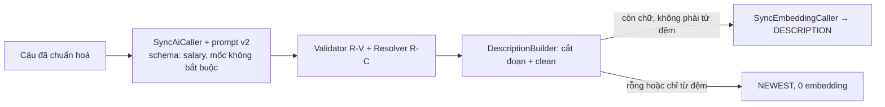

# Walkthrough — `fix/u13-salary-parse`

Nhánh sửa hai lỗi của FR-U13 (tìm việc bằng ngôn ngữ tự nhiên) lộ ra ở cổng AI thật 7.2 B ngày 18/10/2026 (L50).
Không thêm chức năng, không đổi API, không đổi frontend, không có migration. Mọi chỗ khác đặc tả ban đầu đều đã được
ghi thành điểm làm rõ L56–L60 và duyệt lại ngày 20/10/2026 trước khi code (xem mục 8).

## 1. Mục tiêu

Ứng viên gõ một câu như "content marketing lương trên 15 triệu ở Hà Nội, không yêu cầu kinh nghiệm". Hệ thống nhờ AI
chỉ ra đoạn chữ nào là khu vực, ngành, lương, hình thức làm việc; backend tự kiểm và cắt các đoạn đó khỏi câu. Phần
chữ còn lại là "mô tả", được embedding để xếp việc theo độ gần nghĩa. Có hai lỗi:

- **(A) Câu chỉ có một mốc lương không được tách lương.** Ở cổng 18/10, câu 1 ra `salaryMin = null`, còn đoạn "lương
  trên 15 triệu" ở lại phần mô tả. Kết quả là việc không được lọc theo lương, và câu chữ về lương lại đi vào
  embedding.
- **(B) Phần mô tả chỉ còn từ đệm.** Câu 3 ("việc hành chính văn phòng Hà Nội hoặc Sài Gòn, làm kết hợp") sau khi cắt
  ba điều kiện chỉ còn chữ "việc". Backend vẫn embedding một chữ đó và xếp theo "độ gần nghĩa" với chữ "việc", thay vì
  xếp mới nhất như khi không có mô tả.

## 2. Các file đã tạo/sửa

**Backend**

| File | Vai trò |
|---|---|
| `backend/src/main/java/com/recruitment/ai/jobsearch/JobSearchParsePayload.java` | Record làm schema JSON cho output AI. Gắn `@Nullable` (jspecify) cho `salary`, `minMillionVnd`, `maxMillionVnd` để schema không bắt buộc ba trường này (L57) |
| `backend/src/main/resources/ai/prompt/job-search-parse-v2.st` | Prompt mới, đổi tên từ v1 (git ghi nhận là rename, giống 95%). Chỉ thay vế "và salary = null." bằng "không có lương thì bỏ trường salary; chỉ có một mốc thì bỏ trường mốc còn lại." (L57, L59) |
| `backend/src/main/java/com/recruitment/ai/jobsearch/JobSearchParseService.java` | `PROMPT_VERSION = "job-search-parse-v2"`: hằng khai một chỗ, gắn với tên file |
| `backend/src/main/java/com/recruitment/jobsearch/JobSearchDescriptionBuilder.java` | Thêm hằng `FILLER_DESCRIPTIONS` và phương thức `isFiller`; `clean` trả `null` khi phần còn lại chỉ là từ đệm (L56) |
| `backend/src/main/java/com/recruitment/jobsearch/JobSearchCatalogPrompt.java` | Chỉ sửa comment trỏ tên prompt v2 |
| `backend/src/test/java/com/recruitment/ai/jobsearch/JobSearchParsePayloadSchemaTest.java` | Test mới (đơn vị, không Spring): khoá schema thật mà `BeanOutputConverter` sinh ra, kèm nội dung prompt v2 |
| `backend/src/test/java/com/recruitment/jobsearch/JobSearchDescriptionBuilderTest.java` | Thêm ca từ đệm → `null`, ca không phải từ đệm giữ nguyên, ca câu 3 của 7.2 B |
| `backend/src/test/java/com/recruitment/jobsearch/JobSearchIntegrationTest.java` | Đổi tên file prompt mà test nạp sang v2 |

**Tài liệu và skill**

| File | Vai trò |
|---|---|
| `.claude/skills/srs-guard/SKILL.md` | Ngoại lệ đích danh N10 (nguyên tắc 13) trỏ sang `job-search-parse-v2.st` (L58) |
| `docs/features/UV/U13/REQUIREMENT.md` | Bảng 13.10: L56–L63 |
| `docs/ROADMAP.md` | Mục FR-U13 đổi v1 → v2 (L60), cập nhật dòng giới hạn về lương; thêm dòng `fix/u13-salary-parse` |

**Frontend:** không đổi (`git diff --stat main...HEAD -- frontend` rỗng).

## 3. Luồng chính

Luồng request không đổi so với FR-U13. Nhánh chỉ chạm hai bước, đánh dấu ★:

1. Frontend gửi `POST /api/candidates/job-search` với `{ query }`. `RateLimitFilter` tiêu một lượt `ai-sync` theo
   `userId`; `JobSearchCandidateController` nhận request (RBAC theo tiền tố `/api/candidates/**`).
2. `JobSearchService` (facade, không mở transaction) chuẩn hoá câu (R-I2), rồi gọi `JobSearchParseService`.
3. ★ `JobSearchParseService` nạp prompt `job-search-parse-v2.st` (đã ghép danh mục tỉnh/ngành từ
   `JobSearchCatalogPrompt`). Nó gọi `SyncAiCaller.call` (K3: hạn 15 s, thử lại 1 lần chỉ khi output hỏng). K3 tự chèn
   `{format}`: schema JSON do `BeanOutputConverter` sinh từ `JobSearchParsePayload`. Sau nhánh này, schema cho phép
   thiếu `salary` và thiếu từng mốc.
4. `JobSearchParseValidator` kiểm output (R-V). `JobSearchConditionResolver` chấp nhận điều kiện theo danh mục C05.
   Riêng lương, `isAcceptedSalary` yêu cầu: mỗi mốc khác null nằm trong [0, 1000], và nếu có cả hai mốc thì min ≤ max.
5. ★ `JobSearchDescriptionBuilder.build` cắt các đoạn chữ của điều kiện đã nhận khỏi câu, rồi `clean` dọn dấu câu và
   khoảng trắng. Bước mới: nếu bản đã dọn, sau khi hạ chữ thường và gộp khoảng trắng, **trùng toàn bộ** một mục của
   `FILLER_DESCRIPTIONS`, thì trả `null`.
6. `description = null` → nhánh `NEWEST` (truy vấn U07, mới nhất, không embedding). Có mô tả → `SyncEmbeddingCaller`
   embedding mô tả → `JobRepository.findRankedForSearch` xếp theo khoảng cách cosine trên `job_embeddings`.
7. Trả `interpretation` (mã điều kiện, `salaryMin`/`salaryMax`, `description`, `personalInfoIgnored`), `ranking` và
   tối đa 50 việc. Không lưu câu hay kết quả xuống DB.

## 4. Quyết định thiết kế

**4.1 Chẩn đoán lỗi (A): đường (b1), schema mâu thuẫn prompt.**
- *Đã chọn:* sửa schema bằng `@Nullable` thay vì chỉ sửa câu chữ trong prompt.
- *Lựa chọn khác:* (a) chỉ viết lại prompt dặn AI kỹ hơn; (b) nới `isAcceptedSalary` để chấp nhận `max = 0`.
- *Vì sao:* Spring AI 2.0.0 sinh schema với `requiredByDefault = true`
  (`AbstractSpringAiSchemaModule.checkRequired`, đọc bằng `javap` ở lượt chẩn đoán). Mọi field không có
  `@Nullable`/`@JsonProperty`/`@Schema`/`@ToolParam` đều bị đánh dấu bắt buộc. Prompt v1 bảo AI "chỉ có một mốc" và
  "salary = null", nhưng schema lại bắt `salary` là object có **cả hai** mốc là số nguyên. Lượt chẩn đoán 3 (20/10,
  câu 1 ×3) cho thấy đúng hiện tượng: hai lượt AI trả `max = null` (trái schema) và tách được lương; lượt thứ ba AI
  tuân schema, điền `maxMillionVnd: 0`. Khi đó R-C4 thấy 15 > 0 nên bỏ lương, đoạn "lương trên 15 triệu" ở lại mô tả,
  đúng như cổng 18/10. Lỗi là ngẫu nhiên theo lượt, nên (a) chỉ giảm xác suất. (b) thì phá ý nghĩa của R-C4: `max = 0`
  là mốc giả, không phải dữ liệu.
- **Không gắn `@Nullable` cho 4 danh sách**: chúng vẫn bắt buộc, AI trả `[]` khi không có điều kiện (test
  `rootRequired_excludesSalary_keepsListsRequired`).

**4.2 Đổi tên prompt sang v2, không sửa v1 tại chỗ.**
- *Đã chọn:* file mới `job-search-parse-v2.st`, xoá v1 (git ghi rename), hằng `PROMPT_VERSION` đổi theo.
- *Lựa chọn khác:* sửa v1 tại chỗ; hoặc giữ cả v1 trong repo.
- *Vì sao:* CLAUDE.md §4 yêu cầu prompt đánh version theo tên file. U13 không lưu `PROMPT_VERSION` xuống DB nên không
  có bản ghi lịch sử nào trỏ v1, vì vậy không cần giữ file cũ. Hệ quả là ngoại lệ N10 của `srs-guard` phải trỏ v2
  (L58), và ROADMAP phải sửa tên (L60).

**4.3 Từ đệm: so trùng toàn bộ với danh sách cố định.**
- *Đã chọn:* `FILLER_DESCRIPTIONS` (16 mục, có cả bản không dấu). Mô tả chỉ thành `null` khi **trùng toàn bộ** một mục.
- *Lựa chọn khác:* cắt từ đệm khỏi mô tả dài hơn; hoặc đặt ngưỡng độ dài tối thiểu.
- *Vì sao:* cắt chữ khỏi mô tả dài sẽ làm `description` không còn là chữ nguyên văn còn lại của câu (R-D4). Ngưỡng độ
  dài lại loại nhầm mô tả ngắn nhưng có nghĩa ("Java"). Danh sách **cố ý không có** "tuyển", "tuyển dụng": "tuyển dụng"
  có thể chính là ngành ứng viên muốn tìm (test `nonFiller_kept`). Bản chuẩn hoá chỉ dùng để so; chuỗi trả ra vẫn là
  bản sau R-D3.

**4.4 Test khoá schema thật, không khoá chuỗi tự viết.**
- *Đã chọn:* `JobSearchParsePayloadSchemaTest` lấy `getFormat()` của `BeanOutputConverter` thật rồi đọc mảng
  `required`.
- *Vì sao:* nếu sau này có người gỡ `@Nullable`, hoặc nâng Spring AI làm đổi mặc định `required`, test đỏ ngay mà
  không cần gọi AI thật. Test `codeConditionRequired_unchanged` là đối chứng: chứng minh test nhìn đúng chỗ (field
  không gắn `@Nullable` vẫn bắt buộc). **Không xoá các test này khi refactor**: đây là chốt duy nhất giữ lỗi (A)
  không quay lại, vì validator R-V và resolver R-C4 không đổi.

**4.5 Cổng AI thật chạy lại với scheduler tối thiểu.**
- *Đã chọn:* lệnh khởi động chỉ bật job-embedding và candidate-profile-embedding, mail về MailHog (L62).
- *Vì sao:* chạy mặc định thì resume-embedding embed 4 CV đã trích xuất chưa có embedding trên DB dev. Như vậy tốn
  OpenAI ngoài dự kiến và làm sai cách đếm lượt gọi.

## 5. Ràng buộc đã thực thi

| Mã | Ràng buộc | Thực thi ở đâu |
|---|---|---|
| FR-U13 R-C4 | Lương: mốc trong [0, 1000], có cả hai thì min ≤ max, không mốc nào thì bỏ | `JobSearchConditionResolver.isAcceptedSalary` (không đổi) |
| FR-U13 L57 | Schema cho phép thiếu `salary` và từng mốc; 4 danh sách vẫn bắt buộc | `@Nullable` trên `JobSearchParsePayload`; khoá bằng `JobSearchParsePayloadSchemaTest` |
| FR-U13 R-D3/L56 | Mô tả chỉ còn từ đệm thì thành `null`, chỉ so trùng toàn bộ | `JobSearchDescriptionBuilder.clean` → `isFiller` |
| FR-U13 R-D4 | `description` là chữ nguyên văn còn lại hoặc `null` | `JobSearchDescriptionBuilder.build` (bản chuẩn hoá chỉ để so) |
| CLAUDE.md §4 | Prompt đánh version theo tên file, `PROMPT_VERSION` khai một chỗ | `JobSearchParseService.PROMPT_VERSION` |
| CLAUDE.md §7 / K3 | Gọi AI đồng bộ có hạn, thử lại ≤ 1 lần chỉ khi output hỏng, không transaction | `SyncAiCaller.call` (không đổi) |
| SRS nguyên tắc 13 | Prompt chỉ nhắc nhân thân ở dòng ngoại lệ đích danh | `job-search-parse-v2.st:24`, ngoại lệ N10 trong `srs-guard` |

## 6. Đã kiểm thử gì

**Test tự động.** Full `.\mvnw.cmd clean test` (20/10/2026, `clean` để xoá `job-search-parse-v1.st` cũ trong
`target/classes`): **2088 test, 0 fail, 0 error, 0 skip, 8:37**. Test thêm ở nhánh này:
- `JobSearchParsePayloadSchemaTest`: `rootRequired_excludesSalary_keepsListsRequired`, `salaryRequired_onlySourceText`,
  `codeConditionRequired_unchanged` (đối chứng), `missingBoundOrSalary_deserializesToNull`,
  `promptV2_replacesSalaryNullSentence`.
- `JobSearchDescriptionBuilderTest`: `fillerOnly_null` ("việc", "Việc", "tìm việc làm", "việc  làm" hai dấu cách, có
  dấu câu ở hai đầu), `nonFiller_kept` ("việc nhẹ", "Java", "tuyển dụng"), `gate72bCase3_threeTextsCut_null`.

**Kiểm tĩnh.** Diff frontend so với `main` rỗng. `job-search-parse-v1` trong `backend/src` ra 0 dòng (đối chứng
`job-search-parse-v2`: 5 dòng, 4 file).

**Cổng AI thật 7.2 B (20/10/2026, L61).** Khối 7.2 B 2 vòng + câu 1 ×5 lượt: 21/21 lượt HTTP 200, thời gian 2,1–4,4 s
(trung vị 3,2 s ở 16 lượt khối). Kết quả:
- Câu 1 tách lương **7/7 lượt** (`salaryMin = 15`, `salaryMax = null`, mô tả "không yêu cầu kinh nghiệm").
- Câu 3 `description = null`, nhánh `NEWEST`, cả hai vòng.
- Mọi tiêu chí cũ của L50 vẫn đạt.
- Anthropic 21 lần gọi (0 thử lại), OpenAI 18 lần.
- DB: job embedding 12 → 14, hồ sơ 4 → 5, CV có embedding 8 → 8.

Script cổng lưu UTF-8 có BOM và kiểm số byte từng câu trước khi gửi. Hai lượt chẩn đoán đầu ngày 20/10 dùng script
không BOM: PowerShell 5.1 đọc theo ANSI nên câu gửi đi bị vỡ mã, ra 502 `AI_INVALID_OUTPUT`, và tốn 10 lần gọi
Anthropic không dùng được (L57).

**Soát tay** (người dùng, 20/10/2026; backend tắt mọi scheduler AI; tài khoản `bui.ngoc.mai@demo.local`; chế độ "Tìm
bằng mô tả"):

| Câu | Kết quả | Đánh giá |
|---|---|---|
| content marketing lương trên 15 triệu ở Hà Nội, không yêu cầu kinh nghiệm | Điều kiện: Hà Nội · Marketing - Truyền thông · Lương từ 15 triệu; "Xếp theo mô tả: không yêu cầu kinh nghiệm"; 0 việc làm ("Không tìm thấy việc làm nào khớp các điều kiện đã hiểu.") | Đạt (A). 0 kết quả do dữ liệu demo không có tin Marketing ở Hà Nội lương ≥ 15 triệu — không phải lỗi; kịch bản demo ở docs/final cần chọn câu khớp dữ liệu |
| việc hành chính văn phòng Hà Nội hoặc Sài Gòn, làm kết hợp | Điều kiện: Hà Nội · TP. Hồ Chí Minh · Hành chính - Văn phòng · Kết hợp; "Không còn phần mô tả để xếp theo độ liên quan; việc làm được sắp theo thời gian đăng mới nhất."; 1 việc làm | Đạt (B). Kết quả là tin của bộ test (DB đang có demo + bộ test) |

**Chưa kiểm thử:**
- 7.2 phần A không chạy lại. Nhánh không đổi controller, rate limit hay validator đầu vào.
- Chưa có đối chứng dương lúc chạy cho logger DEBUG của `SyncAiCaller`: không có lượt thử lại nào để sinh dòng log, và
  actuator trả 401 (L63).
- Câu có hai mốc lương mà AI chỉ trả một mốc: chưa có câu cổng nào thử.

**Đối chiếu "Xong khi" của L56/L57:**

| Tiêu chí | Cách nghiệm thu | Kết quả |
|---|---|---|
| `salary` không thuộc `required` gốc; `required` của `salary` = `["sourceText"]` | `JobSearchParsePayloadSchemaTest` | Đạt |
| Prompt v2 thay đúng vế "và salary = null." (L59) | `promptV2_replacesSalaryNullSentence` | Đạt |
| T8: từ đệm → `null`; "việc nhẹ", "Java", "tuyển dụng" giữ nguyên; câu 3 → `null` | `JobSearchDescriptionBuilderTest` | Đạt |
| Validator R-V, resolver R-C4 không đổi | `git diff main...HEAD` không chạm hai file | Đạt |
| Cổng 7.2 B chạy lại sau khi sửa | L61: 21/21, câu 1 tách lương 7/7, câu 3 `NEWEST` | Đạt |
| Full suite xanh | 2088/0/0/0 | Đạt |

## 7. Nợ kỹ thuật

- `ResumeParsedPayload` (D1, trích xuất CV) cũng bị `BeanOutputConverter` đánh dấu mọi field là `required`
  (Contact, Education…). Chưa sửa ở nhánh này, để `docs/final` ghi vào ROADMAP (L57).
- Danh sách từ đệm cố định, chỉ có tiếng Việt có dấu và không dấu. Từ đệm khác ("job", "việc gì cũng được") vẫn đi
  vào embedding.
- Việc AI tách lương vẫn phụ thuộc vào việc AI làm theo prompt. Schema chỉ gỡ mâu thuẫn, không bảo đảm. Cổng đo 7/7
  trên một câu.

## 8. Lệch so với đặc tả

Không có chỗ lệch nào chưa được duyệt lại.

| Điểm | Lệch | Đặc tả đã sửa / duyệt lại |
|---|---|---|
| L56 | R-D3 thêm bước "chỉ còn từ đệm → `null`" | Đã sửa REQUIREMENT.md (13.10), **duyệt 20/10/2026** |
| L57 | Schema `@Nullable` + prompt v2 (đặc tả gốc dùng v1) | **Duyệt 20/10/2026** |
| L58 | Ngoại lệ N10 của `srs-guard` trỏ v2 | **Duyệt 20/10/2026** |
| L59 | Giữ vế "trả danh sách rỗng" cho 4 danh sách, chỉ thay vế lương | **Duyệt 20/10/2026** |
| L60 | ROADMAP `:1072`, `:1080` v1 → v2, sửa ở đợt cuối | **Duyệt 20/10/2026** |
| L62 | Lệnh khởi động cổng khác mặc định ngầm định của 7.2 B | **Duyệt 20/10/2026** (người dùng chỉ định); văn bản 7.2 B không đổi |
| L63 | Phần script ngoài khối 7.2 B nguyên văn | **Duyệt 20/10/2026** (người dùng chỉ định); không đổi câu, thứ tự, nghỉ 31 s |
