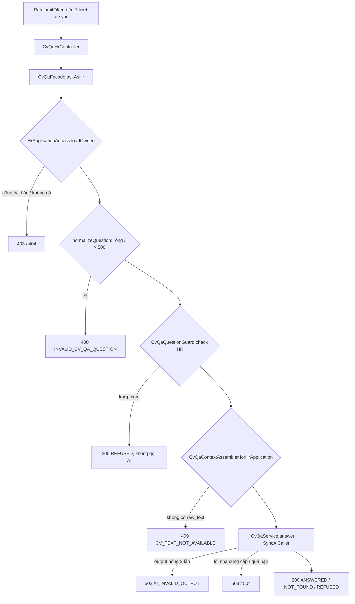

# Walkthrough — FR-C08: Hỏi đáp CV có trích dẫn (`feat/fr-c08-cv-qa`)

## 1. Mục tiêu

HR muốn biết "ứng viên này từng làm ở đâu, có ghi kinh nghiệm X không" mà không phải tự đọc dò cả CV; ứng viên muốn
kiểm tra CV của mình đang thể hiện điều gì. FR-C08 cho phép đặt một câu hỏi bằng lời về **đúng một CV**: HR hỏi về CV
đã nộp trong một đơn (tab "Hỏi đáp CV" ở trang hồ sơ đơn), ứng viên hỏi về một CV của chính mình (trang riêng, vào từ
danh sách CV). AI trả lời ngắn bằng tiếng Việt và **bắt buộc kèm 1–5 đoạn trích nguyên văn từ CV**. Backend tự kiểm
từng đoạn trích có thật trong CV hay không; chỉ cần một đoạn sai là cả câu trả lời bị coi là hỏng (thử lại một lần,
vẫn hỏng thì báo lỗi). Câu hỏi về nhân thân (phía HR), về phán quyết tuyển dụng, hay xin gợi ý cải thiện CV (phía ứng
viên) bị từ chối. Không lưu gì: các lượt hỏi đáp chỉ nằm trên trang, tải lại là mất.

## 2. Các file đã tạo/sửa

**Backend**

| File | Vai trò |
|---|---|
| `ai/citation/VerbatimQuoteVerifier.java` (mới — **K2**) | Kiểm một đoạn trích có nằm nguyên văn trong văn bản nguồn không (gộp khoảng trắng, phân biệt hoa/thường và dấu) |
| `ai/criterion/CriterionScoringService.java` | FR-H04 chuyển sang gọi K2; `normalizeWhitespace` thành lớp chuyển tiếp mỏng |
| `aicontext/CvQaContext.java`, `CvQaContextAssembler.java` (mới — mở rộng **K1**) | Record ngữ cảnh gửi AI và bộ gom: HR = CV + tin (tiêu đề, mô tả, yêu cầu); ứng viên = chỉ CV |
| `ai/cvqa/CvQaService.java` (mới) | Dựng user message, gọi K3, hàm kiểm output, cắt CV dài, gộp trích dẫn trùng |
| `ai/cvqa/CvQaPayload`, `CvQaAnswer`, `CvQaOutcome`, `CvQaRefusalReason` (mới) | Schema JSON AI trả về; kết quả đã kiểm; hai enum |
| `ai/client/CvQaChatClientConfig.java` (mới) | Bean `cvQaChatClient` riêng, trần 1000 token đầu ra |
| `resources/ai/prompt/cv-qa-v1.st` (mới) | Prompt đã duyệt (REQUIREMENT mục 13.3) |
| `cvqa/CvQaFacade.java` (mới) | Điều phối theo thứ tự: quyền → câu hỏi → chặn từ khoá → K1 → AI |
| `cvqa/CvQaQuestionGuard.java` (mới) | Chặn sớm bằng danh sách cụm từ, trước khi đọc CV |
| `cvqa/CvQaHrController`, `CvQaCandidateController`, `CvQaExceptionAdvice`, `dto/*` (mới) | Hai endpoint `POST …/cv-qa`; body JSON hỏng → 400 riêng; request/response |
| `common/exception/CvTextNotAvailableException`, `InvalidCvQaQuestionException`, `GlobalExceptionHandler` | 409 khi CV chưa có văn bản; 400 câu hỏi với câu cố định |
| `ratelimit/RateLimitFilter.java` | Hai mẫu đường dẫn mới vào nhóm `ai-sync` có sẵn |

**Frontend**

| File | Vai trò |
|---|---|
| `features/cvQa/useCvQaSession.ts` | State phiên hỏi đáp ở cấp trang, có khoá (đơn/CV) và epoch |
| `features/cvQa/CvQaPanel.tsx`, `CvQaTurnItem.tsx`, `CvQaCitationQuote.tsx`, `CvQaUnavailable.tsx` | Ô hỏi + danh sách lượt; một lượt (khối AI có nhãn "Do AI tạo"); trích dẫn kiểu evidence H06; trạng thái CV chưa trích xuất |
| `features/cvQa/api.ts`, `types.ts`, `cvQaLabels.ts` | Gọi Q1/Q2 (timeout 35 s), kiểu dữ liệu, mọi chuỗi hiển thị |
| `pages/HrApplicationDetailPage.tsx` | Thêm tab "Hỏi đáp CV" (`?tab=cvqa`) sau "Giải thích" |
| `pages/CandidateCvQaPage.tsx` (mới), `App.tsx`, `features/resumes/ResumeList.tsx` | Trang `/candidate/resumes/:id/qa`, route, nút "Hỏi đáp CV" khi CV `DONE` |

Không có migration (không lưu gì).

## 3. Luồng chính

### 3.1 HR hỏi — `POST /api/hr/applications/{applicationId}/cv-qa`

1. `RateLimitFilter.classify` khớp mẫu `/api/hr/applications/*/cv-qa` → mọi POST (kể cả 400/409/`REFUSED`) tiêu một
   lượt trong bucket `ai-sync:{userId}` (sức chứa 5, nạp 2/phút), dùng chung với C07 và H11.
2. `CvQaFacade.askAsHr` — facade **không** mở transaction:
   - `HrApplicationAccess.loadOwned` kiểm quyền sở hữu (đọc `companies`, `job_applications`, `jobs`). Mọi trạng thái
     đơn đều hỏi được, kể cả `WITHDRAWN`, tin đã xoá mềm hay đã đóng.
   - `normalizeQuestion` đổi CRLF → LF, `strip()`, kiểm 1–500 ký tự.
   - `CvQaQuestionGuard.check(question, HR)`: chuẩn hoá NFC, chữ thường, gộp khoảng trắng, rồi tìm cụm có ranh giới
     từ. Thứ tự xét: `PERSONAL_INFO` → `HIRING_JUDGEMENT`. Khớp → trả `REFUSED` ngay, chưa đọc CV.
   - `CvQaContextAssembler.forHrApplication` (transaction chỉ đọc, ngắn) đọc `job_applications`, `jobs`,
     `resume_parsed_data.raw_text` của **CV đã nộp vào đơn** (không phải CV chính hiện tại). Không có hàng → 409.
3. `CvQaService.answer`: dựng user message gồm các khối `<cau_hoi>`, `<cv>`, `<tin_tuyen_dung>` (`<tieu_de>`,
   `<mo_ta>`, `<yeu_cau>`); đổi `<`/`>` trong dữ liệu thành `‹`/`›`; CV > 45 000 ký tự thì giữ 60% đầu + 40% cuối kèm
   dòng đánh dấu lược. System message chỉ có prompt + `{viewer}` cố định ("nhà tuyển dụng").
4. `SyncAiCaller.call` (K3, có sẵn từ C07) gọi `cvQaChatClient` có thời hạn, parse bằng `BeanOutputConverter` về
   `CvQaPayload`, chạy hàm kiểm `isValidPayload`; `false` → thử lại đúng 1 lần.
5. `isValidPayload` kiểm: lý do từ chối hợp lệ theo phía; `notFound` không kèm trích dẫn; `answer` 1–800 ký tự; 1–5
   trích dẫn, mỗi đoạn (sau khi đổi ngược `‹›`) dài 15–200 ký tự và **qua K2 trên `raw_text` đầy đủ**.
6. `toAnswer` gộp trích dẫn trùng (theo khoảng trắng đã gộp), đặt `cvTruncated` từ độ dài `raw_text` đầy đủ.
   `CvQaResponse.from` trả đúng 5 khoá `outcome`, `answer`, `citations`, `refusalReason`, `cvTruncated`.

Không ghi bảng nào, không đổi trạng thái đơn, không tạo thông báo.

### 3.2 Ứng viên hỏi — `POST /api/candidates/resumes/{resumeId}/cv-qa`

Giống 3.1, chỉ khác bốn chỗ: quyền bằng `ResumeRepository.findByIdAndCandidateId` (CV người khác và CV không tồn tại
cùng trả 404 `RESUME_NOT_FOUND`); guard phía ứng viên xét `HIRING_JUDGEMENT` → `CV_IMPROVEMENT` (**không** chặn nhân
thân); `forCandidateResume` chỉ có CV, `job = null` nên không có khối `<tin_tuyen_dung>`; `{viewer}` = "ứng viên". Không
cần đồng ý AI vì đây là CV của chính mình.

### 3.3 Giao diện

`useCvQaSession(side, key)` được gọi ở **cấp trang** (trước mọi `return` sớm — L6), nên đổi tab không làm mất các lượt.
Mỗi lần gửi ghi lại `epoch` của phiên; khoá đổi (sang đơn/CV khác) thì phiên mới có `epoch + 1`, xoá lượt/lỗi ngay trong
lần render đó, và kết quả về muộn của phiên cũ bị bỏ. Lượt mới nhất ở trên. Mỗi lượt `ANSWERED` là một khối AI
(`Sparkles` + "Do AI tạo") với các trích dẫn kiểu evidence H06; `cvTruncated = true` hiện thêm câu `truncatedNotice`;
`REFUSED CV_IMPROVEMENT` có liên kết sang trang Gợi ý cải thiện CV (U05). Lỗi hiện câu của backend kèm nút "Thử lại"
gửi lại đúng câu hỏi đó.

## 4. Quyết định thiết kế

**K2 tách khỏi H04 nhưng giữ nguyên hành vi, kể cả lỗ hổng (Q12, Q13).**
- Đã chọn: chuyển nguyên văn phép gộp khoảng trắng + `contains` sang `VerbatimQuoteVerifier`; H04 gọi K2;
  `CriterionScoringService.normalizeWhitespace` còn lại làm lớp chuyển tiếp. Điều kiện riêng của C08 (≥ 15 ký tự, ≤ 200)
  đặt ở `CvQaService`, không đặt vào K2.
- Khác: siết luôn K2 (chặn trích dẫn rỗng, chuẩn hoá NFC); chuyển test cũ sang lớp mới.
- Vì sao: cổng của K2 là "FR-H04 không đổi hành vi, test cũ không sửa". Siết chung sẽ đổi kết quả chấm điểm cũ. Hai
  test bảo vệ quyết định này — **không xoá khi refactor**: `VerbatimQuoteVerifierTest.isVerbatim_emptyQuote_returnsTrue_giuHanhViH04`
  và `isVerbatim_blankQuote_returnsTrue_giuHanhViH04` (khoá hành vi của FR-H04, không phải C08 — ai "sửa" thành `false`
  là đổi H04); `CriterionScoringServiceTest` chạy **không sửa** qua lớp chuyển tiếp (`git diff --stat 6aaa6ce` trên test
  `ai/criterion`, `scoring` = 0 file).

**Một trích dẫn hỏng là cả câu trả lời hỏng (Q4).**
- Đã chọn: hàm kiểm trả `false` → K3 thử lại 1 lần → 502.
- Khác: loại riêng trích dẫn sai, giữ phần còn lại; hiện kèm cờ "chưa kiểm".
- Vì sao: câu trả lời có thể dựa đúng vào đoạn bịa; giữ phần lời mà bỏ căn cứ là vi phạm nguyên tắc evidence.

**Hàm kiểm là hàm tổng — không bao giờ ném exception (L7).**
- Đã chọn: `isValidPayload` trả `false` cho mọi dữ liệu lạ (`citations: [null]`, `quote` null, mã từ chối lạ — tự dò
  enum thay vì `valueOf`).
- Khác: để exception nổi lên.
- Vì sao: `SyncAiCaller` gọi validator **ngoài** `try`; một exception ở đây thành 500 thay vì được thử lại rồi 502.

**Hai lớp từ chối: từ khoá trước, prompt sau (Q10); `PERSONAL_INFO` chỉ phía HR (S3).**
- Đã chọn: `CvQaQuestionGuard` chạy **trước** K1 (không đọc CV, không gọi AI); phần còn lại do prompt. Phía ứng viên
  được hỏi "CV của tôi có ghi ngày sinh không?".
- Khác: chỉ dùng prompt (không kiểm được bằng code); chặn nhân thân cả hai phía.
- Vì sao: lớp 1 kiểm được bằng test; ứng viên cần biết CV mình đang lộ gì để quyết định giữ hay bỏ. Test khoá thứ tự:
  `CvQaQuestionIntegrationTest.t8b_resumeWithoutRawText_stillRefused_guardRunsBeforeContext`. Soát tay (L58) cho thấy lớp
  prompt bắt được câu không chứa từ khoá ("cv của tôi đã ổn chưa" → `CV_IMPROVEMENT`).

**Ngữ cảnh K1 là record riêng, chặn bằng kiểu dữ liệu (CLAUDE.md §3d).**
- Đã chọn: `CvQaContext(viewer, resumeText, job)`; `forHrApplication` không nhận tham số vai trò; assembler không phụ
  thuộc `scoring/`, `rubric/`, `ai/`… Không có rubric dù là phía HR (Q6).
- Khác: thêm method vào `ConversationContextAssembler` của C07; cho HR thêm tên tiêu chí rubric.
- Vì sao: kiểu dữ liệu không có chỗ chứa điểm thì không lỡ gửi điểm được; thêm rubric dễ thành "chấm điểm bằng lời"
  song song H04/H05. Test: `CvQaContextSignatureTest` (5 ca), `CvQaHrIntegrationTest.t4_answered_promptHasHrBlocksAndNoSecrets`
  (chuỗi bí mật của rubric/lượt chấm/giải thích/ghi chú không xuất hiện trong prompt).

**Không lưu; phiên phía frontend khoá theo epoch (Q7, R-N3, L50).**
- Đã chọn: lượt chỉ trong state React; so theo **epoch** chứ không theo khoá.
- Khác: lưu bảng mới + K4; `localStorage`; so theo khoá.
- Vì sao: lưu kéo theo migration, quyền đọc lịch sử, xoá mềm; `localStorage` lộ trên máy dùng chung. So theo khoá hỏng
  ở A → B → A khi request A cũ còn treo (khoá trùng lại, lượt cũ lọt vào phiên mới). Dùng `mutateAsync` thay callback
  của `mutate()` để promise luôn kết thúc (L44).

**CV dài: cắt phần giữa và báo người dùng (O8).**
- Đã chọn: > 45 000 ký tự → 60% đầu + 40% cuối; `cvTruncated = true` (chỉ `ANSWERED`/`NOT_FOUND`); UI hiện câu báo.
  Trích dẫn vẫn kiểm trên `raw_text` **đầy đủ**.
- Khác: không báo.
- Vì sao: không báo thì người dùng tin `NOT_FOUND` trong khi phần giữa CV chưa được đọc. Test:
  `t13_aboveThreshold_*`, `t6b_quoteFromCutMiddleOfLongCv_isAccepted`.

**Gọi AI đồng bộ qua K3, không transaction (CLAUDE.md §7).** C08 nằm trong danh sách ngoại lệ K3; facade, service,
controller không `@Transactional`; gọi facade trong `TransactionTemplate` → K3 ném `IllegalStateException` (T17).

## 5. Ràng buộc đã thực thi

| Mã | Ràng buộc | Thực thi ở đâu |
|---|---|---|
| R-K2-1–R-K2-7 | K2 dùng chung, không phụ thuộc dự án, H04 không đổi; C08 không tự so khớp | `VerbatimQuoteVerifier.isVerbatim/normalizeWhitespace`; `CriterionScoringService.validate`; kiểm tĩnh 7.1 |
| R-Q1, R-Q2, R-Q5, R-Q6 | Quyền HR/ứng viên, vai trò suy từ đường dẫn, thứ tự kiểm | `CvQaFacade.askAsHr/askAsCandidate`; `HrApplicationAccess.loadOwned`; `ResumeRepository.findByIdAndCandidateId` |
| R-Q3 | Thiếu văn bản CV → 409 | `CvQaContextAssembler.resumeText` → `CvTextNotAvailableException` |
| R-Q4 (FR-U02) | HR chỉ hỏi đơn đã đồng ý AI | Bất biến DB `chk_consent_true` (T11), không kiểm runtime (M8) |
| R-H1 | Câu hỏi 1–500 ký tự sau `strip()` | `CvQaFacade.normalizeQuestion`; `InvalidCvQaQuestionException` |
| R-G1–R-G5 | Chặn sớm theo phía | `CvQaQuestionGuard.check/containsPhrase` |
| R-O1–R-O6 | Hình dạng output, 1–5 trích dẫn 15–200 ký tự, `answer` ≤ 800, gộp trùng | `CvQaService.isValidPayload/isValidCitation/distinctQuotes` |
| R-K1 (CLAUDE.md §3d) | Ứng viên không nhận điểm/rubric/giải thích/ghi chú | Kiểu `CvQaContext`; `forCandidateResume` (`job = null`) |
| R-I1–R-I3 | Dữ liệu không tin cậy | `CvQaService.buildUserMessage/sanitize/unsanitize`; system message chỉ có prompt + `{viewer}` |
| R-A1–R-A4 (CLAUDE.md §7) | K3: thời hạn, thử lại 1 lần khi output hỏng, rate limit theo userId, không transaction, trần token | `SyncAiCaller`; `RateLimitFilter.classify`; `CvQaChatClientConfig` (`app.cv-qa.max-output-tokens`) |
| R-N1, R-N2 | Không lưu, không tác dụng phụ | Không repository ghi trong `cvqa/`, `ai/cvqa/`; T10 đếm 8 bảng |
| R-N3 | Không rò lượt giữa hai đơn/CV | `useCvQaSession` (epoch) |
| 4.5 (Q3) | Response không lộ `raw_text`, điểm, prompt | `CvQaResponse` 5 khoá; `CvQaResponseKeysIntegrationTest` |
| CLAUDE.md §2, §8; UI_GUIDE 4 | Không phán quyết; khối AI có nhãn; trích dẫn kiểu evidence | `CvQaTurnItem` (`Sparkles` + "Do AI tạo"), `CvQaCitationQuote`; không màu theo kết quả |

## 6. Đã kiểm thử gì

**Tự động.** Full suite backend `.\mvnw.cmd test` (đợt 7a): **1471 test xanh**. Lần chạy full ra 1467 với 1 lỗi hạ tầng
(`CatalogSeedConsistencyTest` không khởi động được container Testcontainers); chạy lại riêng lớp đó thì 5/5 xanh (L56).
Lớp test mới: `VerbatimQuoteVerifierTest`, `CvQaServiceTest`, `CvQaQuestionGuardTest`, `CvQaHrIntegrationTest`,
`CvQaQuestionIntegrationTest`, `CvQaCandidateIntegrationTest`, `CvQaResponseKeysIntegrationTest`, `CvQaSignatureTest`,
`CvQaContextSignatureTest`, `CvQaContextAssemblerIntegrationTest` và lớp hỗ trợ `CvQaIntegrationTestSupport`; thêm ca vào
`RateLimitFilterTest`. Mock ở tầng `ChatModel`, không gọi API thật. Frontend `npm run build` + `npm run lint` sạch. Kiểm
tĩnh 7.1 và 7.3 đạt.

**Thử đột biến (sửa tạm code để xem test có bắt không, rồi hoàn nguyên):**
- `isVerbatim` luôn `true`: 7/28 ca đỏ (đợt 2).
- Đột biến K2: 3/44 ca đỏ. Đột biến `PERSONAL_INFO`: 32/116 ca đỏ (đợt 3a).
- Đảo thứ tự guard/K1 và bỏ mẫu rate limit: đều bị bắt (đợt 3b).
- Bỏ kiểm chủ CV: 2/11 ca đỏ (đợt 4, L39).

**Kiểm HTTP 7.2 với AI thật (15/10/2026).**
- Phần A: 11/11 bước đúng mong đợi.
- Phần B phía HR: 10 lượt, `ANSWERED` 6, `NOT_FOUND` 4, 0 lỗi 5xx; thời gian 1,3 / 4,0 / 7,4 s (nhỏ nhất / trung vị /
  lớn nhất).
- Phần B phía ứng viên: 10 lượt, `ANSWERED` 6, `NOT_FOUND` 4, 0 lỗi 5xx; 1,3 / 3,6 / 6,2 s.
- Câu Kubernetes ra `NOT_FOUND` cả hai vòng ở cả hai phía.
- 30/30 trích dẫn có trong `raw_text` R3, đối chiếu bằng SQL chỉ đọc; chuỗi sai cố ý ra `false`.
- Người duyệt đọc toàn văn 12 câu trả lời: không đánh giá, không khen chê, không có thông tin ngoài CV (L57).

**Soát tay 7.4 (người dùng, 15/10/2026).** Đạt 19/19 bước ở desktop, 768px và 375px.
- Ngoài kịch bản: "cv của tôi đã ổn chưa" (không chứa từ khoá) được AI xếp `CV_IMPROVEMENT` kèm liên kết U05; "hello"
  ra `OUT_OF_SCOPE`.
- Dòng CV dài: đệm R3 lên 47 019 ký tự → câu `truncatedNotice` hiện, trích dẫn vẫn khớp. Sau đó đã khôi phục R3 (md5
  `d491d6ca…`, 1019 ký tự) (L58).

| "Xong khi" (REQUIREMENT mục 7) | Cách nghiệm thu | Kết quả |
|---|---|---|
| T1, T2 | `VerbatimQuoteVerifierTest`; `CriterionScoringServiceTest` không sửa + diff test = 0 file | Đạt |
| T3, T6a | `CvQaServiceTest` | Đạt |
| T4, T5, T6b, T9, T10, T11, T13, T14 | `CvQaHrIntegrationTest` (ca `t4_…`–`t14_…`) | Đạt |
| T7, T8b | `CvQaQuestionIntegrationTest` | Đạt |
| T8a | `CvQaQuestionGuardTest` | Đạt |
| T12a, T12b | `CvQaContextSignatureTest`, `CvQaContextAssemblerIntegrationTest` | Đạt |
| T15 | `RateLimitFilterTest` (ca mới) | Đạt |
| T16, T17 | `CvQaResponseKeysIntegrationTest`, `CvQaSignatureTest` | Đạt |
| T18–T21 | `CvQaCandidateIntegrationTest` | Đạt |
| Kiểm tĩnh 7.1, 7.3 | Lệnh tìm ở đợt 7a | Đạt |
| 7.2 A, B hai phía | Khối PowerShell 5.1, AI thật | Đạt |
| 7.4 | Soát tay của người dùng | Đạt |

**Chưa test.**
- Frontend không có test tự động: epoch A → B → A, focus, `aria-live` chỉ được soát tay.
- Cổng AI thật chỉ chạy trên một CV seed (R3, 1019 ký tự, không có NFD/NBSP), 5 câu hỏi × 2 vòng mỗi phía. Chưa đo
  trên CV thật, CV tiếng Anh, CV có bảng/ký tự lạ.
- Chưa đo tải nhiều người hỏi cùng lúc (luồng executor K3).
- Lớp prompt (từ chối câu không chứa từ khoá) chỉ được soát tay, không có test tự động — test mock `ChatModel` nên
  không kiểm được hành vi thật của AI.

## 7. Nợ kỹ thuật

- K2 giữ lỗ hổng của H04: trích dẫn rỗng hoặc chỉ khoảng trắng vẫn qua K2 (a5). C08 tự chặn bằng ngưỡng ≥ 15 ký tự;
  H04 vẫn còn hở.
- NFC: đã đo trên seed (10 CV), không có NFD; chưa có số đo trên CV thật (L2). K2 không gộp NBSP/U+202F với dấu cách
  thường (L26).
- Danh sách từ khoá không đầy đủ (R-G4): không bắt biến thể không dấu, tiếng Anh, cách nói vòng; có thể chặn nhầm câu
  hợp lệ chứa cụm.
- Phần lời của câu trả lời không kiểm được bằng code (R-O6) — chỉ trích dẫn được kiểm qua K2.
- CV > 45 000 ký tự: phần giữa không được AI đọc (có cờ và câu báo, R-A3/O8). Cắt theo `char` UTF-16 nên có thể tách
  emoji ở biên cắt (L23).
- Ký tự `‹`/`›` có sẵn trong CV: trích dẫn chứa chúng không qua K2 (R-I3, O5).
- Bucket `ai-sync` dùng chung với C07 và H11 (Q8): hỏi đáp nhiều thì làm hết lượt của hai chức năng kia.
- Quy tắc R-N3 là phòng trước, hiện chưa có liên kết nào kích hoạt.
- Bước merge `main` (M6) dời sang lúc mở PR, theo thứ tự U10 → fix → C08 (L55); xung đột SRS/ROADMAP sẽ gỡ khi đó.

## 8. Lệch so với đặc tả

Đặc tả duyệt 14/10/2026.
- L1–L13 (Plan Mode) chốt 15/10/2026, commit `b252212`.
- L14–L58 ghi trong commit của chính đợt phát sinh, người dùng duyệt khi duyệt đợt đó (15/10/2026).
- L59–L61 người dùng quyết định ở đợt 7b (15/10/2026).

| Chỗ lệch | Duyệt |
|---|---|
| L1–L3: số dòng mục 0; NFC đo trên DB dev hiện có, không nạp lại seed | 15/10/2026 |
| L4, L14: T2 chứng minh bắc cầu (không reflection); T1 dùng đúng 2 cặp đầu vào/kỳ vọng có thật | 15/10/2026 |
| L5–L13: advice khai lớp theo đợt; hook gọi trước `return` sớm; hàm kiểm tổng; prompt dặn trích đủ dài; nơi ghi mục 13; kiểm tĩnh; `{ }` trong `.st`; giữ mã 409 riêng; tách đợt 3a/3b, 7a/7b | 15/10/2026 |
| L15–L17: chi phí chuẩn hoá theo từng trích dẫn; comment cũ; cờ surefire thừa | 15/10/2026 |
| L18, L19, L34, L49: công cụ tìm (glob, `rg`); kiểm tĩnh dương giả vì comment, lệnh `ScoreAggregator` chốt theo `^import` | 15/10/2026 |
| L20, L21, L24, L25, L29, L30, L33, L35, L37, L38: factory, kiểm `null` thêm, giá trị mặc định cấu hình, ca test thêm ngoài đặc tả | 15/10/2026 |
| L22, L27: `trim()` → `strip()` cho `answer` và câu hỏi (R-H1 đã sửa chữ) | 15/10/2026 |
| L23, L26: cắt theo `char` UTF-16; K2 không gộp NBSP — ghi nhận rủi ro | 15/10/2026 |
| L28: CRLF trên Windows trong system message; K3 nối schema vào user message | 15/10/2026 |
| L31: T10 504 dùng `CountDownLatch`, ngưỡng 8 000 ms (T10 đã sửa chữ) | 15/10/2026 |
| L32: assembler nạp lại đơn + tin (thêm 2 truy vấn) | 15/10/2026 |
| L36, L57: cổng 7.2 B dời từ đợt 3 vì khoá API; đo xong ở 7a | 15/10/2026 |
| L39: kết quả đột biến bỏ kiểm chủ CV | 15/10/2026 |
| L40–L50: đường dẫn component evidence; timeout 35 s; bộ đếm ký tự; ô hỏi gắn khoá; `mutateAsync`; ẩn câu rỗng khi chờ; phòng `refusalReason` null; liên kết U05; khoá chuỗi chứa "label"; **epoch thay khoá** (L50) | 15/10/2026 |
| L51–L54: layout trang ứng viên; lỗi danh sách CV; liên kết trùng; `fileName · versionLabel` | 15/10/2026 |
| L55, L56: dời M6; số test full suite | 15/10/2026 |
| L58: kết quả soát tay 7.4 | 15/10/2026 |
| L59: `srs-guard` nguyên tắc 13 lệnh 2 bắt `cv-qa-v1.st:35,37` — danh sách thuộc tính nhân thân nằm trong lệnh từ chối | 15/10/2026 — chọn (a): `srs-guard/SKILL.md` mục 13 thêm ngoại lệ đích danh cho hai dòng này (lệch D7); loại sửa prompt và loại để đỏ |
| L60: đoạn tổng quan `SRS.md:13-17` cũ ("18 chức năng đã hoàn thành") | 15/10/2026 — sửa ở nhánh `docs/` riêng (ghi ở nợ ROADMAP) |
| L61: câu README §14/CLAUDE.md §3d ngoài chữ D4/D5 còn lệch đặc tả | 15/10/2026 — sửa trong C08 (bốn câu, ghi "sửa theo FR-C08 đã duyệt") |
