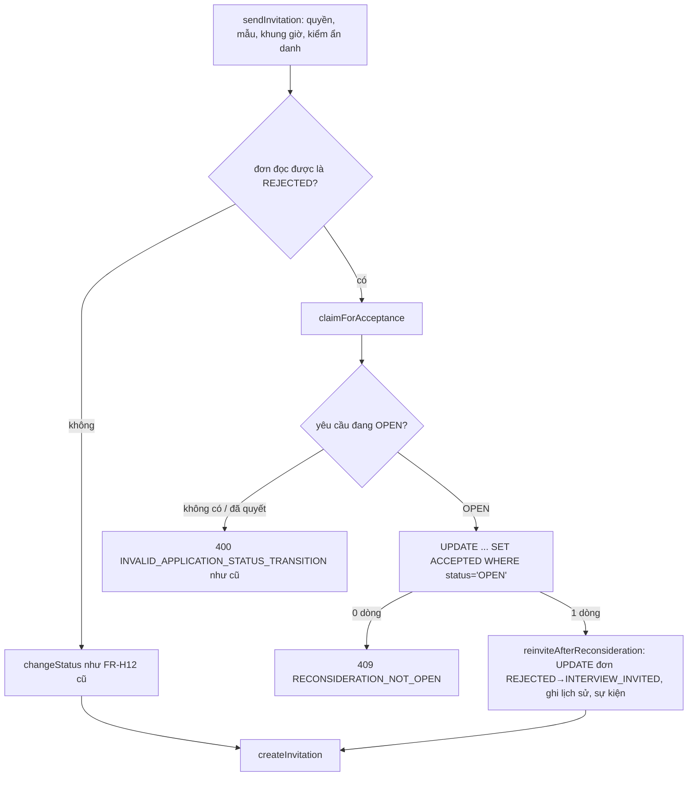

# Walkthrough — `feat/fr-c09-reconsideration` (FR-C09 · Yêu cầu xem xét lại đơn bị từ chối)

Đặc tả: `docs/features/CHUNG/C09/REQUIREMENT.md`, `UI.md` (duyệt 30/10/2026, hoàn thành 31/10/2026). Migration **V21**.
Không có chỗ lệch nào so với đặc tả mà chưa được duyệt lại (mục 8).

## 1. Mục tiêu

Một ứng viên bị loại ngay ở vòng hồ sơ được quyền đề nghị nhà tuyển dụng xem lại **một lần**, trong **7 ngày** kể từ lúc
bị từ chối, kèm lý do tuỳ ý. HR có một chỗ tập trung để xử lý: hoặc **mời phỏng vấn** (dùng đúng hộp giấy mời đã có của
FR-H12), hoặc **giữ quyết định từ chối** kèm phản hồi gửi cho ứng viên. Quyết định vẫn hoàn toàn là của HR; không dùng AI.
Điểm khó: vòng đời đơn của dự án là đúng 5 trạng thái và `REJECTED` vốn là trạng thái cuối — FR-C09 phải mở **đúng một**
cạnh `REJECTED → INTERVIEW_INVITED` mà không làm hỏng máy trạng thái chung, không thêm trạng thái thứ 6.

## 2. Các file đã tạo/sửa

**Backend — gói mới `reconsideration/`**

| File | Vai trò |
|---|---|
| `V21__application_reconsideration_requests.sql` | Bảng yêu cầu riêng: một dòng mỗi đơn (`uq_reconsideration_per_application`), `status` OPEN/ACCEPTED/DECLINED, CHECK độ dài 1000 và tính nhất quán quyết định, FK `ON DELETE RESTRICT` |
| `ReconsiderationRequest`, `ReconsiderationStatus` | Entity chỉ đọc (`@Immutable`) và enum trạng thái của **yêu cầu** |
| `ReconsiderationRequestRepository` | Mọi câu SQL: `findCandidateRow`, `insertIfEligible`, `acceptIfOpen`, `declineIfOpen`, `findHrRow`, `findHrRowsByJob`, `countOpenByJob`; hai đoạn LATERAL dùng chung giữ định nghĩa hạn 168 giờ ở một chỗ |
| `ReconsiderationCandidateRow`, `ReconsiderationHrRow` | Projection của câu native (dữ liệu thô, chưa che) |
| `ReconsiderationReader` | Dựng khối phía ứng viên (6 `state`) và khối phía HR (che theo ẩn danh) — nơi duy nhất `jobapplication/` gọi sang |
| `ReconsiderationCandidateService` / `…Controller` | C1: `POST /api/candidates/applications/{id}/reconsideration-request` |
| `ReconsiderationHrService` / `…Controller` | H1 danh sách theo tin, H2 giữ từ chối, `claimForAcceptance` cho nhánh mời phỏng vấn |
| `ReconsiderationText` | Chuẩn hoá văn bản như tin nhắn FR-C06 (CRLF → LF, không trim) và đếm độ dài |
| `dto/*` | DTO ứng viên và DTO HR tách riêng; DTO ứng viên không có `decidedBy` |

**Backend — sửa file có sẵn**

| File | Thay đổi |
|---|---|
| `ApplicationStatusService` | Thêm `reinviteAfterReconsideration` (cạnh riêng); **không** đổi `ALLOWED_TRANSITIONS` |
| `InterviewInvitationService.sendInvitation` | Nhánh đơn `REJECTED` sau bước kiểm ẩn danh |
| `ApplicationService`, `ApplicationHrDetailService`, `JobApplicationRepository` | Khoá `reconsideration` ở E1 hai phía; `reconsiderationStatus` ở danh sách đơn ứng viên (thêm khoá cuối `a.id` cho ORDER BY) |
| `GlobalExceptionHandler`, `common/exception/Reconsideration*` | 6 mã lỗi mới + nhánh dịch `uq_reconsideration_per_application` → 409 |
| `notification/*` | Hai loại `RECONSIDERATION_REQUESTED`, `RECONSIDERATION_DECLINED`, hai sự kiện, hai listener |

**Frontend**

| File | Vai trò |
|---|---|
| `features/reconsideration/CandidateReconsiderationSection`, `ReconsiderationRequestDialog`, `PendingReconsiderationText` | Khối "Xem xét lại" ở tab "Thông tin đơn", hộp thoại gửi, chữ "· Đang chờ xem xét lại" cạnh badge |
| `ReconsiderationTab`, `ReconsiderationCard`, `DeclineReconsiderationDialog`, `useReconsiderationDialogs` | Tab mới ở trang sửa tin, thẻ yêu cầu dùng chung cho tab và hồ sơ đơn, hộp thoại giữ từ chối |
| `keys.ts`, `queries.ts`, `api.ts`, `types.ts`, `reconsiderationLabels.ts` | Khoá query, hook, API, kiểu, chuỗi cố định |
| `HrJobEditPage`, `ApplicationActionBar`, `ApplicationDetailHeader`, `CandidateApplicationHeader`, `ApplicationInfoTab`, `CandidateApplicationsPage` | Gắn các phần trên vào màn hình cũ |
| `interviewinvitation/queries.ts` | Khi gửi giấy mời lỗi 409/400 thì làm mới thêm khoá của nơi gọi (L1 Plan Mode) |

**Seed**: `seed-demo-structural-3.sql` Phần B (dải `d3a00000-`), `seed-test.sql` mục 18 (dải `f3000000-`), dọn dữ liệu theo
khoá RESTRICT ở `reset-test-data.sql`, `seed-demo-structural-1b.sql`, `reset-demo-db.sql`.

## 3. Luồng chính

**Luồng C1 — ứng viên gửi yêu cầu**

1. Trang chi tiết đơn gọi E1 (`GET /api/candidates/applications/{id}`). `ApplicationService.getMyApplicationDetail` hỏi
   `ReconsiderationReader.candidateBlock`, reader chạy `findCandidateRow`: một câu SQL đọc trạng thái đơn, dòng lịch sử vào
   `REJECTED` mới nhất, dòng `PENDING → REJECTED` (lấy mốc), `jobs.deleted_at` và yêu cầu (nếu có); **ngay trong SQL** tính
   `deadline = changed_at + 168 giờ` và `withinDeadline = now() <= deadline`. Reader chọn một trong 6 `state` hoặc `null`.
2. Khối `AVAILABLE` hiện hạn chót; ứng viên bấm "Yêu cầu xem xét lại", hộp thoại đếm ký tự giống backend.
3. `POST …/reconsideration-request` → `ReconsiderationCandidateService.request`: kiểm quyền bằng `findByIdAndCandidateId`
   (404 cả đơn người khác) → đọc lại `findCandidateRow` → kiểm theo thứ tự R-E5 (đã có yêu cầu → không phải bị từ chối ở
   vòng hồ sơ → tin đã gỡ → quá hạn) → chuẩn hoá và kiểm độ dài → `insertIfEligible` (một câu `INSERT … SELECT … WHERE`
   lặp lại đúng các điều kiện) → phát `ReconsiderationRequestedEvent` → trả khối `OPEN`.
4. Sau commit, `NotificationEventListener.onReconsiderationRequested` ghi một thông báo cho chủ công ty (không chứa lý do).

**Luồng I2 — HR mời phỏng vấn (chấp nhận)**

Cả nhánh nằm trong **một** transaction của `sendInvitation`: bước tạo giấy mời lỗi thì yêu cầu vẫn `OPEN`.

**Luồng H2 — HR giữ quyết định từ chối**: `ReconsiderationHrService.decline` → `HrApplicationAccess.loadOwned` (quyền) →
chuẩn hoá phản hồi → `declineIfOpen` (0 dòng → 409) → `ReconsiderationDeclinedEvent` → thông báo cho ứng viên (không chứa
phản hồi). Đơn giữ nguyên `REJECTED`, không ghi lịch sử trạng thái.

**Luồng H1 — tab của tin**: `list` → `ApplicationOwnerService.loadOwnedJob` → `countOpenByJob` + `findHrRowsByJob`
(`ORDER BY requested_at, application_id`) → `ReconsiderationReader` che họ tên/lý do/phản hồi cho đơn đang ẩn danh bằng
`BlindReviewResolver.maskedAmong` + `IdentityMaskSource.load` (một lượt cho cả danh sách).

## 4. Quyết định thiết kế

**Yêu cầu ở bảng riêng, không phải trạng thái đơn thứ 6.** Khác: thêm `RECONSIDERING` vào `ApplicationStatus`. Chọn
bảng riêng vì CLAUDE.md §2 chốt đúng 5 trạng thái; thêm giá trị sẽ lan sang dashboard, badge, funnel, lịch sử.

**Cạnh mới là method riêng, không thêm khoá `REJECTED` vào `ALLOWED_TRANSITIONS`.** Khác: thêm vào bảng chung. Bảng
chung được `changeStatus` dùng cho mọi đơn — thêm khoá là mở cạnh cho **mọi** đơn bị từ chối. Bảo vệ bằng
`ReconsiderationSourceGuardTest` (tên method chỉ ở hai file, tập khoá bằng reflection, `ApplicationStatus` đúng 5) và ca
`t12_changeStatusDirectly_rejectedToInterviewInvited_stillInvalid` trong `ReconsiderationAcceptIntegrationTest`. Hai test
này bảo vệ ràng buộc của **FR-H07** (máy trạng thái), không chỉ của C09 — không được xoá khi refactor.

**Chấp nhận = gửi giấy mời, không có endpoint "accept" riêng.** Khác: nút "Chấp nhận" rồi mời sau. Tránh trạng thái lơ
lửng "đã chấp nhận nhưng chưa mời" (R-D1) và dùng lại đúng hộp giấy mời FR-H12.

**Hạn tính bằng `now()` của Postgres, `interval '168 hours'`, trong SQL.** Khác: `Instant.now()`/`LocalDate` ở Java,
`interval '7 days'`. Một đồng hồ duy nhất cho cả bước kiểm và câu ghi (R-T3); `'7 days'` lệch một giờ ở ngày đổi giờ mùa
hè. Hạn luôn lấy từ dòng `PENDING → REJECTED` (B2), điều kiện đủ xét theo dòng vào `REJECTED` mới nhất.

**"Một lần mỗi đơn" chốt bằng UNIQUE ở DB, bước kiểm ở service chỉ để trả lỗi sớm.** Hai request đồng thời: request sau
chờ ở unique index rồi văng `unique_violation`; `GlobalExceptionHandler` nhận tên constraint và trả **409** đúng câu, không
500. Đột biến "bỏ nhánh dịch" làm T5 đỏ (đã chạy, đợt 3).

**Mọi quyết định là `UPDATE … WHERE status = 'OPEN'` trên cùng một hàng, không `SELECT … FOR UPDATE`.** Postgres (READ
COMMITTED) bắt lượt sau chờ khoá hàng rồi đánh giá lại `WHERE` → 0 dòng → 409. Không giữ khoá lâu, không cần lock tường
minh. Đột biến bỏ điều kiện làm T15 đỏ (đợt 4).

**`jobapplication/` gọi sang `reconsideration/` qua một `ReconsiderationReader`.** Khác: viết SQL đọc khối trong
`JobApplicationRepository`. Giữ logic hạn 168 giờ ở một gói; vòng import giữa hai gói chấp nhận (tiền lệ
`jobapplication ↔ notification`), không vòng bean (L4).

**Hai hộp thoại phía HR đặt ở nơi gọi (`useReconsiderationDialogs`), không trong thẻ.** Ở bộ lọc "Đang chờ", thẻ vừa
quyết biến mất khi danh sách tải lại; hộp thoại nằm trong thẻ sẽ bị gỡ trước khi kịp trả focus (đợt 6).

**Seed demo dùng mốc tương đối theo lúc nạp** (cả seed test mục 18 — ngoại lệ có chủ đích với mốc tuyệt đối của bộ test),
vì hạn 7 ngày so bằng `now()`: mốc tuyệt đối sẽ thành "quá hạn" sau một tuần.

## 5. Ràng buộc đã thực thi

| Mã | Ràng buộc | Thực thi ở |
|---|---|---|
| FR-H07, CLAUDE §2 | Đúng 5 trạng thái; `REJECTED → INTERVIEW_INVITED` chỉ qua yêu cầu OPEN | `ApplicationStatusService.reinviteAfterReconsideration`, `ReconsiderationHrService.claimForAcceptance`, `ReconsiderationSourceGuardTest` |
| C09 R-E1, R-E3 | Chỉ đơn bị từ chối ở vòng hồ sơ | `insertIfEligible` (`last_rej.from_status = 'PENDING'`), `ReconsiderationReader.rejectedAtScreening` |
| C09 R-E2 | Một yêu cầu mỗi đơn | `uq_reconsideration_per_application`, nhánh trong `GlobalExceptionHandler.handleDataIntegrityViolation` |
| C09 R-E4 | Tin đã gỡ không gửi được; tạm dừng/đóng vẫn gửi | `jobs.deleted_at IS NULL` trong `insertIfEligible` |
| C09 R-T | 168 giờ, đúng mốc còn hạn, so bằng DB | `PENDING_REJECTED_LATERAL`, `now() <= pending_rej.deadline` |
| C09 R-D3 | Tranh chấp chỉ một bên thắng | `acceptIfOpen`, `declineIfOpen` (`WHERE status = 'OPEN'`) |
| C09 R-V | Văn bản thuần, ≤ 1000 sau đổi CRLF | `ReconsiderationText`, `chk_reconsideration_*_length`, `whitespace-pre-wrap` ở giao diện |
| C09 R-A, FR-H16 | Che danh tính phía HR, không lộ bản gốc | `ReconsiderationReader.toHrResponses` |
| C09 R-C3, SRS bổ sung | Ứng viên không nhận dữ liệu nội bộ | `CandidateReconsiderationResponse` (6 khoá, T19) |
| C09 R-N | Thông báo không chứa lý do/phản hồi; chấp nhận không thêm thông báo | `NotificationContentBuilder.forReconsideration*`, `reinviteAfterReconsideration` chỉ phát `ApplicationStatusChangedEvent` |
| C09 R-D7 | Thanh thao tác không nói "Không còn thao tác nào" khi có yêu cầu OPEN, không thêm nút | `finalStatusMessage` trong `ApplicationActionBar.tsx` |
| CLAUDE §4 | Không hard delete | Không có đường xoá; FK `ON DELETE RESTRICT` |

## 6. Đã kiểm thử gì

**Test tự động.** 78 test mới trong 9 lớp `Reconsideration*Test` phủ T1–T25 và T10b. Full suite 31/10/2026: lần
đầu `Tests run: 2226, Failures: 0, Errors: 1` (lỗi môi trường đồng hồ VM Docker, mục 7), chạy lại đúng một lần:
**`Tests run: 2226, Failures: 0, Errors: 0, Skipped: 0` — BUILD SUCCESS, 08:28 phút** (2148 trước nhánh + 78 mới).
Hồi quy không sửa khẳng định cũ nào; hai test cũ có sửa:
- `ApplicationCandidateDetailControllerIntegrationTest:337` thêm khoá `reconsideration` (M2);
- `ApplicationServiceTest` thêm một `@Mock` và một tham số constructor.

**Đột biến đã chạy rồi hoàn nguyên, so hash file:**

| Đột biến tạm | Test đỏ |
|---|---|
| Bỏ nhánh dịch unique | T5 |
| `<=` → `<` | T2 |
| Bỏ `status = 'OPEN'` trong `declineIfOpen` | T15(a), T14 |
| Bỏ `status = 'OPEN'` trong `acceptIfOpen` | T15(b) |
| Thêm khoá `REJECTED` | T13, ca T12 gọi thẳng `changeStatus` |
| Bỏ che lý do | T18 |

**Đợt 7 trên DB thật** (backend scheduler tắt, khoá giả):
- Nạp sạch reset → 1 → 2 → 1b → 1b → 2b → 3 → 3 từ DB trống, không lỗi, số dòng 32 bảng giống nhau giữa hai lần nạp tầng 3.
- Khối HTTP 22/22 trên Phần B: C1, H1, H2, I2, guard PATCH, quyền 401/403/404.
- Bốn ca seed test kiểm qua API: `AVAILABLE`, `EXPIRED`, `null`, `DECLINED`.
- `npm run build` + `npm run lint` sạch; `srs-guard` 16/16 mục sạch.

**Test tay (người dùng tự làm 31/10/2026, bản rút gọn 8 bước, đều đạt):**
1. Bùi Ngọc Mai ứng tuyển "Kế toán tổng hợp", HR từ chối → khối `AVAILABLE` có hạn chót 7 ngày.
2. Mai gửi yêu cầu → khối `OPEN`, lý do nguyên văn, "· Đang chờ xem xét lại" ở đầu trang và danh sách đơn.
3. HR nhận thông báo không chứa lý do; hồ sơ đơn có câu R-D7 và khối 2 nút.
4. Tab "Yêu cầu xem xét lại (1)" có bộ lọc.
5. HR "Mời phỏng vấn" từ tab → Mai thấy `ACCEPTED` và giấy mời.
6. Sơn/Marketing: HR "Giữ quyết định từ chối" kèm phản hồi.
7. Sơn thấy phản hồi; thông báo không chứa phản hồi.
8. Ở 375px không cuộn ngang trang.

**Không soát tay** (đã phủ bằng test backend): ẩn danh (T18), tin đã gỡ (T7, T20), hết hạn (T3), hai tab tranh nhau (T15).
Frontend không có test tự động; phần hiển thị chỉ kiểm qua soát tay ở trên.

| "Xong khi" (REQUIREMENT mục 7) | Cách nghiệm thu | Kết quả |
|---|---|---|
| 7.1 T1–T25 (+T10b) | `Reconsideration*Test` (9 lớp, 78 test) + full suite | Đạt |
| 7.2 build/lint, không tự tính hạn, `NotificationType` | `npm run build`, `npm run lint`, grep `Date.now`/`new Date` = 0, 2 loại mới | Đạt |
| 7.2 R-D7 hàm thuần | `finalStatusMessage` trong `ApplicationActionBar.tsx` | Đạt |
| 7.3 soát tay 7 bước | Bản rút gọn 8 bước của người dùng (trên); bước 5 (ẩn danh) và 6 (hai tab) thay bằng T18, T15 | Đạt (có thay thế) |
| 7.4 đột biến | Bảng trên | Đạt |

## 7. Nợ kỹ thuật

- **Lệch đồng hồ VM Docker.** Lần chạy full suite đầu của đợt 7 có 1 Error ở
  `ApplicationTalentPoolControllerIntegrationTest.t14_…` (FR-H15, không chạm): CHECK `removed_at >= added_at` vỡ vì đồng
  hồ VM Docker lùi khoảng 18 giây giữa hai câu lệnh (đo được VM chậm hơn máy 17,3 giây). Lỗi môi trường, không phải lỗi
  code; chạy lại đúng một lần thì xanh 2226/2226. Test FR-H15 này nhạy với đồng hồ DB bị chỉnh lùi — chưa xử lý.
- **Yêu cầu `OPEN` khi tin bị gỡ sau đó** chỉ còn lối vào bằng link thông báo; không tự `DECLINED` (Giới hạn đã biết, Q2).
- **Nhánh "I2 thắng, H2 thua" của T15(c)** chỉ được phủ bởi ca tất định. Ở dạng lặp, H2 thắng 20/20 vòng vì I2 nhiều
  bước hơn trước khi chạm khoá.
- **Nhãn tab "Yêu cầu xem xét lại (n)"** gọi H1 ngay khi mở trang sửa tin, kể cả khi HR không mở tab (thêm một request).
- **Khối HTTP đợt 7** (`http-smoke-c09.ps1`) nằm ở scratchpad, không commit. Trên PowerShell 5.1, script phải lưu
  UTF-8 có BOM thì chuỗi có dấu mới so đúng (lần đầu trượt 1 mục vì lý do này; tên thật khớp từng byte).
- Frontend không có test tự động.

## 8. Lệch so với đặc tả

Mọi thay đổi đều được ghi vào đặc tả và duyệt lại trước khi code tiếp:

| Chỗ | Nội dung | Duyệt |
|---|---|---|
| Đồng bộ sau FR-U16 | Số dòng trích dẫn, V21, 32 bảng, seed tầng 3 | 30/10/2026 |
| L1–L9, B1 (sau Plan Mode) | Làm mới query khi giấy mời lỗi (`interviewinvitation/queries.ts`); sửa khẳng định `:337`; bản riêng hàm chuẩn hoá; `ReconsiderationReader`; tên method; T13 bằng reflection; NFC khi che; quy tắc chạy script seed; seed Mai/Sơn; T10b rollback | 30/10/2026 |
| B2 | Hạn và `rejectedAt` luôn từ dòng `PENDING → REJECTED` | 30/10/2026 |
| L1–L2 sau đợt 4 | Dạng lặp T15 chấp nhận 409 hoặc 400 cho bên I2 thua; bảng đột biến 7.4 sửa hàng 3 + ca T12 gọi thẳng `changeStatus` | 30/10/2026 |
| UI.md 5a/5b (đợt 5, 6) | Export `MY_APPLICATIONS_QUERY_KEY`; thêm `keys.ts`, `useReconsiderationDialogs.tsx` | 30/10/2026 |
| Mục 4.5 seed test | Cặp ứng viên–tin cụ thể (Lan/Khoa/Ngọc vì Quốc Huy đã có đơn ở J1–J5) và mốc tương đối — đặc tả chỉ nêu các ca, không nêu cặp | Khớp đặc tả, không cần duyệt lại |
