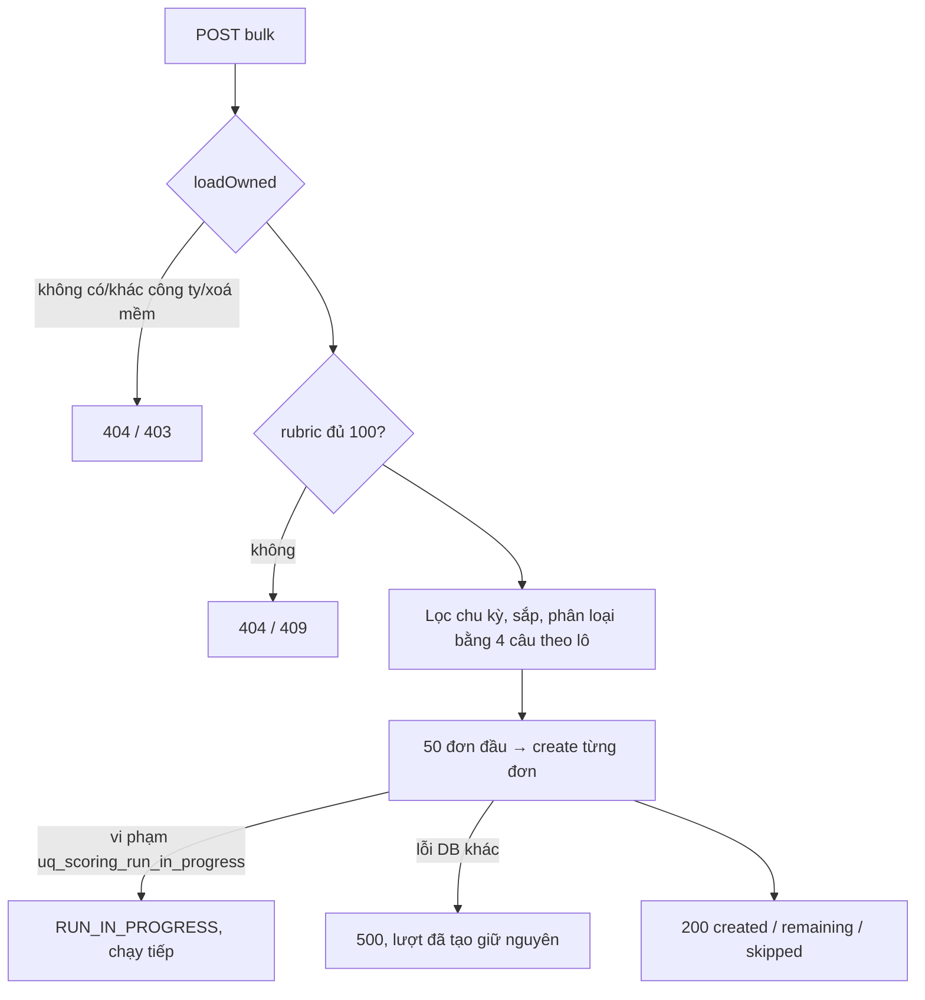

# Walkthrough — `feat/fr-h04-bulk-scoring` (FR-H04 mở rộng: Chấm tất cả CV trong tin)

> Mọi chỗ code khác đặc tả đã duyệt ban đầu đều đã được sửa vào đặc tả và duyệt lại (L1–L17, mục 8). Không có lệch nào
> đang chờ duyệt.

Đặc tả: `docs/features/HR/H04/REQUIREMENT.md`, `UI.md` (duyệt 30/10/2026, hoàn thành 06/11/2026). Nhánh rebase lên
`main` tại `90c9d2d` (đã có `perf/scoring-latency` và FR-C09).

## 1. Mục tiêu

Trước nhánh này, HR muốn chấm điểm mọi hồ sơ của một tin phải bấm "Chấm điểm hồ sơ" lần lượt ở từng dòng. Nhánh thêm
một nút "Chấm tất cả (N)" ở tab Ứng viên: một lần bấm xếp vào hàng chấm mọi đơn của chu kỳ tuyển dụng hiện tại mà chưa
từng có điểm, đang chờ duyệt, CV đã trích xuất xong và không có lượt chấm nào đang chạy. Tối đa 50 đơn mỗi lần. Request
chỉ ghi bản ghi "chờ chấm"; việc gọi AI vẫn do job nền làm, đúng luật cũ của FR-H04 (mỗi tiêu chí một lần gọi, evidence
kiểm nguyên văn). AI không tính tổng, không xếp hạng, không gắn nhãn — phần đó không đổi.

## 2. Các file đã tạo/sửa

**Backend**

| File | Vai trò |
|---|---|
| `scoring/ScoringRunService.java` (sửa) | Thêm `createScoringRunsForJob`: kiểm quyền, kiểm rubric, phân loại đơn, cắt trần 50, gọi tạo lượt từng đơn; hằng `MAX_BULK_SCORING_RUNS = 50` |
| `scoring/BulkScoringSkipReason.java` (mới) | 4 mã lý do bỏ qua, khai đúng thứ tự ưu tiên |
| `scoring/dto/BulkScoringRunResponse.java` (mới) | Response `{created, remaining, skipped[{applicationId, reason}]}` — không có tên, điểm hay id lượt |
| `scoring/JobScoringRunBulkHrController.java` (mới) | `POST /api/hr/jobs/{jobId}/scoring-runs/bulk`, trả 200 |
| `ratelimit/RateLimitFilter.java` (sửa) | Đưa đường bulk vào nhóm `llm-action` theo userId |
| Test: `JobScoringRunBulkIntegrationTest`, `JobScoringRunBulkRaceIntegrationTest`, `JobScoringRunBulkIntegrationTestSupport` (mới); `RateLimitFilterTest` (thêm 4 test) | Mục 6 |

**Frontend** (`frontend/src/features/scoring/`)

| File | Vai trò |
|---|---|
| `scoringRules.ts` (sửa) | `isBulkScorable` — điều kiện duy nhất để đếm N |
| `api.ts`, `types.ts` (sửa) | Hàm gọi API bulk, kiểu response |
| `queries.ts` (sửa) | `useBulkCreateScoringRunsMutation`: thành công thì làm mới danh sách và mọi cache lượt chấm |
| `bulkScoringTexts.ts` (mới) | Mọi câu chữ; hàm dựng câu "Bỏ qua k đơn: …" theo lý do |
| `BulkScoringButton.tsx` (mới) | Nút, câu lý do khi khoá, câu kết quả `role="status"`, giữ state mutation |
| `BulkScoringConfirmDialog.tsx` (mới) | Hộp xác nhận: số đơn, thời gian ước tính, lỗi |
| `ApplicationsTab.tsx` (sửa) | Hàng "Sắp xếp theo" thành hàng flex chứa nút |

Không có migration, không đổi seed.

## 3. Luồng chính

**Bấm "Chấm tất cả"**

1. `ApplicationsTab` đã có sẵn danh sách đơn (`GET /api/hr/jobs/{id}/applications`) và thông tin tin (`useHrJobQuery`).
   `BulkScoringButton` đếm N bằng `isBulkScorable` trên chính danh sách đó, không gọi API mới.
2. HR bấm nút → `BulkScoringConfirmDialog` hiện số đơn `k = min(N, 50)` và "khoảng k phút". Bấm "Chấm tất cả" → mutation
   gửi `POST /api/hr/jobs/{jobId}/scoring-runs/bulk`.
3. `RateLimitFilter.classify` xếp request vào bucket `llm:<userId>`; `SecurityConfig` đòi role HR cho `/api/hr/**`.
4. `JobScoringRunBulkHrController.createForJob` lấy ownerId từ token, gọi `ScoringRunService.createScoringRunsForJob`.
5. Service (không `@Transactional`):
   - `JobOwnerService.loadOwned` (bảng `jobs`, `companies`) → 404/403; tin có `deleted_at` → 404.
   - `requireRubricComplete` (bảng `rubrics`, `rubric_criteria`) → 404/409 cùng câu với nút đơn lẻ.
   - `findByJobIdOrderByAppliedAtDesc`, lọc chu kỳ hiện tại, sắp `applied_at` tăng dần, hoà thì theo chuỗi id.
   - `classifyIneligible` đọc 4 câu theo lô: `resumes` (trạng thái trích xuất), `resume_parsed_data` (chỉ id CV có dữ
     liệu), lượt mới nhất và lượt `DONE` mới nhất của `scoring_runs`. Mỗi đơn nhận một lý do theo thứ tự ưu tiên hoặc
     được coi là đủ điều kiện.
   - Lấy 50 đơn đủ điều kiện đầu; phần dư thành `remaining`. Nếu có đơn để thử, chụp `RubricSnapshot` một lần.
   - Từng đơn gọi `ScoringRunStateService.create` — mỗi lần một transaction ngắn: INSERT `scoring_runs` `PENDING` +
     khoá rubric. Nếu INSERT vấp `uq_scoring_run_in_progress` (race với nút đơn lẻ) thì đơn đó thành `RUN_IN_PROGRESS`,
     vòng lặp chạy tiếp; lỗi DB khác ném ra (500).
   - Dựng `skipped` theo thứ tự nộp.
6. Frontend nhận response: đóng hộp, hiện câu kết quả, invalidate danh sách và mọi khoá `['scoring-runs', …]`. Vòng poll
   sẵn có tự bật vì danh sách giờ có đơn `PENDING`.
7. `ScoringRunScheduler` (job nền, không đổi) nhặt từng lượt `PENDING`, chấm lần lượt; mỗi lượt xong tạo một thông báo.

## 4. Quyết định thiết kế

**Đọc trạng thái bằng câu theo lô có sẵn, không gọi lại hàm kiểm của nút đơn lẻ.** Lựa chọn khác: gọi
`requireResumeParsed`/`requireNoRunInProgress` cho từng đơn. Không chọn vì đó là 3–4 câu SQL mỗi đơn (N+1) và dùng
exception làm luồng điều khiển. Câu theo lô cho số câu cố định — T16 đo được đúng 9 câu với cả 3 lẫn 20 đơn (Q4, L2).

**Kiểm "có dữ liệu trích xuất" bằng `findPromptVersionsByResumeIds`.** Bản đặc tả đầu ghi `findByResumeIdIn`, nhưng câu
đó nạp nguyên `raw_text` của mọi CV. Projection chỉ lấy id + phiên bản, không đưa nội dung CV vào bộ nhớ (L1).

**"Đang chạy" của bulk rộng hơn nút đơn lẻ.** Bulk coi lượt mới nhất `PENDING` hoặc `RUNNING` là đang chạy, kể cả
`RUNNING` đã có `finished_at` (chấm xong tiêu chí, chờ tổng hợp). Nút đơn lẻ và index DB vẫn cho tạo lượt mới ở trạng
thái đó. Chọn vậy để bấm "Chấm tất cả" không tạo lượt thứ hai cho đơn sắp có điểm; không sửa nút đơn lẻ vì đó là hành vi
đã duyệt của FR-H04 gốc (Q3, R-E4, R-G4).

**Mỗi đơn một transaction riêng, không bọc cả request.** Lựa chọn khác: `@Transactional` cho cả vòng lặp. Không chọn vì
một vi phạm index sẽ đánh hỏng cả transaction (mất mọi lượt đã tạo), giữ connection suốt vòng lặp và mọi lượt cùng
`created_at` (CLAUDE.md §3c). Hệ quả chấp nhận: lỗi giữa chừng thì lượt đã tạo vẫn còn (R-T4).

**Chỉ nuốt đúng vi phạm `uq_scoring_run_in_progress`.** Đọc tên index trong `getMostSpecificCause()` — cùng cách
`GlobalExceptionHandler` đang dịch lỗi này ra 409. Mọi lỗi toàn vẹn khác ném tiếp để không giấu lỗi dữ liệu (R-T3).

**Khoá phụ sắp theo chuỗi id.** `UUID.compareTo` của Java so hai số `long` có dấu, cho thứ tự khác Postgres; chuỗi hex
chữ thường thì khớp. Thứ tự này quyết định ai vào 50 đơn đầu (L3, T19).

**Trả 200 + bản tóm tắt, không trả id lượt.** Một request tạo 0–50 bản ghi; frontend không cần id vì invalidate theo
tiền tố khoá. Response không có tên/email để không lộ danh tính khi tin bật ẩn danh (Q11, R-G3).

**Câu kết quả tại chỗ thay vì toast.** Dự án chưa có Snackbar; thêm thư viện là việc của FR riêng. Vùng `role="status"`
luôn có trong DOM (rỗng + `sr-only` khi chưa có kết quả) để trình đọc màn hình đọc được khi nội dung đổi (Q7).

**Hộp xác nhận chỉ hai ý.** Bản duyệt có ước tính số lượt gọi AI và câu nhắc polling; khi soát tay, người dùng yêu cầu
bỏ (L17). Chốt chặn chi phí còn lại là trần 50 đơn và số đơn hiện trong hộp.

**Test race bằng spy chèn trước, không dùng hai luồng.** `JobScoringRunBulkRaceIntegrationTest.t10_raceOnOneApplication_skipsItAndContinues`
chèn lượt `PENDING` cho đơn A ngay trước khi `create` thật chạy, nên index ném chắc chắn. Đo được: stub chạy khi
transaction của `create` đang mở (spy nằm trong proxy giao dịch), nên câu chèn phải ở `PROPAGATION_REQUIRES_NEW`; nếu
dùng `JdbcTemplate` thường, hàng chèn tay rollback cùng vi phạm (L4). Test này cũng là bằng chứng duy nhất cho nhánh bắt
lỗi race — không xoá khi refactor.

## 5. Ràng buộc đã thực thi

| Mã | Ràng buộc | Thực thi ở đâu |
|---|---|---|
| R-T2, CLAUDE.md §7 | Request không gọi AI | `createScoringRunsForJob` chỉ đọc + `stateService.create`; test kiểm 0 lần gọi `ChatModel`/`EmbeddingModel` (`assertNoAiCall`) |
| R-E1 | Chỉ đơn chu kỳ hiện tại; đơn chu kỳ cũ không vào `skipped` | Bộ lọc `recruitmentCycle` trong `createScoringRunsForJob` |
| R-E2, R-E3 | 5 điều kiện, 4 lý do theo thứ tự ưu tiên | `ScoringRunService.skipReason` |
| R-E4 | Lượt mới nhất `PENDING`/`RUNNING` bất kể `finished_at` | `skipReason` |
| R-E5, L1, L2 | Số câu đọc cố định | `classifyIneligible`; T16 |
| R-E6, L3 | `applied_at` tăng dần, hoà theo chuỗi id | `BULK_ORDER` |
| R-C1, R-C2 | Trần 50, không bù chỗ | `MAX_BULK_SCORING_RUNS`, `toTry`/`remaining` |
| R-R1, R-R2, R-R3 | Rubric đủ 100; snapshot một lần; không khoá khi 0 đơn | `requireRubricComplete`; snapshot trong khối `if (!toTry.isEmpty())` |
| R-T1, R-T3, R-T4 | Transaction riêng; chỉ nuốt race; lượt đã tạo giữ nguyên | `ScoringRunStateService.create`; `isRunInProgressViolation` |
| FR-H04 (chốt DB) | Một lượt đang chạy mỗi đơn | Index `uq_scoring_run_in_progress` (V4) |
| R-P1–R-P5 | HR, sở hữu tin, tin xoá mềm 404, không kiểm trạng thái tin | `SecurityConfig`; `JobOwnerService.loadOwned`; kiểm `deletedAt` |
| R-L1, R-L2 | Một lần bấm = một token `llm-action` | `RateLimitFilter.SCORING_RUN_BULK_PATTERN` |
| R-G2, R-G3, CLAUDE.md §8 | Không nhãn/màu phán quyết; không trường danh tính | `BulkScoringRunResponse`; câu kết quả chữ trung tính; T13 |
| R-F1, R-F2 | N đếm một chỗ; khoá nút có lý do đọc được | `isBulkScorable`; `disabled` + `aria-describedby` |
| R-F4 | Làm mới danh sách và mọi lượt | `useBulkCreateScoringRunsMutation` |

## 6. Đã kiểm thử gì

**Test tự động (backend)**

- `JobScoringRunBulkIntegrationTest` (15 test): T1 tạo 3 lượt cùng snapshot, đúng thứ tự tiêu chí, khoá rubric; T2 đủ 11
  ca lý do; T3 đơn chỉ có lượt `FAILED`; T4 ưu tiên lý do; T5 rubric 99,99 / 0 tiêu chí → 409 cùng câu nút đơn lẻ,
  100,00 → 200; T6 401/403/403/404/404 xoá mềm/404 chưa có công ty; T7 biên 49/50/51; T8 bấm hai lần; T9 51 đơn qua hai
  lần bấm; T12 chu kỳ cũ; T13 ẩn danh, JSON chỉ 5 khoá; T14 tin tạm dừng/đóng; T15 không đơn đủ điều kiện thì không khoá
  rubric; T16 số câu SQL 9 = 9 với 3 và 20 đơn; T19 hoà `applied_at`.
- `JobScoringRunBulkRaceIntegrationTest` (2 test, context riêng): T10 race → `RUN_IN_PROGRESS`, đơn sau vẫn được tạo;
  T11 lỗi toàn vẹn khác không bị nuốt, lượt trước đó giữ nguyên.
- `RateLimitFilterTest` (+4): chung bucket với nút đơn lẻ, biên 2/3, GET và đường thiếu `/bulk` không bị giới hạn, chưa
  xác thực thì bỏ qua.
- `ScoringRunHrControllerIntegrationTest` (nút đơn lẻ) không sửa dòng nào, vẫn xanh (T18).
- Full suite: 2174/2174 xanh, 10 phút 41 giây (trước khi rebase lên FR-C09, sau commit đợt 3). Sau rebase lên
  `90c9d2d`: 2252/2252 xanh (0 fail, 0 error, 0 skip), 10 phút 42 giây.

**Frontend**: `npm run build` + `npm run lint` sạch; kiểm tĩnh 7.3 đạt. Frontend không có test tự động.

**Soát tay (31/10/2026, bộ demo, AI thật, hộp xác nhận đã rút gọn theo L17)**

- Khối HTTP 7.2 chạy hai lần trên tin Senior Java Backend Developer:
  - Lần 1 (Sơn chưa nộp đơn): nhóm 1 `created 1` (đơn của Hà — chưa có lượt `DONE`), `skipped` Hoàng `ALREADY_SCORED`,
    Tùng `NOT_PENDING`; nhóm 2 `created 0`, Hoàng `ALREADY_SCORED`, Hà `RUN_IN_PROGRESS`, Tùng `NOT_PENDING`; nhóm 3
    404 `JOB_NOT_FOUND`, 403 `FORBIDDEN`, 401 `UNAUTHENTICATED`.
  - Lần 2 (Sơn đã nộp, đơn `1dd13dc2…`): khớp đúng nhánh "Hà FAILED" của 7.2 — nhóm 1 `created 2` (Hà, Sơn), `skipped`
    Hoàng `ALREADY_SCORED`, Tùng `NOT_PENDING`; nhóm 2 đủ 4 dòng Hoàng `ALREADY_SCORED`, Hà `RUN_IN_PROGRESS`, Tùng
    `NOT_PENDING`, Sơn `RUN_IN_PROGRESS`; nhóm 3 như lần 1.
- Lượt chấm tin Java sau buổi soát tay (đọc bằng SQL): Hà 7 lượt `FAILED`, cả 7 là `EVIDENCE_NOT_VERIFIED` (3 từ seed +
  4 trong buổi); Sơn `DONE`; Hoàng `DONE` (seed); Tùng không có lượt.
- Giao diện 7.4, tất cả Đạt:
  - N = 0 ở tin DevOps và QA: nút khoá, có câu lý do.
  - Tin Java: nút "(1)", hộp chỉ 2 dòng; câu "Đã xếp 1 đơn vào hàng chấm. Bỏ qua 3 đơn: 1 không ở trạng thái chờ duyệt,
    2 đã có điểm."; đúng một request bulk; dòng `FAILED` cũ chuyển sang lượt mới; không lộ tên (tin bật ẩn danh).
  - Tin QA (bước 5): "Đã xếp 1 đơn vào hàng chấm.", không có câu bỏ qua.
  - Tin Frontend Ngân Hà (bước 6): rubric 99 → 409 trong hộp, hộp giữ mở; rubric 100 → hộp "3", "khoảng 3 phút"; bấm
    hai lần liền → một request; các dòng xong lần lượt, chuông 3 thông báo; không màu/nhãn phán quyết.
  - Bề rộng 375/768/1024px không cuộn ngang; ở 375px nút nằm dưới "Sắp xếp theo" và rộng hết hàng.

**Chưa kiểm**

- Không bấm giờ lô thật (DEMO.md ghi ước tính ~1 phút/đơn).
- Không chạy lô thật trên 50 đơn qua giao diện (dòng vượt trần của hộp và câu `remaining` chỉ phủ bằng T7, T9 ở backend
  và đọc code frontend).
- Ca đơn có CV chưa trích xuất xong không có trên bộ demo — chỉ phủ bởi T2 (L10).
- Mã 500 thật của lỗi toàn vẹn khác chỉ kiểm dưới MockMvc (exception nổi lên, L5), chưa gọi qua server thật.
- Frontend không có test tự động.

**Đối chiếu "Xong khi"**

| Mục | Cách nghiệm thu | Kết quả |
|---|---|---|
| 7.1 T1–T19 | Hai lớp test bulk + `RateLimitFilterTest` + `ScoringRunHrControllerIntegrationTest` | Đạt |
| 7.2 Khối HTTP | Người dùng chạy hai lần trong buổi soát tay | Đạt (lần 2 khớp nhánh "Hà FAILED") |
| 7.3 Kiểm tĩnh frontend | build, lint, các lệnh tìm (câu về `isBulkScorable` sửa theo L16) | Đạt |
| 7.4 Soát tay | Bộ demo, 6 bước, ba bề rộng | Đạt |

## 7. Nợ kỹ thuật

- **CV của Nguyễn Thị Thu Hà (seed demo) bị K2 từ chối 7/7 lượt** (`EVIDENCE_NOT_VERIFIED`). Nghi `raw_text` có ký tự
  đặc biệt khiến trích dẫn nguyên văn của AI không khớp; cần điều tra ở K2/trích xuất, ngoài phạm vi nhánh.
- **Đơn luôn `FAILED` bị xếp lại mỗi lần bấm** "Chấm tất cả": đúng R-E2.4 (chưa có lượt `DONE` thì vẫn đủ điều kiện),
  nhưng tốn ~5 lượt gọi AI mỗi lần với rubric 4 tiêu chí mà không ra điểm.
- **Tải polling khi lô lớn (L11)**: sau lô 50 đơn, mỗi dòng có lượt đang chạy tự poll 5 s, cộng vòng poll danh sách —
  khoảng 10 GET/s tới mốc 10 phút. Không đổi code ở nhánh này.
- **Vòng chấm vẫn tuần tự** trong một nhịp của `ScoringRunScheduler`: lô N đơn mất khoảng N phút; mốc dừng poll 10 phút
  ngắn hơn một lô lớn, HR phải bấm "Tải lại".
- Lớp test bulk để lại ~260 lượt `PENDING` đã commit trong container dùng chung (khuôn không dọn, L6); các câu đọc toàn
  cục hiện có chịu được, nhưng test mới đọc `scoring_runs` toàn cục phải lọc theo id của mình.

## 8. Lệch so với đặc tả

Mọi điểm dưới đây đã ghi vào `REQUIREMENT.md` mục 11 (bảng "Đã chốt sau Plan Mode đợt 1") và được người dùng duyệt.

| # | Lệch | Duyệt lại |
|---|---|---|
| L1 | Danh sách không đọc `resume_parsed_data`; bulk dùng `findPromptVersionsByResumeIds` thay `findByResumeIdIn` | 31/10/2026 (sau Plan Mode) |
| L2 | Số câu đọc cố định ghi lại theo code: 2 + 2 + 1 snapshot + 5 | 31/10/2026 |
| L3 | Khoá phụ so bằng `id.toString()`; thêm T19 | 31/10/2026 |
| L4 | T10 chèn bằng `REQUIRES_NEW` | 31/10/2026 |
| L5 | T11 kiểm exception nổi lên thay vì mã 500 | 31/10/2026 |
| L6 | Không dọn dữ liệu test (khuôn có sẵn) | 31/10/2026 |
| L7 | Tách hai lớp test, import `LlmTestConfiguration` | 31/10/2026 |
| L8 | 7.2/7.4 dùng tài khoản và tin của bộ demo | 31/10/2026 |
| L9 | 7.2 chạy trong buổi soát tay, sau khi Sơn nộp đơn | 31/10/2026 |
| L10 | Bỏ ca "CV chưa trích xuất xong" khỏi 7.4, phủ bởi T2 | 31/10/2026 |
| L11 | Ghi rủi ro tải polling, giảm tải vào Ngoài phạm vi | 31/10/2026 |
| L12 | Nền nhánh: `abaf31b`, đợt cuối rebase lên `90c9d2d` (FR-C09) | 31/10/2026; rebase đợt cuối |
| L13 | "Bấm lại ngay" kiểm bằng JSON 7.2, vì nút khoá khi N = 0 | 31/10/2026 |
| L14 | Lượt của Hà ra `DONE` hoặc `FAILED` đều hợp lệ; 7.2 ghi hai nhánh | 31/10/2026 |
| L15 | T2 có 11 dòng, không phải 10 | 31/10/2026 (đợt 2) |
| L16 | Lời gọi `isBulkScorable` ở `BulkScoringButton.tsx`, sửa câu 7.3 | 31/10/2026 (đợt 3) |
| L17 | Hộp xác nhận chỉ còn số đơn và thời gian (bỏ ước tính lượt gọi AI, câu polling) | 31/10/2026 (khi soát tay) |
