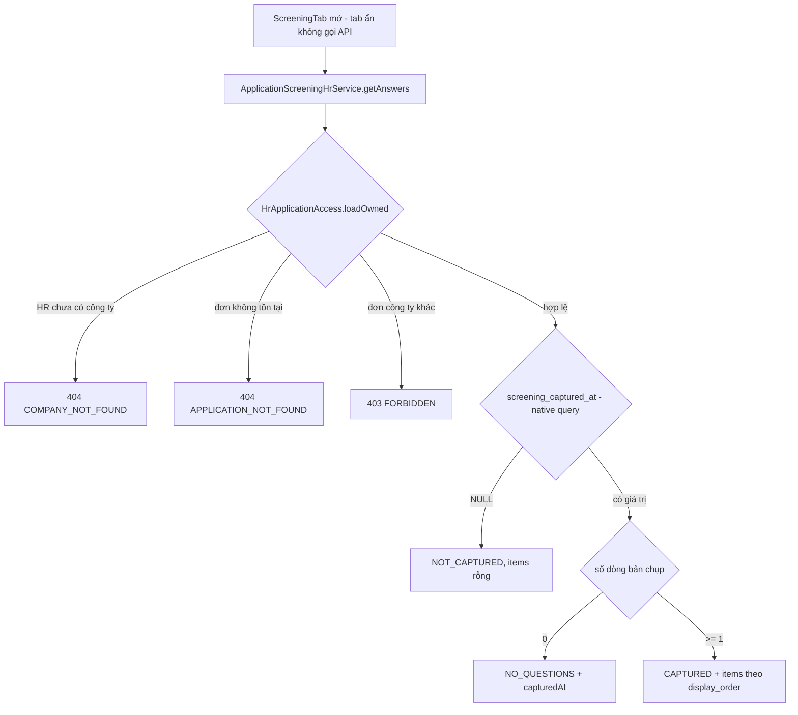

# Walkthrough — FR-H10: Câu hỏi sàng lọc theo Job (`feat/fr-h10-screening`)

## 1. Mục tiêu

HR cần hỏi ứng viên vài câu ngắn ngay lúc nộp đơn (đi làm được từ khi nào, có làm ca tối được không, mức lương mong
muốn) mà không phải nhắn riêng từng người. FR-H10 cho HR soạn tối đa 10 câu cho mỗi tin tuyển dụng, thuộc ba loại
(trả lời ngắn, một lựa chọn, có/không), sắp xếp và sửa xoá bất cứ lúc nào. Mỗi đơn giữ một **bản chụp** câu hỏi và
câu trả lời đúng như lúc nộp, HR xem ở tab "Sàng lọc" của hồ sơ đơn. Câu trả lời chỉ để HR tham khảo: không đi vào
AI chấm điểm hay giải thích, không ảnh hưởng tổng điểm và thứ hạng, không có cơ chế tự loại. Phần ứng viên trả lời
câu hỏi lúc nộp đơn (đường ghi bản chụp) thuộc FR-U09, chưa làm ở nhánh này.

## 2. Các file đã tạo/sửa

**Backend**

| File | Vai trò |
|---|---|
| `db/migration/V13__screening_questions.sql` | Bảng `job_screening_questions` (xoá mềm), bảng bản chụp `application_screening_answers` (bất biến, không `updated_at`), cột `job_applications.screening_captured_at`, cột `jobs.screening_revision`, các CHECK chốt hình dạng dữ liệu |
| `screening/ScreeningQuestion`, `ScreeningQuestionType` | Entity câu hỏi + enum ba loại |
| `screening/ScreeningQuestionRepository` | Truy vấn câu đang hoạt động; native `incrementRevision` (câu UPDATE vừa tăng revision vừa khoá hàng `jobs`), `findRevision`, `findMaxActiveDisplayOrder` |
| `screening/ScreeningQuestionOwnerService`, `...Controller` | S1–S5: liệt kê, thêm, sửa, xoá mềm, đổi thứ tự; kiểm quyền, chuẩn hoá đầu vào, giới hạn 10 câu |
| `screening/ApplicationScreeningAnswer` | Entity bản chụp, `@Immutable`, không setter — FR-H10 chỉ đọc |
| `screening/ApplicationScreeningAnswerRepository` | Đọc bản chụp theo đơn; native query đọc `screening_captured_at` (không sửa entity `JobApplication`) |
| `screening/ApplicationScreeningHrService`, `...Controller`, `ScreeningCaptureState` | S6: HR đọc bản chụp của một đơn, tính ba trạng thái `NOT_CAPTURED`/`NO_QUESTIONS`/`CAPTURED` |
| `screening/dto/*` | Request/response của S1–S6 |
| `common/exception/*Screening*`, `GlobalExceptionHandler` | 4 mã lỗi mới: `INVALID_SCREENING_QUESTION` (7 câu cố định), `SCREENING_QUESTION_LIMIT_REACHED`, `SCREENING_QUESTION_NOT_FOUND`, `INVALID_SCREENING_ORDER` |
| `db/seed/seed-test.sql`, `reset-test-data.sql`, `README.md` | Seed soát tay: 3 câu hỏi cho tin CSKH, bản chụp cho đơn A1, A9; A2 đã chụp 0 dòng; A6 chưa chụp |

**Frontend**

| File | Vai trò |
|---|---|
| `features/screening/types.ts`, `api.ts`, `queries.ts` | Kiểu dữ liệu, gọi S1–S6, hook TanStack Query |
| `features/screening/screeningLabels.ts` | Mọi chuỗi hiển thị (nguyên văn UI.md mục 7), hàm đếm ký tự sau trim theo code point |
| `features/screening/ScreeningQuestionsTab.tsx` | Tab "Câu hỏi sàng lọc" ở trang sửa Job: bộ đếm n/10, khối lưu ý, danh sách, các trạng thái tải/lỗi/rỗng/đủ 10 |
| `features/screening/ScreeningQuestionRow.tsx` | Một câu hỏi: nút ↑/↓/Sửa/Xoá, hộp xác nhận xoá |
| `features/screening/ScreeningQuestionFormDialog.tsx` | Hộp thoại thêm/sửa, React Hook Form + Zod |
| `features/screening/QuestionTypeSegmentedControl.tsx`, `ScreeningNotice.tsx` | Chọn loại câu hỏi bằng bàn phím; khối lưu ý nhân thân luôn hiện |
| `features/applicationDetail/ScreeningTab.tsx` | Tab "Sàng lọc" ở trang hồ sơ đơn (chỉ đọc) |
| `pages/HrJobEditPage.tsx`, `pages/HrApplicationDetailPage.tsx` | Thêm tab; `VALID_TABS` |

## 3. Luồng chính

### 3.1 HR thêm một câu hỏi (S2 `POST /api/hr/jobs/{jobId}/screening-questions`)

1. Hộp thoại `ScreeningQuestionFormDialog` kiểm bằng Zod trên giá trị đã trim (1–300 ký tự; với "Một lựa chọn":
   2–10 phương án, mỗi phương án 1–100 ký tự, không trùng không phân biệt hoa thường). Loại khác không gửi `options`.
2. Filter chain của Spring Security chỉ cho role HR vào `/api/hr/**` (ứng viên → 403, không token → 401).
3. `ScreeningQuestionOwnerController.add` gọi `ScreeningQuestionOwnerService.add`, chạy trong **một** transaction ngắn,
   đúng thứ tự R-Q10:
   - **(1) Kiểm quyền** — `requireOwnedJob`: công ty của HR trước (404 `COMPANY_NOT_FOUND`), rồi Job (404
     `JOB_NOT_FOUND`), Job của công ty khác → 403.
   - **(2) Kiểm đầu vào** — `normalize`: null coi như rỗng, `strip()`, đếm code point, kiểm theo đúng thứ tự bảng
     R-Q4b, dừng ở lỗi đầu tiên → 400 `INVALID_SCREENING_QUESTION` kèm một trong 7 câu cố định.
   - **(3) Khoá + tăng revision** — `incrementRevision`: `UPDATE jobs SET screening_revision = screening_revision + 1`.
   - **(4) Kiểm theo trạng thái** — đếm câu đang hoạt động (≥ 10 → 400 `SCREENING_QUESTION_LIMIT_REACHED`), lấy
     `max(display_order) + 1`.
   - **(5) Ghi** — `saveAndFlush` vào `job_screening_questions`. Lỗi ở bước 4–5 rollback cả lần tăng revision.
4. Frontend làm mới S1; bộ đếm "n/10 câu hỏi" lấy `maxQuestions` từ response, không hardcode.

Sửa (S3), xoá mềm (S4: chỉ đặt `deleted_at`) và đổi thứ tự (S5) đi cùng khuôn năm bước. S5 nhận **toàn bộ** danh
sách id theo thứ tự mới; thiếu/thừa/trùng/id của Job khác/id đã xoá → 400 `INVALID_SCREENING_ORDER`, rồi đánh số lại
1..n. Frontend không đổi thứ tự trước khi backend trả về; xong thì trả focus về đúng nút ở vị trí mới.

### 3.2 HR xem câu trả lời của một đơn (S6 `GET /api/hr/applications/{id}/screening-answers`)

Dữ liệu hiển thị lấy **chỉ** từ các cột `*_snapshot` của `application_screening_answers`, không đọc lại câu hỏi gốc
qua `question_id`. Frontend đọc `state` từ backend, không tự suy từ `items.length`. "Có"/"Không", chữ phương án đã
chọn và câu trả lời ngắn cùng kiểu chữ, cùng màu; câu bỏ trống hiện "Ứng viên không trả lời câu này.". Thời điểm chụp
in bằng `formatDateTimeVi`, cùng định dạng với "Nộp ngày" ở đầu trang (L10).

## 4. Quyết định thiết kế

**4.1 Bản chụp bất biến theo đơn.** *Đã chọn:* mỗi đơn có các dòng `application_screening_answers` chép **toàn bộ**
câu hỏi (loại, nội dung, phương án, cờ bắt buộc, thứ tự) cùng câu trả lời; không `updated_at`, không trigger, không
endpoint sửa; entity `@Immutable` không setter. *Khác:* (a) chỉ lưu `question_id` + câu trả lời, hiển thị bằng cách
join sang câu hỏi hiện tại; (b) cấm sửa câu hỏi khi Job đã có đơn. *Vì sao:* (a) làm câu trả lời cũ "đổi nghĩa" khi
HR sửa câu hỏi — "Có" của câu "làm ca tối?" thành "Có" của câu khác; (b) chặn HR chỉnh tin đang tuyển. Bản chụp cho
phép sửa câu hỏi bất cứ lúc nào (R-Q9) mà lịch sử vẫn đúng (R-S2, R-S3) — cùng tinh thần `rubric_snapshot` của
FR-H08. `question_id` chỉ để truy vết, `ON DELETE SET NULL`.

**4.2 `screening_captured_at` tách khỏi việc "có dòng hay không".** *Đã chọn:* cột đánh dấu đơn đã đi qua bước
chụp, kể cả khi Job lúc đó có 0 câu. *Khác:* suy trạng thái từ số dòng. *Vì sao:* 0 dòng có hai nghĩa khác hẳn —
"tin không có câu hỏi lúc nộp" (`NO_QUESTIONS`) và "đơn nộp trước khi có tính năng" (`NOT_CAPTURED`); HR cần phân
biệt. Cột đọc bằng native query trong `screening/`, không thêm field vào entity `JobApplication` (L3) — FR-U09 thêm
khi làm đường ghi.

**4.3 `screening_revision` và câu UPDATE làm khoá (L1).** *Đã chọn:* mỗi thao tác ghi S2–S5 chạy
`UPDATE jobs SET screening_revision = screening_revision + 1 WHERE id = ?` **sau** kiểm quyền/kiểm đầu vào và
**trước** mọi bước đếm/tìm/ghi. Câu UPDATE vừa tăng số phiên bản (để FR-U09 phát hiện bộ câu hỏi đổi giữa lúc ứng
viên đang điền, Q7) vừa giữ khoá hàng `jobs` tới khi commit. *Khác:* (a) `@Lock(PESSIMISTIC_WRITE)` + `SELECT … FOR
UPDATE` như bản đặc tả đầu; (b) chỉ đếm ở service; (c) ràng buộc DB. *Vì sao:* (b) có race — hai tab cùng thấy 9 câu
và cùng thêm thành 11; (c) Postgres không có CHECK đếm số dòng theo nhóm, unique index không diễn đạt được "tối đa
10". (a) đúng nhưng cần thêm một câu SELECT và một cơ chế khoá codebase chưa từng dùng (0 `@Lock` trong
`backend/src/main`); câu UPDATE đằng nào cũng phải chạy để tăng revision nên dùng luôn làm khoá. Transaction thứ hai
dừng ở câu UPDATE; khi được nhả, câu đếm chạy với snapshot mới (READ COMMITTED) nên thấy đủ 10 câu → 400 → rollback.
Hai hệ quả phải giữ: `@Modifying(clearAutomatically = true)` xoá persistence context để không ai dùng lại entity
`Job` nạp trước câu UPDATE (R-Q10a); lỗi sau bước khoá phải rollback cả lần tăng revision (T17 kiểm). Tăng revision
làm trigger đổi `jobs.updated_at` — chấp nhận, cột này không dùng để sắp xếp hay làm mới embedding (mục 0 a14).

**4.4 Lỗi CHECK ra NULL của V13 (L7).** Bản V13 đã duyệt có `CHECK ((type = 'SINGLE_CHOICE' AND
jsonb_typeof(options) = 'array' AND …) OR (type <> 'SINGLE_CHOICE' AND options IS NULL))`. Test T15 cho thấy một
dòng `SINGLE_CHOICE` với `options = NULL` vẫn insert được: `jsonb_typeof(NULL)` ra `NULL`, vế đầu ra `NULL`, vế sau
ra `FALSE`, `NULL OR FALSE` ra `NULL` — và **Postgres coi CHECK ra NULL là đạt**. *Đã chọn:* thêm `options IS NOT
NULL` (và `options_snapshot IS NOT NULL`) vào vế `SINGLE_CHOICE`, soát lại mọi CHECK còn lại theo logic ba trị
(bảng ở REQUIREMENT 4.1), ghi lý do cạnh từng cột được NULL có chủ đích. V13 chưa từng chạy ở môi trường nào khác
DB dev nên sửa thẳng file, không cần V14. Bài học áp cho mọi migration sau: mỗi CHECK phải xét từng cột tham gia là
NULL.

**4.5 Hai test cô lập chấm điểm (T13, T14).** Đây là hai test bảo vệ nguyên tắc của **FR-H04/H05/H06**, đặt trong
file của nhánh này — **không được xoá khi refactor** dù trông như "test của người khác":
- `ScreeningAiIsolationIntegrationTest` (T13) gọi **thật** `ScoringRunOrchestrator.processOne` và
  `ScoreExplanationOrchestrator.processOne` cho một đơn có bản chụp và câu hỏi chứa chuỗi đánh dấu
  `SCREENING-MARKER-7f3a`; `ChatModel` mock bắt mọi `Prompt`. Mỗi nhánh khẳng định bắt được ≥ 1 prompt (tránh "xanh
  rỗng" khi nhánh không gọi AI) và không message nào, system lẫn user, chứa chuỗi đánh dấu. Đã thử đột biến: chèn
  chuỗi vào `raw_text` của CV và vào `reasoning` của tiêu chí → cả hai nhánh đỏ. Nếu sau này ai đó đưa câu trả lời
  sàng lọc vào ngữ cảnh AI (K1 của C08/H13), test này đỏ — đúng ý đồ, vì việc đó phải được ghi trong đặc tả của FR
  đó (R-N1).
- `ScreeningRankingIsolationIntegrationTest` (T14): ba đơn cùng Job, hai đơn có `criterion_scores` giống hệt (một có
  bản chụp "Có", một `NOT_CAPTURED`), một đơn điểm cao hơn. Khẳng định `totalScore` và `rank` bằng nhau ở cả
  `GET /api/hr/jobs/{jobId}/applications` lẫn E3 của FR-H09; thêm/xoá bản chụp rồi gọi lại → JSON từng dòng y hệt.

**4.6 Ranh giới H10 / U09 / H11.** FR-H10 tạo **cả hai bảng** trong V13 (Q5) nhưng **chỉ đọc** bản chụp; dòng bản
chụp trong FR-H10 chỉ do test và seed tạo (R-B2). FR-U09 sẽ: thêm endpoint ứng viên lấy câu hỏi của Job `OPEN`, form
trả lời ở `/jobs/:id/apply`, kiểm câu bắt buộc và hình dạng ở backend, ghi bản chụp + đặt `screening_captured_at`
**trong cùng transaction** của `ApplicationService.apply`, dùng `screening_revision` trả 409 khi bộ câu hỏi đổi giữa
chừng. FR-U09 được phép `jobapplication/ → screening/`; code FR-H10 không thêm import ngược chiều đó. FR-H11 sở hữu
phần gợi ý câu hỏi bằng AI; FR-H10 không có câu hỏi mẫu do hệ thống tạo (R-P3) và không gọi AI.

**4.7 Kiểm quyền: công ty trước, Job sau.** S1–S5 dùng khuôn đã làm cứng (company → job → 403), S6 dùng nguyên
`HrApplicationAccess.loadOwned` của FR-H09. Hệ quả: HR chưa có công ty gọi với jobId không tồn tại nhận
`COMPANY_NOT_FOUND`, trong khi `JobOwnerService`/`RubricOwnerService` cũ trả `JOB_NOT_FOUND` — lệch có chủ đích, ghi
nợ M4 (mục 7), FR-H10 không sửa service cũ.

**4.8 Kiểm đầu vào sau trim ở service, không dùng `@Size`/`@NotBlank` ở DTO (R-Q4b).** `@Size(max=300)` đếm trước
khi trim nên `" " + 300 ký tự + " "` sẽ bị chặn sai; frontend và backend đều đếm **sau** trim theo code point (khớp
`VARCHAR` của Postgres). DTO không `List.copyOf` vì `copyOf` ném NPE với phần tử null — phải để service trả 400.

## 5. Ràng buộc đã thực thi

| Mã | Ràng buộc | Thực thi ở đâu |
|---|---|---|
| R-Q2 | Tối đa 10 câu/Job, kể cả hai request song song | `ScreeningQuestionOwnerService.add` (đếm sau `incrementRevision`) |
| R-Q3, R-Q4, R-Q4b | Độ dài, số phương án, trùng phương án, sau trim | `ScreeningQuestionOwnerService.normalize`; CHECK `question_text`, `chk_screening_question_options` |
| R-Q8 | Xoá mềm | `ScreeningQuestionOwnerService.delete` (`setDeletedAt`) |
| R-Q10, R-Q11 | Thứ tự kiểm–khoá–ghi; revision tăng đúng 1 mỗi thao tác ghi thành công | `ScreeningQuestionRepository.incrementRevision` |
| R-S2 | Bản chụp bất biến | `ApplicationScreeningAnswer` `@Immutable`; V13 không `updated_at`/trigger |
| R-S6 | Hình dạng bản chụp theo loại, câu bắt buộc có trả lời, ≤ 500 ký tự, thứ tự không trùng | `chk_screening_answer_options`, `_shape`, `_required`, CHECK `answer_text`, `uq_screening_answer_order` |
| R-A2, R-A3 | Quyền S1–S6, công ty trước | `ScreeningQuestionOwnerService.requireOwnedJob`; `HrApplicationAccess.loadOwned` |
| R-A3 | Ba trạng thái do backend tính | `ApplicationScreeningHrService.getAnswers` |
| R-N1 | Không vào ngữ cảnh AI | Không import `screening` ở `ai/`, `scoring/`, `aicontext/`; T13 |
| R-N2 | Không đổi điểm/hạng, không lọc/sắp theo câu trả lời | T14; không sửa `ApplicationSortOption`, danh sách ứng viên, dashboard |
| R-N4 | "Có"/"Không" hiển thị như nhau, không màu/icon theo câu trả lời | `ScreeningTab.answerOf` + một kiểu chữ |
| R-P1 | Lưu ý nhân thân luôn hiện, không đóng được | `ScreeningNotice` |
| CLAUDE.md §7 | Không field `verdict`/`label`/... | T16; DTO S1, S2, S6 |

## 6. Đã kiểm thử gì

**Test tự động.** 7 lớp mới trong `backend/src/test/java/com/recruitment/screening/`, 33 test:
`ScreeningQuestionOwnerIntegrationTest` (13), `ScreeningQuestionRevisionIntegrationTest` (1),
`ScreeningQuestionConcurrencyIntegrationTest` (1), `ScreeningSchemaConstraintIntegrationTest` (4),
`ApplicationScreeningHrIntegrationTest` (11), `ScreeningAiIsolationIntegrationTest` (2),
`ScreeningRankingIsolationIntegrationTest` (1). Full suite đợt 6 (`.\mvnw.cmd test`): **1008/1008**, 0 lỗi, `BUILD SUCCESS`. Frontend: `npm run build` +
`npm run lint` sạch.

**Kiểm HTTP (REQUIREMENT 7.2).** Chạy đủ khối PowerShell trên DB dev đã nạp seed test: 12/12 dòng khớp "Mong đợi"
(200, 201; 403 ×2; 404 `JOB_NOT_FOUND`; 403, 403, 401; 200; 403). Ở đợt 3 đã in thân JSON S6 của A1, A9
(`CAPTURED`), A2 (`NO_QUESTIONS`), A6 (`NOT_CAPTURED`) — khớp seed mục 4.5.

**Soát tay trên trình duyệt (người dùng làm, 11/10/2026).** Đã kiểm và đúng: tab "Câu hỏi sàng lọc" ở trang sửa tin;
tab "Sàng lọc" với bốn đơn A1, A9, A2, A6; bản chụp của A1 không đổi sau khi sửa/xoá câu hỏi của tin CSKH.

**Chưa test.** Không có test tự động cho frontend (dự án chưa có bộ test component): trả focus sau khi đổi thứ tự,
thông báo `aria-live`, segmented control bằng phím mũi tên chỉ được kiểm qua soát tay. Đường ghi bản chụp từ form
nộp đơn chưa tồn tại (FR-U09) nên chưa có đơn thật nào đi qua bước chụp — mọi bản chụp hiện có do seed/test tạo.

| "Xong khi" (REQUIREMENT 7) | Nghiệm thu | Kết quả |
|---|---|---|
| T1–T4, T6–T9, T16 (S1/S2) | `ScreeningQuestionOwnerIntegrationTest` | Đạt |
| T5 | `ScreeningQuestionConcurrencyIntegrationTest` | Đạt |
| T10–T12, T16 (S6) | `ApplicationScreeningHrIntegrationTest` | Đạt |
| T13 | `ScreeningAiIsolationIntegrationTest` (+ thử đột biến) | Đạt |
| T14 | `ScreeningRankingIsolationIntegrationTest` | Đạt |
| T15 | `ScreeningSchemaConstraintIntegrationTest` | Đạt |
| T17 | `ScreeningQuestionRevisionIntegrationTest` | Đạt |
| Kiểm tĩnh 7.1 lệnh 1 | Grep theo mẫu sau L11: 0 dòng ở bốn thư mục AI (đối chứng: 141 dòng ở `screening/`). Mẫu cũ ra 2 dòng "resume screening" có sẵn trong prompt FR-H04/H06 | Đạt (sau L11) |
| Kiểm tĩnh 7.1 lệnh 2 | Grep `ApplicationSortOption`, `features/candidates`, `features/dashboard` | Đạt (0 dòng) |
| 7.2 HTTP | Khối PowerShell đợt 6 | Đạt |
| 7.3 frontend | `npm run build`, `npm run lint`; ba lệnh grep (`dangerouslySetInnerHTML`, `screening` ở scoring/candidates/dashboard, `api/candidates` ở `features/screening`) đều 0 dòng | Đạt |
| 7.4 soát tay | Người dùng, trình duyệt | Đạt |

## 7. Nợ kỹ thuật

- **Đơn nộp mới sau khi triển khai FR-H10 chưa có bản chụp nên hiện `NOT_CAPTURED` cho tới khi FR-U09 xong.** Form
  nộp đơn chưa ghi bản chụp và chưa đặt `screening_captured_at`, nên đơn nộp vào tin đã có câu hỏi vẫn hiện "Đơn này
  được nộp trước khi hệ thống ghi nhận câu trả lời sàng lọc…". Đây là giới hạn đã biết, không phải lỗi.
- **M4 — thứ tự kiểm quyền ở service cũ.** `JobOwnerService.loadOwned` và `RubricOwnerService.loadOwnedRubric` còn
  tra Job trước khi kiểm công ty (HR chưa có công ty + jobId không tồn tại → `JOB_NOT_FOUND`, FR-H10 trả
  `COMPANY_NOT_FOUND`). Nên sửa ở một nhánh `chore/` riêng.
- `ScreeningQuestionRow` giữ một hộp thoại sửa cho mỗi dòng (theo khuôn `CriterionRow`); tối đa 10 dòng nên chấp
  nhận được.

## 8. Lệch so với đặc tả

Mọi thay đổi đã ghi vào `REQUIREMENT.md` mục 12 và được duyệt lại (đặc tả gốc duyệt 10/10/2026):

| Mã | Nội dung | Duyệt lại |
|---|---|---|
| L1 | Bỏ `PESSIMISTIC_WRITE`, khoá bằng chính câu UPDATE tăng revision | 10/10/2026 |
| L2 | Test không `@Transactional` không dọn dữ liệu (dữ liệu ngẫu nhiên riêng) | 10/10/2026 |
| L3 | Đọc `screening_captured_at` bằng native query, không sửa `JobApplication` | 10/10/2026 |
| L4 | Sửa `db/seed/README.md` tiền tố `e0…`–`ef…` | 10/10/2026 |
| L5 | Không thêm index cho bảng bản chụp; trigger viết thành câu riêng | 10/10/2026 |
| L6 | Chính sách chạy test theo đợt | 10/10/2026 |
| L7 | Thêm `IS NOT NULL` vào hai CHECK `options` (lỗi ba trị, mục 4.4) | 10/10/2026 (đợt 2) |
| L8 | T10 ghi bản chụp bằng SQL vì entity `@Immutable` | 11/10/2026 (đợt 3) |
| L9 | Thông báo `aria-live` "…tới vị trí {n}." cho cả hai chiều | 11/10/2026 (đợt 4) |
| L10 | Thời điểm chụp dùng `formatDateTimeVi` (`HH:mm dd/MM/yyyy`) | 11/10/2026 (đợt 5) |
| L11 | Lệnh kiểm tĩnh 7.1 thứ nhất đổi mẫu thành `com\.recruitment\.screening\|screening_\|Screening[A-Z]` (mẫu cũ khớp "resume screening" có sẵn trong prompt từ `81fbd85`) | 11/10/2026 (đợt 6) |
