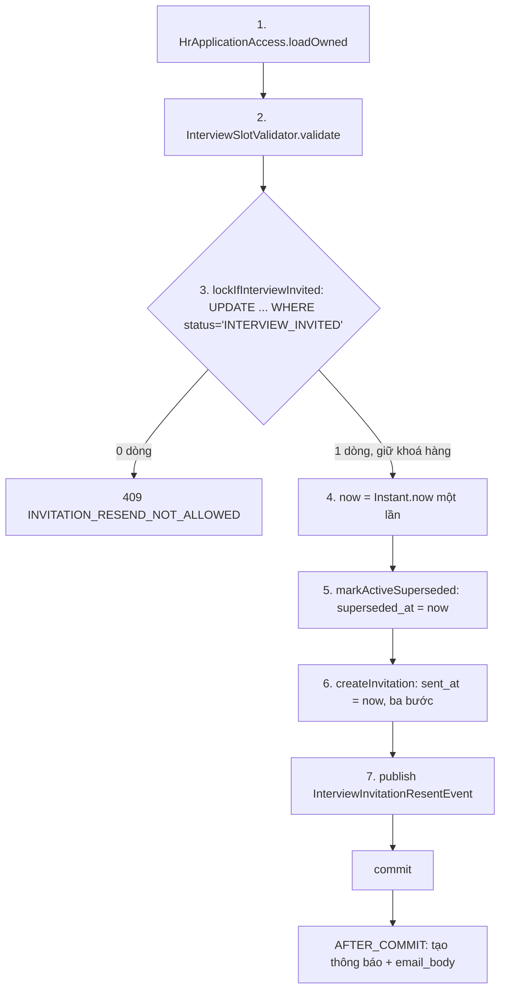

# Walkthrough — FR-H12: Giấy mời phỏng vấn nhiều khung giờ (`feat/fr-h12-multi-slot`)

## 1. Mục tiêu

Trước FR này, một giấy mời phỏng vấn chỉ có đúng một thời điểm và một địa điểm, và đã gửi thì không đổi được lịch nếu
không đụng vào trạng thái đơn. FR-H12 cho HR đưa ra **1–5 lựa chọn** trong một giấy mời — mỗi lựa chọn (khung giờ) gồm
thời điểm bắt đầu và địa chỉ hoặc link phòng họp — để ứng viên có lựa chọn và hai bên bớt nhắn qua lại. Giấy mời chỉ có
một khung được coi là đã chốt ngay khi gửi, nên luồng cũ không đổi. Khi đơn đang "Đã mời phỏng vấn", HR **gửi lại
giấy mời** để đổi lịch: giấy mời mới thay giấy mời đang hiệu lực, trạng thái đơn giữ nguyên, giấy mời cũ được giữ nguyên
văn trong lịch sử, ứng viên nhận thông báo web một dòng và email kèm danh sách khung giờ. HR xem mọi giấy mời ở tab mới
"Giấy mời phỏng vấn" của trang hồ sơ đơn; ứng viên xem danh sách khung giờ chỉ đọc ở trang chi tiết đơn. Việc ứng viên
**bấm chọn** một khung là của FR-U10 — FR-H12 chỉ tạo sẵn cột lưu khung đã chốt.

## 2. Các file đã tạo/sửa

**Backend**

| File | Vai trò |
|---|---|
| `db/migration/V16__interview_invitation_slots.sql` | Bảng khung giờ; cột khung chốt, thời điểm chốt, `superseded_at`; partial unique index "một giấy mời hiệu lực"; FK ghép khung chốt; chuyển dữ liệu cũ; bỏ hai cột cũ; thêm `notifications.email_body` |
| `interviewinvitation/InterviewInvitation.java` | Entity giấy mời: bỏ `scheduledAt`/`location`, thêm `confirmedSlotId`, `confirmedAt`, `supersededAt` |
| `interviewinvitation/InterviewInvitationSlot.java` (mới) | Entity khung giờ, `@Immutable`, không setter |
| `interviewinvitation/InterviewInvitationSlotRepository.java` (mới) | Đọc khung theo một hoặc nhiều giấy mời, sắp theo thứ tự |
| `interviewinvitation/InterviewInvitationRepository.java` | `findByApplicationIdAndSupersededAtIsNull` (giấy mời hiệu lực), `markActiveSuperseded` (đánh dấu cũ), `findByApplicationId` |
| `interviewinvitation/InterviewSlotValidator.java` (mới) | Bộ kiểm khung dùng chung cho gửi lần đầu và gửi lại (R-S8) |
| `interviewinvitation/InterviewInvitationService.java` | I1 danh sách, I2 gửi lần đầu, I3 gửi lại, I4 đọc phía ứng viên; ghi giấy mời + khung theo ba bước |
| `interviewinvitation/InterviewInvitationController.java` | Thêm `GET …/interview-invitations` (I1) và `POST …/interview-invitation/resend` (I3) |
| `interviewinvitation/dto/*` | Thân request dạng `slots`; response có danh sách khung; `InterviewInvitationListResponse` mới; preview thêm `maxSlots` |
| `jobapplication/JobApplicationRepository.java` | `lockIfInterviewInvited` — câu `UPDATE` có điều kiện để khoá hàng đơn |
| `common/exception/InvitationResendNotAllowedException.java` (mới), `InvalidInterviewScheduleException.java`, `GlobalExceptionHandler.java` | 409 gửi lại sai trạng thái; câu lỗi theo từng khung; 409 khi vi phạm `uq_invitation_active` |
| `notification/InterviewInvitationResentEvent.java` (mới) | Sự kiện gửi lại, mang danh sách khung vừa lưu |
| `notification/NotificationContentBuilder.java`, `NotificationEventListener.java`, `NotificationMailOrchestrator.java`, `Notification.java`, `NotificationType.java` | Loại thông báo mới; dựng `body` một dòng + `email_body`; email ưu tiên `email_body` |
| `aicontext/ConversationContextAssembler.java`, `ConversationContext.java` | K1 lấy lịch từ khung chốt của giấy mời hiệu lực |
| `messagedraft/MessageDraftFacade.java` | Điều kiện ba tình huống soạn nháp tính từ giấy mời hiệu lực (hai cờ) |
| `jobapplication/ApplicationStatusController.java` | Chỉ sửa comment nghĩa "Đã mời phỏng vấn" (D4) |

**Frontend**

| File | Vai trò |
|---|---|
| `features/interviewinvitation/InterviewInvitationDialog.tsx` | Hộp thoại chung, `mode='invite'` (mặc định) hoặc `'resend'` |
| `features/interviewinvitation/InterviewSlotFields.tsx` (mới) | Nhập danh sách khung (`useFieldArray`), thêm/xoá, lỗi từng khung, focus, `aria-live` |
| `features/interviewinvitation/InterviewSlotList.tsx` (mới) | Danh sách khung chỉ đọc, kiểu HR và kiểu ứng viên |
| `features/interviewinvitation/ConfirmedSlotMark.tsx`, `PreviousInvitationCard.tsx`, `invitationLabels.ts` (mới) | Dấu "Đã chốt"; thẻ giấy mời cũ; chuỗi cố định + định dạng giờ Việt Nam |
| `features/applicationDetail/InterviewInvitationTab.tsx` (mới) | Tab "Giấy mời phỏng vấn" ở trang hồ sơ đơn |
| `features/interviewinvitation/InterviewInvitationDetails.tsx` | Khối giấy mời phía ứng viên |
| `features/interviewinvitation/types.ts`, `api.ts`, `queries.ts`; `applicationDetail/queries.ts`; `pages/HrApplicationDetailPage.tsx`; `notifications/types.ts` | Kiểu, API, hook I1/I3; chèn tab; loại thông báo mới |

**Seed:** `db/seed/seed-test.sql` (giấy mời + khung tiền tố `f0`, giấy mời A9 ba khung chưa chốt, thông báo gửi lại
`ec…17`, câu mẫu giấy mời theo L14), `reset-test-data.sql`, `reset-demo-db.sql`, `db/seed/README.md`.

## 3. Luồng chính

### 3.1 Gửi lần đầu (I2) — `POST /api/hr/applications/{id}/interview-invitation`

1. `InterviewInvitationController.send` nhận thân `{slots[], subject, content}`; Bean Validation chỉ kiểm `subject`,
   `content`.
2. `InterviewInvitationService.sendInvitation`: kiểm quyền (giữ cách cũ) → đòi mẫu giấy mời tồn tại →
   `InterviewSlotValidator.validate` (cắt giây, kiểm tương lai, trùng phút, địa điểm) → `ApplicationStatusService.changeStatus`
   sang `INTERVIEW_INVITED` (ghi lịch sử, phát sự kiện đổi trạng thái như cũ).
3. `createInvitation` ghi ba bước: `saveAndFlush` giấy mời (chưa có khung chốt) → `saveAllAndFlush` các khung → nếu chỉ
   một khung thì đặt khung chốt + `confirmedAt = sentAt` rồi `flush` (câu `UPDATE`). Bảng: `job_applications`,
   `application_status_history`, `interview_invitations`, `interview_invitation_slots`.
4. Sau commit, listener cũ tạo thông báo đổi trạng thái (không có thông báo mới).

### 3.2 Gửi lại (I3) — `POST …/interview-invitation/resend`

Không gọi `changeStatus`, không ghi lịch sử trạng thái. Sau commit,
`NotificationEventListener.onInterviewInvitationResent` gọi `NotificationContentBuilder.forInvitationResent` từ danh sách
khung **trong sự kiện**, ghi một dòng `notifications` cho ứng viên. Poller email (`NotificationMailOrchestrator.mailText`)
gửi nguyên văn `email_body`.

### 3.3 Đọc giấy mời

- **I1 (HR):** `listInvitations` → kiểm quyền → mọi giấy mời của đơn, sắp hiệu lực trước rồi `superseded_at` giảm dần →
  một truy vấn lấy khung của tất cả giấy mời → `InterviewInvitationListResponse` kèm `maxSlots`.
- **I4 (ứng viên):** `getActiveInvitationForCandidate` → kiểm đơn của chính ứng viên (403 nếu không) →
  `findByApplicationIdAndSupersededAtIsNull` → khung có `id` và cờ `confirmed`. Không có → 404.
- **K1/C07:** `ConversationContextAssembler.forConversation` đọc khung chốt của giấy mời hiệu lực làm `InterviewSchedule`;
  `MessageDraftFacade.invitationState` tính hai cờ (có giấy mời hiệu lực / đã chốt).

### 3.4 Giao diện

Trang `/hr/applications/:id`: tab "Giấy mời phỏng vấn" gọi I1 khi mở; nút "Gửi lại giấy mời" (chỉ khi đơn
`INTERVIEW_INVITED`) mở `InterviewInvitationDialog` chế độ `resend`, điền sẵn tiêu đề/nội dung từ giấy mời hiệu lực, không
gọi preview. Nút "Mời phỏng vấn" ở thanh thao tác (không sửa) mở cùng hộp thoại chế độ `invite`. Trang ứng viên dùng
`InterviewSlotList` kiểu `candidate`.

## 4. Quyết định thiết kế

**Giấy mời hiệu lực = `superseded_at IS NULL`, không chọn theo `created_at`.**
- Đã chọn: cột `superseded_at` + partial unique index `uq_invitation_active (application_id) WHERE superseded_at IS NULL`;
  mọi chỗ cần "giấy mời hiện tại" (I4, K1, soạn nháp) dùng `findByApplicationIdAndSupersededAtIsNull`.
- Khác: lấy dòng `created_at` mới nhất như trước FR này.
- Vì sao: `now()` của Postgres theo transaction (CLAUDE.md §3c) — hai giấy mời trong cùng transaction cùng `created_at`,
  thứ tự không xác định; và "hiện tại" phải là một sự thật lưu ở DB, có chốt chặn DB (CLAUDE.md §4), không phải suy luận
  từ thời gian. Test chứng minh: `InterviewInvitationCandidateControllerIntegrationTest.t13_afterResend_returnsNewActiveInvitation_evenIfOldHasLaterCreatedAt`,
  `ConversationContextAssemblerIntegrationTest.forConversation_usesConfirmedSlotOfActiveInvitation_ignoresOldInvitation`
  (cố ý cho giấy mời cũ `created_at` muộn hơn). Hai test này bảo vệ quyết định — không xoá khi refactor.

**Khoá hàng đơn bằng `UPDATE … SET status = status` có điều kiện, chạy trước mọi thao tác trên giấy mời (R-G3, R-G4).**
- Đã chọn: `JobApplicationRepository.lockIfInterviewInvited` — một câu vừa kiểm trạng thái vừa giữ khoá hàng tới hết
  transaction; 0 dòng → 409.
- Khác: (a) `findById` rồi kiểm trạng thái — không khoá, gửi lại có thể tạo giấy mời sau khi đơn đã có kết quả cuối;
  (b) `SELECT … FOR SHARE`/`@Lock` — chưa có tiền lệ trong dự án, giữ khoá chia sẻ không chặn `UPDATE` cùng loại (Q2);
  (c) đọc giấy mời hiệu lực rồi mới khoá — hai lần gửi lại đồng thời đánh dấu cùng bản cũ, lượt sau vi phạm
  `uq_invitation_active`.
- Vì sao: Postgres bắt mọi `UPDATE` khác trên cùng hàng phải chờ rồi **đánh giá lại** `WHERE` trên bản đã commit. Tuần tự
  hoá với ba đường đổi trạng thái:

  | Đường kia | Gửi lại khoá trước | Đường kia commit trước |
  |---|---|---|
  | Trúng tuyển/Từ chối (`updateStatusIfCurrent`) | Chờ; sau đó vẫn thấy `INTERVIEW_INVITED` → ghi kết quả | Khoá đánh giá lại → 0 dòng → 409 |
  | Rút đơn (`save` entity) | Chờ rồi ghi `WITHDRAWN` (hợp lệ) | 0 dòng → 409 |
  | Gửi lại khác | Chờ; câu đánh dấu chạy sau nên thấy giấy mời vừa tạo → cả hai 201 | — |

  Hệ quả phụ chấp nhận: trigger đổi `updated_at` của đơn (tiền lệ FR-U09 Q19). Test: `InterviewInvitationResendConcurrencyIntegrationTest`
  — (a) hai lần gửi lại song song, (b)/(c) 10 vòng song song với Trúng tuyển/Rút đơn, (d) đơn luồng chắc chắn: A giữ khoá,
  `updateStatusIfCurrent` của B bị chặn quá 500 ms rồi mới xong khi A commit.

**`notifications.email_body` thay cho đọc giấy mời qua `entity_id` lúc gửi email (S1).**
- Đã chọn: listener dựng `email_body` **một lần** từ khung trong sự kiện; poller gửi nguyên văn; API thông báo không trả
  cột này.
- Khác: poller đọc lại bảng giấy mời theo `entity_id` lúc gửi.
- Vì sao: tránh gói `notification/` phụ thuộc ngược `interviewinvitation/` (kiểm tĩnh 7.1 lệnh 4); email đã gửi được lưu
  nguyên văn, không đổi theo lần gửi lại sau; loại cũ ghi `NULL` nên email cũ không đổi (T21 b, c). FR-U10 dùng lại được.

**Khung giờ lưu tách khỏi thư (R-C1, M3).**
- Đã chọn: bảng `interview_invitation_slots`, hiển thị riêng; `rendered_content` vẫn là thư HR sửa, lưu nguyên văn; mẫu
  FR-H02 không thêm placeholder ngày giờ. Seed: câu mẫu đổi thành "theo một trong các khung giờ phỏng vấn được gửi kèm"
  (L14).
- Khác: chèn danh sách khung vào thư khi render (README cũ ghi vậy).
- Vì sao: thư là nội dung tự do HR sửa — chèn khung vào thư thì không còn dữ liệu có cấu trúc để FR-U10 chọn, K1 đọc,
  email liệt kê; và vi phạm ranh giới "mẫu không có ngày giờ" của FR-H02 (`InterviewTemplateOwnerIntegrationTest`).

**Thay đổi hành vi FR-C07 (đã hoàn thành) — R-K1x, R-K2x.**
- Đã chọn: `InterviewSchedule` = khung **đã chốt** của giấy mời hiệu lực, chưa chốt → `null` (record giữ nguyên hình dạng,
  `ConversationContextSignatureTest` không sửa). "Nhắc lịch phỏng vấn" đòi khung đã chốt; "Xin dời lịch" chỉ cần giấy mời
  hiệu lực; không thêm mã lý do mới (Q3).
- Khác: lấy khung sớm nhất khi chưa chốt; thêm mã lý do `INTERVIEW_SLOT_NOT_CONFIRMED`.
- Vì sao: khung sớm nhất chưa chắc là lịch thật — AI sẽ nhắc sai giờ; thêm mã lý do kéo theo sửa enum, `types.ts`,
  `draftLabels.ts` của C07. Đánh đổi: câu hiển thị của `NO_ACTIVE_INTERVIEW` không nêu đúng lý do "chưa chốt". Test:
  `MessageDraftScenarioIntegrationTest.unconfirmedActiveInvitation_reminderUnavailable_rescheduleAndThankAvailable`,
  `MessageDraftPromptIntegrationTest.t19_unconfirmedActiveInvitation_rescheduleSaysNoSchedule_noSlotInPrompt`.

**Ghi giấy mời và khung theo ba bước; khung chốt là cột UUID thường (L2).**
- Đã chọn: giấy mời `saveAndFlush` (chưa có khung chốt) → khung `saveAllAndFlush` → đặt khung chốt + `flush`.
- Khác: `@ManyToOne` tới khung; đặt khung chốt trước khi khung được INSERT.
- Vì sao: FK ghép `fk_invitation_confirmed_slot (id, confirmed_slot_id)` không `DEFERRABLE`; Hibernate hoãn INSERT giấy
  mời tới lúc flush và mang theo giá trị lúc đó → vi phạm FK nếu đặt sớm.

**Kiểm khung ở service, không bằng Bean Validation (R-S8).** Lỗi trả một câu nêu đúng số khung ("Khung giờ 3: …"),
cùng mã `INVALID_INTERVIEW_SCHEDULE` đã có; `@NotEmpty`/`@NotBlank` sẽ trả map tên trường. Giây bị cắt **trước** khi
kiểm, để test cũ của FR-H07 gửi `Instant.now().plus(…)` vẫn hợp lệ (Q1).

## 5. Ràng buộc đã thực thi

| Mã | Ràng buộc | Thực thi ở đâu |
|---|---|---|
| R-S1–R-S8 | 1–5 khung, tương lai, không trùng phút, địa điểm bắt buộc ≤ 500 một dòng, câu lỗi theo khung | `InterviewSlotValidator.validate`; DB `uq_invitation_slot_time`, CHECK `display_order` 1–5 |
| R-K1, R-K2, R-K3 | Một khung = chốt ngay; khung chốt thuộc đúng giấy mời; chốt đi cặp | `InterviewInvitationService.createInvitation`; FK ghép `fk_invitation_confirmed_slot`; CHECK `chk_invitation_confirmed_pair` |
| R-C1, R-C2 | Thư lưu nguyên văn; khung bất biến; không sửa/xoá | `InterviewInvitationSlot` `@Immutable`; không có PUT/PATCH/DELETE (T17) |
| R-F1–R-F4 | Gửi lần đầu giữ luồng cũ; một giấy mời hiệu lực | `sendInvitation`; `uq_invitation_active` → 409 ở `GlobalExceptionHandler` |
| R-G1–R-G6 | Gửi lại chỉ khi `INTERVIEW_INVITED`, không đổi trạng thái, thứ tự 7 bước | `resendInvitation`; `JobApplicationRepository.lockIfInterviewInvited`; `InterviewInvitationRepository.markActiveSuperseded` |
| R-A1–R-A4 | Hiệu lực theo `superseded_at`; I1 đủ giấy mời; I4 chỉ hiệu lực; quyền HR 403 | `listInvitations`, `getActiveInvitationForCandidate`, `HrApplicationAccess.loadOwned` |
| R-N1–R-N5 | Thông báo ứng viên, web một dòng, email kèm khung giờ Việt Nam, không lộ API | `NotificationEventListener.onInterviewInvitationResent`, `NotificationContentBuilder.forInvitationResent`, `NotificationMailOrchestrator.mailText`; `NotificationResponse` không có `emailBody` |
| R-K1x, R-K2x | K1/C07 dùng khung chốt của giấy mời hiệu lực | `ConversationContextAssembler.forConversation`, `MessageDraftFacade.unavailableReason` |
| CLAUDE.md §2, §8 | Không phán quyết; không xanh/đỏ | Dấu "Đã chốt" dùng cặp màu badge trung tính + chữ + icon (`ConfirmedSlotMark`) |
| SRS nguyên tắc bổ sung | Phía ứng viên không nhận dữ liệu nội bộ | `CandidateInterviewInvitationResponse` không có id giấy mời, `sentBy`, `supersededAt`, giấy mời cũ |

## 6. Đã kiểm thử gì

**Tự động.** Full suite backend `.\mvnw.cmd test`: **1228 test, 0 lỗi**. FR-H12 thêm 5 lớp test mới
(`InterviewInvitationSlotMigrationTest`, `InterviewInvitationSchemaConstraintIntegrationTest`,
`InterviewInvitationResendIntegrationTest`, `InterviewInvitationResendConcurrencyIntegrationTest`,
`NotificationContentBuilderTest`) và sửa/thêm ca ở 12 lớp có sẵn (gồm lớp hỗ trợ `MessageDraftIntegrationTestSupport`). Frontend: `npm run build` + `npm run lint` sạch.
Kiểm tĩnh 7.1 (7 lệnh, theo L10, L12) và 7.3 đều đúng kỳ vọng. Seed: `reset-test-data.sql` + `seed-test.sql` và
`reset-demo-db.sql` + hai tầng demo + seed test chạy không lỗi, số đếm khớp mục 4.5.

**Kiểm HTTP mục 7.2 (PowerShell 5.1, backend thật, 14/10/2026).** Bảy nhóm khớp "Mong đợi": I1 A2 200 (hiệu lực + 1 cũ);
gửi lại 201 rồi đọc lại I1 có "Phòng họp Hồ Gươm, tầng 5" → True (L13); 409 `INVITATION_RESEND_NOT_ALLOWED`; ba 400
đúng ba câu; 403/403/403/401; ứng viên 200 hai khung có `id`, chưa chốt; gửi lần đầu 201.

**Soát tay mục 7.4.** Người dùng đã soát tay toàn bộ bảng 7.4 (desktop, 768px, 375px) ngày 14/10/2026: đạt toàn bộ.

| "Xong khi" (REQUIREMENT mục 7) | Cách nghiệm thu | Kết quả |
|---|---|---|
| T1 | `InterviewInvitationControllerIntegrationTest.t1_…` (DB) + `InterviewInvitationResendIntegrationTest.t1_…` (thông báo) | Đạt |
| T2, T3, T4, T6, T7, T8, T9, T11, T12, T17 | `InterviewInvitationControllerIntegrationTest` (ca `t2_…`–`t17_…`, test cũ `send_*` đổi thân request); T11 thêm ở `HrApplicationCrossEndpointAccessIntegrationTest` | Đạt |
| T5; phần "không thông báo" của T7, T8 | `InterviewInvitationResendIntegrationTest` (lớp không `@Transactional`) | Đạt |
| T10 (a)–(d) | `InterviewInvitationResendConcurrencyIntegrationTest` | Đạt |
| T13 | `InterviewInvitationCandidateControllerIntegrationTest` (đổi tên theo L5, hai ca `t13_…`) | Đạt |
| T14 | `InterviewInvitationSlotMigrationTest` | Đạt |
| T15, T16 | `InterviewInvitationSchemaConstraintIntegrationTest` | Đạt |
| T18 | `ConversationContextAssemblerIntegrationTest` (hai ca mới); `ConversationContextSignatureTest` không sửa | Đạt |
| T19 | `MessageDraftScenarioIntegrationTest`, `MessageDraftPromptIntegrationTest` | Đạt |
| T20 | `NotificationContentBuilderTest` | Đạt |
| T21 | (a) `NotificationMailOrchestratorIntegrationTest.processOne_emailBodyPresent_…`; (b), (c) hai test có sẵn | Đạt |
| T22 | `NotificationEventListenerIntegrationTest.conversationRead_marksNewMessageOnly_…` | Đạt |
| Kiểm tĩnh 7.1, 7.3 | Lệnh tìm ở đợt 7 phần A | Đạt |
| 7.2 | Khối PowerShell (sau L13) | Đạt |
| 7.4 | Soát tay của người dùng | Đạt |

**Chưa test.** Frontend không có test tự động (focus khi thêm/xoá khung, `aria-live`, focus về tiêu đề sau gửi lại chỉ
soát tay). T10(b)(c) chỉ kiểm tập kết quả hợp lệ, không ép được thứ tự chạy; phần "khoá thật sự chặn" dựa vào T10(d).
Email thật qua MailHog chỉ soát tay (7.4), không có test đọc MailHog. Không kiểm múi giờ trình duyệt khác Việt Nam.

## 7. Nợ kỹ thuật

- Email mời **lần đầu** vẫn chỉ là câu đổi trạng thái, không kèm giờ (M6) — chỉ email gửi lại kèm khung.
- HR nhập giờ theo múi giờ trình duyệt, mọi nơi hiển thị theo giờ Việt Nam (B2) — lệch nếu máy HR khác múi.
- Địa điểm dạng link hiện chữ thường, không bấm được (B4).
- Danh sách bảng của `reset-demo-db.sql` thiếu bảng V13–V15 — không gây lỗi nhờ `TRUNCATE … CASCADE` (L1).
- Câu `NO_ACTIVE_INTERVIEW` của C07 không nêu đúng lý do khi giấy mời chưa chốt (Q3, chấp nhận).
- Kiểm phiên bản Flyway trên DB phải dùng `ORDER BY installed_rank DESC LIMIT 1`; `max(version)` so chuỗi (DB ở V16 trả
  `9`).
- `sentAt` trong response I2/I3 có độ chính xác nano giây (giá trị Java trước khi lưu), đọc lại qua I1/I4 chỉ còn micro
  giây (Postgres). Trong DB, `superseded_at` cũ và `sent_at` mới vẫn bằng nhau.

## 8. Lệch so với đặc tả

Mọi chỗ lệch dưới đây đã ghi vào mục 12 REQUIREMENT.md và được duyệt.

| Chỗ lệch | Duyệt |
|---|---|
| L1–L8: làm rõ sau Plan Mode (lý do sửa `reset-demo-db.sql`; ghi ba bước; `@Immutable` không `@Generated`; T3, T13, T21; đợt 2 không đổi API; lớp riêng cho T10) | 13/10/2026 |
| L9: kiểm xuống dòng trên giá trị đã bỏ khoảng trắng (`"Tầng 3\n"` lưu `"Tầng 3"`) | 14/10/2026 |
| L10: lệnh kiểm tĩnh `FOR SHARE…` thu phạm vi (comment có sẵn của FR-U09) | 14/10/2026 |
| L11: bước 2 của I3 dùng mốc `now` riêng; kỳ vọng tạm 3 dòng của lệnh `findBy…CreatedAtDesc` ở đợt 3 | 14/10/2026 |
| L12: lệnh `findBy…CreatedAtDesc` loại gói `scoring/` (method trùng tên) | 14/10/2026 |
| L13: khối 7.2 dùng địa điểm "Phòng họp Hồ Gươm, tầng 5" (chuỗi cũ đã có trong seed) | 14/10/2026 |
| L14: câu mẫu giấy mời trong seed test theo R-C1; giấy mời đã gửi giữ nguyên | 14/10/2026 |
| Không thuộc L: test `@Transactional` ghi bằng JDBC rồi gọi API phải `flush` trước, `clear` sau (T13 đợt 3) — chỉ cách viết test | Xác nhận trong báo cáo đợt 3 (14/10/2026) |
