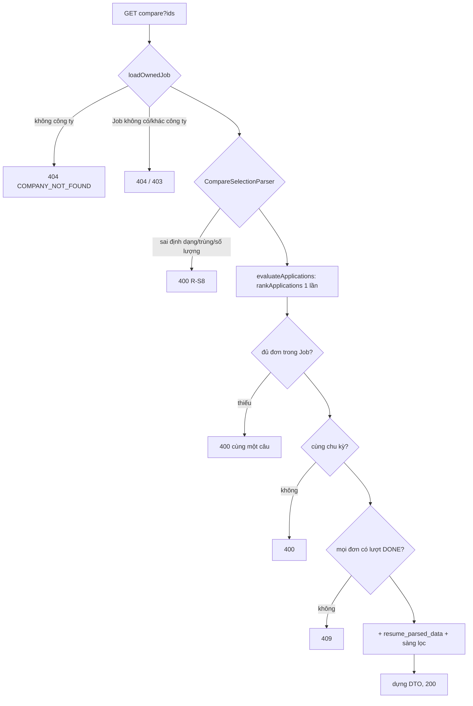

# Walkthrough — `feat/fr-h14-compare` (FR-H14 · So sánh 2–3 ứng viên)

Đặc tả: `docs/features/HR/H14/REQUIREMENT.md`, `UI.md` (duyệt 15/10/2026, duyệt lại 16/10/2026 sau Plan Mode; hoàn thành
16/10/2026). Không có chỗ lệch nào chưa được duyệt lại — xem mục 8.

## 1. Mục tiêu

HR đang xem danh sách ứng viên đã xếp hạng của một tin tuyển dụng muốn đặt hai hoặc ba người cạnh nhau để đối chiếu
trước khi quyết định mời ai phỏng vấn. FR-H14 cho HR tick 2–3 đơn ở tab "Ứng viên", bấm "So sánh" và xem một bảng cột song
song: tổng điểm và hạng (FR-H05), điểm từng tiêu chí kèm lý giải và trích dẫn CV (FR-H04), kinh nghiệm, kỹ năng, học vấn
(FR-C04/C05), tóm tắt điểm mạnh/yếu (FR-H06), câu trả lời sàng lọc (FR-H10/U09). Bảng **chỉ đọc**: không gọi AI, không chấm
lại, không lưu gì, và không bao giờ gợi ý "ai tốt hơn". Từ mỗi cột HR mở hồ sơ đơn hoặc mời phỏng vấn bằng đúng hộp thoại
có sẵn — quyết định vẫn bấm trên từng đơn.

## 2. Các file đã tạo/sửa

**Backend**

| File | Vai trò |
|---|---|
| `comparison/ApplicationComparisonController.java` | Endpoint C1 `GET /api/hr/jobs/{jobId}/applications/compare?ids=…`, nhận `ids` dạng chuỗi thô |
| `comparison/ApplicationComparisonService.java` | Method `compare` — **nơi duy nhất** dựng DTO bảng so sánh: kiểm lựa chọn, ghép hàng tiêu chí/sàng lọc, tính cờ `valuesDiffer` |
| `comparison/CompareSelectionParser.java` | Tách và kiểm chuỗi `ids` (định dạng → trùng → số lượng 2–3) |
| `comparison/dto/ApplicationComparisonResponse.java` | DTO duy nhất của bảng (các record con `Column`, `Row`, `IntRow`, `CriterionRow`, `ExperienceRow`, `ProfileCell`, `ExplanationCell`, `Screening`…) |
| `jobapplication/ApplicationOwnerService.java` (sửa) | `loadOwnedJob` thành `public`; thêm `evaluateApplications`; `RankableRow` mang thêm `resumeId`, `recruitmentCycle`, `screeningCapturedAt`, tiêu chí snapshot |
| `jobapplication/ApplicationComparisonSource.java` | Record nguồn dữ liệu một đơn cho C1 (tách riêng, không đụng `ApplicationEvaluation` của FR-H09) |
| `jobapplication/dto/ApplicationHrListItemResponse.java` (sửa) | Thêm `recruitmentCycle` cho danh sách theo Job (để tab "Ứng viên" khoá ô khác chu kỳ) |
| `resume/ResumeParsedDataRepository.java` (sửa) | `findByResumeIdIn` — một câu cho mọi CV được chọn |
| `screening/ApplicationScreeningAnswerRepository.java`, `ApplicationScreeningReader.java` (sửa), `ScreeningAnswerSnapshot.java` (mới) | `readMany` đọc bản chụp sàng lọc của nhiều đơn bằng một câu, giữ `questionId` để ghép hàng |
| `common/exception/InvalidCompareSelectionException.java`, `CompareApplicationNotScoredException.java`, `GlobalExceptionHandler.java` (sửa) | 400 `INVALID_COMPARE_SELECTION` (5 câu cố định), 409 `COMPARE_APPLICATION_NOT_SCORED` |

**Frontend**

| File | Vai trò |
|---|---|
| `features/scoring/ApplicationsTab.tsx` (sửa) | Cột "Chọn", thanh chọn "Đã chọn n/3 · Bỏ chọn · So sánh", lý do khoá ô, điều hướng sang trang so sánh |
| `pages/HrJobComparePage.tsx`, `App.tsx` (sửa) | Route `/hr/jobs/:id/compare`; đầu trang, "Tải lại", trạng thái lỗi; chọn bố cục theo `matchMedia`; giữ trạng thái mở rộng theo khoá hàng |
| `features/comparison/{api,queries,types,compareLimits,comparisonLabels}.ts` | Gọi C1, khoá query, kiểu dữ liệu, hằng `MAX_COMPARE`/`MIN_COMPARE`, mọi chuỗi giao diện |
| `features/comparison/ComparisonTable.tsx` | Bố cục bảng `<table>` thuần (≥ md) |
| `features/comparison/ComparisonStacked.tsx` | Bố cục theo hàng `<section>` + `<dl>` (< md, 375px) |
| `features/comparison/ComparisonColumnHeader.tsx` | Đầu cột: tên, badge, ngày, "Mở hồ sơ", "Mời phỏng vấn" (dùng `InterviewInvitationDialog` có sẵn) |
| `features/comparison/CriterionCompareCell.tsx`, `DiffMark.tsx` | Ô tiêu chí (điểm, trọng số, vùng mở rộng); chip chữ "Khác nhau" |
| `features/scoring/EvidenceQuoteList.tsx` (mới), `CriterionScoreBreakdown.tsx` (sửa) | Tách khối trích dẫn evidence thành component dùng chung; trang hồ sơ đơn render y hệt trước |

## 3. Luồng chính

### Luồng A — chọn đơn ở tab "Ứng viên"

1. `ApplicationsTab` đã có sẵn danh sách `GET /api/hr/jobs/{id}/applications` (FR-H05). Mỗi dòng nay có `recruitmentCycle`.
2. HR tick ô chọn. State `selectedIds` lưu **theo thứ tự tick**, nằm ở `ApplicationsTab` nên đổi kiểu sắp xếp hay polling
   không làm mất lựa chọn. Hàm `selectionBlockReason` khoá ô theo thứ tự: chưa có lượt chấm xong → khác chu kỳ với đơn chọn
   đầu → đã đủ `MAX_COMPARE`. Đây chỉ là báo sớm; backend vẫn kiểm lại tất cả.
3. Bấm "So sánh" → `navigate('/hr/jobs/{jobId}/compare?ids=a,b[,c]')`. Không gọi API nào ở bước này.

### Luồng B — tải bảng so sánh (C1)

1. `HrJobComparePage` đọc `ids` **nguyên văn** từ URL (không bỏ trùng, không sắp) và gọi `useApplicationComparisonQuery`
   → `GET /api/hr/jobs/{jobId}/applications/compare?ids=…`. Không polling; 4xx không thử lại.
2. Spring Security chặn theo vai trò HR (`/api/hr/**`); `ApplicationComparisonController` lấy `ownerId` từ JWT và gọi
   `ApplicationComparisonService.compare(ownerId, jobId, idsParam)`.
3. `compare` kiểm theo đúng thứ tự R-S7, lỗi đầu tiên gặp được trả về:
   - `ApplicationOwnerService.loadOwnedJob` — đọc `companies` theo chủ, `jobs` theo id (2 câu SQL). Chưa có công ty →
     404 `COMPANY_NOT_FOUND`; Job không tồn tại → 404; Job công ty khác → 403.
   - `CompareSelectionParser.parse` — tách chuỗi, sai định dạng → trùng → số lượng (400, R-S2/R-S1).
   - `ApplicationOwnerService.evaluateApplications(job, ids)` — gọi `rankApplications(job)` **một lần** (9 câu: đơn của Job,
     CV, người dùng, lượt mới nhất, lượt DONE mới nhất, các `scoring_runs` DONE, `criterion_scores`, `score_explanations`,
     lần thử giải thích), rồi lọc ra các đơn được chọn thành `Map<UUID, ApplicationComparisonSource>`.
   - Thiếu đơn nào trong map (không tồn tại, Job khác, công ty khác) → **cùng một câu** "Có đơn không thuộc tin tuyển dụng
     này." (R-S3). Khác `recruitment_cycle` → 400 (R-S4). Đơn chưa có lượt DONE → 409 (R-S5).
4. Đọc thêm 2 câu: `resume_parsed_data` theo danh sách `resume_id` (`findByResumeIdIn`) và bản chụp
   `application_screening_answers` của các đơn (`ApplicationScreeningReader.readMany`). `screening_captured_at` lấy từ entity
   đã nạp ở bước 3. Tổng **13 câu SQL cố định**.
5. Dựng DTO:
   - `toColumn`: tên, trạng thái, ngày nộp, id và `finished_at` của lượt DONE; `newerRunInProgress` = lượt mới nhất đang
     `PENDING`/`RUNNING`.
   - `buildCriterionRows`: ghép tiêu chí của các cột theo `criterionId` trong `rubric_snapshot`, ô thiếu là `null`, cờ
     `rubricVersionsDiffer`, cờ `valuesDiffer` so `score`.
   - Tổng điểm/hạng: lấy nguyên từ `rankApplications`; `decimalsDiffer`/`valuesDiffer` tính cờ hàng.
   - Hồ sơ CV: kinh nghiệm qua `ExperienceCalculator.toYears`, kỹ năng/học vấn nguyên văn (không `gpa`).
   - Giải thích: `summary`, `strengths`, `weaknesses` hoặc trạng thái `PENDING`/`FAILED` (không `metCriteria`).
   - `buildScreening`: ghép hàng câu hỏi theo `questionId` + nội dung bản chụp.
6. Frontend nhận JSON, chọn `ComparisonTable` (≥ md) hoặc `ComparisonStacked` (< md). Hàng có `valuesDiffer = true` được
   tô nền trung tính cả hàng và có chip "Khác nhau". Nút "Lý giải và trích dẫn" mở mọi ô của hàng cùng lúc, evidence hiện
   qua `EvidenceQuoteList`.

### Luồng C — mời phỏng vấn từ cột

`ComparisonColumnHeader` chỉ hiện nút khi `status = PENDING`, mở `InterviewInvitationDialog` (FR-H07/H12, không sửa) với
`invalidateQueryKeys = comparisonInvalidateKeys(jobId, id)` — gồm khoá C1 của Job và `applicationDetailInvalidateKeys`
(danh sách theo Job, trang hồ sơ đơn). Gửi thành công → C1 tải lại, badge đổi, nút biến mất, focus về tên ứng viên của cột.

## 4. Quyết định thiết kế

**4.1 Một DTO, một method dựng — điểm che duy nhất cho FR-H16.**
Đã chọn: mọi dữ liệu bảng (tên, evidence, lý giải, giải thích, kỹ năng, học vấn, câu trả lời sàng lọc) đi qua đúng
`ApplicationComparisonService.compare` và `ApplicationComparisonResponse`; frontend không gọi endpoint nào khác (R-B1).
Lựa chọn khác: trang so sánh gọi lại E1–E5 của trang hồ sơ đơn cho từng cột rồi ghép ở frontend.
Vì sao: FR-H16 (ẩn danh) phải che tên và thông tin nhân thân; nếu dữ liệu đến từ nhiều endpoint thì phải che ở nhiều nơi
và dễ sót. Một method dựng nghĩa là H16 chỉ cần sửa một chỗ — REQUIREMENT R-B3 đã liệt kê sẵn từng field H16 phải xử lý.
Kiểm tĩnh 7.3 (`rg` các endpoint ngoài C1 trong `features/comparison`) giữ ràng buộc này.

**4.2 Hạng dùng chung `rankApplications`, gọi đúng một lần, không xếp hạng lại trong nhóm.**
Đã chọn: thêm `ApplicationOwnerService.evaluateApplications(job, ids)` gọi `rankApplications(job)` một lần rồi lọc; hạng
hiển thị là hạng toàn Job, có chú thích "không phải hạng trong nhóm đang so sánh" `[Q2]`.
Lựa chọn khác: tính hạng 1–3 trong nhóm được chọn; hoặc viết truy vấn hạng riêng cho C1.
Vì sao: một công thức hạng duy nhất (FR-H05) — hạng ở bảng so sánh phải trùng hạng ở danh sách, nếu không HR thấy hai con
số khác nhau cho cùng một đơn. Test `t12_rankEqualsListRank_notRecomputedWithinGroup`
(`ApplicationComparisonControllerIntegrationTest`) gọi **cả** C1 và danh sách theo Job rồi so từng giá trị — test này bảo vệ
ràng buộc liên nhánh với FR-H05: ai sửa công thức hạng ở một nơi mà không sửa nơi kia sẽ làm nó đỏ, **không được xoá** khi
refactor. Record nguồn `ApplicationComparisonSource` tách riêng thay vì thêm field vào `ApplicationEvaluation` để JSON của
trang hồ sơ đơn (E3/E4, FR-H09) không đổi một ký tự.

**4.3 Ghép tiêu chí theo `criterionId` của `rubric_snapshot`.**
Đã chọn: khoá ghép = `criterionId` trong snapshot của lượt DONE của từng đơn; snapshot có `criterionId = null` thì khoá dự
phòng `"name:" + tên` (R-C1, R-C2). Tiêu chí thiếu ở một cột → ô `null`, giao diện ghi "Chưa có dữ liệu" kèm lý do (R-C4);
cùng id nhưng khác tên/trọng số → mỗi ô giữ giá trị của cột mình, không quy đổi (R-C5).
Lựa chọn khác: ghép theo vị trí trong rubric; ghép theo `criterion_scores.criterion_id`; ghép theo tên.
Vì sao: thứ tự có thể khác giữa hai snapshot; `criterion_scores.criterion_id` có thể `NULL` (`ON DELETE SET NULL`); tên có
thể bị sửa. Snapshot giữ đúng rubric lúc chấm — đọc trọng số từ `rubric_criteria` hiện tại sẽ làm sai lịch sử (FR-H08).
Rubric demo đang mở khoá nên hai đơn cùng Job thật sự có thể được chấm theo hai phiên bản (a13) — ghép an toàn là bắt buộc.

**4.4 Ghép sàng lọc theo `questionId` + nội dung bản chụp, không theo `display_order`.**
Đã chọn: một hàng = cùng `questionId` (khác null) **và** cùng loại, câu chữ, phương án (record `QuestionKey`); khác nội dung
hoặc `questionId` null → hàng riêng (`UnlinkedQuestionKey`). Đơn chưa ghi nhận/không có câu hỏi hiện câu trạng thái của
FR-H10/U09.
Lựa chọn khác: ghép theo thứ tự hiển thị; chỉ theo `questionId`.
Vì sao: HR có thể sửa hoặc đổi thứ tự câu hỏi giữa hai lần nộp; ghép theo thứ tự hoặc chỉ theo id sẽ đặt câu trả lời của
hai câu hỏi khác nhau vào cùng một hàng — so sánh sai mà nhìn không ra.

**4.5 Khác biệt tô theo HÀNG, cờ do backend tính; không đánh dấu người thắng.**
Đã chọn: backend tính `valuesDiffer` cho tổng điểm, hạng, từng tiêu chí (so `score`), kinh nghiệm (so `months`), câu
`YES_NO`/`SINGLE_CHOICE`; số thập phân so bằng `compareTo` (70.000 = 70.0); ô thiếu là một giá trị riêng. Frontend chỉ đọc
cờ, tô **cả hàng** `bg-m3-surface-container` và đặt chip chữ "Khác nhau" ở tiêu đề hàng.
Lựa chọn khác: tô ô cao nhất/thấp nhất; frontend tự so giá trị; tô màu theo ngưỡng.
Vì sao: tô theo ô hay in đậm giá trị lớn nhất là gợi ý "người thắng" trá hình, trái nguyên tắc HR tự quyết (CLAUDE.md §2,
§8; R-W1, R-W2). Tô cả hàng chỉ nói "ở đây có khác biệt", không nói ai hơn. Không hiện `metCriteria`/`missingCriteria`
(đặt cạnh nhau thành bảng tick đạt/không đạt — R-W4), không hiện `gpa` `[Q10]`. Kiểm tĩnh 7.1/7.3 (`Math.max`, `reduce(`,
`font-bold`, `bg-m3-primary-container`… trong `features/comparison`) giữ ràng buộc này.

**4.6 Không gọi AI, không lưu gì; 13 câu SQL cố định.**
Đã chọn: C1 chỉ đọc kết quả có sẵn; service không `@Transactional`, không `save`; số câu SQL không phụ thuộc số đơn của Job.
Lựa chọn khác: đọc từng đơn theo vòng lặp (N+1); thêm câu native đọc `screening_captured_at`.
Vì sao: không có lý do gọi AI — mọi nội dung AI (lý giải, giải thích) đã được sinh ở FR-H04/H06 và hiện nguyên văn. Đo bằng
`t30_statementCountDoesNotGrowWithApplicationsInJob`: lấy `Statistics.getPrepareStatementCount()` của Hibernate khi Job có
3 đơn và khi Job có 30 đơn → n3 = n30 = 13. Test chạy `@Transactional(propagation = NOT_SUPPORTED)` để request chạy như
production (không chung first-level cache với test), con số đo được là số thật. Plan Mode đã kiểm cả 13 câu đều qua
Hibernate (không có `JdbcTemplate` trên đường C1) nên thống kê đếm đủ.

**4.7 `ids` là chuỗi, tự parse để trả lỗi R-S8.**
Đã chọn: `@RequestParam(name = "ids", required = false) String`, `CompareSelectionParser` tách bằng `split(",", -1)`, bỏ
khoảng trắng, `UUID.fromString`; thứ tự kiểm định dạng → trùng → số lượng.
Lựa chọn khác: `List<UUID>` để Spring tự chuyển kiểu.
Vì sao: Spring sẽ ném lỗi chuyển kiểu mặc định (không phải `ErrorResponse` của dự án), lặng lẽ bỏ phần tử rỗng (`a,,b`), và
không cho phân biệt "trùng" với "sai số lượng". R-S8 cần 5 câu tiếng Việt cố định. R-S3 dùng **một câu** cho cả ba ca
(không tồn tại / Job khác / công ty khác) để không lộ việc một id đơn có tồn tại hay không.

**4.8 Thứ tự cột theo thứ tự tick; mời phỏng vấn dùng nguyên hộp thoại FR-H12.**
Đã chọn: cột = đúng thứ tự `ids` trên URL, frontend không sắp lại (R-O1); không có thao tác đổi chỗ cột. "Mời phỏng vấn" chỉ
khi `PENDING`, mở `InterviewInvitationDialog` có sẵn; không có "Từ chối", "Trúng tuyển", "Gửi lại giấy mời" `[Q9]`.
Lựa chọn khác: sắp cột theo điểm; viết hộp thoại mời riêng cho trang so sánh.
Vì sao: sắp theo điểm đặt người điểm cao ở vị trí đầu — lại là gợi ý người thắng. Hộp thoại dùng lại giữ một luồng gửi giấy
mời nhiều khung giờ duy nhất (FR-H12), mọi lỗi trạng thái (đơn đã đổi ở nơi khác) hiện như ở trang hồ sơ đơn (R-H4). Hộp
thoại không báo "gửi xong" ở chế độ mời, nên cột tự nhận ra khi trạng thái rời `PENDING` sau lần tải lại để đưa focus về tên.

**4.9 Hai bố cục chọn bằng `matchMedia`, trạng thái mở rộng giữ ở trang.**
Đã chọn: `useSyncExternalStore` theo `(min-width: 48rem)`; chỉ một bố cục tồn tại trong DOM; tập hàng đang mở lưu ở
`HrJobComparePage` theo `CriterionRow.key`.
Lựa chọn khác: render cả hai, ẩn/hiện bằng CSS.
Vì sao: render cả hai sinh trùng id `aria-controls` và hai hộp thoại mời; giữ state ở trang làm việc đổi cỡ cửa sổ không
đóng các hàng đang mở (UI.md mục 8).

## 5. Ràng buộc đã thực thi

| Mã | Ràng buộc | Thực thi ở đâu |
|---|---|---|
| FR-H14 R-S1/R-S2 | 2–3 đơn, không trùng, đúng định dạng UUID | `CompareSelectionParser.parse`; `InvalidCompareSelectionException` (factory `malformed`/`duplicate`/`wrongCount`) |
| FR-H14 R-S3 | Đơn phải thuộc Job; một câu cho mọi ca | `ApplicationComparisonService.compare` (so kích thước map), `InvalidCompareSelectionException.notInJob` |
| FR-H14 R-S4/R-S5 | Cùng chu kỳ; đã có lượt DONE | `ApplicationComparisonService.compare`; `CompareApplicationNotScoredException` → 409 |
| CLAUDE.md §4 | Kiểm vai trò **và** quyền sở hữu | `/api/hr/**` (Security) + `ApplicationOwnerService.loadOwnedJob` |
| FR-H05 R-D3 | Một công thức hạng | `ApplicationOwnerService.evaluateApplications` → `rankApplications` |
| FR-H08 | Đọc snapshot, không đọc rubric hiện tại | `ApplicationOwnerService` (`rubricCriteria` từ `getRubricSnapshot()`), `buildCriterionRows` dùng `weightSnapshot` |
| FR-H14 R-C1–R-C6 | Ghép tiêu chí theo `criterionId`, ô thiếu `null`, cờ phiên bản | `ApplicationComparisonService.buildCriterionRows` |
| FR-H14 R-Q1–R-Q5 | Ghép sàng lọc theo `questionId` + nội dung | `ApplicationComparisonService.buildScreening` (`QuestionKey`, `UnlinkedQuestionKey`) |
| FR-H14 R-W1/R-W2 | Không đánh dấu người thắng; tô theo hàng | Backend `valuesDiffer`/`decimalsDiffer`; frontend `rowBackground(diff)` ở `ComparisonTable`/`ComparisonStacked`, `DiffMark` |
| FR-H14 R-W3, CLAUDE.md §7 | Không field `verdict`/`label`/`passed`… | DTO `ApplicationComparisonResponse`; test `FORBIDDEN_KEYS` trong `ApplicationComparisonControllerIntegrationTest` |
| FR-H14 R-W4, `[Q10]` | Không `metCriteria`/`missingCriteria`, không `gpa` | `ExplanationCell`, `EducationItem` không có các field này |
| FR-H14 R-A1/R-A2 | Không AI, không ghi | `comparison/` không import `ChatModel`, không `save` (kiểm tĩnh 7.1) |
| UI_GUIDE mục 4 | Nội dung AI có nhãn "Do AI tạo" + icon | `GroupHeaderRow` (`ComparisonTable`), `GroupHeading` (`ComparisonStacked`) |
| CLAUDE.md §8 | Mọi điểm mở được evidence | `CriterionCompareCell` + `EvidenceQuoteList`; tổng điểm/hạng dùng evidence của hàng tiêu chí (R-D13) |
| FR-H14 R-H2 | Mời chỉ khi `PENDING`, dùng hộp thoại có sẵn | `ComparisonColumnHeader` (`canInvite`) |

## 6. Đã kiểm thử gì

**Tự động (backend)** — full `./mvnw test`: **1569 test, 0 failures, 0 errors, 0 skipped** (16/10/2026).
- `comparison/ApplicationComparisonControllerIntegrationTest` (36 test, T1–T35): đường đúng 2/3 cột, biên số đơn 1/2/3/4,
  định dạng `ids`, trùng, R-S3 ba ca cùng body, khác chu kỳ, bốn ca chưa chấm, thứ tự kiểm R-S7, quyền 401/403/404, năm
  trạng thái đơn, hạng khớp danh sách (T12), hạng toàn Job (T13), lượt DONE mới nhất, `newerRunInProgress`, ghép tiêu chí
  (T16–T19), `valuesDiffer` biên (T20), sàng lọc, N+1 (T30), hoà điểm (T33), điểm 0 với `evidence: []` (T34), trích xuất lại
  sau khi chấm (T35).
- `comparison/CompareSelectionParserTest` (8), `jobapplication/ApplicationOwnerServiceComparisonSourceTest` (8),
  `screening/ApplicationScreeningReaderReadManyTest` (5), và
  `ApplicationOwnerControllerIntegrationTest.listApplications_applicationsFromTwoCycles_eachItemHasOwnRecruitmentCycle` (T28).
- Không test nào gọi LLM (H14 không chạm `ChatModel`; mock mặc định vẫn ném lỗi nếu có ai gọi).

**Tự động (frontend, tĩnh)** — `npm run build` + `npm run lint` sạch. Kiểm tĩnh 7.1 (5 lệnh) và 7.3 (6 lệnh) đều 0 dòng,
trừ đúng một dòng mong đợi `MAX_COMPARE = 3`.

**HTTP (7.2)** — khối PowerShell chạy trên backend thật + seed demo/test: khớp **8/8** nhóm, chữ có dấu đọc đúng; hạng
`1,2` của C1 trùng hạng của danh sách theo Job.

**Tay (7.4)** — người dùng xác nhận 16/10/2026: nhóm A (dữ liệu demo gốc), B (dựng ca 3 cột), C (soát trên ca 3 cột) đều
đạt ở desktop, 768px, 375px; DB đã dọn về demo + test sau đó.

**Chưa kiểm thử**
- Frontend **không có test tự động** (dự án chưa có test runner frontend): khoá ô thứ 4 và khoá ô khác chu kỳ ở tab "Ứng
  viên" không có dữ liệu demo để soát tay; chỉ backend chặn qua T3/T9 (R-S1) và T7 (R-S4).
- Đổi cỡ cửa sổ qua ngưỡng `md` khi hộp thoại mời đang mở (bố cục đổi → hộp thoại đóng theo) — chưa soát.
- Trình đọc màn hình thật (NVDA/VoiceOver) — chỉ soát cấu trúc `caption`/`scope`/`aria-*` bằng mắt.

| "Xong khi" (REQUIREMENT mục 7) | Cách nghiệm thu | Kết quả |
|---|---|---|
| 7.1 Test backend T1–T35, full suite xanh | Các lớp test kể trên; `./mvnw test` 1569/0 | Đạt |
| 7.1 Kiểm tĩnh backend (5 lệnh `rg`) | Chạy 16/10/2026, 0 dòng | Đạt |
| 7.2 Khối HTTP PowerShell 5.1 | Chạy 16/10/2026, 8/8 nhóm khớp | Đạt |
| 7.3 Build, lint, 6 lệnh `rg`/`git diff` | Chạy 16/10/2026 | Đạt |
| 7.4 Soát tay A/B/C ở ba cỡ màn hình | Người dùng xác nhận 16/10/2026 | Đạt |

## 7. Nợ kỹ thuật

- **Lượt DONE có `rubric_snapshot` NULL** làm `ApplicationOwnerService.buildCriterionScores` ném `NullPointerException` →
  danh sách theo Job, E3/E4 và C1 đều trả 500 cho cả Job. Chỉ xảy ra với dữ liệu sửa tay (luồng API luôn ghi snapshot).
  Đây là hành vi có sẵn của FR-H05/H09; H14 chọn giữ nguyên, không sửa, không viết test (16/10/2026).
- **(S3)** Tab "Giải thích" của trang hồ sơ đơn (FR-H09, `ExplanationReport`) chưa có nhãn "Do AI tạo" — sửa ở nhánh riêng.
- **Hạng là hạng toàn Job mọi chu kỳ** (M1): SRS FR-H05 nói "cùng một chiến dịch"; chưa chốt "chiến dịch" = Job hay chu kỳ —
  câu hỏi mở cho FR-H05, H14 chỉ hiện kèm chú thích.
- Kinh nghiệm/kỹ năng theo bản trích xuất **hiện tại**, còn điểm/evidence theo **lúc chấm** (R-D12) — bảng không hoà hai mốc.
- Lựa chọn ở tab "Ứng viên" mất khi tải lại trang hoặc đổi tab (R-L3).
- Ở bảng ≥ md, ô gộp dọc (`rowSpan`) của cột chưa ghi nhận sàng lọc / giải thích chưa có luôn nền `bg-m3-surface`, kể cả khi
  vắt qua hàng "Khác nhau" (đã chốt ở UI.md, đợt 5).

## 8. Lệch so với đặc tả

Mọi chỗ lệch phải đổi đặc tả đều đã sửa vào đặc tả và được người dùng duyệt lại trước khi code tiếp; các quyết định không đổi đặc tả ghi rõ ở cột cuối.

| Khi | Chỗ lệch | Đặc tả đã sửa? |
|---|---|---|
| Plan Mode (đợt 1), 16/10/2026 | **L1** — `JobApplication` đã map `screening_captured_at` (từ FR-U09), nên câu SQL native thứ 14 đọc cột này là thừa: đọc từ entity, C1 còn **13** câu; `ApplicationScreeningReader.readMany` nhận `Map<UUID, Instant>` (1 câu thay vì 2) | REQUIREMENT 4.2, 4.6, T30, mục 9 — duyệt lại 16/10/2026 |
| Plan Mode, 16/10/2026 | **L2** — số dòng tham chiếu ở mục 0 (a14–a17) sai so với code thật; nội dung đúng | REQUIREMENT mục 0 — duyệt lại 16/10/2026 |
| Plan Mode, 16/10/2026 | Chốt phần đặc tả để lại: `loadOwnedJob` thành `public`; thêm `evaluateApplications(Job, Collection<UUID>)`; record riêng `ApplicationComparisonSource`; tách `IntRow` cho hạng (không dùng `BigDecimal`); service không `@Transactional`; lệnh `rg` 4.3 kèm `MSYS_NO_PATHCONV=1` | REQUIREMENT 4.2, 4.3, 4.4 — duyệt lại 16/10/2026 |
| Đợt 3, 16/10/2026 | `Screening.capturedAt` cho phép phần tử `null` (đơn chưa ghi nhận sàng lọc không có thời điểm chụp) | REQUIREMENT 4.4 — làm rõ, duyệt 16/10/2026 |
| Đợt 3, 16/10/2026 | Ca lượt DONE có `rubric_snapshot` NULL: người dùng chọn (a) giữ nguyên hành vi FR-H05/H09, không sửa `buildCriterionScores`, không test; ghi nợ ở ROADMAP | Không đổi đặc tả — quyết định ghi ở ROADMAP và mục 7 |
| Đợt 5, 16/10/2026 | Bố cục 4c: mỗi khối câu hỏi sàng lọc liệt kê **đủ** mọi cột; ô cột `NOT_CAPTURED` dùng câu ngắn mới "Không có câu trả lời được ghi nhận.", cột `NO_QUESTIONS` dùng câu có sẵn; khối "Trạng thái" đầu nhóm giữ câu đầy đủ | UI.md 4c, mục 7 — làm rõ đợt 5, duyệt 16/10/2026 |
| Đợt 5, 16/10/2026 | Bảng 4a: ô gộp dọc ở nhóm sàng lọc và nhóm giải thích luôn nền `bg-m3-surface` | UI.md 4a — làm rõ đợt 5, duyệt 16/10/2026 |
| Đợt 5 | Hai diễn giải nhỏ không đổi đặc tả: `<thead>` không dính (UI.md 4a cho phép bỏ); nhóm giải thích ở bảng là 3 hàng, mỗi ô một khối AI | Không cần — nằm trong phạm vi đặc tả cho phép |

## Câu hỏi tự kiểm tra

1. Nếu xoá `ApplicationOwnerService.evaluateApplications` và cho `ApplicationComparisonService` tự truy vấn điểm/hạng thì
   test nào đỏ đầu tiên, và vì sao đó là lỗi nghiệp vụ chứ không chỉ lỗi kỹ thuật?
2. Một câu trả lời sàng lọc đi từ bảng `application_screening_answers` tới ô trên màn hình qua những class/hàm nào, và ở bước
   nào nó được ghép vào hàng?
3. Vì sao tô **cả hàng** khi `valuesDiffer = true` mà không tô ô có giá trị cao nhất, và vì sao cờ tính ở backend chứ không
   ở frontend?
