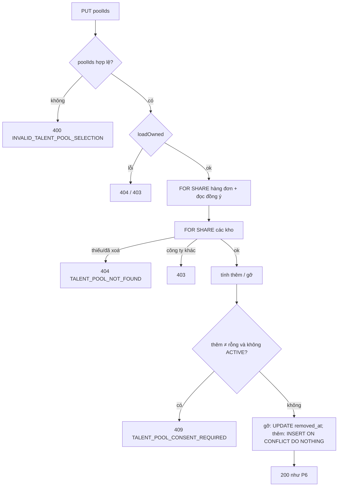

# Walkthrough — `feat/fr-h15-talent-pool` (FR-H15 · Kho ứng viên)

Đặc tả: `docs/features/HR/H15/REQUIREMENT.md`, `UI.md` (duyệt 16/10/2026; làm rõ L1–L3 sau Plan Mode, duyệt lại 16/10/2026;
L4–L8 trong lúc code, duyệt 17/10/2026; hoàn thành 17/10/2026). Không có chỗ lệch nào chưa được duyệt lại — xem mục 8.

## 1. Mục tiêu

Khi tuyển xong một đợt, HR thường muốn giữ lại vài ứng viên tốt nhưng chưa phù hợp lúc đó để liên hệ ở đợt sau. FR-H15 cho
HR tạo các "kho" (ví dụ "Backend tiềm năng"), đổi tên, xoá kho, và lưu một đơn ứng tuyển vào một hoặc nhiều kho. Từ kho,
HR mở lại trang hồ sơ đơn có sẵn (FR-H09) để xem CV, kết quả chấm AI đã có và trao đổi với ứng viên (kèm soạn nháp AI của
FR-C07). Điều kiện cứng: chỉ lưu được đơn mà ứng viên **đang** đồng ý cho công ty lưu hồ sơ (FR-U09); ứng viên rút đồng ý
thì đơn tự rời khỏi mọi kho. Phạm vi đã rút gọn ngày 16/10/2026: H15 **không gọi AI**, không ghi chú, không gắn thẻ, không
bộ lọc hay tìm kiếm.

## 2. Các file đã tạo/sửa

**Backend**

| File | Vai trò |
|---|---|
| `db/migration/V17__talent_pools.sql` | Bảng `talent_pools`, `talent_pool_entries`; hai partial unique index; trigger `updated_at`; CHECK `removed_at >= added_at` |
| `talentpool/TalentPool.java`, `TalentPoolEntry.java` | Entity (chỉ đọc với mục — thêm/gỡ mục đi qua câu SQL riêng) |
| `talentpool/TalentPoolRepository.java` | Danh sách kho kèm `entryCount`, kiểm trùng tên, khoá kho `FOR SHARE` |
| `talentpool/TalentPoolEntryRepository.java` | Trang mục (P8), kho đang chứa đơn (P6), "hiện có" (P7), thêm `ON CONFLICT`, ba câu gỡ |
| `talentpool/TalentPoolRow`, `TalentPoolEntryRow`, `PoolLockRow` | Interface projection cho câu native |
| `talentpool/TalentPoolNameRules.java` | Chuẩn hoá tên: `strip()`, 1–100 ký tự đếm theo code point |
| `talentpool/TalentPoolOwnerService.java` + `TalentPoolOwnerController.java` | P1–P5 (kho), P8 (liệt kê mục), P9 (gỡ một mục) |
| `talentpool/ApplicationTalentPoolService.java` + `ApplicationTalentPoolController.java` | P6 (kho của một đơn), P7 (đặt toàn bộ danh sách kho của đơn) |
| `talentpool/TalentPoolExceptionAdvice.java` | Body không đọc được → 400 với mã theo endpoint, không lặp lại nội dung gửi lên |
| `talentpool/dto/*` | Request/response của P1–P9 |
| `common/exception/*TalentPool*` (6 file) + `GlobalExceptionHandler.java` | Sáu mã lỗi, câu tiếng Việt cố định; nhánh `uq_talent_pool_name_per_company` → 409 |
| `jobapplication/ApplicationService.java` | Rút đồng ý (FR-U09) gỡ mục khỏi mọi kho trong cùng transaction (R-C1) |
| `jobapplication/JobApplicationRepository.java` + `ConsentLockRow.java` | Câu `SELECT … FOR SHARE` đọc hai cột đồng ý (R-C2) |
| `jobapplication/TalentPoolConsentState.java` | `of(...)` thành `public`, thêm overload `(boolean, Instant)` — quy tắc `ACTIVE` duy nhất |
| `db/seed/reset-test-data.sql`, `reset-demo-db.sql` | Dọn bảng kho trước khi xoá đơn test; liệt kê bảng mới trong `TRUNCATE` |

**Frontend**

| File | Vai trò |
|---|---|
| `pages/HrTalentPoolListPage.tsx` | `/hr/talent-pools`: danh sách kho, tạo kho |
| `pages/HrTalentPoolDetailPage.tsx` | `/hr/talent-pools/:id?page=`: đầu trang, đổi tên/xoá kho, danh sách mục, gỡ |
| `features/talentPools/api.ts`, `queries.ts`, `types.ts` | Gọi P1–P9; khoá query bắt đầu bằng `talentPools` để làm mới một lần |
| `features/talentPools/talentPoolLabels.ts` | Mọi chuỗi giao diện (L3) |
| `TalentPoolNameDialog`, `ConfirmTalentPoolDialog`, `TalentPoolEntryList` | Hộp thoại tên kho (RHF + Zod), hộp thoại xác nhận, bảng/thẻ mục |
| `SaveToTalentPoolDialog.tsx` + `applicationDetail/ApplicationDetailHeader.tsx` | Nút và hộp thoại "Lưu vào kho" ở header trang hồ sơ đơn |
| `App.tsx`, `components/layout/HrLayout.tsx` | Hai route mới; mục điều hướng thứ 6 "Kho ứng viên" |

## 3. Luồng chính

**Luồng A — Lưu một đơn vào kho (P7, `PUT /api/hr/applications/{id}/talent-pools`).**

1. HR mở `/hr/applications/:id`, bấm "Lưu vào kho". `SaveToTalentPoolDialog` gọi P6 (`GET` cùng đường dẫn) →
   `ApplicationTalentPoolService.get`: `HrApplicationAccess.loadOwned` kiểm quyền (công ty → đơn → đơn thuộc công ty khác
   là 403), suy `consentState` từ entity, lấy mọi kho chưa xoá của công ty (`TalentPoolRepository.findReadableByCompanyId`)
   và các kho đang chứa đơn (`TalentPoolEntryRepository.findReadablePoolIds`).
2. Đơn `ACTIVE`: các ô bật, ô đang chứa đơn tick sẵn. Đơn không `ACTIVE`: khối thông tin trung tính, mọi ô khoá.
3. HR tick/bỏ tick rồi bấm "Lưu" → P7 gửi `{ poolIds }` là **toàn bộ** tập kho mong muốn.
4. `ApplicationTalentPoolService.replace` (một transaction), dừng ở lỗi đầu tiên:
   - kiểm `poolIds` không null, không phần tử null, không trùng → 400 `INVALID_TALENT_POOL_SELECTION`;
   - `loadOwned` → 404 công ty / 404 đơn / 403;
   - `JobApplicationRepository.lockConsentForShare`: khoá hàng `job_applications` và đọc hai cột đồng ý từ chính câu này;
   - `TalentPoolRepository.lockForShare`: khoá các kho được chọn; có id không tồn tại hoặc đã xoá → 404 (xét trên toàn
     danh sách trước), rồi mới xét kho của công ty khác → 403;
   - "hiện có" = `findActivePoolIdsForWrite` (mục còn hiệu lực trong kho chưa xoá của công ty, **không** lọc đồng ý);
     `thêm = poolIds − hiện có`, `gỡ = hiện có − poolIds`;
   - `thêm` khác rỗng mà `TalentPoolConsentState.of(...)` không phải `ACTIVE` → 409 `TALENT_POOL_CONSENT_REQUIRED`;
   - gỡ bằng `removeFromPools` (đặt `removed_at`), thêm bằng `insertIfAbsent` (mỗi kho một câu).
5. Trả lại hình dạng của P6. Frontend làm mới khoá `applicationTalentPools` và `talentPools`, đóng hộp thoại, hiện câu
   "Đã cập nhật kho ứng viên." (vùng `aria-live`) và trả focus về nút.

**Luồng B — Ứng viên rút đồng ý (FR-U09, `PATCH /api/candidates/applications/{id}/talent-pool-consent/revoke`).**
`ApplicationService.revokeTalentPoolConsent` (một transaction): kiểm đơn thuộc ứng viên → câu `UPDATE` có điều kiện đặt
`talent_pool_consent = FALSE` và `revoked_at` (0 dòng → 409, không chạm mục) → ngay sau đó
`TalentPoolEntryRepository.removeAllActiveByApplicationId` đặt `removed_at` cho mọi mục còn hiệu lực của đơn → commit.
Response của ứng viên không đổi (không có thông tin kho nào).

**Luồng C — Xem kho (P8, `GET /api/hr/talent-pools/{id}/entries?page=`).** `TalentPoolOwnerService.listEntries` kiểm quyền
kho (công ty → kho không tồn tại/đã xoá 404 → kho công ty khác 403), rồi một câu native + một câu đếm: mục còn hiệu lực
**và** đơn đang `talent_pool_consent = TRUE`, sắp `added_at DESC`, phân trang mặc định 10, tối đa 50. Mỗi dòng chỉ có tên
ứng viên, tin, trạng thái đơn, ngày nộp, ngày thêm và `jobDeleted` — không điểm, không hạng. "Mở hồ sơ" và "Trao đổi" là
liên kết sang trang H09 có sẵn.

**Luồng D — Tạo / đổi tên / xoá kho (P2, P4, P5).** Tên qua `TalentPoolNameRules.normalize`; `existsActiveName` (so
`lower()` ở DB) trả 409 sớm; `saveAndFlush` để vi phạm `uq_talent_pool_name_per_company` (khi hai request cùng lúc) nổi
lên ngay và được dịch sang cùng mã 409. Xoá kho chỉ đặt `deleted_at`, không đụng mục.

## 4. Quyết định thiết kế

**4.1 H15 không gọi AI.** *Chọn:* không `ChatClient`/`ChatModel`/`EmbeddingModel` nào trong `talentpool/`; xem lại đánh giá
AI và soạn nháp bằng cách điều hướng sang trang H09. *Khác:* AI tóm tắt ứng viên trong kho (phạm vi cũ). *Vì sao:* phạm vi
rút gọn 16/10/2026; tóm tắt AI trên kho dễ thành một "xếp hạng thứ hai" cạnh tranh với FR-H05 và lặp lại dữ liệu đã có ở
H04/H06. Kiểm tĩnh 7.3 chặn việc thêm lại.

**4.2 Chỉ thêm khi đồng ý `ACTIVE`, gỡ thì luôn được (R-M3).** *Chọn:* điều kiện chặn đặt ở bước 7 của P7 và chỉ khi tập
`thêm` khác rỗng. *Khác:* chặn mọi P7 khi không `ACTIVE`. *Vì sao:* đồng ý là quyền của ứng viên (FR-U09) — thiếu đồng ý thì
công ty không được **giữ thêm**, nhưng việc **bỏ** dữ liệu luôn phải làm được. Quy tắc `ACTIVE` chỉ có một chỗ:
`TalentPoolConsentState.of(boolean, Instant)`; SQL đọc dùng đúng biểu thức `talent_pool_consent = TRUE`.

**4.3 Gỡ khỏi kho trong cùng transaction rút đồng ý (R-C1).** *Chọn:* gọi thẳng repository mục trong
`ApplicationService.revokeTalentPoolConsent`, ngay sau câu `UPDATE`. *Khác:* phát event / `@TransactionalEventListener` /
job nền dọn sau. *Vì sao:* event hoặc job nền tạo một khoảng thời gian đơn đã rút đồng ý vẫn nằm trong kho, và nếu bước dọn
lỗi thì dữ liệu lệch vĩnh viễn. Cùng transaction thì hoặc cả hai xong, hoặc không gì cả. Đổi lại có phụ thuộc vòng
`jobapplication` ↔ `talentpool` (chấp nhận, cùng một ứng dụng).

**4.4 Khoá `FOR SHARE` hàng đơn trước khi đọc đồng ý (R-C2).** *Chọn:* câu native `SELECT … FROM job_applications WHERE id =
:id FOR SHARE`, đọc hai cột đồng ý từ chính câu đó. *Khác:* tin vào khoá mà khoá ngoại tự lấy khi `INSERT`; dùng
`@Lock(PESSIMISTIC_READ)` của JPA. *Vì sao:* khoá FK (`FOR KEY SHARE`) **không** xung đột với câu `UPDATE` của rút đồng ý
(không đổi cột khoá), nên một mục có thể chen vào sau khi R-C1 đã gỡ. `FOR SHARE` xung đột với khoá của `UPDATE`: P7 chờ rút
đồng ý commit rồi đọc giá trị mới (409); ngược lại rút đồng ý chờ P7 commit, và câu gỡ chạy sau đó thấy mục P7 vừa thêm. Không
dùng `@Lock` vì entity đã nạp trước trong persistence context có thể là bản cũ. Bằng chứng: T16 trong
`ApplicationTalentPoolConcurrencyIntegrationTest`; bỏ `FOR SHARE` thì hai ca R-C2 đỏ (kiểm đột biến M1).

**4.5 `INSERT … ON CONFLICT (pool_id, application_id) WHERE removed_at IS NULL DO NOTHING` (L1).** *Chọn:* câu thêm idempotent
trên chính partial unique index. *Khác:* `save()` / `INSERT` thường, hoặc khoá `FOR UPDATE` để tuần tự hoá hai P7. *Vì sao:*
hai khoá `FOR SHARE` không chặn nhau, nên hai P7 cùng thêm một mục đều thấy "hiện có" rỗng; với `INSERT` thường request sau
vi phạm unique và thành 500. `ON CONFLICT DO NOTHING` cho cả hai 200, đúng một dòng hiệu lực, không cần mã lỗi mới. Test ca
này dựng cố định (L6): A giữ dòng chưa commit, B bị chặn ở `INSERT` (xác nhận bằng `pg_stat_activity`), A commit, B
`DO NOTHING`. Bỏ `ON CONFLICT` thì B nhận `duplicate key … uq_talent_pool_entry_active` (kiểm đột biến M2).

**4.6 `removed_at = statement_timestamp()` (L4).** *Chọn:* mốc thời gian lấy từ DB tại thời điểm câu lệnh chạy. *Khác:*
`Instant.now()` của JVM; `now()` của Postgres. *Vì sao:* `added_at` lấy đồng hồ DB; JVM chậm hơn container thì `removed_at <
added_at`. `now()` là thời điểm **bắt đầu** transaction: rút đồng ý bắt đầu ở t0, P7 thêm mục ở t1 > t0 rồi commit, câu gỡ
của R-C1 đặt `removed_at = t0 < t1` → vỡ CHECK → rút đồng ý 500. Test hồi quy:
`l4_removeInTransactionStartedBeforeEntryWasAdded_satisfiesCheck` trong `TalentPoolSchemaConstraintIntegrationTest` — đổi
lại `now()` thì test đỏ. **Không được xoá test này khi refactor**: nó bảo vệ cả luồng rút đồng ý của FR-U09.

**4.7 Đường đọc lọc đồng ý, đường ghi không lọc (R-M5, R-M6).** *Chọn:* P1 (`entryCount`), P6 (`contains`), P8 thêm điều
kiện `talent_pool_consent = TRUE`; P7 ("hiện có") và P9 không lọc. *Khác:* lọc ở mọi nơi; không lọc ở đâu. *Vì sao:* đường
đọc lọc là lưới an toàn — giao diện không bao giờ hiện đơn đã rút đồng ý, kể cả khi dữ liệu lệch. Đường ghi không lọc để vẫn
gỡ được "mục lệch" (mục còn hiệu lực trong khi đơn đã không `ACTIVE`, chỉ có khi sửa tay). Hệ quả chấp nhận: mục lệch không
hiện trên giao diện, chỉ gỡ được qua API.

**4.8 Xoá mềm cả kho và mục (Q2).** *Chọn:* kho `deleted_at`, mục `removed_at`; partial unique index có `WHERE … IS NULL` để
tạo lại tên đã xoá và thêm lại đơn đã gỡ. *Khác:* xoá cứng mục khi gỡ hoặc rút đồng ý. *Vì sao:* quy ước toàn dự án (CLAUDE.md
§4); giữ lịch sử thêm/gỡ. Xoá kho không cascade sang mục: mục của kho đã xoá không truy cập được nữa vì mọi đường đều qua
kho chưa xoá.

**4.9 Quyền theo quy ước nhóm route HR.** *Chọn:* công ty trước (404) → bản ghi không tồn tại (404) → của công ty khác
(403), dùng lại `HrApplicationAccess.loadOwned` cho đơn. *Khác:* trả 404 cho mọi trường hợp để không lộ sự tồn tại. *Vì
sao:* giữ đúng quy ước sẵn có của `/api/hr/**`; frontend vẫn hiện cùng một câu "Không tìm thấy kho ứng viên." cho 403 và 404
(UI_GUIDE mục 5).

**4.10 P7 nhận toàn bộ tập, không nhận từng thao tác.** *Chọn:* `PUT` với `poolIds` đầy đủ, lỗi ở đâu cũng rollback toàn bộ
(R-P3). *Khác:* `POST`/`DELETE` từng cặp (kho, đơn). *Vì sao:* hộp thoại có nhiều ô; gửi từng thao tác thì lỗi giữa chừng để
lại trạng thái nửa vời.

## 5. Ràng buộc đã thực thi

| Mã | Ràng buộc | Thực thi ở đâu |
|---|---|---|
| R-A1 | Không gọi AI | Không có import AI trong `talentpool/`; kiểm tĩnh 7.3 |
| R-A2 | Không trả điểm/hạng/minh chứng | DTO `TalentPoolEntryResponse`, `ApplicationTalentPoolsResponse`; test khoá cấm ở T7 |
| R-K2 | Tên 1–100 ký tự sau `strip()` | `TalentPoolNameRules.normalize`; CHECK + `VARCHAR(100)` ở V17 |
| R-K3 | Tên không trùng (không phân biệt hoa thường) | `existsActiveName` + `uq_talent_pool_name_per_company` |
| R-K5, Q2 | Xoá mềm kho | `TalentPoolOwnerService.delete` |
| R-M2 | Một mục hiệu lực cho mỗi (kho, đơn) | `uq_talent_pool_entry_active` + `insertIfAbsent` |
| R-M3 | Chỉ thêm khi `ACTIVE` | `ApplicationTalentPoolService.replace` bước 7, `TalentPoolConsentState.of` |
| R-M5 | Đường ghi không lọc đồng ý | `findActivePoolIdsForWrite`, `removeOne` |
| R-M6 | Đường đọc lọc đồng ý | `findReadableByCompanyId`, `findReadableById`, `findReadablePoolIds`, `findReadableByPoolId` |
| R-P2, R-P3 | Thứ tự 7 bước, rollback toàn bộ | `ApplicationTalentPoolService.replace`, `checkPools` |
| R-C1 | Gỡ trong cùng transaction rút đồng ý | `ApplicationService.revokeTalentPoolConsent` |
| R-C2 | Khoá trước khi đọc đồng ý | `lockConsentForShare`, `TalentPoolRepository.lockForShare` |
| L4 | Mốc `removed_at` | `statement_timestamp()` ở ba câu gỡ |
| FR-U09 | Ứng viên không thấy kho | Không response phía ứng viên nào đổi; T15 kiểm hình dạng F4 |
| SRS bổ sung | Không gán nhãn, badge trung tính | `ApplicationStatusBadge` có sẵn; nút xác nhận không màu đỏ |

## 6. Đã kiểm thử gì

**Tự động (backend)** — full `./mvnw test`: **1610 test, 0 failures, 0 errors, 0 skipped** (17/10/2026). H15 thêm 41 test:
`TalentPoolNameRulesTest` (6), `TalentPoolSchemaConstraintIntegrationTest` (8), `TalentPoolOwnerControllerIntegrationTest`
(14), `ApplicationTalentPoolControllerIntegrationTest` (8), `ApplicationTalentPoolConcurrencyIntegrationTest` (3), và 2 ca
T15 trong `TalentPoolConsentIntegrationTest`. Có kiểm đột biến cho các test tranh chấp: bỏ `FOR SHARE` (M1), bỏ
`ON CONFLICT` (M2), đổi `statement_timestamp()` về `now()` — cả ba làm test đỏ đúng chỗ.

**Tự động (frontend)** — `npm run build`, `npm run lint` sạch. Bốn lệnh `rg` của 7.3 đều 0 dòng.

**Bằng HTTP** — khối PowerShell 7.2 trên bộ seed-test: 7/7 nhóm khớp.

**Bằng tay** — người dùng soát 7.4 nhóm A, B, C trên bộ seed-test (desktop, 768px, 375px): đạt hết.

**Chưa kiểm:** frontend không có test tự động (giống các FR trước); trường hợp hai HR — không xảy ra vì mỗi công ty đúng một
HR; hiệu năng với kho rất lớn (không giới hạn số kho, danh sách kho không phân trang).

| "Xong khi" | Cách nghiệm thu | Kết quả |
|---|---|---|
| 7.1 T1–T20 | Các lớp test kể trên; full suite 1610/0 | Đạt |
| 7.2 HTTP nhóm 1–7 | Khối PowerShell ở REQUIREMENT 7.2 | Đạt 7/7 |
| 7.3 build + lint + 4 lệnh `rg` | Chạy ở đợt 6a | Đạt |
| 7.4 soát tay A, B, C | Người dùng soát 17/10/2026 | Đạt |

## 7. Nợ kỹ thuật

Không phát sinh nợ phải sửa. Giới hạn đã chấp nhận (ghi ở ROADMAP): mục lệch không hiện trên giao diện; `name` dạng số được
Jackson ép thành chuỗi (L5); `removed_at` không trùng mili giây với `talent_pool_consent_revoked_at`; một ứng viên có thể
xuất hiện nhiều lần trong một kho qua nhiều đơn (Q9). Câu chữ nguyên tắc 6 và 14 trong skill `srs-guard` vẫn ghi "xoá hẳn"
mục khi rút đồng ý, trong khi spec đã duyệt chọn xoá mềm (Q2) — cần chỉnh skill ở một nhánh `chore/` riêng.

## 8. Lệch so với đặc tả

Mọi chỗ code khác đặc tả duyệt ban đầu đều đã ghi vào REQUIREMENT mục 11/11.1 và được duyệt lại:

| Mã | Nội dung | Duyệt lại |
|---|---|---|
| L1 | Thêm mục bằng `ON CONFLICT … DO NOTHING`; T16 thêm ca hai P7 đồng thời | 16/10/2026 |
| L2 | T3 tách: JDBC ném lỗi mang tên constraint + gọi thẳng handler ra 409 | 16/10/2026 |
| L3 | `UI.md` 5a thêm `talentPoolLabels.ts` | 16/10/2026 |
| L4 | `removed_at = statement_timestamp()` | 17/10/2026 |
| L5 | `name` dạng số không chặn riêng | 17/10/2026 |
| L6 | T16 ca L1 dựng cố định, không phát cùng lúc | 17/10/2026 |
| L7 | Nút "Tạo kho" ở header chỉ khi đã có kho | 17/10/2026 |
| L8 | Hộp thoại "Lưu vào kho" lúc đang tải chỉ có nút "Đóng" | 17/10/2026 |

Ngoài ra là các lựa chọn cài đặt người dùng đã chấp nhận ở từng đợt mà không cần sửa spec: P6/P7 ở frontend để sang đợt 5;
`TalentPoolNameRules` trả `Optional`; advice chọn mã lỗi theo controller qua `HandlerMethod`; P6 dùng lại câu của P1; nút xác
nhận không màu đỏ; `?page=` ghi bằng `replace`; câu "Đã cập nhật kho ứng viên." nằm dưới nút tới lần mở sau.

## Câu hỏi tự kiểm tra

1. Nếu xoá câu gọi `talentPoolEntryRepository.removeAllActiveByApplicationId` trong `ApplicationService.revokeTalentPoolConsent`
   thì hỏng gì, và test nào sẽ đỏ?
2. Khi HR bấm "Lưu" trong hộp thoại, dữ liệu đi từ `SaveToTalentPoolDialog` qua những class và câu SQL nào trước khi có dòng
   mới trong `talent_pool_entries`?
3. Vì sao chọn `SELECT … FOR SHARE` cộng `INSERT … ON CONFLICT DO NOTHING` thay vì một khoá `FOR UPDATE` trên hàng đơn?
