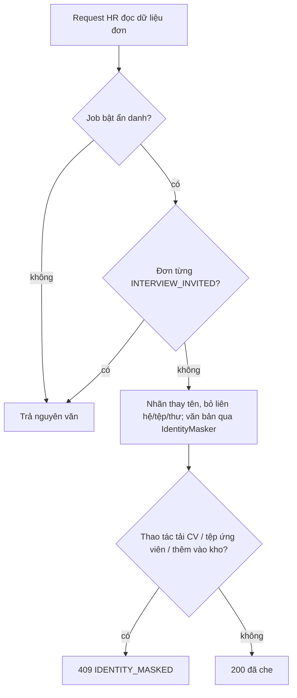

# Walkthrough — `feat/fr-h16-blind` (FR-H16 · Chế độ ẩn danh)

Đặc tả: `docs/features/HR/H16/REQUIREMENT.md`, `UI.md` (duyệt 18/10/2026; làm rõ L1–L4 sau Plan Mode, L5–L11 trong lúc code
và soát tay, tất cả duyệt lại 19/10/2026; hoàn thành 19/10/2026). Không có chỗ lệch nào chưa được duyệt lại — xem mục 8.

## 1. Mục tiêu

Khi đọc hồ sơ, HR dễ bị ảnh hưởng bởi những thứ không liên quan tới năng lực: tên, quê quán đoán từ địa chỉ, giới tính đoán
từ tên. FR-H16 cho HR bật "Chế độ ẩn danh" cho một tin tuyển dụng. Trong lúc bật, mọi màn HR dùng để sàng lọc đơn của tin đó
chỉ hiện nhãn "Ứng viên #XXXXXXXX" thay cho họ tên, không hiện email, số điện thoại, tên tệp, thư giới thiệu, không cho tải
CV gốc; các văn bản còn lại (evidence chấm điểm, giải thích, CV đã trích xuất, tin nhắn, trả lời hỏi đáp CV…) được thay đúng
các giá trị danh tính đã biết bằng "[đã ẩn]". Khi HR gửi giấy mời phỏng vấn, đơn đó tự bỏ ẩn danh — lúc đó HR cần biết mình
mời ai. Chế độ này **chỉ đổi phần hiển thị cho HR**: AI vẫn chấm trên CV gốc như cũ, điểm và hạng không đổi, ứng viên không
thấy gì khác. H16 không gọi AI mới.

## 2. Các file đã tạo/sửa

**Backend — package mới `blindreview/`**

| File | Vai trò |
|---|---|
| `db/migration/V19__blind_review.sql` | Cột `jobs.blind_review_enabled` (mặc định `FALSE`), bảng lưu vết `job_blind_review_changes` + index |
| `BlindReviewController` + `BlindReviewService` | B1 `PATCH /api/hr/jobs/{jobId}/blind-review`: kiểm body, quyền, `UPDATE` có điều kiện, ghi lưu vết |
| `BlindReviewExceptionAdvice`, `dto/BlindReviewRequest`, `dto/BlindReviewResponse` | Body không đọc được → 400 `INVALID_BLIND_REVIEW_REQUEST`; request/response của B1 |
| `JobBlindReviewChange` + `JobBlindReviewChangeRepository` | Entity lưu vết; repository duy nhất của package, chứa mọi câu SQL native của H16 |
| `BlindReviewResolver` | "Đơn này có đang ẩn danh không?" — bản một đơn và bản theo tập id, cùng **một** câu SQL |
| `IdentityMaskSource`, `AccountIdentityRow`, `ParsedContactRow` | Gom giá trị danh tính của các đơn (tài khoản + `contact` của CV) thành `IdentityMasker`, 2 câu cho cả tập |
| `IdentityMasker` | Bộ che chuỗi: chuẩn hoá NFC, bỏ giá trị < 3 ký tự, so không phân biệt hoa thường, giá trị dài thay trước |
| `CandidateAlias` | Nhãn "Ứng viên #" + 8 ký tự hex cuối của id đơn, viết hoa |
| `BlindReviewScoringAuditFilter` | Cài đặt duy nhất của `scoring/ScoringAuditTextFilter` (L4) |

**Backend — file có sẵn được sửa**

| File | Vai trò của thay đổi |
|---|---|
| `job/Job`, `JobRepository.updateBlindReview`, `JobOwnerService` (`loadOwned` public — L3), `dto/JobOwnerResponse` | Cờ trên Job (field chỉ đọc), câu `UPDATE` có điều kiện, `blindReviewEnabled` trong response |
| `common/exception/*` (3 lớp mới) + `GlobalExceptionHandler` | 409 `IDENTITY_MASKED`, 400 `INVALID_BLIND_REVIEW_REQUEST`, 400 `INVITATION_RENDERED_TOO_LONG` |
| `jobapplication/ApplicationOwnerService`, `ApplicationHrDetailService`, `ApplicationSearchService`, `ScoreTextMasking` (L6), hai DTO | Danh sách theo Job, E1/E3/E4, `/hr/candidates`; `identityMasked` trong DTO |
| `resume/ResumeHrService`, `screening/ApplicationScreeningHrService` | E2 (CV đã trích xuất) che, tải CV gốc 409; sàng lọc che câu `SHORT_TEXT` |
| `scoring/ScoringAuditTextFilter` (mới), `ScoringRunAuditService` | Audit lượt chấm che qua interface, `scoring/` không biết `blindreview/` |
| `comparison/ApplicationComparisonService`, `talentpool/TalentPoolOwnerService`, `ApplicationTalentPoolService` | So sánh, mục kho (P8), chặn thêm vào kho (P7 bước 6b) |
| `messaging/MessageService`, `notification/NotificationEventListener`, `NotificationContentBuilder` | Luồng tin, hộp thư, tải tệp; nhãn trong thông báo/email gửi HR (L1, L2) |
| `interviewinvitation/InterviewInvitationService` | Preview giữ `{{candidateName}}`; lúc gửi mới thay tên thật và kiểm độ dài |
| `aicontext/ConversationContextAssembler`, `messagedraft/MessageDraftFacade`, `ai/messagedraft/*`, `message-draft-v2.st` | C07: không gửi họ tên cho AI, che bản nháp; prompt v2 (xoá v1) |
| `cvqa/CvQaFacade` | C08: che câu trả lời và trích dẫn **sau** khi K2 đã kiểm |
| `db/seed/reset-test-data.sql`, `reset-demo-db.sql` | Dọn bảng lưu vết trước khi xoá user/Job |

**Frontend**

| File | Vai trò |
|---|---|
| `features/blindReview/BlindReviewCard.tsx`, `api.ts`, `queries.ts`, `blindReviewLabels.ts` | Khối bật/tắt + hộp thoại xác nhận; gọi B1; danh sách khoá query phụ thuộc ẩn danh (L11); mọi chuỗi giao diện |
| `pages/HrJobEditPage.tsx`, `features/jobs/ownerTypes.ts`, `ownerQueries.ts` | Đặt khối dưới form (ngoài `<form>`); kiểu `blindReviewEnabled`; export hai khoá Job |
| `features/scoring/ApplicationsTab.tsx`, `types.ts` | Dòng thông tin "Tin này đang bật chế độ ẩn danh"; nút "Xem CV gốc" khoá kèm lý do |
| `features/applicationDetail/ApplicationDetailHeader.tsx`, `CvAndScoreTab.tsx`, `types.ts` | Badge trung tính "Ẩn danh", "Lưu vào kho" khoá; câu thay cho nút tải và thư giới thiệu |
| `features/resumes/ResumeParsedDataView.tsx` | Prop `contactMasked`: câu "Thông tin liên hệ được ẩn…" thay câu "Không trích xuất được…" |
| `features/messages/MessageBubble.tsx`, `types.ts` | Chip tệp "đã ẩn tên", không nút tải (L10) |
| `features/interviewinvitation/InterviewInvitationDialog.tsx` | Khối giải thích khi preview còn `{{candidateName}}`; gửi xong làm mới trang hồ sơ đơn |
| `pages/HrApplicationDetailPage.tsx`, `features/cvQa/useCvQaSession.ts`, các `queries.ts` khác | L11: hook `useIdentityMaskChangeSync`, `reset` cho phiên hỏi đáp CV, export hằng tiền tố khoá |

## 3. Luồng chính

**Luồng A — HR bật ẩn danh (B1).** `BlindReviewCard` → hộp thoại xác nhận → `PATCH /api/hr/jobs/{jobId}/blind-review`
`{ "enabled": true }`. `BlindReviewController` (vai trò HR chặn ở `SecurityConfig` cho `/api/hr/**`) gọi `BlindReviewService.update` trong một transaction:

1. `enabled` null hoặc body hỏng → 400 (kiểm trước quyền sở hữu — L5).
2. `JobOwnerService.loadOwned` → Job không tồn tại 404, công ty khác 403; Job đã xoá mềm → 404.
3. `JobRepository.updateBlindReview` chạy `UPDATE jobs SET blind_review_enabled = :enabled WHERE id = :id AND
   deleted_at IS NULL AND blind_review_enabled <> :enabled`. Trả 1 dòng nghĩa là giá trị thật sự đổi → ghi một dòng `job_blind_review_changes`
   (người đổi, thời điểm). Trả 0 dòng (gửi lại cùng giá trị) → không ghi gì.
4. Trả `{ jobId, enabled, changedAt }`. Frontend `resetQueries` 10 nhóm khoá có danh tính và invalidate hai khoá Job (L11).

**Luồng B — HR đọc một đơn (ví dụ E1 `GET /api/hr/applications/{id}`).** `ApplicationHrDetailService.getDetail` dựng response
như cũ, rồi:

1. `BlindReviewResolver.isMasked(id)` — một câu SQL: Job của đơn bật cờ **và** không có dòng `application_status_history`
   nào có `to_status = 'INTERVIEW_INVITED'`. Không có cột "đơn đang ẩn danh" nào được lưu.
2. Ẩn danh → `IdentityMaskSource.load(id)` đọc họ tên/email/SĐT tài khoản và `contact` của CV, tạo `IdentityMasker`.
3. Thay `candidateName` bằng `CandidateAlias.of(id)`, `coverLetter = null`, `resumeFileName = null`, `identityMasked =
   true`; văn bản tự do đi qua `masker.mask(...)`.

Màn có nhiều đơn (danh sách theo Job, `/hr/candidates`, hộp thư, kho, so sánh) gọi `maskedAmong(ids)` và `load(ids)` một
lần cho cả trang — số câu SQL không tăng theo số đơn.

**Luồng C — HR gửi giấy mời cho đơn ẩn danh.** Preview render với chuỗi `{{candidateName}}` giữ nguyên, nên HR không thấy
tên trong lúc soạn. Khi gửi, `InterviewInvitationService.sendInvitation` đọc trạng thái ẩn danh trong transaction, thay
`{{candidateName}}` bằng tên thật, kiểm độ dài sau khi thay (255 / 10000 ký tự → quá thì 400, đơn vẫn `PENDING`), rồi mới
`changeStatus` sang `INTERVIEW_INVITED`. Từ lúc commit, có dòng lịch sử `INTERVIEW_INVITED` nên resolver trả "không ẩn danh"
ở mọi màn.

**Luồng D — C07/C08 phía HR.** C07: `ConversationContextAssembler.forConversation` (chỉ với `ContextViewer.HR`) đặt
`candidateName = null`; prompt v2 in "Họ tên ứng viên: (không cung cấp)"; bản nháp AI trả về được che trước khi trả HR.
C08: `CvQaService` gọi AI và K2 kiểm trích dẫn trên `raw_text` gốc như cũ; `CvQaFacade.askAsHr` chỉ che **response** sau
cùng.

## 4. Quyết định thiết kế

**4.1 Trạng thái ẩn danh tính lúc đọc, không lưu theo đơn.** *Chọn:* một câu SQL (cờ Job + không có lịch sử
`INTERVIEW_INVITED`) trong `BlindReviewResolver`. *Khác:* cột `masked` trên `job_applications`, cập nhật khi bật/tắt và khi
gửi giấy mời. *Vì sao:* cột lưu phải đồng bộ ở ba nơi (B1, gửi giấy mời, đơn mới nộp) và lệch khi một nơi quên; câu tính
lúc đọc luôn đúng. "Đã từng được mời" lấy từ lịch sử nên đơn đã mời rồi bị từ chối vẫn không quay lại ẩn danh (T3).

**4.2 Che ở backend, frontend không tự che.** *Chọn:* mọi service HR tự che trước khi trả JSON. *Khác:* trả dữ liệu thật,
frontend ẩn. *Vì sao:* dữ liệu đã về trình duyệt thì HR mở DevTools là thấy; kiểm tĩnh 7.3 dòng cuối chặn frontend tự dựng
nhãn hay "[đã ẩn]".

**4.3 Che sau khi xếp hạng và sau K2.** *Chọn:* danh sách theo Job che **sau** `rankApplications`; C08 che sau K2. *Khác:*
che sớm ở đầu vào. *Vì sao:* đầu vào chấm và kiểm trích dẫn phải là CV gốc (CLAUDE.md §2). Che trước K2 thì trích dẫn đã
che không còn khớp `raw_text`, hoặc tệ hơn là K2 đạt trên chuỗi sai. T15 kiểm trích dẫn không khớp CV vẫn lỗi như cũ; T16
chạy D2 với Job tắt rồi bật và so user message gửi `ChatModel` giống hệt nhau. **Không xoá T16
(`BlindReviewScoringInvarianceIntegrationTest`) khi refactor**: nó bảo vệ nguyên tắc FR-H04/H05.

**4.4 Thay chuỗi theo giá trị đã biết, không dùng AI nhận diện.** *Chọn:* `IdentityMasker` với `Pattern.quote`,
`CASE_INSENSITIVE | UNICODE_CASE`, chuẩn hoá NFC, giá trị dài thay trước. *Khác:* AI/NER tìm tên. *Vì sao:* đặc tả cấm AI mới;
thay chuỗi kiểm thử được và không bao giờ "bịa" chỗ che. Đổi lại có giới hạn đã biết (mục 7). `Pattern.quote` cần vì SĐT
"+84 (90)…" chứa ký tự đặc biệt của regex (T2).

**4.5 Audit qua interface trong `scoring/` (L4).** *Chọn:* `ScoringAuditTextFilter` ở `scoring/`, cài đặt ở `blindreview/`.
*Khác:* `ScoringRunAuditService` import thẳng resolver. *Vì sao:* ranh giới 7.3 — `ai/` và `scoring/` không biết gì về ẩn
danh, nên không có đường nào để logic chấm điểm vô tình đọc bản đã che.

**4.6 `UPDATE` có điều kiện thay cho kiểm-rồi-ghi (R-B3).** *Chọn:* `WHERE blind_review_enabled <> :enabled`, số dòng đổi
quyết định có ghi lưu vết không. *Khác:* đọc cờ, so, rồi ghi. *Vì sao:* hai request cùng bật gần như đồng thời thì cả hai
đọc thấy `false` và ghi hai dòng lưu vết; câu có điều kiện để DB tuần tự hoá, chỉ một câu trả 1 dòng. Field `Job` để
`insertable/updatable = false` nên `PUT /api/hr/jobs/{id}` không thể ghi đè cờ (T4).

**4.7 Giấy mời: preview giữ placeholder, gửi mới thay (R-I).** *Chọn:* thay `{{candidateName}}` ở bước gửi, kiểm độ dài sau
thay, trước `changeStatus`. *Khác:* preview chèn nhãn, HR tự sửa. *Vì sao:* thư gửi ứng viên phải có tên thật (ẩn danh chỉ
áp cho HR); kiểm độ dài trước `changeStatus` để lỗi 400 không để lại đơn đã đổi trạng thái.

**4.8 Thông báo nhận nhãn đầy đủ (L1, L2).** *Chọn:* listener dựng `"Ứng viên " + tên` hoặc `CandidateAlias.of(id)`, builder
bỏ tiền tố. *Khác:* truyền nhãn vào builder cũ. *Vì sao:* tránh "Ứng viên Ứng viên #…"; nội dung khi Job tắt giữ nguyên từng
chữ. Tin của ứng viên khi ẩn danh không kèm đoạn trích (đoạn trích có thể chứa tên).

**4.9 Frontend: reset cache sau B1 (L11).** *Chọn:* `resetQueries` 10 nhóm khoá có danh tính, invalidate hai khoá Job; trang
hồ sơ đơn tự làm mới các tab và bỏ phiên hỏi đáp CV khi `identityMasked` đổi. *Khác:* chỉ invalidate (lỗi soát tay: đầu
trang hiện tên thật trong khi C08 đã che); reset cả khoá Job. *Vì sao:* invalidate vẫn hiện bản cũ trong lúc tải lại; reset
khoá Job thì cả trang sửa tin về "Đang tải…" và gỡ form.

## 5. Ràng buộc đã thực thi

| Mã | Ràng buộc | Thực thi ở đâu |
|---|---|---|
| R-A1 | Không gọi AI mới | Không có `ChatClient`/`ChatModel`/`EmbeddingModel` trong `blindreview/` (7.3 dòng 1) |
| R-A2 | Đầu vào chấm, điểm, hạng không đổi | Che sau `rankApplications`; T16, T9 |
| R-A4 | `ai/`, `scoring/` không import `blindreview/` | `ScoringAuditTextFilter`; 7.3 dòng 2–3 |
| R-B3 | Một dòng lưu vết mỗi lần đổi thật | `JobRepository.updateBlindReview` + `BlindReviewService.update` |
| R-S1 | Định nghĩa đơn ẩn danh | Câu `findMaskedApplicationIds` (một chỗ duy nhất) |
| R-N1 | Nhãn ổn định | `CandidateAlias.of` |
| R-M1–R-M6 | Bộ che chuỗi | `IdentityMasker.of/mask`, `IdentityMaskSource.load`, `ScoreTextMasking` |
| R-V1–R-V3 | Ghi đè H09: không tải CV gốc, không thư giới thiệu | `ResumeHrService.downloadForApplication` (409), `ApplicationHrDetailService.getDetail` |
| R-T1, R-T2 | Trao đổi | `MessageService.getThreadAsHr`, `listConversationsAsHr`, `downloadAttachmentAsHr` |
| R-I1–R-I4 | Giấy mời | `InterviewInvitationService.previewInvitation`, `sendInvitation` |
| R-C1, R-C2 | C07 | `ConversationContextAssembler.forConversation`, `MessageDraftFacade`, `message-draft-v2.st` |
| R-Q | C08 che sau K2 | `CvQaFacade.askAsHr` |
| R-K | Kho: chặn thêm, P8 nhãn | `ApplicationTalentPoolService.replace` (bước 6b), `TalentPoolOwnerService.listEntries` |
| R-O1–R-O3 | Thông báo/email gửi HR | `NotificationEventListener`, `NotificationContentBuilder` |
| R-U1 | Phía ứng viên không đổi | Không response `/api/candidates/**` nào đổi; T17 |
| §4 CLAUDE.md | RBAC + sở hữu | `SecurityConfig` (`/api/hr/**` → HR) + `JobOwnerService.loadOwned`; mọi màn HR dùng kiểm quyền sẵn có |
| §8 CLAUDE.md | Badge trung tính | Badge "Ẩn danh" dùng token trung tính, không đỏ/xanh |

## 6. Đã kiểm thử gì

**Tự động (backend)** — full `./mvnw test` (19/10/2026): **2080 test, 0 failures, 0 errors, 0 skipped**. H16 thêm 125
test trong 16 lớp ở `src/test/.../blindreview/` (T1–T17, cộng lớp dữ liệu dùng chung
`BlindReviewIntegrationTestSupport`), gồm `CandidateAliasTest`, `IdentityMaskerTest` (unit) và các lớp
`BlindReview*IntegrationTest` (Testcontainers, mock `ChatModel` throw mặc định). Sửa một test cũ:
`MessageDraftPromptIntegrationTest` đọc file prompt theo `PROMPT_VERSION` (v1 đã xoá).

**Tự động (frontend)** — `npm run build`, `npm run lint` sạch.

**Kiểm tĩnh 7.3** — 7 lệnh `rg` đều 0 dòng; lệnh khẳng định cho thấy `BlindReviewScoringAuditFilter` là cài đặt duy nhất
của `ScoringAuditTextFilter`.

**Bằng HTTP 7.2** — khối PowerShell trên bộ seed-test vừa nạp: **10/10 nhóm khớp** bảng mong đợi; chạy xong đã reset bộ test
(README mục 8.2 rồi 8.1).

**Bằng tay 7.4** — người dùng tự soát 19/10/2026 trên bộ seed-test (desktop, 768px, 375px): **đạt toàn bộ**, kể cả kịch bản
bật/tắt rồi mở nhanh hồ sơ đơn sau khi sửa L11. Riêng màn so sánh không soát tay được vì J1 không có đơn đã chấm xong — phần
này phủ bằng T9.

**`srs-guard`** — 15 nguyên tắc, không vi phạm.

**Chưa kiểm:** frontend không có test tự động; màn so sánh chưa soát tay với dữ liệu thật; bật/tắt ở tab trình duyệt khác
chỉ phân tích bằng code (giới hạn đã biết); hiệu năng của bộ che với văn bản rất dài hoặc rất nhiều giá trị nguồn chưa đo;
email thật gửi qua SMTP chỉ kiểm qua `mailText` trong test (T12), chưa mở hộp thư MailHog.

| "Xong khi" | Cách nghiệm thu | Kết quả |
|---|---|---|
| 7.1 T1–T17 | 16 lớp test ở `blindreview/`; full suite 2080/0 | Đạt |
| 7.2 HTTP nhóm 1–10 | Khối PowerShell ở REQUIREMENT 7.2 | Đạt 10/10 |
| 7.3 build + lint + lệnh `rg` | Chạy ở đợt 6 | Đạt |
| 7.4 soát tay | Người dùng soát 19/10/2026 | Đạt (so sánh phủ bằng T9) |

## 7. Nợ kỹ thuật

- `InterviewInvitationDialog` vẫn làm mới trang hồ sơ đơn bằng `applicationDetailKey(id).slice(0, 2)` (L10), dù L11 đã
  export `APPLICATION_DETAIL_KEY_PREFIX`. Hành vi đúng, chỉ nên đổi sang hằng ở lần sửa sau.
- `identityDependentKeys` (`features/blindReview/queries.ts`) là danh sách viết tay: FR sau thêm màn HR có danh tính ứng
  viên phải tự thêm khoá vào đây; không có kiểm tự động nào bắt việc quên.
- Giới hạn đã chấp nhận (ghi ở REQUIREMENT 6b và ROADMAP): bộ che chỉ bắt đúng giá trị nguồn; `contact` trích sai thì che
  sai; C07 có thể viết tên ở dạng khác; thông báo cũ giữ tên, thông báo lúc ẩn danh giữ nhãn; nhãn không duy nhất tuyệt đối;
  không xoá được những gì HR đã thấy; không có màn xem lưu vết; `jobs.updated_at` đổi khi bật/tắt; tab trình duyệt khác
  không tự cập nhật.

## 8. Lệch so với đặc tả

Mọi chỗ code khác đặc tả duyệt ban đầu đều đã ghi vào REQUIREMENT mục 11–11.5 và được duyệt lại:

| Mã | Nội dung | Duyệt lại |
|---|---|---|
| L1 | Thông báo nhận nhãn đầy đủ, builder bỏ tiền tố "Ứng viên " | 19/10/2026 |
| L2 | Tin chỉ có tệp giữ câu "đã gửi một tệp đính kèm", thay nhãn | 19/10/2026 |
| L3 | `JobOwnerService.loadOwned` thành `public` | 19/10/2026 |
| L4 | Audit che qua `scoring/ScoringAuditTextFilter` | 19/10/2026 |
| L5 | Chấp nhận `jobs.updated_at` đổi; kiểm body trước quyền | 19/10/2026 |
| L6 | Helper `jobapplication/ScoreTextMasking` | 19/10/2026 |
| L7 | Response M2 phía HR trả nguyên văn | 19/10/2026 |
| L8 | Bỏ câu "Đã đổi lúc …" ở khối bật/tắt | 19/10/2026 |
| L9 | Câu lỗi tải 409 lấy theo mã trạng thái | 19/10/2026 |
| L10 | Giữ trong phạm vi file 5b (khoá `slice`, chip tệp riêng) | 19/10/2026 |
| L11 | Cache frontend sau B1: `resetQueries` khoá danh tính, invalidate khoá Job; đồng bộ trang hồ sơ đơn | 19/10/2026 |

Kế hoạch đợt thực tế: 8 lượt (1, 2, 3a, 3b, 4a, 4b, 5, 6) thay vì 6 — tách 3 và 4 vì quá lớn, ghi ở REQUIREMENT mục 9.

## Câu hỏi tự kiểm tra

1. Nếu xoá điều kiện `NOT EXISTS (… to_status = 'INTERVIEW_INVITED')` trong `findMaskedApplicationIds` thì hỏng gì, và test
   nào sẽ đỏ?
2. Khi HR mở tab "Hỏi đáp CV" của một đơn ẩn danh và hỏi, câu trả lời đi qua `CvQaFacade`, `CvQaService`,
   `VerbatimQuoteVerifier` và `IdentityMasker` theo thứ tự nào — và vì sao che ở cuối mà không che `raw_text` trước khi gửi
   AI?
3. Vì sao B1 dùng `UPDATE … WHERE blind_review_enabled <> :enabled` thay vì đọc cờ, so sánh rồi mới ghi lưu vết?
