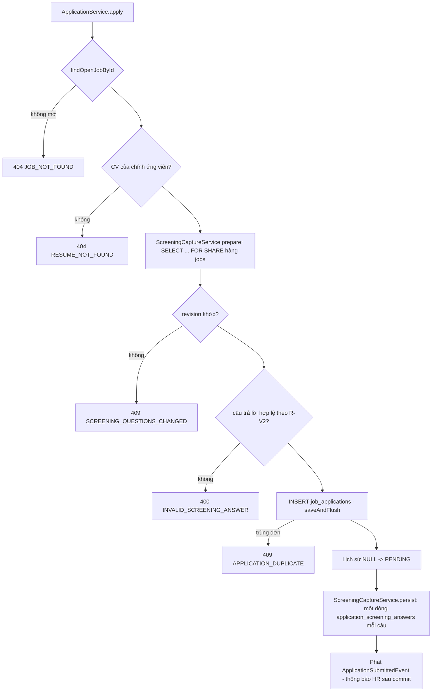

# Walkthrough — FR-U09: Trả lời sàng lọc và đồng ý lưu hồ sơ (`feat/fr-u09-screening-answer`)

> **Lưu ý cho người review.** Các chỗ lệch L5–L32 (trừ L13) đã được người dùng chấp nhận trong báo cáo từng đợt
> (11–12/10/2026), nhưng **nội dung** `REQUIREMENT.md`/`UI.md` chưa được viết lại theo các lệch đó. Chỉ L1, L2, L3,
> L4, L13 đã được ghi vào đặc tả. Chi tiết ở mục 8.

## 1. Mục tiêu

FR-H10 cho HR đặt câu hỏi sàng lọc cho từng tin, nhưng ứng viên chưa có chỗ trả lời — mọi đơn mới đều hiện "chưa ghi
nhận câu trả lời". FR-U09 lấp khoảng trống đó ở phía ứng viên. Khi nộp đơn, ứng viên trả lời các câu hỏi của tin;
backend kiểm câu trả lời, phát hiện trường hợp HR vừa sửa câu hỏi giữa lúc ứng viên đang điền, rồi lưu một **bản
chụp** câu hỏi + câu trả lời trong cùng giao dịch nộp đơn. Cùng lúc, ứng viên có thể tick một ô riêng để cho công ty
lưu hồ sơ dùng cho các đợt tuyển sau. Ô này không bắt buộc, không ảnh hưởng xét tuyển, và rút lại được (một chiều) ở
trang chi tiết đơn. Câu trả lời và lựa chọn đồng ý không đi vào AI, không đổi điểm hay thứ hạng.

## 2. Các file đã tạo/sửa

Năm commit trên `main` (`497f5cf`): đặc tả `0557e08` (11/10), rồi bốn đợt code `181158e`, `f443b7e`, `b0c8c8c`,
`cf68010` (12/10).

**Backend**

| File | Vai trò |
|---|---|
| `db/migration/V14__talent_pool_consent.sql` | Ba cột đồng ý trên `job_applications` + CHECK `chk_talent_pool_consent_state` chỉ cho đúng ba trạng thái |
| `jobapplication/JobApplication.java` | Map `screening_captured_at` và ba cột đồng ý, tất cả `updatable = false` |
| `jobapplication/dto/ApplicationCreateRequest.java` | Thêm `screeningRevision`, `answers`, `talentPoolConsent` ở cuối; JSON cũ vẫn hợp lệ |
| `jobapplication/ApplicationService.java` | `apply` gọi bước chụp sàng lọc; `revokeTalentPoolConsent` (F4); E1 thêm `talentPoolConsent` |
| `jobapplication/JobApplicationRepository.java` | `revokeTalentPoolConsentIfActive` — một câu `UPDATE` có điều kiện |
| `jobapplication/TalentPoolConsentState.java`, `dto/TalentPoolConsentResponse.java` | Ba trạng thái do backend tính + DTO trả ra |
| `jobapplication/ApplicationCandidateController.java` | Endpoint F4 `PATCH …/talent-pool-consent/revoke` |
| `screening/ScreeningCaptureService.java`, `ScreeningAnswerDraft.java` | `prepare` (khoá, so revision, kiểm câu trả lời) và `persist` (ghi bản chụp) |
| `screening/ScreeningQuestionRepository.java` | `findRevisionForShare` — `SELECT … FOR SHARE` hàng `jobs` |
| `screening/ApplicationScreeningAnswer.java` | Factory `capture(...)` + `@UuidGenerator`; entity vẫn `@Immutable` |
| `screening/ScreeningCandidateService.java`, `ScreeningCandidateController.java` | F1: bộ câu hỏi + revision cho form nộp đơn |
| `screening/ApplicationScreeningCandidateService.java` | F3: ứng viên xem lại bản chụp của chính đơn mình |
| `screening/ApplicationScreeningReader.java` | Tính `state` + đọc bản chụp, dùng chung cho S6 (HR) và F3 |
| `common/exception/*` (4 class mới) + `GlobalExceptionHandler` | `INVALID_SCREENING_ANSWER` (6 câu cố định), `SCREENING_QUESTIONS_CHANGED`, `TALENT_POOL_CONSENT_NOT_ACTIVE` |
| `db/seed/seed-test.sql`, `db/seed/README.md` | A1 đồng ý (`ACTIVE`), tám đơn còn lại `NOT_GIVEN`; hướng dẫn soát |

**Frontend**

| File | Vai trò |
|---|---|
| `features/applications/JobApplyForm.tsx` | Form nộp đơn chuyển sang React Hook Form + Zod; khối câu hỏi, ô đồng ý, xử lý 409, liên kết "Xem đơn vừa nộp" |
| `features/candidateScreening/*` (7 file) | Gọi F1/F3, schema Zod khớp R-V2, khối câu hỏi, một câu hỏi theo loại, chuỗi tiếng Việt |
| `features/screening/ScreeningAnswerList.tsx` | Danh sách bản chụp dùng chung HR + ứng viên, chữ truyền qua props |
| `features/applicationDetail/ScreeningTab.tsx` | Tab "Sàng lọc" phía HR chuyển sang dùng danh sách chung, giao diện không đổi |
| `features/candidateApplicationDetail/ScreeningAnswersSection.tsx` | Khối "Câu trả lời sàng lọc" (chỉ khi `CAPTURED`) |
| `features/candidateApplicationDetail/TalentPoolConsentSection.tsx`, `RevokeTalentPoolConsentDialog.tsx` | Khối "Lưu hồ sơ cho đợt tuyển sau" + hộp xác nhận rút |

## 3. Luồng chính

### 3.1 Ứng viên mở form nộp đơn (F1 `GET /api/candidates/jobs/{jobId}/screening-questions`)

1. `JobApplyForm` gọi `useScreeningFormQuery`. Spring Security chỉ cho role CANDIDATE vào `/api/candidates/**`.
2. `ScreeningCandidateService.getForm` mở transaction **chỉ đọc**, theo đúng thứ tự: `findOpenJobById` (tin không mở
   → 404) → `findRevision` → danh sách câu đang hoạt động. Đọc revision **trước** câu hỏi là quy tắc cứng (R-F3).
3. Frontend dựng schema Zod theo bộ câu hỏi; tin 0 câu thì không hiện khối câu hỏi.

### 3.2 Ứng viên nộp đơn (F2 `POST /api/candidates/applications`)

- Một `Instant` duy nhất dùng cho `ai_consent_at`, `screening_captured_at` và `talent_pool_consent_at` (nếu tick).
- `prepare` duyệt danh sách câu trả lời hai lượt (id lạ, rồi trùng id), rồi duyệt từng câu theo thứ tự hiển thị: sai
  loại → thiếu câu bắt buộc → quá 500 ký tự (đếm code point sau khi bỏ khoảng trắng) → phương án không có trong câu.
- Khoá `FOR SHARE` giữ tới khi commit, nên bản chụp luôn khớp đúng bộ câu đã kiểm.

### 3.3 Frontend xử lý 409 khi HR vừa sửa câu hỏi

`JobApplyForm` nhận 409 `SCREENING_QUESTIONS_CHANGED` → hiện câu của backend ở đầu khối câu hỏi → tải lại F1 →
`mergeAnswersAfterReload` giữ câu trả lời của câu còn cùng id và cùng loại (một lựa chọn: phương án còn tồn tại),
xoá phần còn lại → đặt focus về tiêu đề khối. Ứng viên kiểm lại rồi nộp lại.

### 3.4 Ứng viên xem lại và rút đồng ý (F3, E1, F4)

1. Trang `/candidate/applications/:id` tải E1 (đã có khoá `talentPoolConsent`) và F3.
2. `ApplicationScreeningCandidateService.getMyAnswers` kiểm đơn thuộc ứng viên (`findByIdAndCandidateId`, sai thì
   404) rồi gọi `ApplicationScreeningReader.read` — cùng hàm S6 phía HR dùng. Khối chỉ hiện khi `CAPTURED`.
3. Bấm "Rút đồng ý" → hộp xác nhận → `ApplicationService.revokeTalentPoolConsent`: kiểm sở hữu (404) → câu `UPDATE …
   SET talent_pool_consent = FALSE, talent_pool_consent_revoked_at = :now WHERE id = … AND candidate_id = … AND
   talent_pool_consent = TRUE` → 0 dòng thì 409 → đọc lại và trả trạng thái mới. Frontend làm mới E1, khối chuyển
   sang "đã rút".

## 4. Quyết định thiết kế

**4.1 Khoá `FOR SHARE` ở `apply` thay vì chỉ so revision.** *Đã chọn:* `SELECT screening_revision FROM jobs … FOR
SHARE` trước khi đọc câu hỏi. *Khác:* (a) chỉ so revision không khoá; (b) dựa vào thứ tự đọc; (c) `@Lock` hay `FOR
UPDATE`. *Vì sao:* (a) giữa lúc so và lúc ghi, HR vẫn commit được → bản chụp ghép lệch; (c) khoá mạnh hơn sẽ chặn cả các
đơn nộp song song. `FOR SHARE` chặn đúng câu `UPDATE … screening_revision` của HR, còn hai đơn cùng lúc không chặn nhau.
Đã thử đột biến: bỏ `FOR SHARE` thì cả hai ca của `ScreeningCaptureConcurrencyIntegrationTest` đỏ. Câu này **không
chạy được** trong transaction chỉ đọc (Postgres báo lỗi) — vì vậy F1 dùng `findRevision` thường (L2).

**4.2 `screeningRevision` được phép `null`.** *Đã chọn:* `null` nghĩa là "client không thấy câu hỏi nào", chỉ nhận
khi tin có 0 câu; ngược lại 409. *Khác:* bắt buộc revision. *Vì sao:* 25 file test cũ gửi JSON không có trường này
vẫn xanh mà không sửa, trong khi bảo đảm "câu trả lời khớp bộ câu hỏi" vẫn giữ nguyên (Q2).

**4.3 Ba cột đồng ý map `updatable = false`; rút đồng ý dùng `UPDATE` có điều kiện.** *Đã chọn:* chỉ câu `UPDATE` riêng
ghi được ba cột. *Khác:* đọc entity rồi `save`. *Vì sao:* `ApplicationService.withdraw` có sẵn vẫn đọc-rồi-`save` toàn
bộ cột; nếu ba cột updatable thì rút đơn sau khi rút đồng ý sẽ ghi đè cờ về giá trị cũ. Test
`t11_withdrawAfterRevoke_doesNotOverwriteRevokedConsent` (`TalentPoolConsentIntegrationTest`) khoá điều này.

**4.4 CHECK ba trạng thái ở DB.** *Đã chọn:* `chk_talent_pool_consent_state` chỉ cho `NOT_GIVEN`/`ACTIVE`/`REVOKED`,
xét `NULL` tường minh (bài học L7 của FR-H10). *Khác:* chỉ kiểm ở Java. *Vì sao:* tổ hợp sai (đồng ý mà không có thời
điểm, rút trước khi đồng ý) bị DB chặn dù có đường ghi nào khác về sau; `TalentPoolConsentSchemaConstraintIntegrationTest`
thử đủ 5 tổ hợp sai.

**4.5 Bản chụp ghi qua factory của entity `@Immutable`.** *Đã chọn:* `ApplicationScreeningAnswer.capture(...)` +
`@UuidGenerator`. *Khác:* câu INSERT native. *Vì sao:* đọc bytecode Hibernate 7.4.1 bằng `javap` cho thấy tính bất biến
chỉ được kiểm ở bước flush/UPDATE, không ở INSERT (L1); giữ được kiểu dữ liệu chặt và vẫn không có đường sửa bản chụp.

**4.6 Dùng chung phần đọc và phần hiển thị giữa HR và ứng viên.** *Đã chọn:* `ApplicationScreeningReader` (backend) và
`ScreeningAnswerList` (frontend), chữ khác nhau truyền qua props. *Khác:* chép logic cho phía ứng viên. *Vì sao:* hai phía
luôn hiện cùng một bản chụp theo cùng quy tắc; tab HR đã được đối chiếu tự động (8/8 chuỗi class và cấu trúc JSX trùng).

**4.7 Ẩn khối câu trả lời khi `NO_QUESTIONS`/`NOT_CAPTURED` (Q20).** Ngoại lệ có chủ đích với UI_GUIDE mục 4: với đơn cũ,
`NOT_CAPTURED` không cho biết tin lúc đó có câu hỏi hay không, nên mọi câu thông báo đều gây hiểu lầm.

**4.8 Test bảo vệ ràng buộc của FR khác — không được xoá khi refactor.**
- `TalentPoolConsentRankingIsolationIntegrationTest` bảo vệ FR-H05: cờ đồng ý và câu trả lời không đổi tổng điểm, hạng,
  trạng thái đơn.
- `ScreeningAiIsolationIntegrationTest`, `ScreeningRankingIsolationIntegrationTest` (của FR-H10) vẫn xanh sau khi có
  đường ghi thật.
- Dòng sửa ở `ApplicationCandidateDetailControllerIntegrationTest.java:336` (FR-U08) chỉ thêm đúng khoá
  `talentPoolConsent`; danh sách khoá cấm của U08 giữ nguyên.

## 5. Ràng buộc đã thực thi

| Mã | Ràng buộc | Thực thi ở đâu |
|---|---|---|
| FR-U09 R-R1, R-R2 | Bộ câu hỏi đổi giữa lúc điền → 409 | `ScreeningCaptureService.prepare` |
| FR-U09 R-R3 | Bản chụp không ghép lệch khi HR sửa song song | `ScreeningQuestionRepository.findRevisionForShare` |
| FR-U09 R-V1, R-V2 | 6 vi phạm câu trả lời → 400, không rơi xuống CHECK thành 500 | `ScreeningCaptureService` (`indexAnswers`, `validate`) |
| FR-U09 R-S1, R-S2 | Ghi bản chụp + `screening_captured_at` cùng transaction nộp đơn | `ApplicationService.apply`, `ScreeningCaptureService.persist` |
| FR-U09 R-K1, R-K2 | Đồng ý lưu hồ sơ tuỳ chọn, mặc định không | `ApplicationService.apply`; `DEFAULT FALSE` (V14) |
| FR-U09 R-K5 | Đúng ba trạng thái | `chk_talent_pool_consent_state`; `TalentPoolConsentState.of` |
| FR-U09 R-K6 | Chỉ đường rút ghi được cờ | `JobApplication` (`updatable = false`) |
| FR-U09 R-K7, R-K8 | Rút: 404 đơn người khác, 409 khi không đang đồng ý, không đổi trạng thái đơn | `ApplicationService.revokeTalentPoolConsent`, `JobApplicationRepository.revokeTalentPoolConsentIfActive` |
| FR-U09 R-A2 | Ứng viên chỉ xem/rút đơn của mình (404) | `findByIdAndCandidateId` trong `ApplicationScreeningCandidateService`, `ApplicationService` |
| FR-U09 R-N1, SRS "Nguyên tắc bổ sung" | Câu trả lời, cờ đồng ý không vào AI | Không import ở `ai/`, `scoring/`, `aicontext/`; kiểm tĩnh 7.1 |
| FR-U09 R-N2, FR-H05 | Không đổi điểm/hạng/trạng thái | `TalentPoolConsentRankingIsolationIntegrationTest` |
| FR-U02 | AI consent vẫn bắt buộc, không tick sẵn | `@AssertTrue aiConsent`, `chk_consent_true`; nút Nộp khoá tới khi tick |
| SRS "Nguyên tắc bổ sung" | Phía ứng viên không nhận dữ liệu nội bộ | DTO F1/F3/E1/F4 chỉ chứa câu hỏi, câu trả lời của chính ứng viên, cờ đồng ý |

## 6. Đã kiểm thử gì

**Test tự động.** Full suite `.\mvnw.cmd test` (chạy một lần ở đợt 6): **1047/1047**, 0 lỗi, `BUILD SUCCESS`, 6 phút 40
giây (tăng 39 test so với 1008 của FR-H10). Tám lớp mới: `ScreeningFormCandidateIntegrationTest` (5),
`ScreeningCandidateServiceTest` (2), `ApplicationScreeningCaptureIntegrationTest` (14),
`ScreeningCaptureConcurrencyIntegrationTest` (2), `TalentPoolConsentSchemaConstraintIntegrationTest` (3),
`ApplicationScreeningCandidateIntegrationTest` (5), `TalentPoolConsentIntegrationTest` (7),
`TalentPoolConsentRankingIsolationIntegrationTest` (1). Frontend: `npm run build` + `npm run lint` sạch ở đợt 4, 5.

**Kiểm HTTP (REQUIREMENT 7.2).** Chạy nguyên văn khối PowerShell trên backend thật với seed test mới: **7/7 nhóm**
khớp (200/404; 403/401; 200 `CAPTURED`/404; 409; 400; 404; 200 rồi 409).

**Kiểm tĩnh + `srs-guard`.** Ba lệnh 7.1 đạt (0 / 0 / đúng một dòng `save` của `withdraw`); `srs-guard` 15 nguyên tắc
không có vi phạm (nguyên tắc 14 phần FR-H15 và 15 chưa có code để soát).

**Soát tay trên trình duyệt (người dùng làm, 12/10/2026).**
- Đã soát và đúng: bước 1 (form tin J1 có 3 câu), bước 3 (nộp + đồng ý, "Xem đơn vừa nộp", hai khối ở trang chi tiết),
  bước 5 (rút đồng ý A1), bước 6 (A2 không đồng ý, không khối câu trả lời), bước 7 (A3 chưa chụp), và tab "Sàng lọc"
  phía HR với đơn J1 mới (`CAPTURED`).
- Trong lúc soát, một đơn được nộp nhầm vào tin demo "QA Engineer" (công ty demo); đã xoá tay 5 dòng của đơn đó trong
  một transaction (đơn, lịch sử, một tin nhắn, hai thông báo) vì `reset-test-data.sql` không chạm dữ liệu demo.

**Chưa test.**
- Bước 2 (lỗi Zod trên trình duyệt): chỉ được phủ gián tiếp — backend kiểm cùng quy tắc ở T6
  (`ApplicationScreeningCaptureIntegrationTest`, biên 499/500/501 và các ca sai). Schema Zod và bộ đếm ký tự ở
  frontend **không** có test tự động.
- Bước 4 (409 trên trình duyệt): backend phủ bởi T5, T8 và HTTP nhóm 4; hàm `mergeAnswersAfterReload` và việc đặt focus
  sau 409 ở frontend **không** có test tự động.
- Bước 9 (375px): **không** có kiểm tự động; chỉ dựa vào class responsive (`w-full` dưới `sm`, `break-words`).
- Dự án chưa có bộ test component frontend.

| "Xong khi" (REQUIREMENT 7) | Nghiệm thu | Kết quả |
|---|---|---|
| T1, T16-F1 | `ScreeningFormCandidateIntegrationTest` | Đạt |
| T2 (thứ tự đọc F1) | `ScreeningCandidateServiceTest` (`InOrder`) | Đạt |
| T3–T7, T9, T17-F2 | `ApplicationScreeningCaptureIntegrationTest` | Đạt |
| T8 (song song) | `ScreeningCaptureConcurrencyIntegrationTest` + thử đột biến bỏ `FOR SHARE` | Đạt |
| T10–T12, T16-F4/E1, T17-F4 | `TalentPoolConsentIntegrationTest` | Đạt |
| T13, T16-F3 | `ApplicationScreeningCandidateIntegrationTest` | Đạt |
| T14 | `TalentPoolConsentRankingIsolationIntegrationTest` | Đạt |
| T15 | `TalentPoolConsentSchemaConstraintIntegrationTest` | Đạt |
| T18 (hồi quy) | Full suite 1047/1047 | Đạt |
| 7.1 kiểm tĩnh | Ba lệnh đợt 6a | Đạt |
| 7.2 HTTP | Khối PowerShell đợt 6b | Đạt (7/7) |
| 7.3 frontend | build, lint, các lệnh tìm (0 dòng) | Đạt |
| 7.4 soát tay | Người dùng | Đạt bước 1, 3, 5, 6, 7; bước 8 soát với đơn J1 mới (chưa soát lại đủ A1/A9/A2/A6 — tab HR được đối chiếu tự động ở đợt 5 và 11 test `ApplicationScreeningHrIntegrationTest` không sửa); **chưa** bước 2, 4, 9 |

## 7. Nợ kỹ thuật

- **FR-H15 phải tự gắn việc xoá khỏi kho** vào chính transaction `ApplicationService.revokeTalentPoolConsent`, và chặn thêm
  vào kho mọi đơn không `ACTIVE`. Hiện rút đồng ý chỉ đặt cờ + thời điểm (không bảng kho, không event — Q10).
- `ApplicationService.withdraw` vẫn đọc-rồi-`save` (có thể ghi đè trạng thái HR vừa đổi). FR-U09 chỉ chặn hậu quả lên
  cột đồng ý bằng `updatable = false`; sửa tận gốc ở một nhánh `chore/` riêng.
- `screening_captured_at` lấy từ `Instant` của Java, còn `applied_at` là `now()` của DB, nên hai giá trị lệch vài mili giây.
  H10 R-S4 ghi "đặt bằng thời điểm nộp"; hiển thị theo phút nên không thấy khác.
- `trim()` của JS bỏ cả U+00A0, U+FEFF ở hai đầu, còn `strip()` của Java thì không (L23). Câu trả lời chỉ gồm các ký tự
  này có thể bị frontend coi là trống trong khi backend coi là có nội dung; backend vẫn là chốt chặn.
- Frontend chưa có test tự động cho schema Zod, phép ghép câu trả lời sau 409 và bố cục 375px.

## 8. Lệch so với đặc tả

Đặc tả duyệt 11/10/2026. Cột "Ghi vào đặc tả" cho biết nội dung `REQUIREMENT.md`/`UI.md` đã được sửa theo lệch chưa; mọi
lệch đều đã được người dùng chấp nhận trong báo cáo đợt tương ứng.

| Mã | Nội dung | Ghi vào đặc tả |
|---|---|---|
| L1 | Hibernate 7.4.1 persist được `@Immutable` → giữ factory (đóng O2) | Có (mục 12, đợt 2) |
| L2 | `FOR SHARE` lỗi trong transaction chỉ đọc; F1 dùng `findRevision` | Có (mục 8, đợt 2) |
| L3 | Ứng viên demo soát tay `tran.minh.hoang@demo.local` → J1 | Có (bảng 7.4, đợt 4) |
| L4 | `prepare` trả `List<ScreeningAnswerDraft>` thay record `PreparedScreeningCapture` | Có (mục 4.3, đợt 2) |
| L5 | T8 nhận diện phiên bị khoá qua `pg_stat_activity` | Không |
| L6 | T12 đặt ở lớp test mới, lớp U08 chỉ thêm đúng một khoá | Không |
| L7 | Số dòng UI_GUIDE ở mục 10 dời do D3 | Không (chỉ ghi nhận) |
| L8 | Test `@Transactional` phải flush + clear `EntityManager` trước khi sửa bằng JDBC | Không |
| L9 | Phải gọi `pg_stat_clear_snapshot()` trước mỗi lần thăm dò | Không |
| L10 | Phần F3/E1 của T3, T9 dời sang đợt 3 | Không |
| L11 | R-V2 bước 1 cài thành hai lượt (id lạ trước, trùng sau) | Không |
| L12 | F1 tự viết hàm chuyển câu hỏi → DTO, không sửa file H10 | Không |
| L13 | Dòng trạng thái REQUIREMENT "O2 chờ Plan Mode" → "O2 đã đóng (L1)" | Có (đợt 6) |
| L14 | F3 ở service mới `ApplicationScreeningCandidateService` | Không |
| L15 | T14 flush + clear trước lần quan sát đầu | Không |
| L16 | Câu `UPDATE` rút đồng ý thêm `flushAutomatically = true` | Không |
| L17 | T10 đặt trạng thái đơn bằng JDBC | Không |
| L18 | `db/seed/README.md` trỏ tới bảng 7.4 cho tên ứng viên demo | Không |
| L19 | Zod: phương án ngoài danh sách dùng câu R-V1 của backend | Không |
| L20 | 409 khi tin không có khối câu hỏi → hiện ở dòng lỗi chung | Không |
| L21 | Khoá nút Nộp trong lúc tải lại F1 sau 409 | Không |
| L22 | Khung form đổi sang `<form>` + nút `type="submit"` | Không |
| L23 | `trim()` (JS) khác `strip()` (Java) ở ký tự khoảng trắng hai đầu | Không (nợ, mục 7) |
| L24 | `candidateScreening/api.ts`, `queries.ts` có sẵn hàm F3 từ đợt 4 | Không |
| L25 | Khoá các `<fieldset>` câu hỏi trong lúc đang nộp | Không |
| L26 | Ngày giờ giữ `HH:mm dd/MM/yyyy` theo UI.md mục 7 (yêu cầu `dd/MM/yyyy` là nhầm) | Không cần (đúng đặc tả) |
| L27 | Hộp thoại rút đồng ý chỉ đóng sau khi E1 tải lại xong | Không |
| L28 | Focus sau khi rút đặt qua `onCloseAutoFocus` của Radix | Không |
| L29 | Đang gửi: chặn cả Esc, nút X, bấm ra ngoài | Không |
| L30 | F3 trả 404 xử lý như lỗi tải + "Thử lại" | Không |
| L31 | Chuỗi hai khối mới nằm trong `candidateScreeningLabels.ts` | Không |
| L32 | Yêu cầu 375px chỉ bảo đảm qua class, chưa soát trình duyệt | Không (xem mục 6) |
