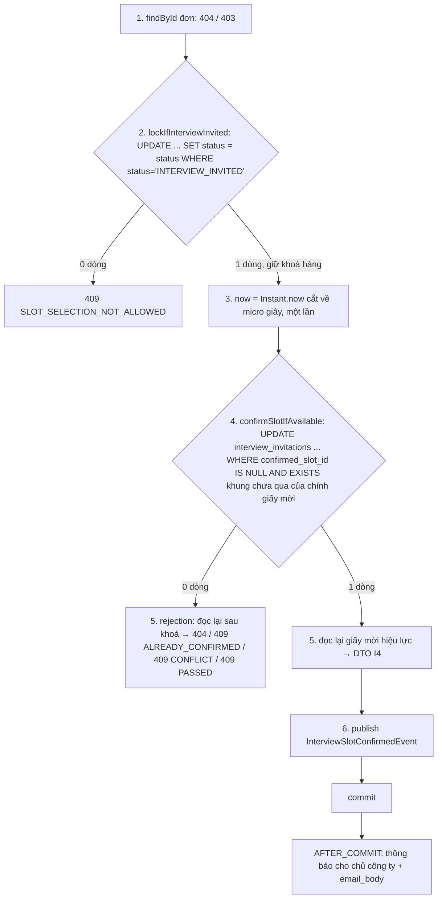

# Walkthrough — FR-U10: Chọn khung giờ phỏng vấn (`feat/fr-u10-pick-slot`)

## 1. Mục tiêu

FR-H12 cho HR gửi giấy mời có 1–5 khung giờ, nhưng ứng viên chỉ xem được danh sách khung và phải nhắn HR để chốt lịch.
FR-U10 cho ứng viên **tự chọn một khung** trong giấy mời hiệu lực ngay ở trang chi tiết đơn, qua một hộp xác nhận. Chọn
**một lần**, không tự đổi được; muốn đổi thì nhắn HR để HR gửi lại giấy mời (H12). Khung đã qua giờ không chọn được. Chủ
công ty nhận thông báo web một dòng và email kèm địa điểm, link. Tab "Giấy mời phỏng vấn" phía HR hiện thêm thời điểm ứng
viên chọn. Trạng thái đơn **không đổi**. Không gọi AI, không migration mới (V16 của H12 đã có sẵn cột khung chốt).

## 2. Các file đã tạo/sửa

**Backend**

| File | Vai trò |
|---|---|
| `interviewinvitation/InterviewInvitationCandidateController.java` | Thêm `POST /api/candidates/applications/{id}/interview-invitation/confirm-slot` (C1) |
| `interviewinvitation/dto/ConfirmInterviewSlotRequest.java` (mới) | Thân request `{ slotId }`, `@NotNull` câu "Vui lòng chọn một khung giờ." |
| `interviewinvitation/InterviewInvitationService.java` | `confirmSlot` (R-W1 bước 1–6), `rejection` (chẩn đoán khi 0 dòng, R-W5); tách `toCandidateResponse` dùng chung với I4 |
| `interviewinvitation/InterviewInvitationRepository.java` | `confirmSlotIfAvailable` — native `UPDATE` có điều kiện, `@Modifying(clearAutomatically = true, flushAutomatically = true)` |
| `common/exception/SlotSelectionNotAllowedException.java`, `InterviewSlotAlreadyConfirmedException.java`, `InterviewSlotPassedException.java`, `InterviewInvitationConflictException.java` (mới) | Bốn lỗi 409, câu cố định trong constructor |
| `common/exception/GlobalExceptionHandler.java` | Bốn handler 409; nhánh `uq_invitation_active` dùng chung câu với `InterviewInvitationConflictException` |
| `notification/InterviewSlotConfirmedEvent.java` (mới) | Sự kiện mang giá trị khung vừa chốt |
| `notification/NotificationType.java`, `NotificationEventListener.java`, `NotificationContentBuilder.java` | Loại `INTERVIEW_SLOT_CONFIRMED`; `onInterviewSlotConfirmed`; `forSlotConfirmed` dựng `body` một dòng + `email_body` |

**Frontend**

| File | Vai trò |
|---|---|
| `features/interviewinvitation/InterviewSlotPicker.tsx` (mới) | `<fieldset>` radio, nhãn "Đã qua", lỗi "chưa chọn", nút "Xác nhận khung giờ" |
| `features/interviewinvitation/ConfirmInterviewSlotDialog.tsx` (mới) | Hộp xác nhận, gọi mutation C1, lỗi trong hộp thoại |
| `features/interviewinvitation/InterviewInvitationDetails.tsx` | Chọn hiển thị theo bảng UI.md mục 6; giữ hộp xác nhận (L30) |
| `features/candidateApplicationDetail/InvitationSection.tsx` | Truyền `status`; `h2` nhận focus sau khi xác nhận |
| `features/interviewinvitation/api.ts`, `queries.ts`, `types.ts` | `confirmInterviewSlotRequest`, `useConfirmInterviewSlotMutation`, `ConfirmInterviewSlotRequest` |
| `features/interviewinvitation/invitationLabels.ts` | Khoá mới phía ứng viên, hộp xác nhận, dòng HR; thay `candidateUnconfirmed`; sửa `resendConfirmedNotice` |
| `features/applicationDetail/InterviewInvitationTab.tsx`, `features/interviewinvitation/PreviousInvitationCard.tsx` | Dòng "Ứng viên đã chọn lúc …" (`CandidatePickedLine`, L37) |
| `features/notifications/types.ts` | `'INTERVIEW_SLOT_CONFIRMED'` |

**Seed:** `db/seed/seed-test.sql` (dải `f1`: đơn A10 của Lê Thị Lan, giấy mời 3 khung chưa chốt, 1 khung đã qua, hai thông
báo), `db/seed/README.md`.

## 3. Luồng chính

### 3.1 Ứng viên chọn khung (C1)

Bảng ghi: `interview_invitations` (chỉ `confirmed_slot_id`, `confirmed_at`), `job_applications` (chỉ `updated_at` đổi do
trigger khi khoá — R-S2), sau commit `notifications`. Không gọi `ApplicationStatusService`, không ghi lịch sử trạng thái.
Response là DTO I4, không đổi hình dạng.

### 3.2 Thông báo cho HR

`NotificationEventListener.onInterviewSlotConfirmed` (`AFTER_COMMIT` + `REQUIRES_NEW`) nạp tin → công ty → ứng viên, gọi
`NotificationContentBuilder.forSlotConfirmed` với giờ và địa điểm **trong sự kiện**, ghi một dòng `notifications` cho
`company.getOwnerId()`, `link` `/hr/applications/{id}?tab=invitation`. Poller email gửi nguyên văn `email_body` (cơ chế
của H12). Ứng viên không nhận thông báo.

### 3.3 Giao diện

- **Ứng viên** (`/candidate/applications/:id`): `InterviewInvitationDetails` chọn trạng thái từ `status` của đơn + I4 —
  chọn được (radio + nút), mọi khung đã qua (câu hướng sang "Trao đổi"), đã chọn (câu "Bạn đã chọn khung giờ này lúc …"),
  giấy mời 1 khung / đơn đã có kết quả (chỉ đọc như H12). Bấm nút khi chưa chọn → lỗi tại chỗ, focus radio đầu tiên chọn
  được. Hộp xác nhận: thành công → `setQueryData` I4, focus `h2`; lỗi 409/404 → câu backend trong hộp thoại, I4 (và trang
  chi tiết với `SLOT_SELECTION_NOT_ALLOWED`) tải lại.
- **HR** (`/hr/applications/:id?tab=invitation`): giấy mời ≥ 2 khung đã chốt có dòng "Ứng viên đã chọn lúc …" dưới "Gửi
  lúc …", cả ở thẻ giấy mời trước đó. Hộp thoại "Gửi lại" đổi câu lưu ý thành "Giấy mời hiện tại đã chốt khung …".

## 4. Quyết định thiết kế

**Khoá hàng đơn trước mọi thao tác đọc giấy mời (R-W2).**
- Đã chọn: dùng lại `lockIfInterviewInvited` của H12; đọc giấy mời chỉ sau khoá (bước 5).
- Khác: đọc giấy mời hiệu lực ngay ở bước kiểm quyền "để trả 404 sớm".
- Vì sao: I2, I3, Trúng tuyển/Từ chối, Rút đơn đều ghi hàng `job_applications`; có khoá thì giấy mời hiệu lực không đổi
  tới hết transaction, nên lý do lỗi đọc ở bước 5 là đúng. Đọc trước khoá có thể báo `INTERVIEW_SLOT_PASSED` cho giấy
  mời đã bị thay. Test: `InterviewSlotConfirmConcurrencyIntegrationTest.t7_lockHeldByA_resendCommitted_confirmOfBBlockedThenConflict`,
  `t8_lockAndHiredByA_confirmOfBBlockedThenNotAllowed` (đơn luồng, xác nhận B bị chặn bằng `pg_stat_activity`). Thử đột
  biến bỏ khoá làm đỏ 4/10 ca của lớp này (L17).

**Chốt một lần bằng một câu `UPDATE` có điều kiện, không nạp entity rồi `set` (R-W3).**
- Đã chọn: `WHERE superseded_at IS NULL AND confirmed_slot_id IS NULL AND EXISTS (khung của chính giấy mời, scheduled_at >
  :now)`.
- Khác: `findBy…` rồi `setConfirmedSlotId` + `flush`; hoặc kiểm "đã chốt chưa" bằng Java rồi ghi không điều kiện;
  `SELECT … FOR UPDATE`.
- Vì sao: Postgres đánh giá lại `WHERE` trên bản đã commit khi lượt sau chờ khoá → bấm đúp hay hai tab chỉ một lượt thắng;
  Hibernate không `@DynamicUpdate` sẽ ghi lại mọi cột. Điều kiện `s.invitation_id = i.id` chặn trước FK ghép, nên `slotId`
  lạ/cũ/của đơn khác ra 409, không 500 (R-W4). Test: `t6a_…`, `t6b_…` (10 vòng, đúng một 200, một 409, một thông báo).

**`now` lấy một lần, cắt về micro giây (L14).**
- Đã chọn: `Instant.now().truncatedTo(ChronoUnit.MICROS)` dùng cho cả câu `UPDATE`, `confirmed_at` và phân loại lỗi.
- Khác: `now()` của Postgres; `Instant.now()` nano giây.
- Vì sao: `TIMESTAMPTZ` lưu micro giây; nếu bind nano giây thì JDBC làm tròn, SQL thấy "đã qua" trong khi Java thấy "chưa
  qua" → rơi vào nhánh phòng thủ `INTERVIEW_INVITATION_CONFLICT`. Test: `t2_slotAtNow_returns409Passed`.

**Chẩn đoán lỗi chỉ khi `UPDATE` trả 0 dòng, theo thứ tự cố định (R-W5).** Không có → 404; đã chốt → `ALREADY_CONFIRMED`
(kể cả chọn lại đúng khung, Q3); khung không thuộc giấy mời hiệu lực → một mã, một câu cho mọi trường hợp (không lộ khung
của đơn khác); khung đã qua → `PASSED`. Test: `t4_…` (bốn ca thứ tự).

**Sự kiện mang giá trị khung, gói `notification/` không import `interviewinvitation/` (R-N1, L20).** Giờ và địa điểm
lấy từ phần tử `confirmed = true` của DTO vừa dựng. Thông báo không xảy ra khi lỗi nhờ rollback + `AFTER_COMMIT` (thử
đột biến L26), có test riêng ở lớp không `@Transactional`: `InterviewSlotConfirmNotificationIntegrationTest`.

**Mốc "đã qua" ở giao diện là `dataUpdatedAt` của I4, không `Date.now()` trong render (L31).** Lint
`react-hooks/purity` cấm `Date.now()` trong thân component; trang mở lâu thì backend chặn bằng 409 `INTERVIEW_SLOT_PASSED`
rồi I4 tải lại.

**Hộp xác nhận nằm ở `InterviewInvitationDetails`, không ở phần chọn (L30).** `setQueryData` đổi I4 sang "đã chốt" ngay
khi thành công → phần chọn bị gỡ; hộp thoại nằm trong phần chọn sẽ bị gỡ theo, mất `onCloseAutoFocus`.

**"Ứng viên đã chọn" suy từ `slots.length >= 2 && confirmedSlotId !== null` (R-H1, L36).** H12 chỉ tự chốt giấy mời 1
khung, nên giấy mời nhiều khung đã chốt ⇔ ứng viên đã chọn. Không thêm cột `confirmed_by`, không so `confirmedAt` với
`sentAt`.

## 5. Ràng buộc đã thực thi

| Mã | Ràng buộc | Thực thi ở đâu |
|---|---|---|
| R-C1, R-A1, R-A2 | Chỉ chủ đơn; 404/403 trước khoá | `confirmSlot` bước 1; `/api/candidates/**` ở `SecurityConfig` |
| R-C2 | Đơn `INTERVIEW_INVITED`, đọc dưới khoá | `JobApplicationRepository.lockIfInterviewInvited` |
| R-C3, R-C4, R-C5, R-C6 | Giấy mời hiệu lực, chưa chốt, khung của chính nó, chưa qua | `InterviewInvitationRepository.confirmSlotIfAvailable`; FK ghép `fk_invitation_confirmed_slot`, CHECK `chk_invitation_confirmed_pair` (V16) |
| R-C7 | Tin `CLOSED`/xoá mềm vẫn chọn được | Không kiểm tin (test `t5_…`) |
| R-W1–R-W8 | Một transaction ngắn, đúng thứ tự, không khoá `SELECT`, không lời gọi ngoài | `InterviewInvitationService.confirmSlot`, `rejection` |
| R-S1–R-S3 | Không đổi trạng thái, không lịch sử; chỉ hai cột giấy mời đổi | Kiểm tĩnh 7.1 (`changeStatus` 1 dòng); `t1_…` so từng cột |
| R-N1–R-N6 | Một thông báo cho chủ công ty, web một dòng, email có địa điểm + link, không lộ `email_body` | `NotificationEventListener.onInterviewSlotConfirmed`, `NotificationContentBuilder.forSlotConfirmed`; `NotificationResponse` không có `emailBody` |
| R-K1, R-K2 | K1/C07 dùng khung vừa chọn, không sửa code | `ConversationContextAssembler` không đổi (kiểm tĩnh `git diff --stat`) |
| R-U1–R-U3, R-H1, R-H2 | Giao diện ứng viên, dòng HR, sửa đúng một câu H12 | `InterviewInvitationDetails`, `InterviewSlotPicker`, `CandidatePickedLine`, `invitationLabels.ts` |
| CLAUDE.md §2, §7, §8 | Không trạng thái mới; không tên cấm; không xanh/đỏ, không làm mờ khung đã qua | Kiểm tĩnh 7.1 (`-w`); token `m3-*` trung tính, chữ "Đã qua" + radio khoá |

## 6. Đã kiểm thử gì

**Tự động.** Full suite backend `.\mvnw.cmd test`: **1270 test, 0 lỗi, 0 bỏ qua** (đợt 6, 14/10/2026). FR-U10 thêm 3 lớp
test mới (`InterviewSlotConfirmControllerIntegrationTest`, `InterviewSlotConfirmNotificationIntegrationTest`,
`InterviewSlotConfirmConcurrencyIntegrationTest`) và thêm ca ở 3 lớp có sẵn (`ConversationContextAssemblerIntegrationTest`,
`NotificationContentBuilderTest`, `CandidateApplicationCrossEndpointAccessIntegrationTest`). Frontend: `npm run build` +
`npm run lint` sạch. Kiểm tĩnh 7.1 (theo L15, L16) và 7.3 đều đúng kỳ vọng. Seed: reset → nạp → câu đếm → reset lần hai
→ nạp lại, số đếm khớp mục 4.6 (L25).

**Kiểm HTTP mục 7.2.** Đạt 10/10 bước (14/10/2026), chạy trên seed sạch. Email trong MailHog khớp R-N4 (tiêu đề, dòng
`body`, "Địa điểm: …", link `?tab=invitation`); chỉ HR test nhận, ứng viên không nhận thư.

**Soát tay mục 7.4.** Đạt (người dùng soát 14/10/2026, desktop/768px/375px). Hai trường hợp không soát:
- "Nhắc lịch phỏng vấn" bị khoá **trước** khi chọn: khung đã được chốt trước khi kiểm; phần này do test MessageDraft phủ
  (`NO_ACTIVE_INTERVIEW`).
- A9 (tài khoản phải qua onboarding): test tự động và seed đã phủ.

| "Xong khi" (REQUIREMENT mục 7) | Cách nghiệm thu | Kết quả |
|---|---|---|
| T1, T2, T3, T4, T5, T13 | `InterviewSlotConfirmControllerIntegrationTest` (`t1_…`–`t5_…`, `t13_…`) | Đạt |
| T6, T7, T8 | `InterviewSlotConfirmConcurrencyIntegrationTest` (song song 10 vòng + đơn luồng qua `pg_stat_activity`) | Đạt |
| T9 | `ConversationContextAssemblerIntegrationTest.forConversation_afterCandidateConfirmsSlot_interviewIsChosenSlot`; `ConversationContextSignatureTest` không sửa | Đạt |
| T10; "không thông báo" của T3 (L21) | `InterviewSlotConfirmNotificationIntegrationTest` (lớp không `@Transactional`, thêm ca rollback) | Đạt |
| T11 | `NotificationContentBuilderTest.forSlotConfirmed_…` (hai ca) | Đạt |
| T12 | `CandidateApplicationCrossEndpointAccessIntegrationTest` (thêm C1) | Đạt |
| Kiểm tĩnh 7.1, 7.3 | Công cụ tìm của phiên + `git diff --stat main` (L16) | Đạt |
| 7.2 | Khối PowerShell + email MailHog | Đạt |
| 7.4 | Soát tay của người dùng | Đạt |

**Chưa test.** Frontend không có test tự động (focus sau xác nhận, lỗi "chưa chọn", `aria-live` chỉ soát tay). T7/T8
song song chỉ kiểm tập kết quả hợp lệ; phần "khoá thật sự chặn" dựa vào các ca đơn luồng. Email thật qua MailHog chỉ
soát tay. Không kiểm máy ứng viên lệch giờ.

## 7. Nợ kỹ thuật và giới hạn đã biết

- **Chọn trùng lúc HR gửi lại** (Q8, R-R1): cả hai thứ tự đều hợp lệ; HR đang mở hộp thoại "Gửi lại" không được báo ứng
  viên vừa chọn. Muốn báo phải đổi I3 của H12.
- **Giờ máy ứng viên**: giao diện ẩn radio khung đã qua theo giờ máy (mốc `dataUpdatedAt`, L31); máy lệch giờ hoặc trang
  mở lâu thì khung đã qua vẫn hiện chọn được, backend trả 409 `INTERVIEW_SLOT_PASSED` và I4 tải lại.
- **`slotId` sai định dạng UUID**: body không đọc được rơi vào nợ có sẵn "body JSON hỏng trả 401 trên server thật"
  (`ROADMAP.md`, mục FR-H11).
- 409 `SLOT_SELECTION_NOT_ALLOWED` khi đơn vừa bị rút ở tab khác: khối giấy mời ẩn theo FR-U08 R-T3 nên câu lỗi biến mất
  cùng hộp thoại; người dùng thấy badge "Đã rút" (L33).
- **Môi trường dev — đồng hồ container Postgres chậm khoảng 34 giây so với máy** (đo khi chạy 7.2). `created_at` của thông
  báo (`now()` của DB) có thể nhỏ hơn `confirmed_at` (`Instant.now()` của Java). Không phải lỗi code.
- **Ngoài phạm vi, chưa sửa (ghi lại để nhánh sau xử lý):**
  - `backend/src/test/java/com/recruitment/interviewinvitation/InterviewInvitationResendConcurrencyIntegrationTest.java:99`
    ghi "1 khung, da chot" nhưng helper gửi 2 khung (`request(2)`) — comment sai có từ H12 (L8).
  - `backend/src/main/java/com/recruitment/notification/NotificationMailOrchestrator.java:58` ghi "email_body khác null
    (hiện chỉ INTERVIEW_INVITATION_RESENT)"; từ U10 còn `INTERVIEW_SLOT_CONFIRMED`. Mục 4.2 không cho sửa file này (L23).

## 8. Lệch so với đặc tả

Mọi chỗ lệch dưới đây đã ghi vào mục 13 REQUIREMENT.md và được duyệt.

| Chỗ lệch | Duyệt |
|---|---|
| L1–L13: làm rõ sau Plan Mode (DB dev ở V14; câu SQL soát tay "mọi khung đã qua" vi phạm unique → câu mới; T6 không vòng thăm; T7/T8 xác nhận chặn bằng `pg_stat_activity` + ca đơn luồng thuận; bind `Instant`; cờ `@Modifying`; comment cũ H12; focus "Huỷ"; `findById` khung; file thử nghiệm) | 14/10/2026 |
| L14: `now` cắt về micro giây | 14/10/2026 (đợt 2) |
| L15: kiểm tĩnh `confirmed_slot_id` 4 dòng, không phải 2 | 14/10/2026 (đợt 2) |
| L16: máy dev không có `rg` — kiểm tĩnh bằng công cụ tìm của phiên | 14/10/2026 (đợt 2) |
| L17, L18: kết quả thử đột biến bỏ khoá; đếm thông báo của T6/T7 dời sang đợt 3 | 14/10/2026 (đợt 2) |
| L19–L26: nguồn kế hoạch đợt 3; giá trị khung cho sự kiện; "không thông báo" của T3 kiểm ở lớp không `@Transactional`; phạm vi assert thông báo T6–T8; comment lỗi thời `NotificationMailOrchestrator`; dòng U09 của seed README; môi trường DB dev; thử đột biến phát sự kiện | 14/10/2026 (đợt 3) |
| L27–L35: ngoặc kép lồng; focus sau xác nhận; `aria-invalid` trên `role="radiogroup"`; hộp xác nhận ở `InterviewInvitationDetails`; mốc `dataUpdatedAt` (L31, duyệt ở đợt 5); hai nút cùng hàng ở 375px; 409 khi đơn bị rút ở tab khác; 403 không câu riêng; tránh tên `passed` | 14/10/2026 (đợt 4, 5) |
| L36, L37: vế `confirmedAt !== null` chỉ để thu hẹp kiểu; `CandidatePickedLine` đặt ở `PreviousInvitationCard.tsx` | 14/10/2026 (đợt 5) |
| L38: SRS cột Trạng thái và tick ROADMAP dời sang đợt 6 phần B, cùng lúc với trạng thái đặc tả | 14/10/2026 (đợt 6 phần B) |
