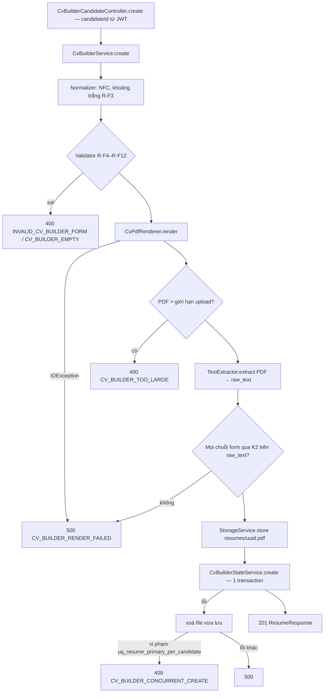

# Walkthrough — FR-U12: Tạo CV (`feat/fr-u12-cv-builder`)

## 1. Mục tiêu

Nhiều ứng viên chưa có CV, hoặc có nhưng trình bày lộn xộn. FR-U12 cho ứng viên tự tạo CV ngay trong hệ thống: điền một
form theo 7 khối (liên hệ, thông tin chung, học vấn, kinh nghiệm, kỹ năng, chứng chỉ, dự án), chọn 1 trong 2 mẫu trình
bày một cột, xem trước rồi lưu. Backend dựng ra một file PDF thật và lưu nó như một CV tải lên bình thường, nên mọi chức
năng dùng CV (nộp đơn, chấm điểm, hỏi đáp CV, gợi ý việc làm, gợi ý cải thiện) chạy y như với CV upload. Điểm khác: CV
này **không** đi qua AI trích xuất — hệ thống ghi thẳng "CV đã trích xuất" từ dữ liệu form, còn văn bản thô `raw_text`
được trích lại từ chính file PDF vừa dựng. Sửa CV là mở lại form và lưu thành **một CV mới**; CV cũ và các đơn đã nộp bằng
nó giữ nguyên. AI chỉ xuất hiện ở một nút tuỳ chọn "Gợi ý diễn đạt" cho đoạn mô tả kinh nghiệm/dự án, và gợi ý chỉ có
hiệu lực khi ứng viên bấm "Dùng gợi ý". Form cố ý không có ô ảnh, ngày sinh, giới tính, hôn nhân.

## 2. Các file đã tạo/sửa

**Backend** (đường dẫn dưới `backend/src/main/java/com/recruitment/`, trừ khi ghi khác)

| File | Vai trò |
|---|---|
| `cvbuilder/CvBuilderCandidateController.java` (mới) | 4 endpoint dưới `/api/candidates/cv-builder`: B1 `POST /resumes` (tạo, 201), B2 `GET /resumes/{id}` (đọc form đã lưu), B3 `POST /preview` (PDF xem trước, `no-store`), B4 `POST /rephrase` (gợi ý diễn đạt) |
| `cvbuilder/CvBuilderService.java` (mới) | Facade, **không** `@Transactional`: chuẩn hoá → kiểm → dựng PDF → giới hạn kích thước → trích `raw_text` + K2 → lưu file → gọi bean ghi; rollback thì xoá file |
| `cvbuilder/CvBuilderStateService.java` (mới) | Bean ghi: một transaction ngắn ghi `resumes` + `resume_parsed_data` + `cv_builder_documents` |
| `cvbuilder/CvBuilderForm`, `CvBuilderFormNormalizer`, `CvBuilderFormValidator` (mới) | Schema form (không trường nhân thân); chuẩn hoá NFC/khoảng trắng (R-F3); kiểm độ dài, mốc, GPA, email, ngành, ký tự, glyph, từ quá dài (R-F4–R-F12) |
| `cvbuilder/CvBuilderPayloadMapper.java` (mới) | Ánh xạ form → `ResumeParsedPayload` (schema CV đã trích xuất v2) |
| `cvbuilder/CvPdfRenderer`, `CvPdfFonts`, `CvPdfLabels`, `CvTemplate` (mới) | Dựng PDF 2 mẫu bằng PDFBox, nạp font Noto Sans, nhãn mục cố định tiếng Việt, enum mẫu |
| `cvbuilder/CvBuilderDocument`, `CvBuilderDocumentRepository` (mới) | Entity/repository bảng `cv_builder_documents` |
| `cvbuilder/CvBuilderExceptionAdvice`, `dto/*` (mới) | Body JSON hỏng → 400 riêng cho B1/B3 và B4; request/response |
| `ai/cvrephrase/CvRephraseService`, `CvRephraseValidator`, `CvRephrasePayload`, `CvRephraseKind` (mới) | Gọi K3 cho một đoạn mô tả; hàm kiểm output (số, độ dài, ngôn ngữ, ký tự) |
| `ai/client/CvRephraseChatClientConfig.java` (mới) | Bean `cvRephraseChatClient` riêng, trần 800 token đầu ra |
| `resources/ai/prompt/cv-rephrase-v1.st` (mới) | Prompt đã duyệt (REQUIREMENT 13.4, siết thêm 2 quy tắc sau cổng đo lần 1 — L47) |
| `resources/db/migration/V18__cv_builder_documents.sql` (mới) | Bảng form: `resume_id` UNIQUE, `template` CHECK `CLASSIC`/`MODERN`, `form_data` JSONB |
| `resources/fonts/NotoSans-Regular.ttf`, `NotoSans-Bold.ttf`, `OFL.txt` (mới) | Font tĩnh nhúng vào PDF + giấy phép (nguồn, SHA-256 ở L23) |
| `common/text/VietnameseLetters.java` (mới) | Hằng bộ chữ tiếng Việt có dấu, dùng chung cho kiểm glyph và kiểm ngôn ngữ (L8) |
| `common/exception/CvBuilder*Exception`, `CvBuilderField`, `InvalidCvRephraseRequestException`, `GlobalExceptionHandler` | Mã lỗi chuẩn hoá + câu tiếng Việt cố định |
| `resume/ResumeParsingStateService.java` | Thêm `insertBuiltResume` (ghi CV `DONE` + CV đã trích xuất, không qua scheduler) |
| `resume/ResumeSchemaVersions.java` | `cv-builder-v1` → schema 2; `isCvBuilder` |
| `resume/ResumeService.java`, `dto/ResumeResponse.java` | `fromCvBuilder` trong danh sách CV; hằng kích thước tối đa thành `public` |
| `ratelimit/RateLimitFilter.java` | Đường dẫn B4 vào nhóm `ai-sync` có sẵn |
| `.gitattributes` | `*.ttf binary -text` |

**Frontend** (dưới `frontend/src/`)

| File | Vai trò |
|---|---|
| `pages/CvBuilderPage.tsx` (mới), `App.tsx` | Trang dùng cho cả tạo (`/candidate/resumes/new`) và sửa (`/candidate/resumes/:id/edit`) |
| `features/cvBuilder/CvBuilderFormView.tsx`, `ListSection.tsx`, `MonthField.tsx`, `TemplatePicker.tsx` | Form React Hook Form 7 khối, khối danh sách động, ô mốc `MM/YYYY`, chọn mẫu |
| `features/cvBuilder/cvBuilderSchema.ts`, `cvBuilderLabels.ts`, `types.ts`, `api.ts` | Zod kiểm cùng câu lỗi backend; mọi chuỗi hiển thị; kiểu dữ liệu; gọi B1–B4 |
| `features/cvBuilder/prefillFromParsed.ts` | Điền sẵn form từ một CV đã trích xuất (chỉ chép mốc đúng dạng) |
| `features/cvBuilder/RephraseAssist.tsx` | Nút "Gợi ý diễn đạt", khối "Do AI tạo", "Dùng gợi ý"/"Bỏ qua" |
| `features/cvBuilder/PreviewDialog.tsx`, `useLeaveGuard.ts` | Hộp thoại PDF xem trước; cảnh báo khi tải lại trang lúc chưa lưu |
| `features/resumes/ResumeList.tsx`, `queries.ts`, `types.ts` | Nút "Sửa CV" cho CV `fromCvBuilder`; câu rỗng mới; export khoá query |
| `pages/CandidateProfilePage.tsx`, `features/candidateProfile/SkillTagInput.tsx` | Nút "Tạo CV", câu "Đã tạo CV."; 2 prop tuỳ chọn cho ô công nghệ (L12) |

## 3. Luồng chính

### 3.1 Tạo CV — B1 `POST /api/candidates/cv-builder/resumes`

1. Controller lấy `candidateId` từ JWT; quyền vai trò theo tiền tố `/api/candidates/**` (token HR → 403).
2. `CvBuilderFormNormalizer` chuẩn hoá: NFC, `\r\n` → `\n`, tab/NBSP → dấu cách, strip, ô tuỳ chọn trống → `null`. Không
   đổi hoa/thường.
3. `CvBuilderFormValidator.validate(template, form, versionLabel)` kiểm theo thứ tự cố định (L5), trả **lỗi đầu tiên**
   kèm câu tiếng Việt không chứa giá trị đã gõ. Kiểm glyph và "từ quá dài" gọi **cùng** hàm đo chữ với renderer
   (`CvPdfRenderer.styleOf/textWidth/wordsFit`, L28) để form hợp lệ thì chắc chắn in được, không phải ngắt giữa từ.
4. `CvPdfRenderer.render` dựng PDF A4 một cột, nhúng Noto Sans, ngắt dòng tại dấu cách, không căn đều hai bên, không in
   chữ nào ngoài nội dung form và nhãn mục (không in ngành nghề — O1).
5. PDF lớn hơn `ResumeService.MAX_RESUME_SIZE_BYTES` → 400 (R-P9).
6. `extractVerified`: trích văn bản bằng chính `TextExtractor` của upload, rồi kiểm mọi chuỗi đã in (ô chữ, phần tử kỹ
   năng/công nghệ, mốc, "Hiện tại", GPA đã định dạng) bằng `VerbatimQuoteVerifier.isVerbatim` (K2). Một chuỗi không khớp
   → 500, không lưu gì; log `warn` chỉ ghi đường dẫn ô, không ghi giá trị (R-P8).
7. Lưu file qua `StorageService` (khoá `resumes/<uuid>.pdf`) **trước** khi mở transaction.
8. `CvBuilderStateService.create` (transaction ngắn): `insertBuiltResume` ghi `resumes` (`file_type = PDF`,
   `parse_status = DONE`, CV chính chỉ khi ứng viên chưa có CV nào) và `resume_parsed_data` (`raw_text`, payload qua
   `ResumeParsedDataEnricher`, `model = cv-builder`, `prompt_version = cv-builder-v1`, `token_usage` NULL); rồi
   `cv_builder_documents` (`template`, `form_data`) bằng `saveAndFlush`.
9. Transaction lỗi → không còn hàng nào; facade xoá file vừa lưu (R-W3). Hai request tạo CV đầu tiên cùng lúc: unique
   index `uq_resume_primary_per_candidate` chặn một bên → 409 (R-W5).
10. Trả `ResumeResponse` (`parseStatus = DONE`, `schemaVersion = 2`, `fromCvBuilder = true`). Không gọi `ChatModel`
    hay `EmbeddingModel`; scheduler trích xuất không nhặt CV này vì nó đã `DONE`.

### 3.2 Đọc lại form (B2), xem trước (B3)

- B2 `GET …/resumes/{id}`: `findByIdAndCandidateId` → CV người khác hoặc không tồn tại cùng 404 `RESUME_NOT_FOUND`; CV
  tải lên (không có hàng `cv_builder_documents`) → 409 `CV_NOT_FROM_BUILDER`; còn lại trả `form`, `template`,
  `versionLabel`, `createdAt`.
- B3 `POST …/preview`: chạy bước 2–5 của B1, trả bytes PDF (`application/pdf`, `Cache-Control: no-store`). Không lưu
  file, không ghi bảng nào.

### 3.3 Gợi ý diễn đạt — B4 `POST …/rephrase`

1. `RateLimitFilter` khớp **chính xác** đường dẫn → tiêu một lượt bucket `ai-sync:{userId}` (chung với C07, H11, C08).
2. `CvBuilderService.rephrase` chuẩn hoá đoạn văn, kiểm rỗng → < 20 → > 800 ký tự → ký tự cấm → `kind` (R-A2). Mọi lỗi
   400 xảy ra trước khi gọi AI.
3. `CvRephraseService.rephrase`: system message chỉ gồm prompt + nhãn loại đoạn cố định; đoạn văn nằm trong khối
   `<doan_van>` của user message, `<`/`>` đổi thành `‹`/`›` (R-I).
4. `SyncAiCaller` (K3) gọi `cvRephraseChatClient` có thời hạn; hàm kiểm `CvRephraseValidator.isValid`: độ dài ≤ 1,5×
   đoạn gốc, không có số mới, giữ ngôn ngữ gốc, không ký tự định dạng ẩn. Sai → thử lại 1 lần → 502 `AI_INVALID_OUTPUT`;
   lỗi nhà cung cấp/quá hạn → 503/504.
5. Trả `{ suggestion }`. Không lưu gì, không K4.

### 3.4 Giao diện

`CvBuilderPage` dùng một form cho cả tạo và sửa. Kiểm phía client bằng Zod với đúng câu lỗi backend (đếm độ dài sau
NFC — L56); glyph và "từ quá dài" chỉ backend báo được, lỗi hiện ở thanh thao tác cuối form. `RephraseAssist` ghi lại
nội dung ô lúc gửi; kết quả về mà ô đã đổi thì bỏ; cả trang chỉ một request gợi ý cùng lúc; chỉ `handleUse` ("Dùng gợi
ý") mới ghi gợi ý vào ô. Lưu xong quay về `/candidate/profile` với câu tại chỗ "Đã tạo CV." (`role="status"`, không
toast). `useLeaveGuard` hỏi xác nhận khi tải lại/đóng tab lúc form đã sửa mà chưa lưu.

## 4. Quyết định thiết kế

**`raw_text` trích lại từ PDF thật và kiểm bằng K2, không ghép chuỗi từ form (Q-U3, O2).**
- Đã chọn: trích văn bản từ chính file PDF vừa dựng bằng `TextExtractor` của upload; test T7 bắt buộc mọi chuỗi form
  có trong `raw_text` qua K2 với cả hai mẫu; thêm kiểm lúc chạy ở mỗi lần lưu (R-P8).
- Khác: ghép chuỗi trực tiếp từ form; chỉ kiểm trong test.
- Vì sao: evidence của chấm điểm (FR-H04) và trích dẫn hỏi đáp (FR-C08) được kiểm trên `raw_text`, còn HR tải về file
  PDF. Ghép chuỗi có thể lệch với chữ thật trong file, khiến "evidence nguyên văn" không có trong file HR đọc (CLAUDE.md
  §2). Kiểm lúc chạy chặn được trường hợp PDFBox/font trích lệch mà test không phủ; đánh đổi là một form hợp lệ vẫn có
  thể bị 500. Chính quyết định này buộc phải có R-F12 (chặn từ dài hơn một dòng) và NFC (R-F3).

**Font Noto Sans tĩnh nhúng trong `resources/fonts/` (Q-U2, L23).**
- Đã chọn: bản tĩnh `NotoSans-v2.015` từ kho `notofonts`, Regular + Bold, kèm `OFL.txt`; `*.ttf binary -text`.
- Khác: font hệ thống; bản biến thiên của `google/fonts`.
- Vì sao: font hệ thống không có sẵn ổn định trên container/máy khác; font chuẩn PDF không có glyph tiếng Việt. Đo bằng
  font thật (L24) để chốt bề rộng dòng cho R-F12. Đánh đổi: thêm ~1,2 MB vào repo, emoji/chữ Hán không in được (bị chặn
  bằng câu lỗi glyph).

**Transaction ngắn, chỉ bao phần ghi DB (R-W2, R-W3; CLAUDE.md §3c).**
- Đã chọn: dựng PDF, trích văn bản, lưu file đều ở facade không transaction; `CvBuilderStateService.create` (bean riêng)
  mở một transaction ghi ba bảng; lỗi thì facade xoá file bằng đúng giá trị `store()` trả về (L16).
- Khác: một transaction bao cả dựng PDF + lưu file + ghi DB.
- Vì sao: giữ connection trong lúc dựng PDF làm cạn pool; method `@Transactional` gọi bằng `this.` không mở transaction
  nên phải ở bean riêng. Test T15 xác nhận file thật sự bị xoá khi rollback.

**Không gọi AI trích xuất; ghi `model = cv-builder`, `prompt_version = cv-builder-v1` (Q-U4).**
- Đã chọn: CV ghi thẳng `DONE`; `ResumeSchemaVersions` nhận `cv-builder-v1` là schema 2.
- Khác: ghi `resume-parse-v2` (sai sự thật — không có LLM); thêm cột `source`.
- Vì sao: để `PENDING` thì scheduler sẽ gọi LLM trích xuất lại CV vừa dựng. Test bảo vệ hành vi của FR khác — **không
  xoá khi refactor**: `resume/ResumeSchemaVersionsTest` khoá cả ánh xạ cũ của FR-C05 (`resume-parse-v1` → 1,
  `resume-parse-v2` → 2); `ResumeReparseEndpointTest` và `ResumeParsePromptTest` của C05 không sửa (diff = 0 file, T1).

**Sửa = CV mới, không kế thừa cờ CV chính (Q-U10).**
- Đã chọn: không có `PUT`/`PATCH`; mỗi lần lưu khi sửa tạo hàng và file mới; chỉ CV đầu tiên tự thành CV chính.
- Khác: ghi đè; bản mới kế thừa cờ CV chính.
- Vì sao: đơn đã nộp phải giữ đúng CV đã nộp (T11); đổi cờ âm thầm sẽ đổi nguồn gợi ý việc làm (FR-U15).

**Gợi ý diễn đạt qua K3, prompt siết sau cổng đo (Q-U6, L47, L48).**
- Đã chọn: một đoạn mỗi request, validator số/độ dài/ngôn ngữ, chỉ hiệu lực khi bấm. Cổng đo lần 1 với AI thật: 10/10
  lượt 200 nhưng đọc toàn văn thấy AI đổi "Đào tạo" thành "Hỗ trợ đào tạo" và thêm "and manage" — validator không bắt
  được (R-A6). Sửa prompt (thêm quy tắc giữ vai trò, không thêm việc làm), đo lại: đạt.
- Khác: nới validator; chấp nhận output lần 1.
- Vì sao: CLAUDE.md §2 cấm AI thêm nội dung không có trong CV; validator chỉ kiểm được số và ngôn ngữ, phần chữ phải
  chặn bằng prompt và đọc toàn văn. Đánh đổi đã chấp nhận: gợi ý thận trọng hơn, có đoạn trả nguyên văn.

**Không trường nhân thân, gợi ý không lưu (NT, R-A5).** Form chỉ có 5 trường liên hệ của schema CV đã trích xuất
(T25 so kiểu `CvBuilderForm.Contact` với `ResumeParsedPayload.Contact`); `ai/cvrephrase/` không có repository/entity.

## 5. Ràng buộc đã thực thi

| Mã | Ràng buộc | Thực thi ở đâu |
|---|---|---|
| R-F1–R-F2 (NT) | Form 7 khối, không trường nhân thân | `CvBuilderForm`; `CvBuilderSignatureTest` (T25); kiểm tĩnh S7 |
| R-F3–R-F12 | Chuẩn hoá, giới hạn, mốc, GPA, glyph, từ quá dài; lỗi đầu tiên, không chứa giá trị gõ | `CvBuilderFormNormalizer`; `CvBuilderFormValidator.validate`; `CvPdfRenderer.styleOf/wordsFit` |
| R-M | Payload suy xác định từ form | `CvBuilderPayloadMapper.toPayload`; `ResumeParsedDataEnricher.applyExtraction` |
| R-P1–R-P7 | PDFBox thuần, font nhúng, 2 mẫu một cột, không chữ thừa, không ngắt giữa từ | `CvPdfRenderer.render`, `CvPdfFonts`, `CvPdfLabels` |
| R-P8 (O2) | `raw_text` từ PDF, mọi chuỗi qua K2 | `CvBuilderService.extractVerified/printedValues`; `VerbatimQuoteVerifier.isVerbatim` |
| R-P9 | PDF ≤ giới hạn upload | `CvBuilderService.buildChecked` (`maxPdfBytes`) |
| R-W1–R-W3 | Ghi `DONE` trong một transaction; rollback xoá file | `ResumeParsingStateService.insertBuiltResume`; `CvBuilderStateService.create`; `CvBuilderService.deleteOrphan` |
| R-W4, R-W5 | CV chính chỉ CV đầu tiên; race → 409 | `insertBuiltResume` (`existsByCandidateId`) + `uq_resume_primary_per_candidate` (V3) |
| R-W6 (Q-U10) | Sửa = CV mới | Không có endpoint cập nhật; `cv_builder_documents.resume_id` UNIQUE (V18) |
| R-S1, R-S2 | Schema 2; `fromCvBuilder` không import `cvbuilder/` | `ResumeSchemaVersions.of/isCvBuilder`; `ResumeService` (từ `prompt_version`); kiểm tĩnh S3 |
| R-B2, R-B3 | Quyền đọc form; xem trước không lưu | `CvBuilderService.getDocument/preview`; `findByIdAndCandidateId` |
| R-A2–R-A5, R-I | Đầu vào 20–800, validator, không lưu, dữ liệu không tin cậy | `CvBuilderService.rephrase`; `CvRephraseValidator.isValid`; `CvRephraseService.buildUserMessage/sanitize` |
| R-A7, R-A8 (CLAUDE.md §7) | K3: thời hạn, thử lại 1 lần, rate limit theo userId, không transaction, trần token | `SyncAiCaller`; `RateLimitFilter` (`ai-sync`); `CvRephraseChatClientConfig`; kiểm tĩnh S1 |
| CLAUDE.md §2 | AI không thêm nội dung; evidence nguyên văn file | Gợi ý chỉ áp khi bấm (`RephraseAssist.handleUse`); `raw_text` từ PDF cuối |
| CLAUDE.md §8; UI_GUIDE 4 | Khối AI có nhãn | `RephraseAssist` (`Sparkles` + "Do AI tạo") |

## 6. Đã kiểm thử gì

**Tự động.** Full suite backend `.\mvnw.cmd test` (đợt 7a, 18/10/2026): **1816 test, 0 fail, 0 error**, 7:44 (L67).
Lớp test mới: `CvBuilderFormNormalizerTest`, `CvBuilderFormValidatorTest`, `CvBuilderPayloadMapperTest`,
`CvPdfRendererTest`, `CvBuilderMigrationTest`, `CvBuilderStateServiceTest`, `CvBuilderCreateIntegrationTest`,
`CvBuilderReadIntegrationTest`, `CvBuilderPreviewIntegrationTest`, `CvBuilderServiceSizeTest`,
`CvBuilderRequestIntegrationTest`, `CvBuilderResponseKeysIntegrationTest`, `CvBuilderSignatureTest`,
`CvRephraseIntegrationTest`, `ai/cvrephrase/CvRephraseValidatorTest`, `resume/ResumeSchemaVersionsTest`, lớp hỗ trợ
`CvBuilderIntegrationTestSupport`; thêm ca vào `RateLimitFilterTest`. Mock ở tầng `ChatModel`, không gọi API thật; T7,
T8, T12 dùng font thật. Frontend `npm run build` + `npm run lint` sạch; kiểm tĩnh S1–S10 và lệnh git 7.1, 7.3 đạt (S6,
S9 phải đổi đối chứng dương — L69).

**Thử đột biến** (sửa tạm code, xem test có đỏ không, rồi hoàn nguyên):
- Đợt 2: đột biến schema và cờ CV chính đều bị bắt.
- Đợt 3: bỏ chữ, thêm chữ, ngắt giữa từ trong PDF đều bị bắt.
- Đợt 4: bỏ kiểm K2 lúc chạy, không xoá file khi rollback, B3 lưu file đều bị bắt.
- Đợt 5: luật con số của validator, mẫu rate limit, đưa đoạn văn vào system message đều bị bắt. Hoàn nguyên bằng chép
  file phải đặt lại mốc thời gian, nếu không Maven chạy bytecode cũ (L46).

**Kiểm HTTP 7.2.** Phần A: 12/12 đạt; file CV và bản xem trước trích lại đúng tiếng Việt, cả hai font nhúng (L38). Phần
B (AI thật) chạy hai lần: lần 1 10/10 lượt 200 nhưng AI hạ vai trò và thêm việc làm (L47) → siết prompt; lần 2 đoạn 1, 2,
4 × 2 vòng = 6/6 lượt 200 (1,25 / 1,93 / 2,88 s) cộng đoạn 3, 5 × 1 = 2/2, số ⊆ đoạn gốc, cùng ngôn ngữ, không còn
"hỗ trợ"/"manage" (L48).

**Soát tay 7.4 (người dùng, 18/10/2026).** 15/15 dòng đạt ở desktop, 768px, 375px: điền sẵn, gợi ý diễn đạt (có gợi ý
thật và ca "AI không đề xuất"), xem trước hai mẫu, lưu, sửa thành CV mới, cảnh báo tải lại, 409/404 qua URL, tài khoản
mới có CV đầu tiên là CV chính, HR mở đơn thấy CV đã trích xuất và chấm điểm chạy được (L68). Người dùng cũng đã xem 2
PDF mẫu bằng mắt ở đợt 3.

| "Xong khi" (REQUIREMENT mục 7) | Cách nghiệm thu | Kết quả |
|---|---|---|
| T1 | `ResumeSchemaVersionsTest`; diff 2 test C05 = 0 file | Đạt |
| T2 | `CvBuilderMigrationTest` | Đạt |
| T3, T4, T5 | `CvBuilderFormNormalizerTest`, `CvBuilderFormValidatorTest`, `CvBuilderPayloadMapperTest` | Đạt |
| T6 | `CvBuilderFormValidatorTest` (font thật) | Đạt |
| T6b | `CvBuilderRequestIntegrationTest` | Đạt |
| T7, T8, T12 (phần xác định) | `CvPdfRendererTest` | Đạt |
| T9–T11, T12 (hạ nguồn), T15, T16 | `CvBuilderCreateIntegrationTest` | Đạt |
| T13, T14 | `CvBuilderReadIntegrationTest`, `CvBuilderPreviewIntegrationTest` | Đạt |
| T16b | `CvBuilderServiceSizeTest` + ca bean trong `CvBuilderCreateIntegrationTest` (L36) | Đạt |
| T17, T19–T21 | `CvRephraseIntegrationTest` | Đạt |
| T18 | `CvRephraseValidatorTest` | Đạt |
| T22 | `RateLimitFilterTest` | Đạt |
| T23, T24, T25 | `CvBuilderResponseKeysIntegrationTest`, `CvBuilderSignatureTest` | Đạt |
| T26 | `CvBuilderStateServiceTest` | Đạt |
| Kiểm tĩnh 7.1, 7.3 | Lệnh Grep/git ở đợt 7a | Đạt |
| 7.2 A, B | Khối PowerShell 5.1; B với AI thật hai lần | Đạt |
| 7.4 | Soát tay của người dùng | Đạt |

**Chưa test.**
- Frontend không có test tự động: bỏ kết quả gợi ý khi ô đã đổi, khoá một request, cảnh báo rời trang chỉ soát tay.
- Cổng AI thật chỉ đo trên 5 đoạn mẫu (đoạn 1, 2, 4 × 2 vòng; 3, 5 × 1). Validator không kiểm được kỹ năng/công nghệ
  thêm bằng chữ (R-A6) — chỉ đọc toàn văn ở cổng đo.
- Chưa đo tải: nhiều người dựng PDF/xem trước cùng lúc (B1/B3 không rate limit — O4).

## 7. Nợ kỹ thuật

- R-A6: validator gợi ý diễn đạt không bắt được nội dung thêm bằng chữ; kiểm ngôn ngữ là heuristic.
- O5: nhãn mục trong PDF chỉ tiếng Việt, kể cả CV viết tiếng Anh.
- Q-U11: bucket `ai-sync` dùng chung với C07/H11/C08 — sửa nhiều đoạn làm hết lượt của chức năng kia.
- O4: B1/B3 không rate limit.
- M7: race CV chính của upload (FR-U01) vẫn trả 500; chỉ U12 dịch sang 409.
- L39: 7.2 A12 để lại tài khoản `u12-*@example.com` và file PDF trên DB/đĩa dev.
- L48: gợi ý diễn đạt thận trọng sau khi siết prompt, ít diễn đạt lại hơn.
- L42: luật chuẩn hoá R-F3 và luật ký tự R-F4 cài hai chỗ (`cvbuilder/` và `ai/cvrephrase/`) — sửa luật phải sửa cả hai.
- Ký tự `‹`/`›` có sẵn trong đoạn gốc sẽ thành `<`/`>` trong gợi ý (comment `CvRephraseService.unsanitize`).
- Việc tài liệu ngoài U12: `docs/features/UV/U15/UI.md:18` cột FR còn ghi FR-U11 (D7) — sửa ở nhánh `docs/` riêng.

## 8. Lệch so với đặc tả

Đặc tả duyệt 17/10/2026. Mọi chỗ lệch đều đã được ghi vào REQUIREMENT.md mục 13.5 và duyệt; không có chỗ lệch nào chưa
duyệt lại.
- L1–L15 (Plan Mode) duyệt 17/10/2026, commit `fbf6980`.
- L16–L66 ghi trong commit của đợt phát sinh (L16–L22 ngày 17/10; L23–L66 ngày 18/10), người dùng duyệt khi duyệt đợt.
- L67–L70 ở đợt 7 (18/10/2026).

| Chỗ lệch | Duyệt |
|---|---|
| L1: bỏ thanh thao tác sticky, đặt cuối form (UI.md 4a, 4e, 5d, 6 đã sửa) | 17/10/2026 |
| L2–L4, L15: đo font thật; font/cỡ theo ô cho R-F12; phân cách in (R-P5, R-P6 đã sửa); T7 cần ≥ 2 trang | 17/10/2026 |
| L5–L11: thứ tự kiểm; thứ tự file đợt 2/3; lỗi dựng PDF → 500; hằng chữ tiếng Việt ở `common/text/`; xuống dòng `raw_text`; tách T12; thêm T26 | 17/10/2026 |
| L12–L14: 2 prop tuỳ chọn cho `SkillTagInput`; đọc lỗi B3 từ `Blob`; tin dùng cho 7.4 | 17/10/2026 |
| L16–L22: chữ ký `insertBuiltResume`; `CvBuilderField.Path`; câu lỗi mới; câu GPA có tiền tố mục (4.4 đã sửa); chữ ký validator; nguồn payload; `findByResumeId` | 17/10/2026 |
| L23–L31: nguồn font + SHA-256; số đo font; chữ số Ả Rập-Ấn chuyển sang ca glyph (T4, T6 đã sửa); dữ liệu biên T4 (đã sửa); ô không in không kiểm glyph; đo công nghệ kèm dấu phẩy; khoảng cách và ngắt trang (R-P3 đã sửa); thiếu font | 18/10/2026 |
| L32–L37: cách viết T15, T16, T9, T16b; định dạng đường dẫn ô trong log; danh sách kiểm đợt 4 | 18/10/2026 |
| L38, L39: kết quả 7.2 A; dữ liệu 7.2 để lại trên DB dev | 18/10/2026 |
| L40–L46: chỗ đặt và thứ tự kiểm R-A2; cài lại R-F3/R-F4 trong `ai/cvrephrase/`; advice theo đường dẫn; emoji ở B4; user message có khối JSON do framework nối; hoàn nguyên đột biến | 18/10/2026 |
| L47, L48: cổng đo AI lần 1 → siết prompt `cv-rephrase-v1` (13.4 đã sửa, giữ tên vì chưa merge); lần 2 đạt | 18/10/2026 |
| L49–L56: lỗi R-F10 ở khoá riêng; bỏ `OTHER` khỏi `Select` ngành; export khoá query; ô GPA là chuỗi; vị trí câu lỗi; so nội dung ở `RephraseAssist`; hộp thoại điền sẵn; đếm độ dài theo NFC (UI.md 5a đã sửa) | 18/10/2026 |
| L57–L66: câu dự phòng B3, B2; `formValuesFromDocument`; vị trí `downloadPreviewPdf`; vòng đời URL blob; skeleton; liên kết 4d; tải B2; tiêu đề UI.md 4b thành ≥ 600px (đã sửa); khoá nút | 18/10/2026 |
| L50, L51, L57, L58: chuỗi/ file ngoài bảng UI.md 7 và 5b | 18/10/2026 — đã áp vào UI.md ở đợt 7b |
| L67, L68: kết quả đợt 7a; kết quả soát tay 7.4 | 18/10/2026 |
| L69: đối chứng dương S6, S9 ra 0 dòng ở một đường dẫn | 18/10/2026 — sửa bảng 7.1 |
| L70: `srs-guard` nguyên tắc 13 lệnh 2 bắt `cv-rephrase-v1.st:19` (câu CẤM AI thêm nhân thân) | 18/10/2026 — chọn (a): ngoại lệ đích danh trong `srs-guard/SKILL.md`, cùng tiền lệ L59 FR-C08; loại sửa prompt |
