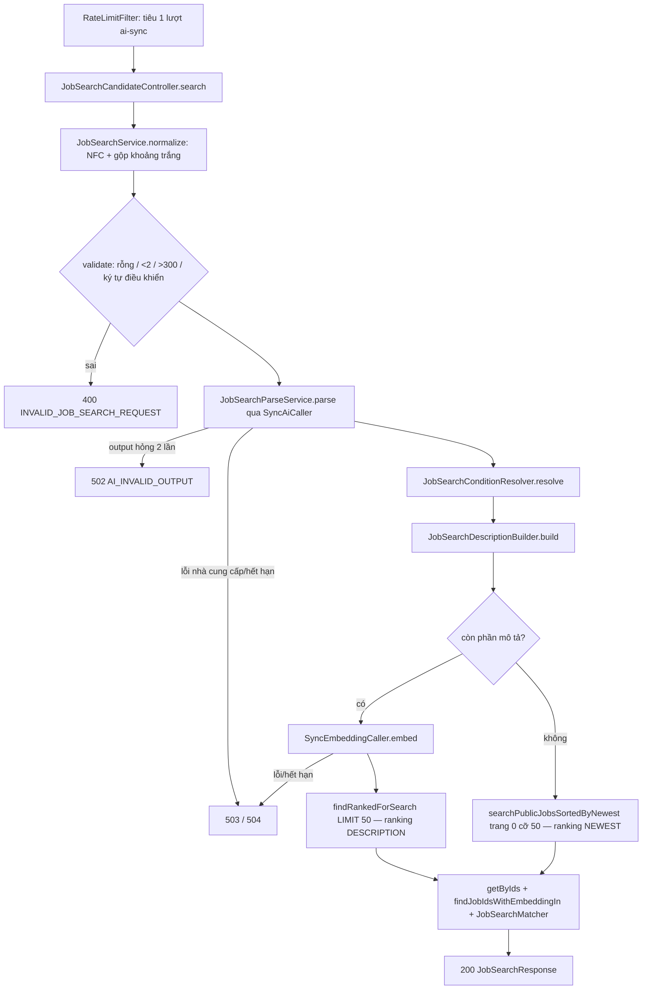

# Walkthrough — FR-U13: Tìm việc bằng ngôn ngữ tự nhiên (`feat/fr-u13-nl-search`)

## 1. Mục tiêu

Bộ lọc việc làm của FR-U07 buộc ứng viên tự chọn từng ô: tỉnh/thành, ngành, lương, hình thức làm việc. FR-U13 cho ứng
viên đã đăng nhập gõ một câu thường, ví dụ "content marketing lương trên 15 triệu ở Hà Nội, không yêu cầu kinh
nghiệm". Hệ thống dùng AI để nhận ra trong câu đâu là điều kiện lọc thuộc 4 loại cố định, áp đúng bộ lọc của U07, rồi
xếp việc làm theo độ gần nghĩa giữa phần chữ còn lại của câu và nội dung tin. Ứng viên luôn thấy hệ thống đã hiểu câu
thế nào (khối "Do AI tạo") và sửa được bằng một lần bấm, khi đó trang chuyển sang bộ lọc U07 bình thường. Không có nhãn
"phù hợp", không có %, không cắt kết quả theo ngưỡng tương đồng, không lưu câu hay kết quả. Thông tin nhân thân trong
câu (tuổi, giới tính…) bị bỏ qua và ứng viên được báo điều đó.

## 2. Các file đã tạo/sửa

**Backend** (đường dẫn dưới `backend/src/main/java/com/recruitment/`, trừ khi ghi khác)

| File | Vai trò |
|---|---|
| `jobsearch/JobSearchCandidateController.java` (mới) | Endpoint duy nhất S1 `POST /api/candidates/job-search`; không đọc `candidateId` (L35) |
| `jobsearch/JobSearchService.java` (mới) | Facade, **không** transaction: chuẩn hoá + kiểm câu → AI tách → nhận điều kiện → cắt phần mô tả → embedding (nếu còn mô tả) → truy vấn → hydrate → đánh dấu xếp theo mô tả → điều kiện khớp |
| `jobsearch/JobSearchConditionResolver.java` (mới) | Nhận/bỏ từng điều kiện AI trả về theo danh mục C05 (R-C): ≤ 3 mã, bỏ `OTHER`, lương 0–1000 triệu, `min ≤ max` |
| `jobsearch/JobSearchDescriptionBuilder.java` (mới) | Cắt khỏi câu các đoạn của điều kiện đã nhận và đoạn nhân thân, dọn dấu câu; kết quả chỉ gồm chữ của câu (R-D) |
| `jobsearch/JobSearchMatcher.java` (mới) | Tính "Khớp điều kiện" của từng việc bằng so sánh xác định (R-M) |
| `jobsearch/JobSearchCatalogPrompt.java` (mới) | Dựng một lần hai chuỗi danh mục tỉnh/ngành (kèm bí danh) để chèn vào prompt |
| `jobsearch/JobSearchExceptionAdvice.java`, `dto/*` (mới) | Body hỏng → 400 riêng; request/response (không có field điểm, độ tương đồng) |
| `ai/jobsearch/JobSearchParseService.java` (mới) | Gọi K3 với prompt `job-search-parse-v1`; câu nằm trong khối `<cau_tim_kiem>`, `<`/`>` đổi thành `‹`/`›` |
| `ai/jobsearch/JobSearchParseValidator.java`, `JobSearchParsePayload.java` (mới) | Hàm kiểm output (mọi đoạn chữ AI trỏ tới phải nguyên văn qua K2) và schema JSON |
| `ai/client/JobSearchChatClientConfig.java` (mới) | Bean `jobSearchChatClient`, trần 500 token đầu ra |
| `ai/sync/SyncEmbeddingCaller.java` (mới), `AiSyncExecutorConfig.java` | Phần embedding đồng bộ của K3: executor riêng, hạn 5 s, chặn khi có transaction, không thử lại |
| `job/JobRepository.java` | **Chỉ thêm** `findRankedForSearch` (ghép từ hằng `PUBLIC_JOB_FILTER_WHERE` của U07) |
| `job/JobEmbeddingRepository.java` | **Chỉ thêm** `findJobIdsWithEmbeddingIn` |
| `job/WorkModes.java` (mới), `JobPublicService.java`, `jobrecommendation/JobRecommendationCandidateService.java` | Hằng mã/nhãn hình thức làm việc dùng chung; U07, U15 chuyển sang đọc từ đây, hành vi không đổi |
| `common/exception/InvalidJobSearchRequestException.java`, `GlobalExceptionHandler.java` | Mã `INVALID_JOB_SEARCH_REQUEST` + câu tiếng Việt cố định |
| `ratelimit/RateLimitFilter.java` | Đường dẫn S1 vào nhóm `ai-sync` có sẵn |
| `resources/ai/prompt/job-search-parse-v1.st` (mới) | Prompt đã duyệt toàn văn (REQUIREMENT 13.4) |
| `resources/application.yml`, test `application-test.yml` | `app.ai-sync.embedding-timeout-ms`, `app.job-search.max-output-tokens` |

**Frontend** (dưới `frontend/src/`)

| File | Vai trò |
|---|---|
| `features/jobSearch/NaturalLanguageSearch.tsx` (mới) | Toàn bộ chế độ mô tả: ô nhập, kiểm phía client, gọi S1, trạng thái chờ/lỗi/kết quả, năm quy tắc trạng thái |
| `features/jobSearch/InterpretationPanel.tsx` (mới) | Khối "Do AI tạo": thẻ điều kiện (sửa/xoá), dòng "Xếp theo mô tả", câu nhân thân, nút "Sửa điều kiện bằng bộ lọc" |
| `features/jobSearch/NaturalLanguageResults.tsx` (mới) | Danh sách ≤ 50 việc chia 10/trang ở trình duyệt, câu ngăn cách việc chưa phân tích |
| `features/jobSearch/SearchModeSwitch.tsx` (mới) | Bộ chọn "Tìm theo từ khoá"/"Tìm bằng mô tả" bằng radio thuần |
| `features/jobSearch/normalizeQuery.ts`, `buildFilterParams.ts` (mới) | Đếm độ dài giống hệt backend; cách hiểu → tham số URL của U07 |
| `features/jobSearch/api.ts`, `types.ts`, `jobSearchLabels.ts` (mới) | Gọi S1 (timeout 40 s), kiểu dữ liệu, mọi chuỗi hiển thị |
| `features/jobs/JobBoard.tsx` | Prop `naturalLanguageSearch`; giữ chế độ trong state (không lên URL) |
| `features/jobs/JobCard.tsx` | Prop tuỳ chọn `matchedConditionsLabel` |
| `pages/CandidateJobListPage.tsx` | Bật `naturalLanguageSearch` (trang công khai `/` không bật) |

## 3. Luồng chính

### 3.1 Tìm — S1 `POST /api/candidates/job-search`

1. `RateLimitFilter` so khớp **chính xác** đường dẫn, tiêu một lượt của bucket `ai-sync:{userId}` (chung với C07, H11,
   C08, U12). Một lượt gồm cả lời gọi LLM lẫn embedding.
2. `JobSearchService.normalize` chuẩn hoá NFC và gộp khoảng trắng (hàm của K2). `validate` trả lỗi đầu tiên; mọi lỗi 400
   xảy ra trước khi gọi AI.
3. `JobSearchParseService.parse`: system message chỉ có prompt và hai danh mục; câu nằm trong user message. `SyncAiCaller`
   (K3) gọi bean `jobSearchChatClient` có thời hạn, kiểm output bằng `JobSearchParseValidator` (mọi `sourceText` và đoạn
   nhân thân phải nguyên văn qua `VerbatimQuoteVerifier`), thử lại tối đa 1 lần khi output hỏng.
4. `JobSearchConditionResolver` nhận hoặc bỏ từng điều kiện. Mã lạ, `OTHER`, lương ngoài 0–1000 triệu → bỏ, và chữ của
   nó ở lại phần mô tả.
5. `JobSearchDescriptionBuilder.build` cắt đoạn của điều kiện đã nhận và mọi đoạn nhân thân khỏi câu, dọn dấu câu; còn
   lại rỗng → `null`.
6. Còn phần mô tả: `SyncEmbeddingCaller.embed` gửi đúng chuỗi đó lên executor riêng, chờ tối đa 5 s. Sau đó
   `findRankedForSearch` lấy ≤ 50 tin `OPEN` qua đúng điều kiện lọc của U07, LEFT JOIN `job_embeddings`, xếp theo khoảng
   cách cosine; tin chưa có embedding xếp cuối theo mới nhất. Không còn mô tả: dùng nguyên truy vấn U07 "mới nhất".
7. `toItems`: `JobPublicService.getByIds` hydrate giữ thứ tự; `findJobIdsWithEmbeddingIn` đánh dấu `rankedByDescription`
   (từ tin đầu tiên chưa có embedding trở đi đều `false`); `JobSearchMatcher` tính "Khớp điều kiện". Không ghi bảng nào.

Bảng chỉ đọc: `jobs`, `job_embeddings`, `catalog_provinces`/`catalog_industries` (qua `CatalogRegistry`, nạp lúc khởi
động). Không bảng nào bị ghi.

### 3.2 Giao diện

`JobBoard` (chỉ khi `naturalLanguageSearch`) giữ `mode` trong state. Chế độ mô tả thay khối gợi ý, thanh lọc U07 và danh
sách U07 bằng `NaturalLanguageSearch`; `useJobsQuery` tắt để không gọi `/public/jobs` thừa. Bấm "Tìm": `validateQuery`
đếm giống backend (L7), sai thì báo dưới ô và không gọi API. Gửi đi: ghi `sentQuery` và mã lượt gửi; kết quả về muộn
hoặc sau khi rời chế độ thì bị bỏ. Có kết quả: `InterpretationPanel` + `NaturalLanguageResults`. Bấm/xoá một thẻ:
`buildFilterParams` → `setSearchParams` một lần → chế độ từ khoá, danh sách U07 tải theo URL, câu báo "Đã chuyển sang lọc
thường…" nhận focus. Không gọi lại AI.

## 4. Quyết định thiết kế

**AI chỉ trỏ đoạn chữ, backend tự cắt phần mô tả (R-A, R-D, R-V).**
- Đã chọn: AI trả mã + `sourceText` nguyên văn cho mỗi điều kiện và đoạn nhân thân; backend kiểm từng đoạn bằng K2 rồi tự
  cắt khỏi câu. Phần đi vào embedding chỉ gồm chữ ứng viên đã gõ.
- Khác: cho AI trả luôn "phần mô tả còn lại" và dùng thẳng.
- Vì sao: AI có thể viết lại câu (CLAUDE.md §2: AI không viết lại nội dung). Khi AI chỉ trỏ đoạn, mọi chữ trong
  `description` kiểm được là của câu gốc (T8 kiểm trên 20 câu ngẫu nhiên; cổng 7.2 B kiểm 16/16 lượt). Đánh đổi: AI trỏ
  đoạn không nguyên văn → thử lại → 502.

**`SyncEmbeddingCaller` riêng trong K3, không sửa `SyncAiCaller` (Q-T1, O4).**
- Đã chọn: lớp mới cùng gói `ai/sync/`, executor riêng, hạn 5 s, chặn transaction, không thử lại, lỗi ra cùng bộ mã
  503/504.
- Khác: gọi `EmbeddingService` thẳng trong U13; nhét embedding vào `SyncAiCaller`.
- Vì sao: gọi thẳng thiếu hạn chờ và chặn transaction (CLAUDE.md §7), lại cài lại riêng trong một FR (§3d). Sửa
  `SyncAiCaller` sẽ chạm test của C07/H11/C08/U12. Bảo vệ: phần git của T18 (L33) — diff `SyncAiCaller`, `SyncAiResult`
  và test của 4 FR kia = 0 file.

**U15 giữ nguyên SQL; U13 có method riêng ghép từ cùng hằng (Q-T2, đổi sau spec-review).**
- Đã chọn: `findRankedForSearch` mới ghép từ `PUBLIC_JOB_FILTER_WHERE`; `findRankedMatchesByVector` của U15 không đổi một
  chữ.
- Khác: tham số hoá chung một truy vấn cho U13 và U15; dùng nguyên văn truy vấn U15.
- Vì sao: gộp truy vấn làm U15 mất đường chạy qua index HNSW; dùng nguyên văn U15 thì âm thầm loại việc đã nộp và việc
  chưa có embedding (N1). Đánh đổi ghi ROADMAP: U13 không dùng HNSW, và `ORDER BY`/guard NaN nằm ở hai chỗ.
- Test bảo vệ FR khác — **không xoá khi refactor**: lệnh git T3 (diff `JobRepository.java` chỉ có dòng thêm; diff test
  `jobrecommendation` = 0 file) và `job/WorkModesTest` khoá đúng 3 mã/3 nhãn mà U07 và U15 giờ đọc chung.

**Không lưu gì, không đưa câu lên URL (Q-T3, Q-T6, Q-T8).**
- Đã chọn: một response ≤ 50 việc, frontend chia trang; câu chỉ nằm trong state của trang; không bảng, không cache, không
  K4, không log câu ở mức info/warn.
- Khác: phân trang server; lưu câu lên URL để chia sẻ link.
- Vì sao: mỗi trang hoặc mỗi lần tải lại sẽ tốn một lượt AI; câu có thể chứa thông tin cá nhân. Đánh đổi: không xem
  được việc thứ 51, tải lại trang mất kết quả. Kiểm bằng T15 (đếm hàng trước/sau, log không chứa chuỗi đánh dấu) và S9.

**Thông tin nhân thân: AI chỉ ra để bỏ qua, có báo (Q-T7, O1).** AI chép đoạn nhân thân vào `personalInfoTexts`; backend
cắt các đoạn đó và không bao giờ biến chúng thành điều kiện (4 loại điều kiện không biểu diễn được nhân thân). SRS mục 5
và `srs-guard` nguyên tắc 13 ghi ngoại lệ đích danh cho đúng dòng prompt này.

**Sửa thẻ chuyển sang bộ lọc U07, không gọi lại AI (Q-T5).** Một lần `setSearchParams`; mất thứ tự theo mô tả nhưng
không tốn lượt và ứng viên sửa được giá trị.

## 5. Ràng buộc đã thực thi

| Mã | Ràng buộc | Thực thi ở đâu |
|---|---|---|
| R-I1–R-I3 | Chuẩn hoá, 2–300 ký tự, cấm ký tự điều khiển; 0 lời gọi AI khi lỗi | `JobSearchService.normalize/validate`; `JobSearchExceptionAdvice`; frontend `normalizeQuery.validateQuery` |
| R-I4, Q-T8 | Một lượt `ai-sync` mỗi lần tìm | `RateLimitFilter` (`JOB_SEARCH_PATH`) |
| R-A, R-P | Prompt có version, câu là dữ liệu trong khối thẻ, trần token | `JobSearchParseService` (`PROMPT_VERSION`), `JobSearchChatClientConfig` |
| R-V | Mọi đoạn chữ AI trỏ tới nguyên văn (K2), thử lại 1 lần | `JobSearchParseValidator`; `SyncAiCaller` |
| R-C | Mã thuộc danh mục, ≤ 3, không `OTHER`, lương 0–1000 | `JobSearchConditionResolver.resolve` |
| R-D | Phần mô tả chỉ gồm chữ của câu; đoạn nhân thân luôn bị cắt | `JobSearchDescriptionBuilder.build` |
| R-E | Embedding qua K3, hạn 5 s, không thử lại, lỗi không rơi về mới nhất | `SyncEmbeddingCaller.embed`; `JobSearchService.search` |
| R-Q, R-K | Điều kiện U07, không ngưỡng, không loại việc đã nộp, việc chưa có embedding xếp cuối, ≤ 50 | `JobRepository.findRankedForSearch`; `JobSearchService.toItems` |
| R-M | "Khớp điều kiện" xác định, không AI | `JobSearchMatcher` |
| R-L, CLAUDE.md §7 | Không lưu, không log câu; không `@Transactional` quanh lời gọi AI | Không repository ghi trong `jobsearch/`; kiểm tĩnh S1, S7 |
| CLAUDE.md §8, UI_GUIDE 4 | Nhãn "Do AI tạo", chip trung tính, không %, có câu ngăn cách | `InterpretationPanel`, `NaturalLanguageResults`; kiểm tĩnh S10 |
| Q-T6 | Câu không lên URL/storage | `JobBoard` (state), kiểm tĩnh S9 |
| N6 | Không có ở trang công khai | `PublicJobListPage` không truyền prop (diff 7.3 = 0 file) |

## 6. Đã kiểm thử gì

**Tự động.** Full suite backend `.\mvnw.cmd test` (đợt 6, 18/10/2026): **1955 test, 0 fail, 0 error, 0 skip, 6:54**
(L51). Lớp mới: `SyncEmbeddingCallerTest`, `SyncEmbeddingCallerTransactionIntegrationTest`, `JobRankedForSearchTest`,
`WorkModesTest`, `JobSearchParseValidatorTest`, `JobSearchParseServiceTest`, `JobSearchCatalogPromptTest`,
`JobSearchConditionResolverTest`, `JobSearchDescriptionBuilderTest`, `JobSearchMatcherTest`, `JobSearchIntegrationTest`,
`JobSearchResponseKeysIntegrationTest`, `JobSearchSignatureTest`, lớp hỗ trợ `JobSearchIntegrationTestSupport`; thêm ca
vào `RateLimitFilterTest`. Mock ở tầng `ChatModel`/`EmbeddingModel`, không gọi API thật. Frontend: build + lint sạch;
script Node 34/34 ca cho `normalizeQuery` (biên 1/2/300/301, NFC, NBSP không bị gộp) và `buildFilterParams` (L49). Kiểm
tĩnh S1–S10, khối git 7.1, phần git T18, lệnh 7.3 đều đạt (L51).

**Thử đột biến** (theo commit từng đợt): đợt 3 — 5 đột biến đều bị test bắt; đợt 4 — 5 đột biến đều bị bắt. Commit đợt 2
và đợt 5 không ghi thử đột biến.

**Cổng AI thật 7.2 B (18/10/2026, L50).** 8 câu × 2 vòng = 16/16 lượt 200; 0 `AI_TIMEOUT`, 0 `AI_INVALID_OUTPUT`; thời
gian 1,8 / 3,2 / 7,7 s (nhỏ nhất/trung vị/lớn nhất). Câu nhân thân cả hai vòng được bỏ qua và báo; câu chèn lệnh "bỏ qua
hướng dẫn…" không tạo điều kiện nào; lương USD không thành điều kiện lương; mọi mã thuộc danh mục; mọi phần mô tả là chữ
của câu gốc. Lệch bảng tham khảo: câu "lương trên 15 triệu" không được tách thành điều kiện lương ở cả hai vòng. 7.2 phần
A (không cần khoá API) 9/9 (L39).

**Soát tay 7.4.** Người dùng báo đạt toàn bộ bảng (18/10/2026, L52).

| "Xong khi" (REQUIREMENT mục 7) | Cách nghiệm thu | Kết quả |
|---|---|---|
| T1, T2 | `SyncEmbeddingCallerTest`, `SyncEmbeddingCallerTransactionIntegrationTest` | Đạt |
| T3 | Lệnh git 7.1 (diff chỉ thêm) + test U15 không sửa vẫn xanh | Đạt |
| T4, T4b | `JobRankedForSearchTest`, `WorkModesTest` | Đạt |
| T5, T6 | `JobSearchParseValidatorTest`, `JobSearchCatalogPromptTest` | Đạt |
| T7, T8, T9 | `JobSearchConditionResolverTest`, `JobSearchDescriptionBuilderTest`, `JobSearchMatcherTest` | Đạt |
| T10–T15, T17 | `JobSearchIntegrationTest` | Đạt |
| T16 | `JobSearchResponseKeysIntegrationTest` | Đạt |
| T18 | `JobSearchSignatureTest` + phần git chạy tay (L33) | Đạt |
| T19 | `RateLimitFilterTest` | Đạt |
| Kiểm tĩnh 7.1, 7.3 | Grep kèm đối chứng dương; lệnh git; build + lint | Đạt |
| 7.2 A, B | Khối PowerShell 5.1; B với AI thật | Đạt |
| 7.4 | Soát tay của người dùng | Đạt |

**Chưa test.**
- Frontend không có test tự động cho component: năm quy tắc trạng thái, focus, chia trang chỉ soát tay.
- Cổng AI chỉ đo 8 câu mẫu; chất lượng tách điều kiện trên câu thật đa dạng chưa đo (ví dụ lương "trên 15 triệu" bị bỏ
  sót ở cổng).
- Chưa đo hiệu năng truy vấn khi số tin `OPEN` lớn (DB dev chỉ 8 tin — 13.6); chưa đo tải nhiều người tìm cùng lúc.

## 7. Nợ kỹ thuật

- R-D5: AI có thể bỏ sót hoặc đánh dấu nhầm đoạn nhân thân; AI có thể bỏ sót điều kiện lương (L50).
- R-P2: câu có sẵn ký tự `‹`/`›` → 502.
- N12/O5: `findRankedForSearch` không dùng HNSW, chậm dần khi số tin lớn.
- Q-T2: `ORDER BY` và guard NaN ở hai method (U13, U15) phải sửa cùng nhau.
- Q-T3: tối đa 50 kết quả. Q-T8: bucket `ai-sync` dùng chung. R-K5: không có dấu "đã ứng tuyển".
- L13: hết hạn embedding không cắt được request OpenAI đang đọc socket (luồng bị giữ tới 30 s).
- L19: `SyncAiCallerTransactionIntegrationTest` (K3 cũ) thiếu `@ActiveProfiles("test")` — không sửa vì T18.
- L21: việc có embedding suy biến bị loại khỏi nhánh `DESCRIPTION`.
- L28: so khớp đoạn lồng nhau theo từng `sourceText` có thể cắt chữ trong đoạn của điều kiện bị bỏ.
- Việc tài liệu ngoài U13: `docs/features/UV/U15/UI.md:18` (D7) — sửa ở nhánh `docs/` riêng.

## 8. Lệch so với đặc tả

Đặc tả duyệt 18/10/2026. Mọi chỗ lệch đều ghi ở REQUIREMENT.md mục 13 (L1–L55); không có chỗ lệch nào chưa duyệt lại.

| Chỗ lệch | Duyệt |
|---|---|
| L1–L17 (Plan Mode): ca test U07 có sẵn, 401 thay 405 trên server thật (A7), đếm độ dài phía client giống Java (UI.md 5a đã sửa), test bổ sung, ghi ROADMAP | 18/10/2026 |
| L18–L22 (đợt 2): nhãn riêng trong test, profile test của K3 cũ, thứ tự `uuid`, hệ quả guard NaN, ca thêm T1 | 18/10/2026, khi duyệt đợt |
| L23–L31 (đợt 3): mã trùng, gộp dấu câu từ 2 dấu, "chỉ còn dấu câu", lớp test thêm, dạng user message, đoạn lồng nhau, `code` null, T6 trên danh mục thật, bẫy Grep | 18/10/2026, khi duyệt đợt |
| L32–L38 (đợt 4): dọn job trong test HTTP, bỏ ca git khỏi T18 (chạy tay), số bị ép thành chuỗi (13.8, T13 đã sửa), không đọc `Authentication`, kết quả S5/S1 | 18/10/2026, khi duyệt đợt |
| L39–L49 (đợt 5): kết quả 7.2, vị trí bộ chọn chế độ, câu nhắc, 400 không có "Thử lại", tên cấm §7, mốc `sm` 640px, nhãn ô | 18/10/2026, khi duyệt đợt |
| L40: 429 ở khối lỗi (7.4 dòng "Hết lượt" đã sửa theo UI.md) | 18/10/2026 — người dùng chọn |
| L45: thẻ việc trong kết quả mô tả có nhãn "Chưa chuẩn hoá"/chú thích ngoại tệ như U07 | 18/10/2026 — người dùng chọn |
| L50–L55 (đợt 6): kết quả cổng AI, 6a, soát tay; 7.2 A không chạy lại; phần ngoài khối của script cổng; D7 chỉ ghi lại | 18/10/2026, commit đợt 6 |

## Câu hỏi tự kiểm

1. Nếu xoá `jobsearch/JobSearchDescriptionBuilder.java` và lấy luôn chuỗi AI trả về làm phần mô tả thì nguyên tắc nào của
   CLAUDE.md §2 bị phá, và test nào (T8, T10, T17) sẽ đỏ?
2. Một câu "kế toán ở Bình Dương lương 12-18 triệu" đi qua những class nào, theo thứ tự nào, trước khi thành danh sách
   việc làm — và vì sao ở câu này không có lời gọi `EmbeddingModel` nào?
3. Vì sao U13 viết `findRankedForSearch` riêng mà không tham số hoá chung truy vấn `findRankedMatchesByVector` của U15,
   và cái giá phải trả của lựa chọn đó là gì?
