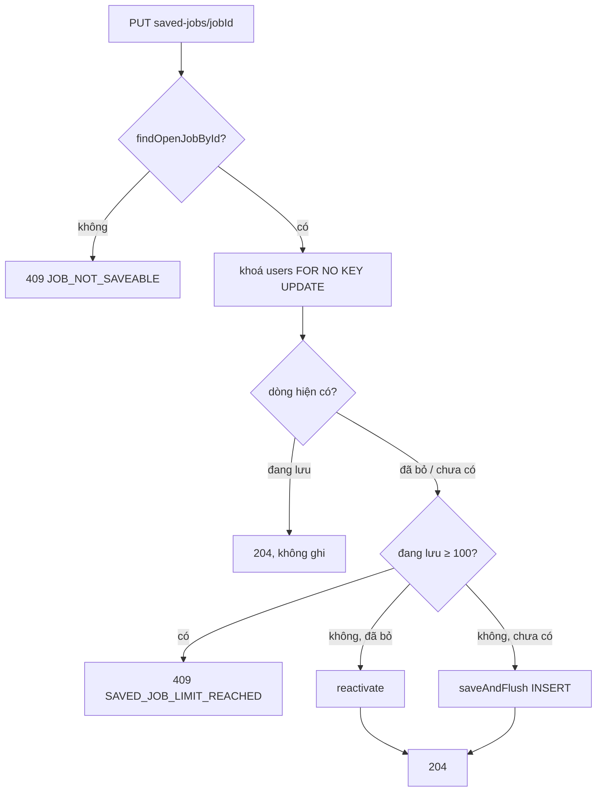

# Walkthrough — FR-U16 · Lưu tin tuyển dụng (`feat/fr-u16-saved-jobs`)

> Đặc tả: `docs/features/UV/U16/REQUIREMENT.md`, `UI.md` (duyệt 30/10/2026, hoàn thành 30/10/2026).
> **Một điểm chờ duyệt:** seed tầng 3 cho Phạm Quốc Bảo lưu **4** tin (3 tin đang mở + chính tin quá hạn, để trang Tin
> đã lưu có tin "Đã hết hạn nộp"), trong khi yêu cầu đợt 7 ghi "lưu 3 tin demo đang mở". L3 đã ghi đúng 4 dòng; người
> dùng chưa duyệt riêng điểm này. Mọi chỗ lệch khác đã sửa vào đặc tả và được duyệt 30/10/2026 (mục 8).

## 1. Mục tiêu

Ứng viên đang xem việc làm thường muốn "để dành" vài tin để quay lại sau. FR-U16 thêm nút Lưu lên mọi thẻ tin và trang
chi tiết tin, cùng trang "Tin đã lưu" trong khu vực ứng viên. Ở trang đó, tin lưu gần nhất nằm trên cùng, mỗi tin có
nhãn tình trạng (đang mở, hết hạn nộp, tạm dừng, đã đóng, không còn đăng). Chỉ tin còn mở mới có nút Ứng tuyển, và nút
này dẫn về đúng luồng ứng tuyển có sẵn. Tin đã có đơn ở chu kỳ hiện tại hiện "Đã ứng tuyển" kèm liên kết sang đơn. Bỏ
lưu được bất kỳ lúc nào; mỗi ứng viên lưu tối đa 100 tin. Chức năng này không dùng AI, không xếp hạng, không có điểm
phù hợp, và HR không biết ai đã lưu tin của mình.

## 2. Các file đã tạo/sửa

**Backend**

| File | Vai trò |
|---|---|
| `db/migration/V20__saved_jobs.sql` | Bảng `saved_jobs`: một dòng mỗi cặp (ứng viên, tin) — `uq_saved_job_per_candidate`; hai khoá ngoại `ON DELETE CASCADE`; index một phần `idx_saved_jobs_candidate_active` cho các dòng đang lưu |
| `savedjob/SavedJob.java` | Entity; `saved_at` do DB gán (`now()`), `deleted_at` chỉ ghi bằng câu native |
| `savedjob/SavedJobRepository.java` | 7 câu SQL Q1–Q8 (khoá hàng `users`, đọc dòng, đếm, lưu lại, bỏ lưu, danh sách, danh sách id) |
| `savedjob/SavedJobListRow.java` | Projection của câu danh sách (dòng lưu + đơn ở chu kỳ hiện tại) |
| `savedjob/SavedJobService.java` | Nghiệp vụ lưu / bỏ lưu / danh sách |
| `savedjob/SavedJobCandidateController.java` | 4 endpoint `/api/candidates/saved-jobs` (PUT, DELETE, GET, GET `/ids`) |
| `savedjob/dto/SavedJobResponse.java` | DTO một dòng "Tin đã lưu" |
| `job/JobAvailability.java`, `job/JobAvailabilityResolver.java` | Tình trạng tin (5 giá trị), tách ra từ FR-U08 để dùng chung; hỗ trợ cả một tin lẫn cả lô |
| `job/JobSummaryMapper.java` | Hàm static dựng `JobSummaryResponse`/`CompanyRef`, tách từ `JobPublicService` |
| `job/JobPublicService.java`, `jobapplication/ApplicationService.java`, `ApplicationCandidateDetailResponse.java` | Dùng lại mapper/resolver thay cho bản riêng; JSON FR-U08 không đổi |
| `common/exception/JobNotSaveableException.java`, `SavedJobLimitReachedException.java`, `GlobalExceptionHandler.java` | Hai lỗi 409 `JOB_NOT_SAVEABLE`, `SAVED_JOB_LIMIT_REACHED` |

**Frontend**

| File | Vai trò |
|---|---|
| `features/savedJobs/api.ts`, `types.ts`, `queries.ts` | Gọi API; một query `['saved-job-ids']` dùng chung; mutation lạc quan |
| `features/savedJobs/SaveJobButton.tsx` | Nút Lưu (bản icon trên thẻ, bản có chữ ở `/jobs/:id`); khách → `/login`; HR không render |
| `features/savedJobs/SavedJobItem.tsx`, `UnsaveConfirmDialog.tsx`, `savedJobTexts.ts` | Một dòng ở trang Tin đã lưu, hộp xác nhận bỏ lưu, chuỗi hiển thị |
| `pages/CandidateSavedJobsPage.tsx`, `App.tsx` | Trang `/candidate/saved-jobs` và route |
| `features/jobs/JobCard.tsx` | Đổi từ `<Link>` bọc cả thẻ sang `<article>` có liên kết phủ thẻ + nút Lưu nằm cạnh |
| `features/jobs/jobAvailability.ts`, `JobAvailabilityBadge.tsx` | Nhãn tình trạng chuyển từ `candidateApplicationDetail/` về dùng chung |
| `pages/PublicJobDetailPage.tsx` | Nút Lưu có chữ sau nút Ứng tuyển |
| `components/layout/CandidateLayout.tsx`, `MobileNavSheet.tsx` | Mục menu "Tin đã lưu"; menu ngang chỉ từ `lg` (B9) |

**Seed và tài liệu:**
- `db/seed/seed-demo-structural-3.sql`: tầng seed mới.
- `seed-demo-structural-1b.sql`: sửa chốt chặn (B11).
- `reset-demo-db.sql`: `TRUNCATE` thêm `saved_jobs`.
- `db/seed/README.md`, `docs/DEMO.md`, `docs/ER.md`, `docs/SRS.md`, `docs/ROADMAP.md`, `CLAUDE.md`, `docs/UI_GUIDE.md` (mục 2, 7), `docs/features/README.md`.

## 3. Luồng chính

### 3.1 Lưu tin — `PUT /api/candidates/saved-jobs/{jobId}`

1. `SaveJobButton` gọi `useSaveJobMutation(jobId)`. Trước khi gửi request, `onMutate` sửa ngay cache `['saved-job-ids']`
   (đưa `jobId` lên đầu) và ghi lại vị trí cũ của tin này. Mọi thẻ cùng tin trên trang đổi sang "Đã lưu" ngay lập tức.
2. Request qua filter JWT. `SecurityConfig` chặn `/api/candidates/**` cho vai trò khác `CANDIDATE` (403).
   `SavedJobCandidateController.save` lấy `candidateId` từ token, không nhận từ path hay body.
3. `SavedJobService.save` chạy trong một transaction, theo đúng thứ tự:
   1. `JobRepository.findOpenJobById` — tin không mở (kể cả không tồn tại, nháp, đã xoá mềm, hết hạn theo
      `CURRENT_DATE` của DB) thì ném `JobNotSaveableException` → 409.
   2. `SavedJobRepository.lockCandidateForSave` — `SELECT … FROM users … FOR NO KEY UPDATE` lên dòng của chính ứng viên.
      Hai request của cùng ứng viên từ đây xếp hàng nối tiếp nhau.
   3. `findByCandidateIdAndJobId` — đang lưu thì trả luôn (idempotent, `saved_at` giữ nguyên).
   4. `countActiveByCandidateId` ≥ 100 → `SavedJobLimitReachedException` → 409.
   5. Đã từng bỏ lưu thì `reactivate` (xoá `deleted_at`, `saved_at = now()`); chưa từng lưu thì `saveAndFlush` một dòng mới.
4. Trả 204. Frontend **không** tải lại ids, chỉ đánh dấu cũ danh sách `['saved-jobs']`. Nếu API lỗi, `onError` đưa riêng
   `jobId` này về vị trí cũ (B8), các thẻ khác đang chờ không bị ảnh hưởng, và câu lỗi hiện dưới nút.

### 3.2 Bỏ lưu — `DELETE …/{jobId}`

`SavedJobService.unsave` → `softDelete`: `UPDATE saved_jobs SET deleted_at = now()` cho dòng đang lưu của chính ứng viên.
Không có dòng nào cũng trả 204. Không có `DELETE FROM`. Ở frontend, dòng đó rời danh sách "Tin đã lưu" đang hiển thị
qua `setQueryData`, không cần tải lại. Tin không còn mở thì `UnsaveConfirmDialog` hỏi xác nhận trước (Q5).

### 3.3 Trang Tin đã lưu — `GET /api/candidates/saved-jobs`

`SavedJobService.listMine` dùng một số câu SQL cố định, không tăng theo số tin (không N+1):

1. `findActiveList` lấy các dòng đang lưu, `LEFT JOIN job_applications` ở **chu kỳ hiện tại** của tin, sắp
   `saved_at DESC, id DESC`.
2. `jobRepository.findAllById` lấy các tin, kể cả tin đã xoá mềm (để vẫn hiện tên).
3. `companyRepository.findByIdIn` lấy các công ty.
4. `JobAvailabilityResolver.of(jobs)` tính tình trạng cả lô bằng **một** lần gọi `findOpenJobsByIdIn`.

Tin `UNAVAILABLE` (đã xoá mềm hoặc bị đưa về nháp) trả `summary = null`, chỉ còn tên tin và công ty. `GET /ids` dùng
câu `findActiveJobIds` để mọi `JobCard` biết tin nào đã lưu.

## 4. Quyết định thiết kế

**4.1 Chốt trần 100 bằng khoá hàng `users`** (Q1, R-L3)
- Đã chọn: `SELECT … FOR NO KEY UPDATE` trên dòng `users` của ứng viên, rồi đếm và ghi trong cùng transaction.
- Lựa chọn khác: chỉ dùng `count()` ở service; trigger DB; `FOR UPDATE`; `SKIP LOCKED`.
- Vì sao:
  - `count()` không khoá thì có race: hai request lúc có 99 tin đều thấy 99 và cùng chèn, thành 101.
  - Trần "100 dòng" không biểu diễn được bằng unique index.
  - `FOR UPDATE` xung đột với khoá `FOR KEY SHARE` mà mọi `INSERT` có khoá ngoại tới `users` phải lấy (đơn ứng tuyển,
    tin nhắn…), làm các thao tác đó bị chặn vô cớ.
  - Thử bằng mutation: bỏ dòng khoá thì cả 4 test trong `SavedJobConcurrencyIntegrationTest` đỏ. Test T16 lặp 20 vòng
    với hai luồng chạy sát trần.

**4.2 Mọi tin không mở trả cùng một 409** (Q2, B7)
- Đã chọn: tin nháp, đã xoá, không tồn tại, hết hạn, tạm dừng, đã đóng đều trả `JOB_NOT_SAVEABLE` cùng một câu, và
  bước kiểm này chạy **trước** khi đọc dòng đang lưu.
- Lựa chọn khác: trả 404 cho tin không tồn tại hoặc tin nháp; trả 204 khi tin đang lưu dù đã đóng.
- Vì sao: 404 riêng sẽ lộ việc một tin nháp có tồn tại hay không. Thứ tự kiểm cố định thì kết quả không phụ thuộc
  trạng thái lưu (B7 — đặc tả đã làm rõ).

**4.3 Một dòng mỗi cặp, bỏ lưu bằng `deleted_at`** (R-S5, R-S6)
- Đã chọn: lưu lại thì dùng lại dòng cũ (`reactivate`).
- Lựa chọn khác: mỗi lần lưu một dòng mới; xoá cứng khi bỏ lưu.
- Vì sao: theo quy ước soft delete toàn dự án, và `UNIQUE (candidate_id, job_id)` là chốt chặn ở DB cho "một dòng mỗi
  cặp".

**4.4 Khoá ngoại `ON DELETE CASCADE`** (Q8)
- Đã chọn: CASCADE cho cả hai cột.
- Lựa chọn khác: `RESTRICT` như `job_applications`.
- Vì sao: dấu trang không có giá trị lưu vết, mất theo tin hoặc người dùng là đúng nghĩa. Hệ quả là
  `reset-test-data.sql` và `seed-demo-structural-1b.sql` không cần thêm câu xoá nào (T17b chứng minh).

**4.5 Tách tình trạng tin thành `JobAvailabilityResolver` dùng chung** (R-A1, R-A2)
- Đã chọn: một hàm `classify` cho thứ tự xét, hai lối vào: một tin, hoặc cả lô qua `findOpenJobsByIdIn`.
- Lựa chọn khác: chép điều kiện `status = 'OPEN' AND deadline >= …` vào câu SQL mới; gọi `availabilityOf` của FR-U08
  trong vòng lặp.
- Vì sao: chép điều kiện thì hai nơi dễ lệch nhau; gọi trong vòng lặp là N+1.
- Bảo vệ hồi quy:
  - `ApplicationCandidateDetailControllerIntegrationTest` (của FR-U08) giữ xanh mà **không sửa dòng nào** (T18).
  - `JobAvailabilityResolverTest` khẳng định `of(List.of())` không gọi repository và 5 tin chỉ gọi đúng một lần.
  - Không được xoá test này khi refactor, vì nó là chốt chặn N+1 cho cả trang Tin đã lưu.

**4.6 Không thêm cờ `saved` vào API công khai** (R-B4, B5, B6)
- Đã chọn: thẻ tin đọc một query riêng `GET /saved-jobs/ids`, chỉ bật khi vai trò là `CANDIDATE`.
- Lựa chọn khác: thêm `saved` vào `JobSummaryResponse`.
- Vì sao: API công khai dùng chung cho khách, HR, ứng viên và nhiều FR khác; một cờ theo người xem sẽ làm bẩn cache và
  DTO công khai. Khách và HR không gửi request `saved-jobs` nào (soát tay đã kiểm ở Network).

**4.7 Cập nhật lạc quan, hoàn lại riêng tin vừa bấm** (B6, B8)
- Đã chọn: lỗi thì chỉ đưa `jobId` đó về vị trí trước khi bấm.
- Lựa chọn khác: không lạc quan (chờ API); hoàn lại bằng ảnh chụp cả danh sách; tải lại ids sau mỗi lần bấm.
- Vì sao: ảnh chụp cả danh sách sẽ xoá mất thay đổi đang chờ của thẻ khác nếu người dùng bấm nhanh nhiều thẻ.

**4.8 `JobCard` thành `<article>` có liên kết phủ thẻ** (R-B3, L6)
- Đã chọn: liên kết tiêu đề có lớp `after:absolute after:inset-0` phủ cả thẻ; nút Lưu là phần tử cùng cấp, `relative z-10`.
- Lựa chọn khác: đặt `<button>` trong `<a>` rồi chặn bằng `preventDefault`/`stopPropagation`.
- Vì sao: nút trong liên kết là HTML không hợp lệ, trình đọc màn hình đọc sai, và chuột giữa vẫn mở tab. Vòng focus dùng
  `has-[a:focus-visible]` để không khoanh cả thẻ khi focus đang ở nút Lưu.

**4.9 Menu ứng viên ngang từ `lg`** (B9)
- Đo 30/10/2026 ở 768px: thanh ngang đã tràn khi mới có 5 mục, tức là lỗi có từ trước FR-U16.
- Đã chọn: dưới `lg` dùng sheet. Chỉ sửa layout ứng viên; layout HR chỉ đo, không sửa (mục 7).

**4.10 Kiểm nguồn thay cho niềm tin** (B2, T21)
- `SavedJobSourceGuardTest` quét `src/main/java`: ngoài `savedjob/`, không file nào được nhắc tới `com.recruitment.savedjob`
  hay chuỗi `saved_jobs`.
- `SavedJobHrPrivacyIntegrationTest` so JSON ba API HR trước và sau khi ba ứng viên lưu tin → giống hệt nhau.
- Hai test này bảo vệ quyền riêng tư cho mọi FR sau. Không xoá khi thêm màn HR mới.

**4.11 Seed tầng 3** (L3, B10, B11)
- Dải id `d3a00000-…`, vì `d3000000-` đã là tiền tố rubric của tầng 1.
- Tự xoá dải của mình rồi chèn lại, nên idempotent.
- Tin quá hạn được tạo mới thay vì sửa tin của tầng khác.
- Chốt chặn tầng 1b đổi từ "đúng V19" thành "V19 trở lên". Không đổi thì nạp demo từ DB trống sẽ dừng ở tầng 1b.

## 5. Ràng buộc đã thực thi

| Mã | Ràng buộc | Thực thi ở đâu |
|---|---|---|
| FR-U16 R-S1 | Chỉ ứng viên, chỉ dữ liệu của chính mình | `SecurityConfig` (`/api/candidates/**` → `CANDIDATE`); `candidateId` từ JWT ở `SavedJobCandidateController`; mọi câu Q lọc `candidate_id` |
| R-S2, R-A2 | Chỉ lưu tin mở, hạn theo `CURRENT_DATE` của DB | `SavedJobService.save` → `JobRepository.findOpenJobById` |
| R-S3, Q2, B7 | Một 409 chung cho mọi tin không mở | `JobNotSaveableException`, `GlobalExceptionHandler` |
| R-S4, R-S6 | Idempotent; một dòng mỗi cặp | `SavedJobService.save`; `uq_saved_job_per_candidate` |
| R-S5, CLAUDE.md §4 | Bỏ lưu không xoá cứng | `SavedJobRepository.softDelete` (`UPDATE … deleted_at`) |
| R-S8 | Thời điểm do DB gán | `SavedJob.savedAt` `@Generated(INSERT)`; `now()` trong `reactivate`/`softDelete` |
| R-L1–R-L4, Q1 | Trần 100, an toàn khi đồng thời | `lockCandidateForSave` + `countActiveByCandidateId`; `MAX_ACTIVE_SAVED_JOBS` |
| R-V1, R-G1/G2 | Sắp `saved_at DESC, id DESC`, không xếp hạng | Câu `findActiveList`, `findActiveJobIds` |
| R-V3 | Đơn ở **chu kỳ hiện tại** | `LEFT JOIN … recruitment_cycle = j.recruitment_cycle` trong `findActiveList` |
| R-V5, R-V6 | Tin không mở: không liên kết; `UNAVAILABLE` không trả tóm tắt | `SavedJobItem.tsx`; `SavedJobService.toResponse` |
| R-V8 | Không có đường ứng tuyển thứ hai | Nút dẫn `/jobs/:id/apply`; `features/savedJobs` không gọi `POST …/applications` (7.3) |
| R-A1, T18 | FR-U08 không đổi | `JobAvailabilityResolver`; test FR-U08 xanh không sửa |
| R-B2–R-B6 | Một query, chỉ ứng viên, lạc quan, hoàn lại riêng tin | `features/savedJobs/queries.ts` |
| R-B3 | Không lồng nút trong liên kết | `JobCard.tsx` (`<article>`) |
| R-B4 | API công khai không có `saved` | `features/jobs/types.ts`, `api.ts` (0 dòng `saved`, 7.3) |
| R-G3, B2 | HR không biết ai lưu | `SavedJobSourceGuardTest`, `SavedJobHrPrivacyIntegrationTest` |
| R-G5, CLAUDE.md §8 | Màu trung tính | `JobAvailabilityBadge` một kiểu viền cho cả 5 giá trị |
| Q8 | `ON DELETE CASCADE` | Hai FK trong `V20__saved_jobs.sql` |
| CLAUDE.md §2 | Không AI | `savedjob/` không import `ChatModel`/`EmbeddingModel` (srs-guard nguyên tắc 12) |

## 6. Đã kiểm thử gì

**Tự động (backend, Testcontainers Postgres thật):**
- Full suite `.\mvnw.cmd test` lúc 30/10/2026: **2148 test, 0 Failures, 0 Errors**, 07:42 phút.
- Lần chạy đầu cùng ngày có 323 Errors, cùng một nguyên nhân: Testcontainers hết 60 giây chờ container
  `pgvector/pgvector:pg17` sẵn sàng (`Timed out waiting for log output matching '.*database system is ready…'`). Spring
  đánh dấu ngữ cảnh test bị lỗi (`ApplicationContext failure threshold (1) exceeded`) nên 35 lớp dùng chung ngữ cảnh đó
  bị bỏ qua. Không có Failure nào. Chạy lại một lần, không thao tác gì khác trên Docker trong lúc chạy → xanh hoàn toàn.
- Test của FR (33 test):

  | Lớp | Số test | Phủ |
  |---|---|---|
  | `SavedJobControllerIntegrationTest` | 16 | T1–T9, T11–T14 |
  | `SavedJobOrderingIntegrationTest` | 3 | T5, T10; lớp không bọc `@Transactional` |
  | `SavedJobConcurrencyIntegrationTest` | 4 | T15, T16 (20 vòng) |
  | `SavedJobHrPrivacyIntegrationTest` | 1 | T20 |
  | `SavedJobMigrationTest` | 8 | T17, T17b |
  | `SavedJobSourceGuardTest` | 1 | T21 |

  Thêm `JobAvailabilityResolverTest` (T19). Hồi quy FR-U08/U02/C02/U13/U15 xanh (T18).

**Kiểm HTTP 7.2** (PowerShell 5.1, backend chạy với 11 scheduler tắt và key giả, seed test): 5/5 nhóm đúng mã mong đợi:
- nhóm 1: 204, 204, 200 `["e2…01"]`;
- nhóm 2: 409 `JOB_NOT_SAVEABLE` hai lần, cùng một body;
- nhóm 3: 200 có `"availability":"OPEN"`;
- nhóm 4: 204 ba lần;
- nhóm 5: 403 hai lần, 401 `UNAUTHENTICATED` hai lần.

**Kiểm tĩnh 7.3:**
- Build và lint sạch.
- Không có `saved` trong `features/jobs/types.ts`, `api.ts`.
- `jobAvailabilityLabels` không còn ở `candidateApplicationDetail`; `JOB_AVAILABILITY_LABELS` chỉ có ở `jobAvailability.ts`
  và `JobAvailabilityBadge.tsx`.
- Không có `api/hr|score|rank|explanation`, không có `POST …/applications` trong `features/savedJobs`.
- DOM ở `/candidate` (Edge headless): `a button` = 0; `article button[aria-pressed]` = 11 = số thẻ.

**Soát tay 7.4** (người dùng tự làm, 30/10/2026): **13 bước đều đạt**:
- khách và HR không có request `saved-jobs`;
- nút Lưu ở cả 4 nơi dùng thẻ, bằng chuột và bằng Tab/Enter;
- hoàn lại khi lỗi;
- trang Tin đã lưu với tin đóng, tạm dừng, đã xoá;
- bỏ lưu có và không hỏi xác nhận;
- đã ứng tuyển + "Xem đơn";
- trạng thái rỗng;
- FR-U08 không đổi;
- menu dưới `lg` dùng sheet.

Thêm: đo menu ứng viên ở 375/768/1023/1024/1280px, cả 5 mức `scrollWidth = clientWidth`.

**Seed:** nạp cả chuỗi reset → 1 → 2 → 1b → 2b → 3 → 3 hai lần từ DB trống, số dòng mọi bảng giống nhau giữa hai lần.
Ca có sẵn dòng `saved_jobs` tạo qua UI trùng cặp (ứng viên, tin) cũng nạp lại được.

**Chưa test:**
- Frontend không có test tự động (như các FR trước).
- Hành vi ở trên 100 tin chỉ có test backend; giao diện câu lỗi trần chưa soát tay ở đúng 100 tin.
- Chưa đo hiệu năng danh sách ở quy mô lớn, chỉ bảo đảm số câu SQL cố định.

**Đối chiếu "Xong khi" (mục 7):**

| Tiêu chí | Cách nghiệm thu | Kết quả |
|---|---|---|
| 7.1 T1–T21, T17b | Các lớp test ở trên, full suite 2148/2148 | Đạt |
| 7.2 khối HTTP | Chạy nguyên văn, mã khớp 5/5 nhóm | Đạt (xem mục 7 về cách hiển thị) |
| 7.3 frontend | Build, lint, 5 lệnh tìm, 2 lệnh DOM | Đạt |
| 7.4 soát tay | Người dùng, 30/10/2026, 13 bước | Đạt |

## 7. Nợ kỹ thuật

- **Layout HR tràn ngang** ở 768px (1133/753) và 1023px (1133/1008), do nội dung Dashboard rộng cố định. Đo 30/10/2026,
  chưa sửa, ngoài phạm vi FR-U16 (đã ghi ở ROADMAP).
- **Tin quá hạn của seed tầng 3 vẫn `OPEN` và chưa có embedding.** Khi backend chạy với key OpenAI thật và bật
  `job-embedding`, `JobEmbeddingScheduler` gọi OpenAI một lần cho tin này. Đã ghi ở `db/seed/README.md` và `docs/DEMO.md`.
- **Khối 7.2 hiển thị kém trên PowerShell 5.1**, dù mã HTTP vẫn đúng:
  - Dòng 204 in ra `System.Byte[]`.
  - Nhóm 3 vỡ dấu tiếng Việt: backend trả `Content-Type: application/json` không kèm charset (giống mọi endpoint có từ
    trước), và `Invoke-WebRequest.Content` giải mã theo ISO-8859-1.
  - Có thể sửa khối lệnh bằng cách giải mã `RawContentStream` theo UTF-8. Chưa sửa, cần người dùng duyệt.
- Danh sách `['saved-jobs']` chỉ được đánh dấu cũ khi lưu ở trang khác; mở trang Tin đã lưu lần sau mới tải lại (chủ
  đích, B6).
- Frontend không có test tự động.

## 8. Lệch so với đặc tả

Mọi điểm dưới đây đã ghi vào `REQUIREMENT.md`/`UI.md` mục 11 và được người dùng duyệt ngày 30/10/2026:

| # | Lệch so với bản duyệt đầu (`f514a03`) | Đã sửa đặc tả | Duyệt lại |
|---|---|---|---|
| L1–L9 | Làm rõ sau Plan Mode (sửa một đối số trong `ApplicationServiceTest`, tên mapper, seed tầng 3, ánh xạ entity, câu khoá, vòng focus, hướng phụ thuộc, cách so JSON T20, T16 20 vòng) | Mục 11 | 30/10/2026 |
| B4–B6 | Lệnh Maven bọc nháy; query ids chỉ cho ứng viên; một query + lạc quan (thay câu "không lạc quan") | R-B2, R-B4–R-B6; UI.md mục 6, 10 | 30/10/2026 |
| B7 | `PUT` tin đang lưu nhưng không còn mở → 409 | R-S4, mục 4.2 | 30/10/2026 |
| B8 | Hoàn lại riêng tin vừa bấm | R-B5, mục 8; UI.md 5a, 6, 10 | 30/10/2026 |
| B9 | Menu ứng viên ngang từ `lg` (bản đầu: `md`) | UI_GUIDE mục 2, UI.md mục 3, 8; mục 7.4 | 30/10/2026 |
| B10 | Dải id seed `d3a00000-` (bản đầu: `d3000000-`) | L3, mục 11 | 30/10/2026 |
| B11 | Chốt chặn tầng 1b "V19 trở lên" | Mục 11 | 30/10/2026 |
| — | Seed lưu 4 tin cho Phạm Quốc Bảo (3 tin mở + tin quá hạn); L3 bản đầu ghi "3 tin" | L3 | **Chưa duyệt riêng** — nêu ở báo cáo đợt 7 |
