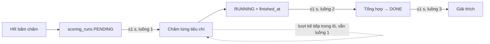

# Walkthrough — `perf/scoring-latency`

Nhánh tối ưu, không mã FR, không migration. Nguồn: `docs/plans/2026-10-28-tang-toc-cham-diem.md` (mục A, B) và mục
"Sửa đổi kế hoạch tăng tốc chấm điểm (28/10)" trong `docs/plans/2026-11-dot-bo-sung.md` (5 điểm sửa thắng kế hoạch
28/10). Kế hoạch Plan Mode đã duyệt có các điểm L1–L7; quyết định của người dùng: L1 ghi nợ, L3 chấp nhận, L4 bỏ method
cũ, L5/L6 đồng ý, L7 người dùng tự làm.

## 1. Mục tiêu

Khi HR bấm "Chấm điểm hồ sơ", kết quả đi qua ba job nền nối tiếp: chấm từng tiêu chí, tổng hợp điểm, viết giải thích.
Trước nhánh này cả 14 phương thức `@Scheduled` của backend dùng chung **một** luồng scheduler mặc định của Spring Boot,
nên một lời gọi AI dài ở job này (ví dụ đang chấm đơn thứ hai) chặn mọi job khác (tổng hợp, giải thích của đơn thứ
nhất). Nhánh này cho các job nền chạy song song trên 8 luồng, rút chu kỳ quét của ba job trên đường HR đang chờ từ 5 s
xuống 1 s, và chặn một race mới lộ ra khi có nhiều luồng: job embedding CV có thể ghi vector của văn bản cũ đè lên sau
khi CV vừa được trích xuất lại. Không đổi luật AI: vẫn mỗi tiêu chí một lần gọi, evidence qua K2, backend tính tổng.

## 2. Các file đã tạo/sửa

**Backend — main**

| File | Vai trò |
|---|---|
| `backend/src/main/resources/application.yml` | Thêm `spring.task.scheduling.pool.size: 8`; `app.scoring`/`app.aggregation`/`app.explanation.poll-interval-ms` 5000 → 1000; `logging.level.org.hibernate.SQL` DEBUG → INFO; ghi chú reaper nay chạy song song với worker |
| `resume/ResumeParsedDataRepository.java` | Thay `updateEmbedding` (chỉ `WHERE id`) bằng `updateEmbeddingIfUnchanged` (thêm `AND parsed_at = :expectedParsedAt`, trả số hàng ghi được) |
| `resume/ResumeEmbeddingStateService.java` | `save` nhận thêm `expectedParsedAt`; ghi được 0 hàng thì chỉ log debug, không ném lỗi |
| `resume/ResumeEmbeddingOrchestrator.java` | Đọc `parsedAt` cùng lần `findById` với dữ liệu CV, trước khi gọi API embedding, rồi truyền vào `save` |
| `ai/embedding/EmbeddingTextFormat.java`, `user/CandidateProfileRepository.java` | Chỉ sửa comment cho đúng tên method mới |

**Backend — test**

| File | Vai trò |
|---|---|
| `resume/ResumeParsedDataRepositoryTest.java` | 3 test mới: `parsed_at` khớp → ghi 1 hàng; lệch +1 µs / −1 µs → 0 hàng, embedding vẫn NULL. Hai test cũ chuyển sang method mới |
| `resume/ResumeEmbeddingOrchestratorTest.java` | 2 test mới: race với trích xuất lại → không ghi; nhịp sau → ghi được |
| `resume/ResumeReparseOrchestratorTest.java`, `jobrecommendation/JobRecommendationCandidate{ControllerIntegration,Service}Test.java` | Chỗ seed embedding chuyển sang chữ ký mới (truyền `getParsedAt()` của bản ghi vừa lưu) |

Frontend: không đổi.

## 3. Luồng chính

### 3.1. Một lượt chấm sau nhánh này

1. HR bấm chấm → `ScoringRunService` tạo hàng `scoring_runs` trạng thái `PENDING` (không đổi).
2. Trong ≤ 1 s, `ScoringRunScheduler.pollPendingScoringRuns` (luồng `scheduling-x`) đọc các lượt `PENDING`, claim từng
   lượt bằng `UPDATE ... WHERE status = 'PENDING'` rồi gọi `ScoringRunOrchestrator.processOne`: mỗi tiêu chí một lần gọi
   AI, ghi `criterion_scores`, cuối cùng `markFinished` đặt `finished_at`.
3. Trong ≤ 1 s sau đó, `AggregationScheduler` — **trên một luồng khác** — nhặt lượt `RUNNING` + `finished_at` khác NULL,
   tính tổng bằng công thức trọng số (Java thuần), ghi `total_score` và `DONE` bằng UPDATE có điều kiện
   `total_score IS NULL`.
4. Trong ≤ 1 s, `ScoreExplanationScheduler` (luồng khác nữa) nhặt lượt `DONE` chưa có giải thích, gọi AI, ghi
   `score_explanations` (UNIQUE `scoring_run_id`).

Trước đây bước 3 và 4 phải đợi luồng duy nhất rảnh, tức là đợi vòng chấm ở bước 2 xử lý xong **mọi** lượt trong lô.

### 3.2. Embedding CV khi có trích xuất lại song song

1. `ResumeEmbeddingScheduler` lấy các `resume_parsed_data` của CV chính có `embedding IS NULL`.
2. `ResumeEmbeddingOrchestrator.processOne` đọc bản ghi (lấy cả `data` và `parsed_at`), kiểm tra CV còn là CV chính,
   dựng văn bản, gọi `EmbeddingService.embed` **ngoài transaction** (vài trăm ms tới vài giây).
3. Cùng lúc, job trích xuất lại (`ResumeReparseStateService.markDone`) có thể ghi `data` mới và chạy
   `touchAfterReparse`: `parsed_at = now()`, `embedding = NULL`.
4. `ResumeEmbeddingStateService.save` chạy `updateEmbeddingIfUnchanged`. `parsed_at` đã đổi → 0 hàng, vector của văn bản
   cũ bị bỏ. `embedding` vẫn NULL nên nhịp quét sau tự embed văn bản mới.

## 4. Quyết định thiết kế

**4.1. Số luồng: 8.**
- *Đã chọn:* `spring.task.scheduling.pool.size: 8` (sửa đổi số 1 của kế hoạch 11/2026).
- *Khác:* 6 như kế hoạch 28/10; một executor riêng cho từng job; đánh thức job bằng sự kiện.
- *Vì sao:* có 5 job gọi LLM (chấm, giải thích, trích xuất, trích xuất lại, gợi ý sửa CV) và 3 job embedding; với 6
  luồng bước tổng hợp vẫn có thể xếp hàng. Job nền không giữ kết nối DB khi chờ LLM nên pool Hikari 10 không phải giới
  hạn thật. Executor riêng hay sự kiện đều là thay đổi kiến trúc, nằm ngoài phạm vi. Tên thuộc tính đã kiểm trên jar
  `spring-boot-autoconfigure-4.1.0` (`TaskSchedulingProperties`, prefix `spring.task.scheduling`, `Pool.size` mặc định 1).

**4.2. Không bật luồng ảo.**
- *Đã chọn:* để `spring.threads.virtual.enabled` tắt (mặc định), ghi chú ngay cạnh khoá.
- *Khác:* bật luồng ảo.
- *Vì sao:* khi bật, Boot dựng `SimpleAsyncTaskScheduler` (`@ConditionalOnThreading(VIRTUAL)`) và `pool.size` mất tác
  dụng — người đọc cấu hình sẽ tưởng đang có 8 luồng.

**4.3. Chỉ rút chu kỳ của ba job trên đường HR đang chờ.**
- *Đã chọn:* chấm, tổng hợp, giải thích quét mỗi 1 s; các job khác giữ 5 s (kinh nghiệm 30 s, reaper 60 s).
- *Khác:* rút tất cả; giữ 5 s.
- *Vì sao:* ba truy vấn quét đều có index (đã ghi plan trong `ScoringRunRepository`), thêm ~3 truy vấn nhỏ/giây khi rảnh.
  Log SQL hạ về INFO để không ồn; cần xem SQL thì bật tạm bằng tham số chạy.

**4.4. Chặn race embedding bằng UPDATE có điều kiện, không bằng claim.**
- *Đã chọn:* `updateEmbeddingIfUnchanged(id, embeddingText, expectedParsedAt)`, cùng khuôn và cùng tên với
  `CandidateProfileRepository.updateEmbeddingIfUnchanged` (FR-U14, theo `updated_at`).
- *Khác:* thêm cột trạng thái + claim cho embedding (cần migration); khoá hàng trong lúc gọi API (vi phạm CLAUDE.md §3c);
  để nguyên vì "hiếm".
- *Vì sao:* `resume_parsed_data` không có cột trạng thái embedding; `parsed_at` vốn đã đổi mỗi lần trích xuất lại nên là
  "số phiên bản" sẵn có. Nếu không chặn, CV giữ embedding sai **vĩnh viễn** (điều kiện quét là `embedding IS NULL`).
  So bằng chắc chắn khớp vì `parsed_at` là `TIMESTAMPTZ` (micro giây), giá trị truyền vào lấy từ DB chứ không phải
  `Instant.now()`; ba test biên ±1 µs khoá điều này.

**4.5. Bỏ hẳn `updateEmbedding` cũ (L4).**
- *Đã chọn:* xoá method, sửa 5 chỗ trong test sang method mới.
- *Khác:* giữ method cũ cho test seed dữ liệu.
- *Vì sao:* giữ lại là để một đường ghi không điều kiện trong main, người sau dễ dùng lại và mở lại race.

**4.6. Chấp nhận reaper chạy song song worker (L3), không sửa.**
- *Đã chọn:* ghi nợ ở ROADMAP, không đổi code.
- *Khác:* thêm cột version theo lần claim, so khớp `started_at` ở mọi lệnh ghi D2/D3.
- *Vì sao:* bản ghi bị reap chỉ được claim lại bởi chính phương thức poll đó, mà `fixedDelay` không chạy chồng, nên
  trong một JVM không có worker thứ hai. Hậu quả tệ nhất là mất một kết quả chấm (HR chấm lại) hoặc chữ lỗi sót trên
  hàng `DONE` — không mất/sai điểm. Chỉ xảy ra khi một lượt vượt 15 phút.

**4.7. Không sửa timeout Anthropic ở nhánh này (L1).**
- *Đã chọn:* ghi nợ.
- *Vì sao:* đổi timeout là đổi hành vi của D1/D2/D4/F2, cùng lý do FR-C07 Q10 đã không đổi; cần nhánh riêng và đo thật.

**Test bảo vệ hành vi liên nhánh:** `processOne_reparsedDuringEmbedCall_doesNotWriteStaleEmbedding` và
`processOne_afterLosingReparseRace_nextPollWritesEmbedding` (`ResumeEmbeddingOrchestratorTest`) bảo vệ tương tác giữa
FR-U04/U15 (embedding CV dùng cho gợi ý việc làm) và FR-C05 (trích xuất lại). Không được xoá khi refactor một trong hai
phía: race chỉ lộ khi hai job chạy trên hai luồng, test là chỗ duy nhất dựng lại đúng thời điểm đó.

## 5. Ràng buộc đã thực thi

| Nguồn | Ràng buộc | Thực thi ở đâu |
|---|---|---|
| CLAUDE.md §3c | Không giữ transaction quanh lời gọi AI/embedding | `ResumeEmbeddingOrchestrator.processOne` không `@Transactional`; ghi qua `ResumeEmbeddingStateService.save` (transaction ngắn) |
| CLAUDE.md §3c | Ghi có điều kiện thay vì `SELECT FOR UPDATE` | `ResumeParsedDataRepository.updateEmbeddingIfUnchanged` (`@Modifying(clearAutomatically = true)`) |
| FR-H05 / CLAUDE.md §2 | AI không tính tổng; backend tổng hợp bằng công thức | Không đổi — `AggregationOrchestrator` + `ScoringRunRepository.finishAggregation` (`total_score IS NULL`) |
| FR-H04 | Mỗi tiêu chí một lần gọi AI | Không đổi — `CriterionScoringService.score`; nhánh không chấm song song tiêu chí |
| FR-C05 R-R6 | Trích xuất lại đặt `embedding = NULL` để tính lại | `touchAfterReparse`; nay không bị job embedding ghi đè |
| Kế hoạch 28/10 | Không bật luồng ảo | Ghi chú tại `spring.task.scheduling` trong `application.yml`; grep không có `threads.virtual` |

## 6. Đã kiểm thử gì

**Tự động**
- 6 lớp của đợt chạy trước, 56/56 xanh: `ResumeParsedDataRepositoryTest` (12), `ResumeEmbeddingOrchestratorTest` (6),
  `ResumeReparseOrchestratorTest` (11), `JobRecommendationCandidateControllerIntegrationTest` (5),
  `JobRecommendationCandidateServiceTest` (19), `CandidateProfileEmbeddingOrchestratorTest` (3).
- Full suite trước rebase: 2116/2116, 0 skip (13:42). Sau rebase lên `main` có FR-U16 (`0d6dbef`): 2153/2153, 0 fail,
  0 skip (15:59) — 2148 của FR-U16 + 5 test mới.
- Test mới: khớp `parsed_at` → 1 hàng (dương); +1 µs và −1 µs → 0 hàng, embedding NULL (âm, biên ở độ phân giải của
  cột); trích xuất lại commit thật qua `TransactionTemplate` ngay trong lúc gọi embedding → không ghi (âm); gọi lại →
  ghi được (tự lành).
- `application-test.yml` tắt cả 11 bean scheduler, nên `pool.size` không ảnh hưởng test cũ.

**Tay (người dùng soát 30/10/2026, AI thật, dữ liệu demo vừa nạp, tin Kỹ sư DevOps, 3 đơn)**
- Log backend có đủ luồng `scheduling-1` … `scheduling-8`; 0 dòng ERROR; 6/6 lượt chấm `DONE`.
- Số đo (trung vị 3 lượt, giây, trước 29/10 → sau 30/10):

| Kịch bản | Chờ nhận việc | Chấm tiêu chí | Tổng hợp + giải thích | Tổng | Lượt cuối |
|---|---|---|---|---|---|
| Đơn lẻ | 1,2 → 0,2 | 45,5 → 40,4 | 17,6 → 17,9 | 69,2 → 58,4 | — |
| Dồn 3 đơn trong 1 s | 57,9 → 47,8 | 44,9 → 42,0 | 75,8 → 18,2 | 178,6 → 111,5 | 193,2 → 139,1 |

- Cách đọc: kịch bản dồn giảm thật vì tổng hợp/giải thích không còn chờ vòng chấm. Kịch bản đơn lẻ gần như không đổi:
  với 1 luồng, job tổng hợp/giải thích đã quá giờ nên chạy ngay khi luồng rảnh, không có nhịp chờ để cắt; chênh tổng
  chủ yếu do thời gian AI chấm tiêu chí. Cải thiện cấu trúc ở đơn lẻ chỉ là chờ nhận việc ~1 s → ≤ 0,3 s.

**Chưa test**
- Race reaper ↔ worker không dựng thật (cần một lượt chạy quá 15 phút); hậu quả chỉ suy từ code.
- Timeout Anthropic thực tế (60 s hay 30 s) chưa đo, chỉ suy từ bytecode.
- Chạy nhiều instance backend cùng lúc.

**Đối chiếu "Xong khi"** (lấy từ kế hoạch, vì không có REQUIREMENT.md)

| Tiêu chí | Cách nghiệm thu | Kết quả |
|---|---|---|
| Đủ 8 luồng scheduler | Soát tay: log có `scheduling-1`…`scheduling-8` | Đạt |
| Ba job chấm/tổng hợp/giải thích quét 1 s | Diff `application.yml`; chờ nhận việc đơn lẻ ≤ 0,3 s | Đạt |
| Race embedding bị chặn | `ResumeEmbeddingOrchestratorTest` 2 test mới; `ResumeParsedDataRepositoryTest` 3 test mới | Đạt |
| Không còn `updateEmbedding(` | `grep -rn "updateEmbedding(" backend/src` rỗng | Đạt |
| Full suite xanh | `./mvnw test` | Đạt |
| Đo lại, cột tổng hợp + giải thích giảm | Bảng trên: dồn 75,8 → 18,2; đơn lẻ không đổi (giải thích ở trên) | Đạt một phần — chỉ kịch bản dồn |

## 7. Nợ kỹ thuật

- **Timeout Anthropic có vẻ là 60 s mỗi lần thử**, không phải `app.hardening.anthropic-timeout-ms` 30 s: `AnthropicChatOptions`
  không đặt timeout nên `AnthropicSetup.DEFAULT_TIMEOUT` (60 s) vào `ClientOptions`; `MessageServiceImpl` gắn timeout đó
  vào request, rồi `SpringAiAnthropicHttpClient.newCall` ghi đè timeout OkHttp đặt qua `httpClientBuilderCustomizer`.
  Suy từ bytecode, chưa đo. Đề xuất nhánh chore riêng đặt timeout ở `AnthropicChatOptions`.
- **Reaper chạy song song worker cùng bảng** — đã chấp nhận (mục 4.6). Hậu quả tệ nhất: mất một kết quả chấm khi reap rơi
  vào lượt thử cuối; chữ `STALE_CLAIM_TIMEOUT`/`LLM_RETRY_EXHAUSTED` sót ở `error_message`/`parse_error` của hàng `DONE`;
  cửa sổ ngắn HR tạo được lượt chấm thứ hai. Trần một lượt chấm ≈ 363 s × số tiêu chí (2 lời gọi × (3 request × 60 s +
  nghỉ ≤ 1,5 s)) — vượt 15 phút từ 3 tiêu chí trong trường hợp bệnh lý; trích xuất ≈ 363 s.
- **Số tiêu chí rubric không có trần tường minh** (tối đa 10 000 theo trọng số ≥ 0,01) — chi phối trần ở trên.
- **Vòng chấm tuần tự trong một nhịp**: khi dồn đơn, chờ nhận việc lượt sau cộng dồn thời gian chấm lượt trước
  (47,8 / 90,0 s ở lượt 2/3). Gỡ được là "chấm song song nhiều lượt" — ngoài phạm vi; liên quan nút chấm tất cả.
- **Job giải thích thử lại theo nhịp, không backoff**: với chu kỳ 1 s, lỗi tức thì hết 3 lần trong ~3 s.

## 8. Lệch so với đặc tả

Không áp dụng — nhánh tối ưu, không có REQUIREMENT.md; nguồn là `docs/plans/2026-10-28-tang-toc-cham-diem.md` + mục sửa
đổi trong `docs/plans/2026-11-dot-bo-sung.md`.
